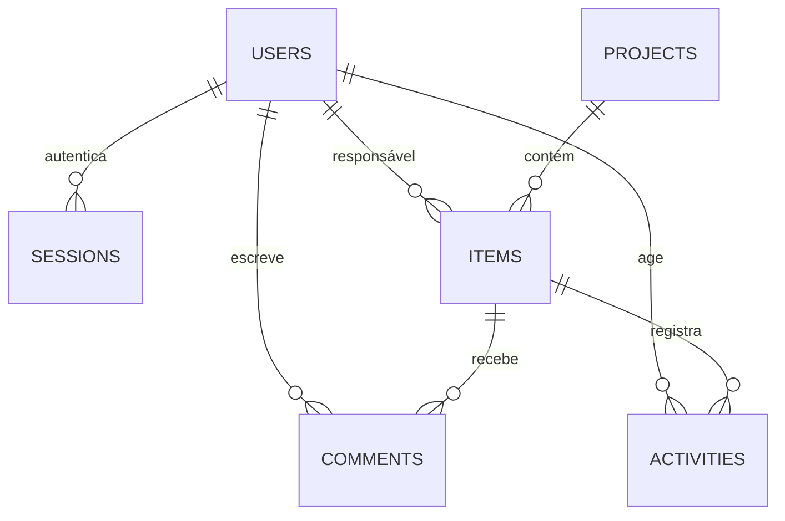
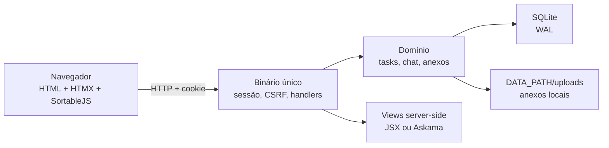

# Panorama — o mínimo funcional para uma equipe de 10

> Premissa: **um time, um workspace, ~10 pessoas, uso diário**. O produto existe para responder três perguntas em até dois cliques: **em que situação está a tarefa, quem é o responsável e para quando**. Tudo o que não serve a isso é candidato a corte.
>
> **Revisão 2026-10-29:** o núcleo de tarefas abaixo continua válido. O escopo agora inclui **chat** (Geral + um canal por projeto, com SSE) e **anexos locais**; a decisão de stack mudou para **binário único** — Somlos/Deno (primário) ou Rust/Axum (fallback). Ver [`03-decisao-stack.md`](03-decisao-stack.md) e [`05-arquitetura-single-binary.md`](05-arquitetura-single-binary.md). As 6 tabelas são o núcleo; chat/anexos acrescentam ~5 tabelas.
>
> **Refinamentos confirmados na implementação:** a conversa de uma demanda é um canal `chat` com `scope=demand` (não há tabela `comments`); mensagens e descrição usam **Markdown seguro**; há **um canvas Excalidraw por demanda, colaborativo e full-screen**; os cargos são `admin`, `manager`, `developer`; tarefas são criadas/arquivadas por manager/admin, issues por qualquer desenvolvedor; **PWA + Web Push** para browser/celular. O plano detalhado está em [`implementation/README.md`](../implementation/README.md).
>
> Este documento não resume os 11.5 mil linhas de [`ref/`](ref/README.md): ele as usa como evidência para decidir **o que fica no MVP e o que é sobre-engenharia**. Recomendações são decisões de produto, não fatos observados.

## 0. Veredito em uma página

| Decisão | MVP |
|---|---|
| Tabelas | **6 de núcleo** (users, projects, items, comments, activities, sessions) + tags, item_tags e anexos/chat |
| Unidade de trabalho | **1** (`item`), sem tipos, épicos ou campos customizados |
| Situação | **5 status fixos** + flag `blocked` |
| Responsável | **1** assignee por tarefa, obrigatório; issue não tem responsável |
| Quando | **início + fim** (datas inclusivas), sem Gantt/baseline |
| Prioridade | **Eisenhower Q1–Q4**, calculada por fim + importância; override de manager/admin |
| Tags | **sim**, globais no tenant, até 8 por demanda |
| Visões | **3 layouts** (lista, quadro, calendário) + **Minhas tarefas**; projetos e busca são páginas de apoio |
| Ordem | derivada de atraso, bloqueio e prioridade Eisenhower, **sem rank manual** |
| Permissões | **3 papéis** (admin, manager, developer), sem ACL por projeto/item |
| Arquitetura | **1 binário** Rust + Askama + HTMX + SQLite |
| Serviços externos | **0 de aplicação** (sem Postgres, Redis, worker, SPA, API pública); push usa endpoints do navegador |

**O que vale manter:** um registro único de trabalho, status com semântica clara, um responsável, início/fim, prioridade Eisenhower, tags, atividade por campo, lista com edição inline, quadro derivado do status, calendário e uma boa tabela. **O que é sobre-engenharia para 10 pessoas:** workflow configurável, campos customizados, views salvas com DSL de filtro, rank fracionário por view, RBAC com catálogo/shares, Gantt com dependências, sprints, estimativas, API pública e multi-tenancy.

## 1. O que a documentação resolve — e onde ela exagera

### 1.1 O que está certo e deve ser usado

| Achado | Onde | Como entra no MVP |
|---|---|---|
| Um único registro endereçável, com ID legível por projeto | `00-sintese-meraki.md` §1, §3.1 | `items` + `seq` por projeto (`MER-42`) |
| Categoria de status é o que agrega; o nome é livre | `00-sintese-meraki.md` §1 | 5 status fixos, mapeados em código |
| Um responsável, não dois | `taiga-data-model.md` §7 (anti-padrão) | `assignee_id` único |
| Histórico por campo, com autor e timestamp | `00-sintese-meraki.md` §6 | `activities` imutável |
| Uma definição alimenta várias views | `00-sintese-meraki.md` §1 | mesmos filtros/URL para lista, quadro e calendário |
| Permissão calculada no servidor | `07-arquitetura-comparada.md` §3 | checagem de papel no servidor; sem regra no JS |
| Sem cache antes de medir | `task-manager/06-simplicidade.md` §2 | nenhum cache no MVP |
| Transação por escrita + versão no `WHERE` | `07-arquitetura-comparada.md` §6; `task-manager/06` | `version` e `activities` na mesma transação |
| Acessibilidade semântica | `07-arquitetura-comparada.md` §10 | `<table>` real, foco visível, menu "Mover para" |

### 1.2 Onde a documentação projeta outro produto

| Recomendação | Onde | Por que não agora |
|---|---|---|
| Blueprint com 20+ tabelas: tipos, custom fields, `view_order`, containers, relations, pages, notifications, shares | `00-sintese-meraki.md` §3–§8 | Para 10 pessoas, 6 tabelas de núcleo + chat/anexos/canvas/notificações cobrem o trabalho; cada tabela extra é schema + UI + teste + migração |
| SPA única + API + Postgres + Redis + worker + object storage | `07-arquitetura-comparada.md` §1, §8 | 10 usuários e 3 layouts não pagam contrato de API, build Node, estado duplicado e 4 processos |
| RBAC com catálogo de permissões, escopos e shares por item | `00-sintese-meraki.md` §4 | Um time confiável precisa de admin/manager/developer, não de 157 codenames |
| Views salvas com JSON versionado, DSL `and/or/not` e rank por view | `00-sintese-meraki.md` §3.5–3.6 | URL com filtros simples é compartilhável e não tem CRUD, dono, share ou migração de schema |
| Gantt, dependências, baseline, workload, sprints, estimativas | `00-sintese-meraki.md` §5 | Prazo + calendário respondem "quando"; o resto é planejamento de portfólio |
| Densidade, zoom de card, command palette, split view, atalhos de duas teclas | `00-sintese` §7; docs `*-ui-ux` | São refinamentos de produto maduro; atrapalham o primeiro uso se vierem antes do básico |

### 1.3 O custo real que os três produtos pagam

| Produto | Número | Por que existe | Para 10 pessoas |
|---|---|---|---|
| OpenProject | 32 engines, 157 codenames de permissão, duas stacks de dashboard (`07` §1; `00` §7) | Portfólio, enterprise, clientes, workflows | 95% é peso |
| Plane | 13 serviços, 30 stores MobX, 5 layouts, 6 cópias de defaults (`07` §1, §8; `plane-data-model.md` §9) | SaaS multi-tenant, escala e velocidade de UI | referência de UX, não de infraestrutura |
| Taiga | 4 modelos de entidade, 4–5 colunas de ordem, gateway WS externo (`00` §2; `07` §1) | Semânticas distintas de épico/US/task/issue e múltiplas views | 1 modelo + 1 ordem derivada |

A conclusão não é "eles estão errados"; é que **a complexidade deles é proporcional ao público deles**. Copiar o modelo sem o público é a definição de sobre-engenharia.

## 2. Definição do produto

### 2.1 Trabalhos que o MVP precisa fazer

1. **"O que eu tenho que fazer hoje?"** — tela inicial `Minhas tarefas`, agrupada por atraso/fim e prioridade.
2. **"Em que pé está o projeto?"** — quadro por status e lista filtrável.
3. **"Quem está com o quê e para quando?"** — responsável, início/fim, prioridade e tags visíveis em toda linha/card.
4. **"O que mudou?"** — atividade por item, com autor e horário.
5. **"Preciso alinhar uma tarefa"** — comentários no item.

### 2.2 Fora de escopo (até existir demanda real)

Portfólio, faturamento, portal de cliente, wiki, **DMs/canais privados**, automações, campos customizados, workflow configurável, dependências, Gantt, sprints, estimativas, apontamento de horas, notificações por e-mail, API pública, webhooks, SSO/2FA, multi-tenant. **PWA + Web Push (browser/celular) entram no escopo.** **Excalidraw colaborativo, issues e índice de demandas entram no escopo.** **Chat geral + canais de projeto/demanda, anexos locais e canvas entram no escopo**; ver [`05-arquitetura-single-binary.md`](05-arquitetura-single-binary.md).

### 2.3 Critérios de sucesso

- As três perguntas são respondidas **sem abrir a tarefa** e em **≤2 cliques**.
- Mudar status ou responsável custa **1 clique** na lista e **1 drag** no quadro (com alternativa por teclado).
- Um membro novo entende a tela inicial em **≤10 minutos**, sem treinamento.
- Lista e quadro carregam em **≤300 ms** com ~2.000 itens ativos no total.
- Nenhuma edição concorrente é perdida silenciosamente; conflito é visível.

## 3. Modelo de dados

A frase que guia o schema: **a tarefa é a unidade; o projeto é a pasta; o status é a situação; o responsável é uma pessoa; início e fim são datas; a prioridade é uma consequência; tags são o vocabulário compartilhado.**

> O DDL abaixo é o **schema lógico** do núcleo. No alvo Somlos, os IDs são `text` UUIDv7 para alinhar com `users`/`sessions`; no fallback Rust, podem ser inteiros. Na implementação confirmada, `comments` é substituído por um canal `chat` com `scope=demand`; o DDL definitivo está no plano de implementação.



### 3.1 DDL mínimo (SQLite `STRICT`)

```sql
create table users (
  id            integer primary key,
  name          text not null,
  email         text not null collate nocase unique,
  password_hash text not null,
  role          text not null default 'member' check (role in ('admin','member')),
  active        integer not null default 1 check (active in (0,1)),
  created_at    text not null default (strftime('%Y-%m-%dT%H:%M:%fZ','now'))
) strict;

create table projects (
  id          integer primary key,
  key         text not null collate nocase unique, -- MER
  name        text not null,
  next_seq    integer not null default 1,
  archived_at text,
  created_at  text not null default (strftime('%Y-%m-%dT%H:%M:%fZ','now'))
) strict;

create table items (
  id            integer primary key,
  project_id    integer not null references projects(id),
  seq           integer not null,
  title         text not null,
  description   text not null default '',
  status        text not null default 'backlog'
                check (status in ('backlog','todo','doing','review','done')),
  blocked       integer not null default 0 check (blocked in (0,1)),
  blocked_reason text,
  importance    text not null default 'medium'
                check (importance in ('low','medium','high')),
  priority_override text check (priority_override in ('q1','q2','q3','q4')),
  priority_override_by integer references users(id),
  priority_override_at text,
  priority_override_reason text,
  assignee_id   integer references users(id), -- obrigatório em task (app)
  start_date    text check (start_date is null or start_date glob '????-??-??'),
  end_date      text check (end_date is null or end_date glob '????-??-??'),
  completed_at  text,
  created_by    integer not null references users(id),
  version       integer not null default 1,
  created_at    text not null default (strftime('%Y-%m-%dT%H:%M:%fZ','now')),
  updated_at    text not null default (strftime('%Y-%m-%dT%H:%M:%fZ','now')),
  archived_at   text,
  unique (project_id, seq)
) strict;

create table tags (
  id          integer primary key,
  name        text not null collate nocase unique,
  slug        text not null unique,
  created_by  integer not null references users(id),
  created_at  text not null default (strftime('%Y-%m-%dT%H:%M:%fZ','now')),
  archived_at text
) strict;

create table item_tags (
  item_id    integer not null references items(id) on delete cascade,
  tag_id     integer not null references tags(id) on delete cascade,
  created_at text not null default (strftime('%Y-%m-%dT%H:%M:%fZ','now')),
  primary key (item_id, tag_id)
) strict;

create table comments (
  id         integer primary key,
  item_id    integer not null references items(id) on delete cascade,
  author_id  integer not null references users(id),
  body       text not null,
  created_at text not null default (strftime('%Y-%m-%dT%H:%M:%fZ','now')),
  edited_at  text
) strict;

create table activities (
  id         integer primary key,
  item_id    integer not null references items(id) on delete cascade,
  actor_id   integer not null references users(id),
  kind       text not null,            -- created | status | assignee | start | end | importance | priority | tags | blocked | title | description | archived
  old_value  text,
  new_value  text,
  created_at text not null default (strftime('%Y-%m-%dT%H:%M:%fZ','now'))
) strict;

create table sessions (
  id         integer primary key,
  user_id    integer not null references users(id) on delete cascade,
  token_hash text not null unique,
  expires_at text not null,
  created_at text not null default (strftime('%Y-%m-%dT%H:%M:%fZ','now'))
) strict;

create index items_active on items(project_id, status, end_date) where archived_at is null;
create index items_assignee on items(assignee_id, status, end_date) where archived_at is null;
create index items_end on items(project_id, end_date) where archived_at is null;
create index item_tags_tag on item_tags(tag_id, item_id);
create index activities_item on activities(item_id, created_at);
```

**Por que inteiros e não UUIDv7:** o servidor é o único criador; não há sync offline nem múltiplas instâncias. UUID paga em criação distribuída e URLs não enumeráveis, custos que não existem num time interno. O identificador que as pessoas usam é `key + seq` (`MER-42`); o inteiro fica na URL interna. Se um dia houver link público, use um token opaco, não o ID.

### 3.2 Invariantes (uma decisão, um dono)

| Invariante | Regra | Onde |
|---|---|---|
| `seq` por projeto | `UPDATE projects SET next_seq = next_seq + 1 WHERE id = ? RETURNING next_seq - 1`, na mesma transação do insert | serviço de criação |
| `done` | setar `completed_at`; reabrir limpa; `done` limpa `blocked` | transição de status |
| `blocked` | motivo opcional; badge vermelho; filtro "Bloqueadas"; desbloquear e concluir limpam `blocked`/`blocked_reason` | UI + query |
| Concorrência | `UPDATE ... WHERE id = ? AND version = ?`; `version = version + 1`; 0 linhas → 409 | serviço de update |
| Histórico | `activities` na mesma transação da mudança; se a transação falhar, não há evento | serviço |
| Comentário | insere `comments`, atualiza `items.updated_at`; **não** incrementa `version` | serviço |
| Arquivar | `archived_at`; listas/quadro/calendário filtram; detalhe acessível por link direto | serviço |
| Tempo | `created_at`/`updated_at`/`completed_at` em UTC ISO 8601; `start_date`/`end_date` são datas locais, sem hora | helper único |
| Timestamps | app escreve `updated_at`; **sem trigger**; nenhum segundo dono | serviço |
| Usuário | `active = 0` bloqueia login, preserva histórico; não deletar | admin |

### 3.3 O que ficou de fora do schema, de propósito

- **`work_item_type`/épico**: um projeto já é o agrupamento. Tipos só pagam quando formulário/workflow mudam por tipo; não é o caso.
- **Status por projeto**: 5 status fixos. Configurar status exige tabela, cor, ordem, transições, tela de admin e migração; para 10 pessoas, o ganho é cosmético.
- **`view`/`view_order`**: a URL é a view. Não há rank manual; a ordem é atraso/bloqueio + Q1–Q4 + `end_date`.
- **`custom_field`/`custom_value`/form config**: descrição e comentários absorvem o que não é campo fixo.
- **`project_member`**: um workspace, todos veem todos os projetos. Se entrar cliente/contratado, aí sim.
- **tags**: entram no MVP como taxonomia leve, global e sem hierarquia; não são campos customizados.
- **notificações push/inbox** têm tabelas próprias; watchers/relations/pages ficam fora do núcleo.
- **anexos/chat**: não estão neste schema de núcleo; as tabelas e o desenho estão em [`05-arquitetura-single-binary.md`](05-arquitetura-single-binary.md).

## 4. As visões

| Rota | Nome | Responde | Interação |
|---|---|---|---|
| `/` | **Minhas tarefas** | o que é meu, atrasado, hoje, próximos 7 dias | editar status/responsável inline |
| `/projects/:key` | **Lista** | situação do projeto, filtros e ordenação | inline + agrupamento por status |
| `/projects/:key/board` | **Quadro** | fluxo por status, quem está em quê | drag muda status; menu "Mover para" |
| `/projects/:key/calendar` | **Calendário** | barras início→fim do mês | clique abre o item; sem drag |
| `/items/:id` | **Detalhe** | tudo sobre a tarefa, discussão e histórico | edição completa |
| `/projects` | **Projetos** | visão geral e contagens | abrir projeto |
| `/search?q=` | **Busca** | achar por título/descrição | resultados em lista |

### 4.1 Lista (a tela mais importante)

- Colunas: `ID`, `Título`, `Status`, `Responsável`, `Início → Fim`, `Prioridade`, `Tags`, `Atualizado`.
- Filtros: texto, status (multi), responsável (inclui "Sem responsável"), tag (AND), prioridade, "Prontas", "Precisam de atenção", projeto.
- "Prontas" = `start_date <= hoje`, `blocked = 0`, `status != done`; derivado, sem coluna.
- "Precisam de atenção" = `end_date < hoje` **ou** `priority = q1` **ou** `blocked = 1` **ou** (`status != 'done'` e `updated_at < hoje - 7 dias`).
- Ordenação padrão: atrasadas → bloqueadas → Q1→Q4 → fim → atualização; concluídas no fim.
- Edição inline de status e responsável; sem modal. `Esc` cancela; erro reverte e mostra toast.
- `?group=status` agrupa; `?assignee=me` filtra; a URL é compartilhável e recarregável.
- Paginação de 50 com "próxima"; sem scroll infinito.

### 4.2 Quadro

- 5 colunas fixas: Backlog, A fazer, Em andamento, Em revisão, Concluído.
- Card: `MER-42`, título, avatar/nome, início→fim, prioridade Q1–Q4, tags, badge "Bloqueado", indicador "parado há N dias".
- Contagem por coluna e filtro por responsável.
- Drag **só muda o status**; a ordem dentro da coluna é derivada (Q1–Q4/fim). Isso elimina rank, rebalance e conflito de ordem.
- Alternativa por teclado: menu "Mover para…" em cada card; toda ação de drag tem equivalente acessível.
- Sem swimlanes, WIP limit, zoom de card ou colunas configuráveis.
- Cada coluna carrega até **100 cards**; acima disso, "carregar mais" ou filtro por responsável. Evita o anti-padrão do Taiga de carregar o quadro inteiro.
- Itens concluídos: coluna comprimida com contador, como no Taiga; não poluem o fluxo.

### 4.3 Calendário

- Grade mensal, itens posicionados como barras de `start_date`→`end_date`; navegação mês anterior/próximo/hoje.
- **Somente leitura**: arrastar para mudar data é uma feature de produto maduro; um clique abre o item e edita o período.
- Agenda lateral para o dia; tarefas sem datas são inválidas.
- Não é Gantt: não há dependência, baseline ou caminho crítico.

### 4.4 Minhas tarefas (home)

- Seções: **Atrasadas**, **Hoje**, **Próximos 7 dias**, **Depois**, **Concluídas recentemente**.
- Cada linha mostra projeto, status, início/fim, prioridade e tags; clique abre o detalhe.
- É a resposta padrão para "o que eu faço agora"; não exige filtro manual.
- Um bloco "Atividade recente" no rodapé (opcional) mostra o que mudou nos últimos 7 dias.

## 5. UX que responde às três perguntas

| Regra | Implementação |
|---|---|
| Situação sempre visível | status textual + cor; nunca só cor |
| Responsável sempre visível | avatar + nome; "Sem responsável" explícito; filtro dedicado |
| Prazo sempre visível | `dd/mm`; "Hoje"/"Atrasada há N dias"; sem hora |
| Risco visível | badge "Bloqueado", "parado há N dias", atraso em vermelho |
| Mudança em 1 clique | selects inline na lista; drag no quadro; menu acessível |
| Histórico legível | "Ana mudou status de A fazer para Em andamento · há 2 h" |
| Sem perder contexto | detalhe em página cheia com deep link; sem split view no MVP |
| Mobile | tabela vira cards abaixo de 720 px; quadro rola horizontalmente; detalhe em página |
| Vazio | "Nenhuma tarefa aqui. Criar tarefa" com CTA, não ilustração |
| Acessibilidade | `<table>` semântico, labels, foco visível, `aria-live` para salvar, menu de movimento |
| Datas | `start_date`/`end_date` locais; timestamps UTC; um único helper de formatação |
| Busca | campo no header; título, descrição e tags; `LIKE` é suficiente para 10 pessoas |

## 6. Arquitetura



| Peça | Escolha | Por quê |
|---|---|---|
| Runtime | Binário único: **Somlos/Deno** (primário) ou **Rust/Axum** (fallback) | zero runtime no servidor; decisão em [`03-decisao-stack.md`](03-decisao-stack.md) |
| Templates | JSX server-side (Somlos) ou Askama (Rust) | HTML tipado/escapado, sem SPA |
| Interação | HTMX 2 + SortableJS + JS mínimo | sem estado duplicado; funciona sem JS para o básico |
| Banco | SQLite (WAL, `busy_timeout`, FKs) | 10 usuários, um escritor; backup é um arquivo |
| Acesso a dados | Kysely (Somlos) ou SQLx (Rust), SQL explícito | sem ORM; queries revisáveis |
| Auth | sessão opaca em tabela, cookie `HttpOnly`/`SameSite=Lax`/`Secure`, Argon2id | revogável, sem JWT |
| CSS | um arquivo, variáveis, dark mode por `prefers-color-scheme` | sem CDN |
| Deploy | binário + Caddy + systemd | operação de uma pessoa; sem Docker obrigatório |

### 6.1 Por que não SPA/Postgres/Redis

- **SPA** resolveria cinco layouts e colaboração rica; aqui são três layouts e formulários. O custo é API JSON, contrato, autenticação dupla, estado no cliente, build e duas fontes de verdade. HTMX mantém uma fonte de verdade e permite migrar depois: o domínio fica separado dos handlers.
- **Postgres** resolveria multi-tenant, concorrência alta e relatórios. Aqui, SQLite em WAL com transações curtas atende 10 pessoas; backup e restore são triviais.
- **Redis/worker** não são necessários: notificações usam inbox + dispatcher em processo/outbox; atividade é síncrona na mesma transação. Se e-mail entrar, um cron do sistema resolve.
- **API pública** só quando houver integração real; nesse momento, os mesmos serviços de domínio ganham endpoints JSON.

### 6.2 Autenticação e permissões

- Admin cria usuários e define senha temporária; usuário troca a própria senha. **Sem signup público.** Primeiro admin via variável de ambiente ou comando `create-admin`; nunca `admin/admin` semeado.
- `admin`: gerencia usuários/projetos, arquiva/restaura projetos; pode tudo que um member pode.
- `member`: cria/edita/arquiva itens, comenta, move status.
- Todos os membros veem todos os projetos. Sem `project_member`, sem ACL por item.
- Login: rate limit de 5/min por IP, erro genérico; sessão de 30 dias; logout revoga a linha.
- CSRF: validar `Origin`/`Sec-Fetch-Site` e content-type de formulário em toda mutação com cookie; token por sessão é opcional, não substituto do guard de origem.
- Chat: texto puro, sem HTML/Markdown; comentários/descrições usam Markdown sanitizado no servidor.
- CSP; nenhum script de CDN.

### 6.3 Escrita e concorrência

```text
POST /items/:id/status
  → require_user
  → begin
  → UPDATE items SET status=?, completed_at=?, blocked=?, version=version+1, updated_at=?
      WHERE id=? AND version=?
  → INSERT activities(...)
  → commit
  → 200 com a linha/coluna atualizada
```

- `rows_affected == 0` → 409 com os valores atuais; a UI recarrega a linha e avisa.
- Comentário não incrementa `version`; não invalida um formulário de edição aberto.
- Arquivar incrementa `version` e registra atividade.
- Nenhuma leitura usa cache; índices cobrem as consultas quentes.

### 6.4 Operação

- `meraki.db` em volume persistente; WAL; `PRAGMA optimize` no shutdown.
- Backup noturno com `sqlite3 .backup` + retenção de 14 dias; **restore testado** mensalmente.
- `/healthz` verifica processo + `SELECT 1`.
- Logs estruturados com request id; erros 5xx com id, sem vazar SQL.
- Sem métricas/APM no MVP.

### 6.5 Testes

- Integração in-process com SQLite `:memory:` e `max_connections(1)`: login, autorização, criação, status, versão, archive, atenção.
- Teste de contrato de templates? Um smoke de render das três views.
- Um teste de navegador (Playwright) para criar → mover → filtrar; drag pode ser testado pelo endpoint e pelo menu.
- `deno task check` + testes (Somlos) ou `cargo fmt`, `clippy -D warnings`, `cargo test` (Rust).

## 7. O que manter × o que é sobre-engenharia

| Capacidade | MVP | Por que / evidência |
|---|---|---|
| Registro único de trabalho | **sim**, 1 tabela | OpenProject e Plane convergem; Taiga paga por 4 modelos (`taiga-data-model.md` §1–§2) |
| Tipos/épicos | **não** | Projeto agrupa; tipo só quando formulário/workflow difere |
| Status configurável | **não**; 5 fixos | Workflow por tipo×papel exige tabela de transições, tela de admin e testes; no OpenProject, essa flexibilidade convive com 157 codenames (`00` §2, §4) |
| Flag bloqueado | **sim** | Custo de 1 campo; responde "situação" melhor que uma coluna extra |
| Um responsável | **sim** | Duas fontes de assignee no Taiga são anti-padrão (`taiga-data-model.md` §7) |
| Múltiplos responsáveis | **não** | Ambiguidade de "quem é o dono"; mencione no comentário |
| Início + fim (`start_date`/`end_date`) | **sim** | Responde "quando" sem Gantt; obrigatórios na tarefa |
| Prioridade Eisenhower | **sim** | Q1–Q4 calculado por fim + importância; override do gerente auditado |
| Campos customizados | **não** | Exige definição, valor tipado, formulário, filtro e coluna; descrição absorve |
| Tags | **sim** | Taxonomia global, chips e filtro AND; sem hierarquia/cor obrigatória |
| Hierarquia/dependências | **não** | Dependência é relação + validação de ciclo + UI; prazo resolve o caso comum |
| 3 layouts + home | **sim** | Lista, quadro e calendário cobrem as perguntas; home é o recorte "meu" |
| Views salvas/DSL | **não**; URL | CRUD, dono, share, migração de schema; bookmark resolve |
| Rank manual por view | **não** | Ordem por Q1–Q4/fim; drag só muda status |
| Swimlanes/WIP/zoom | **não** | Taiga tem; o custo não se paga em 10 pessoas |
| Calendário read-only | **sim** | Intervalo início→fim visível; drag de data é refinamento |
| Gantt | **não** | Plane tem e as dependências são neutralizadas; Taiga não tem (`00` §5.1) |
| Sprints/cycles | **não** | Prazo + quadro bastam; ciclo adiciona entidade, fechamento e carry-over |
| Estimativas/horas | **não** | Só com cobrança/capacidade |
| Comentários | **sim** | Alinhamento sem sair do item |
| Chat | **sim**, Geral + projeto + demanda | Markdown, SSE; sem DMs/presença |
| Tarefas × issues | **sim** | Tarefas oficiais (manager/admin) e issues sugeridas (todos); índice `/demands` |
| Canvas | **sim** | Excalidraw por demanda, colaborativo, modal full-screen, snapshots |
| PWA + notificações | **sim** | Manifest/SW/offline; inbox + Web Push para assign/PO/mensagem de demanda |
| Atividade | **sim** | Base para "o que mudou"; sem ela não há confiança |
| Notificações/inbox/WS | **não** | Atividade + home resolvem; chat usa SSE; e-mail depois |
| Anexos | **sim**, local | Imagens/PDF; validação, download auth, quota e backup |
| Busca | **sim**, `LIKE` | 10 pessoas e poucos milhares de itens; FTS5 depois |
| RBAC/ACL/shares | **não**; 3 cargos | Catálogo + escopos + shares é o maior salto de complexidade (`00` §4) |
| Multi-tenant | **não** | Um time, uma instância; isolamento por `project_id` já basta |
| API pública/webhooks | **não** | Sem consumidor; HTML primeiro |
| Realtime | **sim, só chat** | SSE para mensagens; tasks continuam com refresh/versão |
| App mobile | **não** | Layout responsivo; quadro rola |
| Densidade/zoom/palette/split view | **não** | Refinamentos; atrapalham o primeiro uso |
| Acessibilidade baseline | **sim** | Tabela semântica, foco, teclado, contraste (`07` §10) |
| Tema escuro | **sim**, automático | Uma media query; sem toggle |
| Auditoria exportável | **não** | Atividade já registra; export é compliance |

### 7.1 O que copiar de cada referência

| Fonte | Copiar | Não copiar |
|---|---|---|
| OpenProject | registro único, ID legível, atividade por campo, tabela com inline edit | 157 permissões, form config, dois dashboards, 32 engines |
| Plane | quadro derivado do status, card com responsável/prazo, quick add | 30 stores, 5 layouts, 6 cópias de defaults, dois dialetos de filtro |
| Taiga | colunas legíveis, coluna concluída comprimida, filtros como cidadãos de primeira classe | 4 modelos, 4–5 ordens, swimlanes, WS gateway |
| task-manager | erro único, transação, `version` no `WHERE`, `STRICT`, sem cache | ACL por projeto, cache global, 3 rate limiters, SQL manual em 73 handlers |
| TabNews | rota fina, `filterInput`/`filterOutput`, erro com `key`, validação com limites, teste de CSRF/cache | Next/Postgres/Vercel, 5 workspaces, SWR/ISR, CORS `*`, CSP ausente |

## 8. Quando adicionar o que foi cortado

| Feature | Gatilho real | Custo de adicionar depois |
|---|---|---|
| Labels | 2+ projetos precisam do mesmo recorte transversal | 2 tabelas + UI de filtro |
| Views salvas | as mesmas 5 pessoas recriam o mesmo filtro toda semana | 1 tabela + CRUD + share |
| Notificações | atribuições são esquecidas sem aviso | 2–3 tabelas + e-mail/worker |
| Anexos avançados | miniatura/antivírus/quota por projeto viram requisito | decoder/worker + varredura + políticas |
| `project_member` | cliente/contratado precisa de acesso restrito | 1 tabela + checagem em toda query |
| Gantt/dependências | o time não consegue expressar sequência só com prazos | relações + solver + UI complexa |
| Campos customizados/status configuráveis | dois times recusam o mesmo formulário/fluxo | definição + valor + form + filtro |
| API | CLI/integração pedida por consumidor real | contrato + auth por token + versão |
| Realtime além do chat | tasks precisam de presença/colaboração ao vivo | WS + reconexão + ordering |
| Estimativas/horas | cobrança ou capacidade viram requisito | campos + relatórios + fechamento |
| SSO/2FA | política da empresa exige | IdP + recuperação + testes |
| Multi-tenant | segunda empresa no mesmo deployment | workspace_id em tudo + RLS + billing |

Regra prática: **só adicione quando o workaround manual doer mais do que o custo de schema+UI+teste**. "Pode ser útil" não é gatilho.

## 9. Ordem de construção e aceite

### 9.1 Ordem

1. **Esqueleto:** config, migrations, pool SQLite, login/sessão, layout, admin de usuários/projetos.
2. **Núcleo:** criar/editar item, detalhe, lista, atividade, comentários, arquivar.
3. **Fluxo:** quadro com drag + menu acessível; `Minhas tarefas`.
4. **Tempo:** calendário, filtros, "atenção", busca.
5. **Chat e anexos:** canais Geral/projeto, SSE, upload/download local, limites e quota.
6. **Endurecimento:** CSRF, rate limit, backup/restore, testes, deploy, a11y.

Cada etapa deve terminar com uma tela usável; não construir as três views sobre um modelo ainda instável.

### 9.2 Checklist de aceite

- [ ] Home mostra minhas tarefas por atraso/fim, com status, responsável, período e prioridade.
- [ ] Lista filtra por status, responsável, atenção, prontas, prioridade, tag e texto; URL compartilhável.
- [ ] Tarefa exige início, fim e responsável; Q1–Q4 calculado e override do gerente visível.
- [ ] Tags criadas/anexadas e usadas para filtrar índice/lista/board.
- [ ] Status e responsável mudam inline, persistem e geram atividade.
- [ ] Quadro move status por drag e por menu; refresh mantém o resultado.
- [ ] Calendário mostra barras de início→fim do mês.
- [ ] Bloqueado/atrasado/parado são visíveis sem abrir o item e sem depender só de cor.
- [ ] Detalhe mostra descrição, comentários e histórico com autor/horário.
- [ ] Admin cria usuário/projeto; não há signup público nem senha semeada.
- [ ] Conflito de versão retorna 409 e a UI recupera sem perder o texto.
- [ ] Layout usável em 375 px; teclado alcança menu de movimento.
- [ ] Backup e restore executados pelo menos uma vez.

## 10. Riscos e decisões em aberto

| Risco | Mitigação |
|---|---|
| 5 status não servirem | revisar após 1 mês de uso; migrar para tabela `status` é barato com poucos itens |
| Todos veem todos os projetos | aceitável para um time; `project_member` é a primeira adição se entrar externo |
| HTMX limitar interações futuras | domínio separado dos handlers; migrar telas para SPA sem reescrever regra |
| SQLite com um escritor | transações curtas, WAL, sem relatório pesado no caminho de escrita |
| Push não visto/negado | inbox in-app sempre; permissão só após gesto; preferências por evento; sem spam de canais amplos |
| Markdown abrir XSS | sanitizar no servidor, CSP, sem HTML cru |
| Fuso horário | `start_date`/`end_date` são datas locais; timestamps UTC; um helper |
| Backup nunca testado | restore mensal documentado |
| Construir o blueprint de 20 tabelas | este documento é o corte; feature nova exige gatilho da §8 |

**Resumo final:** 6 tabelas de núcleo + chat/anexos/canvas/tags/notificações, 5 status, 1 responsável, início+fim, prioridade Eisenhower Q1–Q4, tags globais, 3 visões, 3 cargos, **1 binário**, 0 serviços de aplicação. Chat é Geral + projeto + demanda, com SSE; anexos em disco local; canvas colaborativo; PWA + Web Push. Se só uma tela puder existir, ela é **/demands**; se só uma regra puder existir, ela é **início/fim + responsável + prioridade + tags visíveis em toda linha**.
