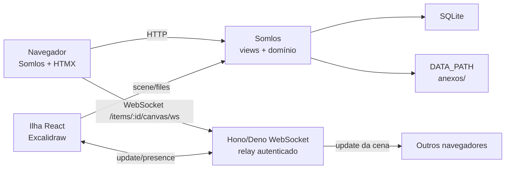

# Feedback, anexos e Excalidraw — arquitetura recomendada

> Premissa: o alvo é **binário único Somlos/Deno + SQLite**, com chat por SSE e anexos locais (doc [`05-arquitetura-single-binary.md`](05-arquitetura-single-binary.md)). O desenho de dados, protocolo e segurança abaixo foi mantido; a stack Django/Channels foi substituída por **Somlos/Hono** e **WebSocket nativo do Deno**. A decisão de stack está em [`03-decisao-stack.md`](03-decisao-stack.md).
>
> Regra de escopo: **feedback é assíncrono** (thread com mensagens); **chat geral/projeto/demanda** é um módulo separado, com SSE (doc 05); **whiteboard é síncrono** (WebSocket). Não construir DMs, canais privados, presença ou typing no MVP.

## 1. Veredito em uma página

| Capacidade | Abordagem | Não fazer |
|---|---|---|
| Feedback | módulo `feedback` no Somlos: threads + mensagens + status + anexos; drawer HTMX com polling | DMs, canais privados, typing/read receipts |
| Chat | módulo `chat` separado: Geral + projeto + demanda, SSE + POST | DMs, presença, threads, reações |
| Anexos | modelo `Attachment` + storage local + re-encode; download autenticado | bucket público, SVG/HTML, `Media` aberto |
| Whiteboard | **npm `@excalidraw/excalidraw`** em uma ilha React; cena no SQLite; **WebSocket Hono/Deno** | fork do app Excalidraw, Firebase, Excalidraw+, iframe público |
| Colaboração | relay autenticado de updates da cena; TLS; servidor persiste para histórico/análise | CRDT próprio, WebRTC, serviço externo |
| Persistência | autosave por **um líder** da sala; cena JSON versionada; arquivos separados | cada cliente gravando a cena inteira |
| Infra | binário único + Caddy + SQLite + disco local | Firebase, S3 externo, Node em runtime |

**Melhor caminho:** usar o pacote React do Excalidraw (MIT, `0.18.0`), uma ilha React isolada e um WebSocket Hono/Deno que faz **relay autenticado** dos updates da cena. Sem Node em runtime, sem Firebase, sem CDN.

## 2. Por que não usar o app Excalidraw inteiro

O repositório `_REF/excalidraw` é o editor **e** o app `excalidraw.com`:

- 92 MB, monorepo Yarn, PWA, share links, Sentry, integração Firebase e promoções do Excalidraw+.
- O pacote npm **não inclui colaboração**: a própria FAQ diz que a implementação é específica de cada host app.
- O Docker oficial de self-host **não suporta compartilhamento nem colaboração**.
- O app usa Firebase para persistir cena/arquivos e `socket.io` para o relay; ambos são externos ou acoplados.

O pacote `@excalidraw/excalidraw` é a superfície certa: componente React, MIT, exporta `initialData`, `onChange`, `excalidrawAPI`, `reconcileElements`, utilidades de criptografia e exportação. A colaboração é sua — mas o protocolo é pequeno.

## 3. Arquitetura geral



- **Feedback, chat e anexos** são HTTP; o chat usa SSE para receber, não WebSocket.
- **Whiteboard** é a única superfície síncrona bidirecional.
- O servidor autentica a sala, aplica limites, repassa os updates e persiste snapshots para histórico/análise. TLS protege o transporte; **não há E2E** no MVP.
- A cena persistida é JSON no banco; os arquivos de imagem ficam no storage local e são referenciados por `fileId`.

## 4. Feedback em thread (distinto do chat)

### 4.1 Modelo

| Tabela | Campos principais |
|---|---|
| `FeedbackThread` | `project` (nullable), `item` (nullable), `page_url`, `title`, `category` (`bug/idea/question`), `status` (`open/triaged/resolved`), `created_by`, `created_at`, `updated_at`, `resolved_at` |
| `FeedbackMessage` | `thread`, `author`, `body`, `created_at` |
| `FeedbackMessageAttachment` | `message`, `attachment` |
| `FeedbackRead` | `thread`, `user`, `last_read_at` (contagem de não lidos) |

- Uma thread é uma conversa; a primeira mensagem pode ser o próprio relato.
- `project`/`item` dão contexto; `page_url` preserva a tela onde o feedback nasceu.
- Sem chat global, sem DMs, sem canais. O drawer lista threads do projeto atual.
- Feedback de app (sem projeto) pode existir com `project = NULL`, visível ao time; se isso virar ruído, exija projeto.

### 4.2 UX

- Botão flutuante **Feedback** no shell; atalho opcional.
- Drawer `GET /feedback/panel?project=...`: lista de threads, filtro por status/categoria, contador de não lidos.
- Nova thread: categoria, título, mensagem, anexo opcional, URL atual preenchida.
- Thread: mensagens em ordem, autor/avatar/hora, anexos como miniaturas, caixa de resposta, botão **Resolver**.
- Atualização: HTMX polling de 5 s (3 s com thread aberta) enquanto o drawer está visível. Para 10 pessoas, é suficiente; sem WebSocket.
- Anexos: drag/drop ou colar imagem; upload `multipart/form-data`; preview; limite por arquivo e total.
- Notificação: badge de não lidos via `FeedbackRead`; sem e-mail no MVP.

### 4.3 Rotas

| Rota | Ação |
|---|---|
| `GET /feedback/panel` | drawer/lista (HTMX) |
| `POST /feedback/threads` | cria thread + primeira mensagem |
| `GET /feedback/threads/<id>` | thread e mensagens |
| `POST /feedback/threads/<id>/messages` | resposta |
| `POST /feedback/threads/<id>/resolve` | fecha/reabre |
| `POST /attachments` | upload; devolve id/thumbnail |
| `GET /attachments/<id>` | download autenticado |

Todas exigem login; threads de projeto exigem acesso ao projeto (no MVP, todo membro; se houver `ProjectMember`, validar); anexos herdam a permissão do alvo.

## 5. Anexos e imagens

### 5.1 Modelo e armazenamento

| Tabela | Campos |
|---|---|
| `Attachment` | `project`, `uploaded_by`, `sha256`, `mime`, `size`, `width`, `height`, `storage_key`, `original_name`, `created_at` |

- `storage_key` content-addressed: `attachments/<aa>/<bb>/<sha256>`.
- Deduplicação por `sha256`; se o mesmo arquivo for reenviado, reutiliza o blob e cria novo vínculo.
- Storage local no MVP; S3-compatible depois, com URLs privadas.
- Download sempre via rota do binário, com checagem de permissão; nunca `static/` ou caminho público.
- Backup inclui `DATA_PATH/attachments/` e o SQLite; restore testado.

### 5.2 Validação de imagem

- Allowlist: **PNG, JPEG** e **PDF**. WebP/GIF só se entrarem no decoder/re-encode; **sem SVG/HTML/JS** (XSS/polyglot).
- Limite: 10 MiB por arquivo; limite de pixels (ex.: 40 MP) contra decompression bomb.
- Abrir com o decoder do servidor (Deno; ex.: `imagescript` para PNG/JPEG), validar dimensões, re-encodar para remover EXIF/metadados e payloads. Formato não suportado vira download, nunca inline.
- Miniatura 320 px opcional (WebP/JPEG) para lista/chat; original sanitizado para download/Excalidraw. Se não houver decoder seguro, não gerar miniatura.
- Nome de arquivo gerado; nome original só em coluna de exibição, escapado.
- `Content-Type` derivado do conteúdo, `X-Content-Type-Options: nosniff`, `Content-Disposition: inline` só para imagens; demais `attachment`.
- Antivírus/ClamAV é opcional no MVP; se o time recebe arquivos de fora, adicionar varredura assíncrona.

### 5.3 Limites de abuso

- Upload por usuário/minuto; tamanho total por thread/whiteboard.
- Quota por projeto (ex.: 1 GB) e alerta; sem quota rígida no primeiro dia.
- Cleanup de órfãos: job semanal remove blob sem vínculo após 24 h.
- Nunca servir blobs sem auth; nunca confiar em `Content-Type` do cliente.

## 6. Whiteboard com Excalidraw

### 6.1 Integração: ilha React, não SPA

Criar `frontend/whiteboard/` com esbuild + React 19 + `@excalidraw/excalidraw@0.18.0`:

- build gera `static/whiteboard/whiteboard.js` + CSS; só o frame do canvas carrega.
- O Somlos entrega um `<div id="whiteboard-root">` e um JSON embutido com `{demandId, scene, version, files, user}` (script same-origin ou `data-` attribute; não inline solto). Todos com acesso editam.
- O componente monta `<Excalidraw initialData={...} onChange={...} excalidrawAPI={...} />`.
- Sem CDN: copiar as fontes de `node_modules/@excalidraw/excalidraw/dist/prod/fonts` para `static/vendor/excalidraw/` e definir `window.EXCALIDRAW_ASSET_PATH = "/static/vendor/excalidraw/"`.
- Esconder links de Excalidraw+/help via `UIOptions`/`renderTopRightUI`; o pacote não deve fazer requests externas.

Não usar iframe do app Excalidraw: autenticação, persistência, arquivos e colaboração ficariam fora do controle.

### 6.2 Modelo

| Tabela | Campos |
|---|---|
| `Whiteboard` | `demand`, `scene` (JSON), `scene_version`, `created_by`, `updated_at`, `archived_at` |
| `WhiteboardFile` | `whiteboard`, `excalidraw_file_id`, `attachment` |

- `scene` guarda elementos + appState essencial; **não** embutir dataURLs de imagens no JSON.
- `scene_version` incrementa em cada save; `updated_at`/`saved_by` para auditoria.
- `WhiteboardFile` mapeia o `fileId` do Excalidraw para o `Attachment`; o cliente baixa os arquivos por uma rota autenticada e chama `excalidrawAPI.addFiles`.
- Limite de cena (ex.: 5 MB JSON) e de arquivos (ex.: 50 MB por whiteboard) para evitar abuso.

### 6.3 Rotas

| Rota | Ação |
|---|---|
| `GET /items/:id/canvas` | canvas da demanda |
| `POST /items/:id/canvas` | cria canvas vazio (qualquer usuário com acesso) |
| `GET /items/:id/canvas/frame` | frame do canvas |
| `GET/PUT /api/items/:id/canvas` | carrega/salva cena (JSON + versão) |
| `POST /api/items/:id/canvas/files` | upload de imagem usada no canvas |
| `GET /api/items/:id/canvas/files/<fileId>` | baixa arquivo autorizado |
| `WS /items/:id/canvas/ws` | sala de colaboração |

Todas as rotas exigem sessão e acesso à demanda; todos com acesso podem editar o canvas. Nada público.

## 7. Colaboração síncrona

### 7.1 Protocolo

Reutilizar o modelo do Excalidraw: updates de elementos + presença; o servidor autentica, repassa e persiste snapshots.

```text
cliente A                    Hono/Deno WebSocket                cliente B
   |-- join {room} ------------------->|                              |
   |<-- room-state {users, first} -----|                              |
   |                                   |<--------- join -------------|
   |-- update {iv, ciphertext} ------->|------ update {iv, ciphertext} ->|
   |<-------- update {iv, ciphertext} -|                              |
   |-- presence {pointer, name} ------>|----- presence -------------->|
```

- **Entrada**: handshake WebSocket com cookie de sessão; validar `Origin`; checar acesso à demanda; recusar sala desconhecida.
- **Saída**: membros da sala, primeiro da sala, atualizações, presença, erro.
- **Persistência**: o persister envia snapshots periódicos; o servidor grava para histórico/análise.
- **Mensagens**: `SCENE_INIT` (cena completa ao entrar), `SCENE_UPDATE` (elementos alterados), `MOUSE_LOCATION`, `IDLE_STATUS` (opcional).
- **Reconciliação**: `reconcileElements` do Excalidraw; `updateScene(..., CaptureUpdateAction.NEVER)` para não sujar undo.
- **Throttle**: updates ~30–60 ms; presença ~30 fps ou menos; o servidor limita mensagens/s e tamanho.

### 7.2 Por que WebSocket nativo no Somlos/Deno

- Um runtime, uma sessão, um deploy; sem Node/socket.io em produção.
- Autorização por projeto no handshake, algo que o `excalidraw-room` oficial não faz.
- Hono/Deno tem `upgradeWebSocket`; um único processo atende 10 usuários. Se houver múltiplos processos, adicionar pub/sub externo — não no MVP.
- SSE não serve para o whiteboard: ele precisa de updates bidirecionais e de baixa latência; o chat, que é só receber, usa SSE.
- O protocolo é pequeno (~150 linhas); o cliente é o trabalho maior, mas seria necessário de qualquer forma (o pacote não traz colaboração).
- Alternativa: self-host do `excalidraw-room` (MIT, ~120 linhas) com token de sala assinado; é viável, mas adiciona um runtime Node e continua exigindo cliente próprio. Para o Somlos, o WebSocket nativo ganha.

### 7.3 Persistência: um líder, não todos

- O servidor escolhe o **primeiro** socket da sala como `persister`; envia `persister: true` e promove o próximo quando ele sai.
- Apenas o persister faz `PUT /scene` a cada ~2 s se houve mudança; os demais não gravam.
- `scene_version` no `PUT`; o servidor aceita se a versão é a atual; em conflito, devolve 409 e o persister recarrega a cena do servidor.
- Se ninguém está conectado, a última cena permanece; ao abrir sozinho, o cliente é persister e autosave funciona.
- `beforeunload`/`visibilitychange`: `navigator.sendBeacon` com a cena final (ou salvar no `onChange` com debounce).
- Isso evita que um cliente atrasado sobrescreva o desenho inteiro.

### 7.4 Presença e UX

- Avatares/nomes na sala; cursor e seleção; “fulano está desenhando”.
- Link interno `/items/:id/canvas`; acesso derivado da demanda.
- Indicador “Salvando…” só no persister; “Sincronizado” após 200.
- Reconnect com backoff; ao voltar, entra na sala, pede cena completa a um peer e reconcilia.
- Todos os participantes com acesso editam; não há modo leitura obrigatório. O `viewModeEnabled` pode existir apenas como preferência local, nunca como bloqueio de interação.
- Mobile: o Excalidraw funciona, mas a experiência é secundária; não é requisito do MVP.

### 7.5 Imagens no canvas

- `onChange` entrega `files` (dataURLs); ao detectar arquivo novo, enviar ao endpoint de upload e guardar `fileId -> attachment`.
- Não enviar dataURL pelo WebSocket; os peers baixam por `GET /api/items/:id/canvas/files/<fileId>`.
- Ao carregar a página, baixar os arquivos referenciados e chamar `excalidrawAPI.addFiles`.
- Limite de 4–10 MB por imagem; validar/re-encodar como nos anexos; se o arquivo for grande, mostrar erro no canvas.
- O pacote oficial usa um `FileManager` com essa mesma ideia; copiar o padrão (MIT), não o Firebase.

## 8. Segurança e “sem infra externa”

| Risco | Controle |
|---|---|
| Acesso ao canvas | sessão + acesso à demanda no HTTP e no handshake WS; `Origin` validado |
| Vazamento de canvas | acesso derivado da demanda; sem URL pública; sem log de conteúdo |
| WS abuse | limite de conexões por usuário/sala, mensagens/s, tamanho de frame, sala ≤ 10; idle timeout |
| Anexos | allowlist raster/PDF, re-encode, limites, auth no download, sem `static/` público |
| XSS em anexos | sem SVG/HTML; `nosniff`; `Content-Disposition`; CSP |
| CSP do Excalidraw | o pacote usa `Worker` e `new Function` no subset de fontes; prever `worker-src 'self' blob:`, `script-src 'unsafe-eval'` e `img-src 'self' data: blob:` **apenas na rota do canvas**; manter CSP estrita no resto |
| Dependências | pinar `@excalidraw/excalidraw@0.18.0`; revisar updates; incluir LICENSE MIT |
| Dados sensíveis | cena é persistida em claro para autosave, snapshots e análise; TLS protege o transporte. Documente que não há E2E |
| Sem infra externa | fontes/JS/CSS self-hosted; sem Firebase, Sentry, Excalidraw+, CDN; Node só no build |

> O Excalidraw é a exceção de CSP do produto. Isole a rota `/items/:id/canvas/*` com headers próprios; não relaxe a política global.

## 9. Testes

| Área | Teste |
|---|---|
| Anexos | MIME falso, imagem enorme, SVG rejeitado, EXIF removido, download sem permissão, órfão |
| Feedback | criar/responder/resolver, autorização, unread, polling, anexo por mensagem |
| Whiteboard HTTP | cena inicial, save/versão, 409, limite de tamanho, autorização |
| Colaboração | WebSocket: join sem sessão → 403; duas conexões recebem update; persister promovido ao sair |
| Browser | Playwright com dois contextos: desenhar em A, ver em B; upload de imagem; export; feedback drawer |
| CSP | rota do whiteboard contém os allowances; demais rotas continuam estritas |
| Sem rede externa | Playwright `page.on("request")` não vê domínios externos; fontes locais |

## 10. Ordem de construção

1. **Anexos**: modelo, storage, validação/re-encode, download auth, testes. Base para tudo.
2. **Feedback**: threads/mensagens, drawer HTMX, polling, anexos, não lidos.
3. **Canvas colaborativo básico**: modelo, modal full-screen, cena/arquivos, WebSocket/presença, autosave, export.
4. **Colaboração**: WebSocket handler Hono/Deno, cliente WS, reconciliação, presença, persister.
5. **Endurecimento**: limites, CSP por rota, reconnect, testes de dois navegadores, backup/restore.

Cada fase entrega algo usável; não construir chat, whiteboard e colaboração ao mesmo tempo.

## 11. O que não fazer

- Fork do app Excalidraw inteiro ou self-host do Docker oficial esperando colaboração.
- Firebase, Excalidraw+, Sentry, CDN de fontes ou qualquer SaaS.
- DMs, canais privados, presença/typing no chat; o chat geral/projeto está no doc 05.
- CRDT/Yjs/WebRTC próprio; o relay + `reconcileElements` resolve 2–10 pessoas.
- Um WebSocket por usuário para feedback; polling HTMX basta.
- Salvar a cena de todos os clientes; use líder.
- Embutir imagens em base64 na cena persistida.
- Servir anexos por URL pública.

## 12. Riscos e limites

| Risco | Mitigação |
|---|---|
| O pacote não traz colaboração; o cliente é seu | começar com relay de dois clientes; usar `reconcileElements` e o protocolo oficial como referência; testar dois navegadores |
| CSP do Excalidraw | isolar rota e headers; testar; se política estrita for obrigatória, reavaliar o whiteboard |
| WebSocket em um processo | 10 usuários cabem; ao escalar, adicionar pub/sub externo (não Redis/Channels no MVP) |
| Autosave perder edição | persister único + versão + sendBeacon; nunca last-write-wins de todos |
| Anexos crescerem | quota, content-addressing, cleanup de órfãos, backup |
| Excalidraw quebrar entre versões | pinar versão, testar upgrade, isolar a ilha React |
| Escopo de chat crescer | manter Geral + canal por projeto, SSE, sem DMs/presença; ver doc 05 |

**Resumo:** use o **pacote** Excalidraw, não o app; uma ilha React para o canvas; **WebSocket Hono/Deno** para relay autenticado; **um líder apenas para o snapshot** (todos editam); **Attachment** compartilhado com validação/re-encode; **feedback em threads** com HTMX polling e **chat** por SSE. Tudo self-hosted, sem Firebase, sem Node em runtime, sem serviço externo.
