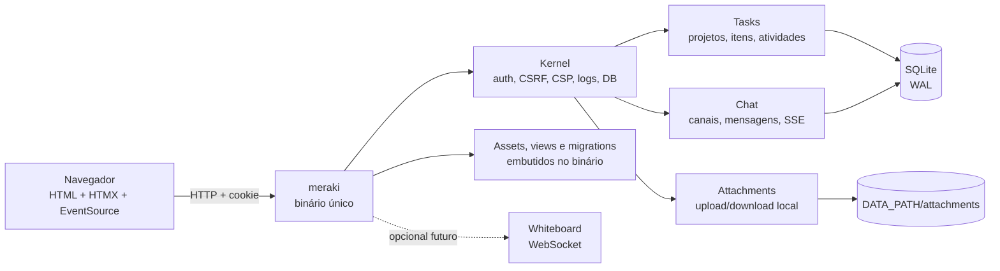

# Arquitetura single-binary — Somlos, SQLite, chat e anexos

> **Decisão:** com o Somlos sendo projeto do próprio titular — portanto sem o bloqueio de licença — e com a restrição de **um binário, SQLite, chat, anexos locais e segurança**, o caminho de menor risco é uma **extração cirúrgica do Somlos** (Deno/TypeScript/Hono/HTMX), não um fork integral e não Django/Next.
>
> **Refinamentos confirmados na implementação:** tarefas exigem início, fim e responsável; prioridade Eisenhower Q1–Q4 calculada na leitura, com override auditado de manager/admin; tags globais por tenant com filtro AND; PWA instalável e Web Push (inbox + browser/celular) com dispatcher no binário; canais `general|project|demand` (a conversa da demanda é um canal, não tabela `comments`); mensagens/descrições em **Markdown seguro**; **um canvas Excalidraw por demanda, colaborativo em tempo real e full-screen**; cargos `admin|manager|developer`; quatro ações `create|edit|archive|export`; tarefas oficiais vs issues sugeridas; manager só se diferencia por criar/arquivar tarefa, definir PO, sobrepor prioridade e gerenciar tags. O schema/roteiro definitivo está em [`implementation/03-dados-e-migracoes.md`](../implementation/03-dados-e-migracoes.md), [`08`](../implementation/08-markdown-e-conversas.md) e [`10`](../implementation/10-excalidraw-na-tarefa.md).
>
> PWA e push fazem parte do alvo; o binário continua sendo o único backend de aplicação. O TabNews entra como **referência de organização**, não de stack: rotas finas, domínio explícito, validação/limites, autorização com allowlist, testes via HTTP e URL como estado. O TabNews é Next.js + Postgres + Vercel, não compila um binário e não tem chat nem upload; copiar a stack seria trocar simplicidade por infraestrutura.

## 1. Restrições e o que isso elimina

| Restrição | Consequência |
|---|---|
| Um binário | Deno `compile`, Rust ou Go. Django/Gunicorn, Next/Node e Vercel ficam fora como base. |
| SQLite | Um processo, WAL, transações curtas, backup por arquivo. Sem pool Postgres, sem RLS, sem stored procedures. |
| Chat | Precisa de mensagens persistidas, autorização por canal, atualização em tempo real e limites de abuso. |
| Anexos locais | Storage fora do banco, auth no download, validação de conteúdo, quota, backup e limpeza de órfãos. |
| Segurança | Sessão opaca, CSRF, autorização por recurso, CSP, rate limit, uploads sem XSS/path traversal, logs redigidos. |
| ~10 pessoas | Um processo basta; SSE/WebSocket em memória é suficiente; sem Redis, worker ou fila. |

O que **não** é requisito: multi-tenant, SSO, e-mail transacional, API pública, DMs, canais privados, chamadas, presença, digitação, edição de mensagem, reações ou busca full-text.

## 2. Decisão: por que o Somlos

O Somlos já resolve as partes caras e perigosas:

| Necessidade | Evidência no Somlos |
|---|---|
| Binário único | `deno task build:bin` empacota runtime, código, views e assets; `deno compile` inclui `src`, `static`, migrations — `deno.json:27-28`, `docs/adr/ADR-014-executavel-unico-deno-compile.md` |
| SQLite | `node:sqlite` + Kysely, WAL, migrations com checksum, backup/restore/doctor — ADR-003, ADR-013, `scripts/backup.ts`, `scripts/restore.ts`, `scripts/doctor.ts` |
| Auth/sessão | Token opaco de 256 bits, banco guarda só `blake3`, cookie, Argon2id, decoy hash, auditoria — `src/modules/identity/infrastructure/session-repository.ts`, `src/modules/identity/application/login.ts` |
| CSRF/headers | `hono/csrf` + CSP estática sem inline, HSTS, nosniff, frame-ancestors — `src/app.tsx`, `src/kernel/http/security.ts` |
| UI server-side | JSX pré-compilado + HTMX + CSS/tokens; sem SPA — ADR-026 |
| Operação | `migrate|seed|backup|restore|doctor` no próprio binário; systemd + Caddy — `src/main.ts`, ADR-025 |

O que o Somlos **não** resolve e precisa ser construído ou adaptado:

1. **Chat** — não há WebSocket/SSE hoje; o mais próximo é streaming de resposta. Chat será um módulo novo via **SSE + POST**, não WebSocket.
2. **Anexos locais** — o `StoragePort` é S3/RustFS; é preciso um adaptador de disco local. O serviço `media` atual usa FFmpeg externo e é mais complexo que o necessário.
3. **Corte de escopo** — 12 módulos, 20 services, 19 tabelas e Compose com Valkey/RustFS/OTel são grandes demais. A extração remove produto de CMS/mídia e mantém apenas o núcleo.
4. **Organização** — o Somlos é mais “DDD modular” que o TabNews; para 10 pessoas, o alvo é **menos services, menos camadas, rotas finas e SQL explícito**.

## 3. O que copiar do TabNews — e o que não copiar

### 3.1 Copiar como contrato

| Padrão do TabNews | Tradução no meraki |
|---|---|
| Página/rota fina: valida, autoriza, chama o domínio, filtra a saída | `src/modules/<área>/http/routes.tsx` com handler curto; regra em `application/` |
| Modelos como funções explícitas, SQL legível, sem ORM mágico | Kysely/SQL explícito; sem “repository genérico” |
| `infra/` separado de `models/` | `kernel/` (config, DB, HTTP, logs) e `infrastructure/` por módulo |
| Erros com status, `error_id` e `key` para o campo | Um formato público único; HTML re-renderiza o campo; JSON de API idem |
| Validação com limites por campo + `CHECK` no banco | Zod no boundary + `CHECK`/limites no SQLite; mensagens em pt-BR |
| `filterInput`/`filterOutput` por allowlist | Nunca devolver `storage_key`, IP, e-mail ou caminho interno |
| URL como estado de paginação/filtro | `?status=&assignee=&page=`; sem estado de UI duplicado |
| Testes de integração via HTTP, incluindo matriz de CSRF | `tests/http/**`; banco temporário por suíte |
| CSS por tokens, poucos breakpoints, estados vazios | Um CSS, variáveis, 3 breakpoints; partial de vazio/erro |
| Markdown renderizado no servidor | Comentários/descrições/chat em Markdown seguro, renderizados no servidor |

### 3.2 Não copiar

- **Next.js/Postgres/Vercel/ISR/SWR/NDJSON** — não há binário único, e o fluxo de dados é de outro produto.
- **CORS `*` e ausência de CSP** — o TabNews tem `Access-Control-Allow-Origin: *` e `// TODO` de CSP (`next.config.js`); o meraki é same-origin e CSP estrita.
- **Sessão em claro no banco** — o TabNews grava o token bruto (`models/session.js`); o Somlos já grava hash, mantenha.
- **Cinco workspaces e barris de reexport** — `packages/ui`, `interface/components/TabNewsUI` etc.; para 10 pessoas, uma camada de views e um CSS bastam.
- **`useForm`/`useConfig`/processors, SWR, `useMediaQuery` decidindo markup, cache de usuário em `localStorage`** — são custos de SPA/Next; no server-side, formulário é HTML + validação única.
- **Firewall em plpgsql, pool Postgres, stored procedures** — trocar por rate limit em memória e queries SQLite.
- **Anexos** — o TabNews não tem upload; não há padrão para copiar. A seção 6 define o padrão do meraki.

## 4. Arquitetura alvo



- **Um processo, um banco, um diretório de dados.**
- **Chat:** SSE para receber; POST para enviar. Sem WebSocket, sem Redis.
- **Whiteboard:** só se entrar no escopo; aí sim WebSocket (Hono/Deno), porque é bidirecional.
- **Anexos:** servidos por rota autenticada; nunca por `static/` ou caminho do filesystem.
- **Assets/migrations:** dentro do binário; `DATA_PATH` é o único estado mutável.

### 4.1 Módulos alvo

| Módulo | Responsabilidade | Fica? |
|---|---|---|
| `kernel` | config, DB, HTTP, segurança, logs, tempo, cripto | sim, enxuto |
| `identity` | usuários, login, sessão, admin de usuários | sim, sem JWT de API e sem reset por e-mail no MVP |
| `tasks` | projetos, itens, comentários, atividades | novo |
| `chat` | canais, mensagens, leituras, SSE | novo |
| `attachments` | upload, validação, storage local, download | novo |
| `system` | `/healthz`, `/readyz` | sim |
| `layout` | shell, partials, CSS, componentes | sim, simplificado |
| `db` | schema agregado + migrations | sim, rebase limpo |
| `tenancy` | `tenant_id` fixo de instância única | manter nesta fase; não expor multi-tenant |
| `audit` | login/admin; não auditoria universal | manter mínimo |
| `cms`, `pages`, `noticias`, `contacts`, `gallery`, `media`, `maps`, `signature`, `demo` | produto original | remover |
| `access`, `cache`, `events`, `jobs`, `mail`, `pdf`, `search`, `seo`, `feed`, `importer`, `richtext`, `blocks` | plataforma desnecessária | remover |

**Meta:** ~6 módulos de produto/plataforma, ~11–13 tabelas ativas, ~8–10 mil linhas, um binário. Não é “6 tabelas” porque chat e anexos são escopo novo; é o menor conjunto que entrega o pedido.

### 4.2 Serviços que sobram

- `auth` (Argon2id, sessão opaca, JWT só se houver API real);
- `storage` (adaptador local; a porta pode continuar);
- `sse` (broker em memória por canal, um processo);
- `audit` (opcional/mínimo).

Sem `cache`/Valkey: rate limit em memória. Sem `jobs`/worker: limpeza de órfãos vira `meraki doctor --prune`. Sem `mail`: admin redefine senha. Sem `events`/outbox: chat e tasks escrevem na mesma transação.

## 5. Dados

### 5.1 Núcleo de tarefas

Reutilizar o DDL do [`00-panorama-mvp.md`](00-panorama-mvp.md): `users`, `sessions`, `projects`, `items` (tarefa/issue), `demand_events`. Usuários/sessões vêm do Somlos; o domínio de demandas é novo; conversas são canais.

### 5.2 Chat

```sql
-- IDs text UUIDv7 no alvo Somlos; projetos/itens usam o mesmo tipo.
create table chat_channels (
  id          text primary key,
  tenant_id   text not null,
  project_id  text references projects(id),
  name        text not null,
  created_at  text not null,
  archived_at text
) strict;

create unique index chat_general_one
  on chat_channels(tenant_id)
  where project_id is null;
create unique index chat_project_one
  on chat_channels(tenant_id, project_id)
  where project_id is not null;

create table chat_messages (
  id         text primary key,
  channel_id text not null references chat_channels(id),
  author_id  text not null references users(id),
  body       text not null check (length(body) between 1 and 4000),
  created_at text not null,
  deleted_at text
) strict;

create index chat_messages_channel_created
  on chat_messages(channel_id, created_at);

create table chat_reads (
  channel_id           text not null references chat_channels(id),
  user_id              text not null references users(id),
  last_read_message_id text,
  updated_at           text not null,
  primary key (channel_id, user_id)
) strict;

-- Criar `attachments` antes desta tabela.
create table chat_message_attachments (
  message_id    text not null references chat_messages(id) on delete cascade,
  attachment_id text not null references attachments(id),
  primary key (message_id, attachment_id)
) strict;
```

- Um canal **Geral** (`project_id is null`), um por projeto e um por demanda; os índices parciais garantem a unicidade.
- Sem DMs, canais privados, threads, reações, edição, presença ou “digitando”.
- Mensagem é **Markdown seguro** (sem HTML cru, sem imagens Markdown); links http/https/mailto com `rel="nofollow noopener"`; render final no servidor.
- `chat_reads` dá badge de não lidos; abrir o canal marca até a mensagem visível.
- Soft delete por autor/admin; sem hard delete de mensagem com anexo sem limpeza.

### 5.3 Anexos

```sql
create table attachments (
  id            text primary key,
  tenant_id     text not null,
  uploader_id   text not null references users(id),
  sha256        text not null,
  mime          text not null,
  bytes         integer not null check (bytes > 0),
  width         integer,
  height        integer,
  storage_key   text not null unique,
  original_name text not null,
  created_at    text not null,
  deleted_at    text,
  unique (tenant_id, sha256)
) strict;
```

- `storage_key` = `attachments/<aa>/<bb>/<sha256>`; nome do usuário **nunca** vira caminho.
- Deduplicação por `sha256`; o mesmo blob pode ter vários vínculos.
- Índice em `chat_message_attachments(attachment_id)` para autorização/limpeza.

## 6. Chat com SSE, não WebSocket

### 6.1 Por que SSE

O chat precisa de **servidor → cliente**; o envio pode ser um POST normal. SSE:

- usa cookie de sessão e `Origin`/`Sec-Fetch-Site` como qualquer GET;
- reconecta sozinho (`EventSource`);
- não exige upgrade, frame protocol, ping/pong ou validação de Origin no handshake;
- funciona atrás de Caddy sem regra especial de WebSocket;
- é suficiente para 10 pessoas em um processo.

WebSocket fica para o canvas, que é bidirecional e de alta frequência. Não usar WebSocket só porque “chat é tempo real”.

### 6.2 Fluxo

```text
POST /chat/channels/:id/messages
  cookie + Origin/Sec-Fetch-Site + form/multipart
  → valida 1..4000, rate limit 30/min
  → INSERT chat_messages + vínculos de anexos
  → broker.publish(canal, evento)
  → 204/HTML parcial

GET /chat/channels/:id/events
  cookie + acesso ao canal
  → streamSSE: hello + mensagens após Last-Event-ID
  → heartbeat 15 s; unsubscribe no abort
```

- `Last-Event-ID`/`after` recupera mensagens perdidas na reconexão.
- O cliente faz append por `id`; o POST pode devolver o HTML da mensagem para feedback imediato.
- Se o SSE cair, o cliente mostra “reconectando” e busca o histórico via HTTP.
- Sem broker externo: um `Map<channelId, Set<stream>>` no processo. Reinício = clientes reconectam e recuperam do SQLite.
- Múltiplos processos exigiriam Redis/pub-sub ou polling; **não** no MVP. O binário único é uma decisão operacional, não um acidente.

### 6.3 Segurança do chat

- Autorização em **cada** subscribe e em **cada** POST; não confiar no canal do cliente.
- `Cache-Control: no-store`; `X-Accel-Buffering: no`; sem compressão que segure o stream.
- Heartbeat; timeout de idle; fechar stream quando a sessão for revogada (checagem periódica de 60 s).
- Limite de conexões SSE por usuário e por canal; limite de mensagens/minuto.
- Corpo máximo 4.000 caracteres; rejeitar controles/invisíveis; trim; sem HTML.
- Logs não guardam corpo de mensagem nem cookie.

## 7. Anexos locais

### 7.1 Upload

`POST /attachments` (multipart, CSRF, auth) ou junto do POST da mensagem:

1. Limite de **10 MiB** por arquivo, **3 arquivos** por mensagem; `Content-Length` também limitado no Caddy.
2. Ler magic bytes; allowlist:
   - **imagens:** JPEG/PNG (e WebP se o decodificador escolhido suportar);
   - **documento:** PDF;
   - **nunca:** SVG, HTML, JS, executáveis, arquivos sem tipo reconhecido.
3. Imagens: decodificar e **re-encodar** (remove EXIF/polyglot) antes de gravar; rejeitar bombs por dimensão (ex.: 40 MP). Se a biblioteca pura não cobrir o formato, tratar como download e não renderizar inline.
4. PDF: validar `%PDF-`, limite de tamanho; servir sempre como `attachment`, sem inline.
5. Gerar `sha256`, gravar em `DATA_PATH/attachments/<aa>/<bb>/<sha256>` com `0600`; criar diretório `0700`.
6. Inserir metadados no SQLite; se o INSERT falhar, remover o blob recém-criado.
7. Deduplicar: se o hash já existe, reutilizar o blob e criar novo vínculo.

### 7.2 Download

`GET /attachments/:id`:

- exige sessão e acesso à mensagem/item que referencia o anexo;
- deriva `Content-Type` do servidor (nunca do cliente);
- `Content-Disposition: inline` **somente** para imagem re-encodada; PDF/outros `attachment`;
- `X-Content-Type-Options: nosniff`, `ETag`, `Cache-Control: private, max-age=…`;
- nunca expõe `storage_key`, caminho absoluto ou nome do arquivo no filesystem;
- suporta `Range` apenas se necessário para PDF grande; começar sem.

### 7.3 Limpeza e backup

- `meraki doctor --prune`: remove blobs sem vínculo com mais de 24 h; verifica metadados sem arquivo e vice-versa.
- Backup = `sqlite3 .backup` + tar/rsync de `DATA_PATH/attachments`; restore testado mensalmente.
- Quota: 5 GB total e 500 MB/usuário no MVP; erro 413/507 claro.
- Sem antivírus no MVP; se entrar arquivo externo, adicionar varredura assíncrona depois.

## 8. Segurança operacional

| Área | Regra |
|---|---|
| Sessão | Token 256-bit, hash no banco, cookie `HttpOnly; Secure; SameSite=Lax; Path=/`; rotação no login; logout revoga |
| CSRF | `Origin`/`Sec-Fetch-Site` + content-type de formulário em toda mutação com cookie; JSON autenticado por cookie não é aceito |
| Autorização | `admin`/`member`; todo projeto visível ao time; acesso a anexo derivado da mensagem; sem `project_member` no MVP |
| CSP | `default-src 'self'; script-src 'self'; style-src 'self'; img-src 'self' data:; connect-src 'self'; frame-ancestors 'none'; object-src 'none'`; sem inline |
| CORS | same-origin; nenhum `Access-Control-Allow-Origin: *` |
| Upload | limites, magic bytes, re-encode, caminho gerado, permissões, sem symlink, sem `static/` |
| SSE | auth no subscribe, `no-store`, heartbeat, timeout, limite por usuário/canal, rechecagem de sessão |
| Rate limit | em memória: login 5/min por IP+conta, chat 30/min por usuário, upload 10/min por usuário |
| Erros/logs | `error_id`/`request_id`; sem SQL, stack, caminho, cookie, senha, corpo de chat |
| Dependências | lockfile, versões pinadas, revisão de licenças; sem CDN/fonte externa |
| Deploy | Caddy TLS/HSTS, body limit, SSE sem buffering; binário + systemd; diretório de dados com usuário dedicado |

**CSP e Excalidraw:** o canvas é a única exceção; a rota `/items/:id/canvas/*` pode precisar de `worker-src blob:`/`script-src 'unsafe-eval'`. Não relaxar a política global; ver [`04-feedback-anexos-excalidraw.md`](04-feedback-anexos-excalidraw.md).

## 9. Binário único e operação

- `deno task build:bin` gera `dist/meraki`; views, CSS, JS, migrations e módulos entram via `--include`.
- Comandos no binário: `meraki migrate`, `meraki seed`, `meraki backup`, `meraki restore`, `meraki doctor`, `meraki serve`.
- `DATA_PATH` guarda `meraki.sqlite3` e `attachments/`; é o único volume.
- Deno/Node **não** ficam instalados no servidor; o build de CSS/JS (Deno/Tailwind) é etapa de CI, e o runtime é o binário.
- Caddy: TLS, HSTS, `request_body { max_size 32MB }`, `flush_interval -1` para SSE, cache de assets; sem servir `DATA_PATH`.
- systemd: usuário dedicado, `EnvironmentFile`, `Restart=on-failure`, `ReadWritePaths=DATA_PATH`.
- Tradeoffs: binário de ~165 MB, específico de SO/arquitetura; build matrix; `--allow-read/write` é amplo — restringir o diretório quando o caminho for fixo.

## 10. Organização do código

```text
src/
  kernel/          # config, db, http, security, logging, time, crypto
  db/              # schema agregado + migrations
  modules/
    identity/      # users, sessions, login, admin
    demands/       # projects/folders, items (task/issue), demand_events
    chat/          # channels, messages, reads, SSE
    attachments/   # upload, local storage, download
    system/        # health/ready
  layout/          # shell, views, componentes, CSS
  lib/             # helpers puros
tests/
  http/            # fluxo por rota, auth, CSRF, limites
  unit/            # validação, path, formatação
  e2e/             # Playwright: login, task, chat, upload
```

- **Rota fina:** parse/validate → auth → domínio → filtro de saída → render/JSON.
- **Sem camadas cerimoniais:** não criar “repository”, “use case” e “service” para cada tabela. Funções de domínio com SQL explícito são suficientes, como no TabNews.
- **Um erro por caso**, não uma hierarquia de 20 classes; status + `key`.
- **Um CSS**, tokens, 3 breakpoints; partials de vazio/erro/loading.
- **Sem barrel/reexport em cadeia**; imports diretos.

## 11. Testes e aceite

| Área | Teste mínimo |
|---|---|
| Auth/CSRF | login, logout, sessão revogada, POST cross-origin bloqueado, multipart aceito só same-origin |
| Tasks | criar/editar/mover, versão 409, atividade, autorização, arquivar |
| Chat | duas sessões recebem SSE; reconexão com `Last-Event-ID`; canal errado 403; rate limit 429 |
| Anexos | magic bytes falso, SVG rejeitado, imagem re-encodada, PDF como attachment, download sem permissão, path traversal, órfão |
| Segurança | CSP/headers, `no-store` em chat/auth, sem CORS `*`, logs sem segredo |
| Operação | `build:bin`, rodar de `/tmp`, migrate, backup/restore, doctor |
| Browser | Playwright: login, criar task, abrir chat em dois contextos, enviar mensagem com imagem, download |

**Definição de pronto:** o binário sobe sozinho em uma máquina limpa, com `DATA_PATH` vazio; migra; cria admin; duas pessoas conversam em tempo real; anexo é enviado, servido apenas a autorizado e incluído no backup; nenhuma request externa no navegador.

## 12. Ordem de corte e construção

1. **Baseline:** copiar Somlos para um repositório próprio; adicionar `LICENSE`; remover `v7_example`, docs de produto e módulos fora do alvo.
2. **Núcleo:** reduzir `kernel`, `identity`, `system`, `layout`; remover JWT de API, reset por e-mail, jobs, events, cache, access, mail, media; trocar storage S3 por adaptador local.
3. **Schema:** rebasear migrations em `0001_core` + `0002_tasks` + `0003_chat` + `0004_attachments`; seed de admin, projeto e canal Geral.
4. **Tasks:** projetos/itens/comentários/atividades; lista, quadro, calendário, Minhas tarefas.
5. **Anexos:** upload local, validação/re-encode, download auth, doctor/prune, backup.
6. **Chat:** canais, mensagens, SSE, não lidos, rate limit, testes de duas sessões.
7. **Endurecimento:** CSP/CSRF, limites no Caddy, logs, restore testado, Playwright.
8. **Canvas colaborativo:** Excalidraw por demanda, full-screen, WebSocket/presença; fase obrigatória após chat/attachments.

Cada etapa termina com um binário usável e um teste de fumaça; não cortar tudo e só então integrar.

## 13. Alternativas e gatilhos

| Caminho | Quando faz sentido | Custo |
|---|---|---|
| **Somlos cirúrgico** (recomendado) | Time aceita Deno/TS; quer auth/CSRF/CSP/migrations/backup prontos; single binary é requisito | Cortar 60–70%; adaptar storage; construir chat/anexos |
| **Rust + Axum + Askama + SQLx** | Rust é requisito ou o time prefere o menor runtime possível | Auth/CSRF/forms/migrations/backup manuais; binário menor |
| **Go + `html/template` + SQLite** | Prioridade absoluta em simplicidade de linguagem e binário | Plataforma manual; menos código “pronto” que Somlos |
| **Django + HTMX** | Single binary é “ideal”, não requisito; prioridade é velocidade de produto | Dois processos/runtime Python; chat via SSE/Channels; não é um binário |
| **TabNews/Next** | Só como referência de organização | Não atende binário/SQLite/uploads; segurança incompleta para o alvo |

**Gatilhos para sair do Somlos:** Deno/TS não for aceitável; o corte não conseguir remover dependências de Valkey/RustFS/OTel; o binário não servir SSE; ou o time decidir que Rust/Go é mandatório.

## 14. Riscos

| Risco | Mitigação |
|---|---|
| Corte do Somlos tocar schema/seed/testes/deploy | Rebase de migrations sem dados; começar por um branch congelado; deletar de verdade, não só `MODULES` |
| Chat SSE em um processo | Suficiente para 10; documentar que múltiplos processos exigem pub/sub; não escalar horizontalmente sem mudar |
| Anexos locais crescerem/perderem | Quota, content-addressing, doctor/prune, backup/restore testado |
| Imagem re-encodada com biblioteca pura falhar em algum formato | Allowlist menor; formato não suportado vira download, nunca inline |
| CSP do Excalidraw | Isolar rota; não relaxar o resto; testar requests externos |
| Escopo de chat crescer | Sem DMs/presença/threads/reações no MVP; medir antes |
| Deno 2.9/TS 6 e binário de 165 MB | Pin de versões, CI de build, imagem mínima; se for bloqueio, Rust/Go |

**Resumo:** um binário **Somlos enxuto**, SQLite, demandas + chat SSE + anexos + canvas colaborativo + PWA/Web Push; TabNews como disciplina de rotas/domínio/validação/testes; zero serviços de aplicação externos (push usa endpoints do navegador). Se Deno/TS não for aceitável, o mesmo desenho cabe em Rust/Axum — mas o caminho de menor risco hoje é cortar o que já existe.
