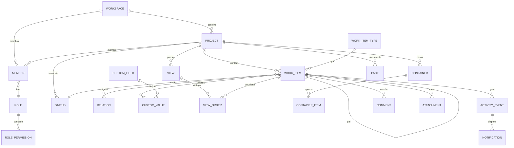

# Meraki — síntese comparativa e blueprint

> Baseado nos seis levantamentos de [`docs/ref/`](README.md). Citações `§` referem-se a esses documentos; caminhos de código foram omitidos aqui de propósito para não duplicar evidência. Legendas: `§OP` = `openproject-data-model.md`, `§OP-16` = seção 16 de `openproject-ui-ux.md`, `§PL` = `plane-data-model.md`, `§TG` = `taiga-data-model.md`.
> Tudo marcado como **recomendação** é decisão de projeto, não fato observado nos sistemas.
> Detalhe de implementação (auth, schema físico, concorrência, realtime, frontend, a11y) está em [`07-arquitetura-comparada.md`](07-arquitetura-comparada.md) e nos seis documentos `0N-*`.

## 1. O que os três produtos convergem

| Invariante | OpenProject | Plane | Taiga | Consequência para o meraki |
|---|---|---|---|---|
| Um registro de trabalho endereçável | `WorkPackage` com `id` curto por projeto | `Issue` com `sequence_id` | `UserStory`/`Task`/`Issue` com `ref` | ID legível por projeto é requisito de UX, não detalhe |
| Estado configurável por projeto, com categoria semântica | `Status` global + workflow | `State` com `group` de 5 valores | status por entidade com `is_closed` | Categoria (backlog/started/closed) é o que agrega; o nome é livre |
| Mesma definição alimenta várias views | `Query` → tabela/Gantt/board/planner | `IssueView` → 5 layouts | ordens por view, sem definição compartilhada | Separar **definição** (filtro/ordem/colunas) de **layout** |
| Ordem manual é dado de primeira classe | `ordered_work_packages` por query | `sort_order` float | 4–5 colunas de ordem por escopo | Precisa de rank por escopo de view |
| Permissão calculada no servidor e espelhada no cliente | `_links` HAL + `AuthorisationService` | `allowPermissions` + `projectUserInfo` | `my_permissions[]` | Payload deve carregar capacidades; nunca replicar regra no cliente |
| Alteração vira evento com autor e delta | Journal por atributo | `IssueActivity` por campo | `HistoryEntry` snapshot+diff | Log de eventos é base de activity, feed, digest e auditoria |
| Dashboard e notificações são agregações | My page/Overview + central | Home + Inbox | Timeline + web notifications | Não modelar como telas especiais; são queries salvas |

## 2. Onde eles divergem (e o custo de cada escolha)

| Dimensão | OpenProject | Plane | Taiga |
|---|---|---|---|
| Granularidade do RBAC | 4 classes de papel, permissão por contexto (global/projeto/WP/query), 157 codenames únicos, shares por item (§OP-4) | 3 papéis numéricos, 2 níveis, sem ACL por item (§PL-4) | papéis por projeto, ~48 codenames, público/anônimo, `is_admin` (§TG-4) |
| Configuração de formulário | `FormConfiguration` por `TypeVariant`, grupos de atributos, seções, visibilidade por papel (§OP-3.3–3.4) | campos fixos + labels/estimates/módulos; sem custom fields (§PL-3) | custom attributes por entidade, 8 tipos, ordem e defaults (§TG-3.7) |
| Modelo de hierarquia | pai/filho livre + relations tipadas + closure table (§OP-2.4) | `parent` (sub-issues) + `IssueRelation` tipada (§PL-2.3) | épico ↔ US N:N + task sob US; sem hierarquia arbitrária (§TG-2) |
| Ordenação | sort por query + tabela de ordem manual por query (§OP-5.1) | float global `sort_order`; drag só reordena se `order_by=sort_order` (§PL-5) | uma coluna por view, reescrita por célula (§TG-5) |
| Kanban | board = grid de colunas, cada coluna é uma `Query`; sem swimlanes/WIP (§OP-8.1) | `group_by`/`sub_group_by`; sem WIP; sem swimlane por coluna (§PL-5) | matriz `swimlane × status`, WIP visual por célula, 4 níveis de zoom (§TG-3.5) |
| Gantt | completo: zoom, relations, baseline, auto-scheduling; **sem caminho crítico** (§OP-7) | existe, mas dependências são interface neutralizada (§PL-5) | não existe (§TG-6) |
| Histórico | journal por atributo, coalescido, abas de atividade (§OP-7.1) | 27 tipos de atividade + descrição versionada, agrupamento no cliente (§PL-6) | snapshot + diff + feed desnormalizado (§TG-6) |
| Densidade | modo compacto só na tabela (§OP-16.6) | nenhum controle de densidade (§PL-10) | 4 níveis de zoom do card, colunas/linhas colapsáveis (§TG-3.5) |

## 3. Modelo de dados recomendado

### 3.1 Um `work_item`, tipo como configuração

OpenProject e Plane convergem em um registro único tipado; Taiga paga o preço de quatro modelos com regras divergentes (`is_closed` materializado em US, derivado em task/issue; §TG-7.5). **Recomendação:** um `work_item` com `type_id`; épico, história, tarefa e bug são tipos, não tabelas.

| Campo | Tipo | Nota |
|---|---|---|
| `id`, `project_id`, `sequence_id` | uuid / int | `sequence_id` único por projeto, exibido como `MER-123` |
| `type_id` | FK | define ícone, cor, hierarquia permitida, form config |
| `parent_id` | FK nullable | profundidade limitada por tipo (ex.: task não tem filho) |
| `status_id` | FK | instância de status do projeto |
| `title`, `description` | text / doc ref | descrição como documento versionado, não textão |
| `assignee_id` + `assignees` | FK + join | **uma** fonte de verdade; Taiga tem duas (§TG-7.4) |
| `priority_id`, `estimate` | FK / numeric | estimativa em escala do projeto |
| `start_date`, `due_date`, `completed_at` | date/timestamp | `completed_at` derivado do status fechado |
| `rank` | text | rank padrão (fora de views) |
| `created_by`, `created_at`, `updated_at`, `archived_at`, `deleted_at` | | soft delete em cascata |

### 3.2 Taxonomias instanciadas por projeto

Taiga acerta ao criar status/pontos/prioridades/severidades **por projeto** a partir de um template (§TG-7.1); OpenProject usa status globais com workflow por tipo e papel. Status global simplifica relatórios entre projetos, mas impede o time de renomear "Em QA".

**Recomendação:** catálogo padrão no workspace + instância por projeto (`status`, `priority`, `estimate_scale`, `label`), com `category` fixa (`backlog|unstarted|started|completed|cancelled`) para agregação. Renomear é livre; a categoria não muda.

### 3.3 Custom fields

| Abordagem | Força | Fraqueza |
|---|---|---|
| OpenProject: STI por formato + seções + `FormConfiguration` por variante | formulário por tipo/papel, campos agrupados, visibilidade | complexidade alta; variantes e tipos se sobrepõem (§OP-9) |
| Taiga: definição por entidade + valor tipado | simples, ordem e defaults | 8 tipos com bug de enum; sem formulário configurável (§TG-7) |
| Plane: nenhum | menos código | força tudo em labels/estimates; clientes pedem campos |

**Recomendação:** `custom_field` (escopo projeto, `key`, `format`, `config` JSON, `required`, `order`) + `custom_value` (`item_id`, `field_id`, `value` tipado). Formulário = lista ordenada de `field_ids` por `(type_id, role?)` com grupos; mesma tabela serve para filtros e colunas. Limitar formatos a: text, long_text, number, date, select, multi_select, user, checkbox, url, formula (depois).

### 3.4 Relações

- OpenProject tem o vocabulário mais completo (`blocks`, `precedes/follows`, `relates`, `duplicates`, `includes/partof`, `requires`) e direção semântica (§OP-2.4).
- Plane reduz a `blocking|blocked_by|duplicate|relates_to` (§PL-2.3).
- Taiga expressa "épico contém US" como N:N, o que impede uma US pertencer a dois épicos com semântica clara.

**Recomendação:** `relation(source_id, target_id, kind, created_by)` com kinds `blocks`, `relates_to`, `duplicates`, `implements`; derivar `blocked_by`, `precedes/follows` na leitura. Containers (épico, ciclo, módulo, versão) são **associação**, não relação. Validar ciclos em `blocks` no serviço, não no banco.

### 3.5 Ordenação multi-view

Taiga mantém uma coluna por view, reescrevendo a célula inteira a cada drop (§TG-5). Isso só escala para views fixas; views salvas arbitrárias exigem rank por view.

**Recomendação:**

```sql
view_order(view_id, group_key text, item_id, rank text, updated_at)
-- PK (view_id, group_key, item_id); rank = fractional index (ex.: "0|hzzzzz:")
```

- `rank` textual (base-62) permite inserir entre dois itens sem reescrever a lista; job de rebalance quando a chave cresce demais.
- `group_key` é o valor do agrupamento no momento do drop (`status:<id>`, `assignee:<id>`, `none`). Reordenar no board não afeta a lista.
- Views não salvas usam `work_item.rank`; ao salvar, copia-se o rank efetivo para `view_order`.
- Conflito de drag concorrente: versão otimista (`If-Match`/`expected_updated_at`) e retorno do rank canônico.

### 3.6 `View` como dado, não como código

Plane replica o mesmo JSON de defaults em cinco modelos (§PL-9) e mantém dois dialetos de filtro; OpenProject tem `Query` + `View` + `PersistedQuery` + `PersistedView` convivendo (§OP-5). **Recomendação:** uma tabela `view` e um schema versionado.

```json
{
  "v": 1,
  "filters": {"and": [
    {"field": "status.category", "op": "in", "value": ["started", "unstarted"]},
    {"field": "assignee.id", "op": "in", "value": ["u_1"]}
  ]},
  "group_by": ["status"],
  "sub_group_by": null,
  "order_by": [{"field": "rank", "dir": "asc"}],
  "layout": "board",
  "columns": ["id", "title", "assignee", "due_date", "priority", "estimate"],
  "card_fields": ["id", "title", "assignee", "labels"],
  "density": "comfortable",
  "options": {"show_empty_groups": true, "wip": "advisory", "calendar": {"range": "month"}}
}
```

Regras que evitam os anti-padrões observados:
1. Servidor valida `field` contra um registry tipado e `op` contra `exact|in|range|is_null|contains`; nada de lookup ORM vindo do cliente.
2. Um único dialeto; migração explícita por `v`.
3. `layout` é só renderização; o endpoint devolve a mesma lista paginada e agrupada.
4. Defaults vivem em **um** lugar (`view_config.defaults`), não copiados por entidade.
5. View tem `owner`, `scope` (`private|project|workspace`), `is_locked`, `sort_order` na sidebar.

## 4. Permissões

| Modelo | Escala | Auditoria | UX |
|---|---|---|---|
| OpenProject | 4 escopos, papéis nomeados, shares por WP | alta (contexto + dependências) | menus e `_links` filtrados; poderoso, difícil de explicar |
| Plane | 3 papéis, 2 níveis | baixa | fácil; não cobre "convidado só neste projeto" com granularidade |
| Taiga | papéis por projeto + catálogo de codenames | média | `my_permissions` no projeto inteiro; simples e eficaz |

**Recomendação:** catálogo de permissões (`work_item.create`, `work_item.transition`, `view.manage`, `member.manage`, `project.admin`) agrupado em papéis por escopo (`workspace`, `project`, `item`). `member(principal, scope, role)`; shares pontuais em `share(item, principal, permission)`. Calcular capacidades no servidor e devolver:
- `permissions: [...]` no payload de projeto (padrão Taiga, cacheável);
- `_links`/`can` por recurso (padrão OpenProject) para ações de item.

Não armazenar permissão por objeto (exceto share). Guest: leitura + comentário; nunca transição de status, sem drag.

## 5. Views e kanban

### 5.1 Cobertura por sistema

| Capacidade | OpenProject | Plane | Taiga |
|---|---|---|---|
| Lista/tabela com inline edit | forte (treegrid, somas, agrupamento, split view) | forte (list + spreadsheet) | média (tabela de issues; backlog) |
| Kanban | boards por atributo, colunas = queries | group_by/sub_group_by, colunas 350px | swimlane × status, WIP, zoom |
| Gantt/timeline | completo, sem caminho crítico | básico, dependências neutralizadas | ausente |
| Calendário | sim (mês/semana, drag) | sim (mês/semana) | ausente |
| Workload/team planner | sim (enterprise) | não | ausente |
| Sprint/backlog | backlogs + burndown | cycles + burn-down | backlog + taskboard + velocity |
| Spreadsheet | não (tabela) | sim | não |
| Wiki/páginas | wiki + documentos | páginas colaborativas + versões | wiki com histórico |
| Dashboards | my page + overview (2 stacks) | home + analytics | timeline + stats |

### 5.2 Kanban — decisões

| Decisão | Recomendação | Evidência |
|---|---|---|
| Colunas | derivadas de `group_by` (status/assignee/priority/type), nunca hardcoded | Plane e OP fazem isso; Taiga fixa status |
| Swimlanes | opcional, `sub_group_by`, colapsável | só Taiga tem; Plane tem sub-grouping global |
| WIP | padrão **avisar** (badge vermelho), opção por projeto para **bloquear** drop | Taiga só sinaliza (§TG-3.1); bloqueio sem opt-in gera atrito |
| Card | campos por view + 3 densidades; não 4 zooms que alteram payload | Taiga altera o request conforme zoom (§TG-3.5) |
| Quick add | por coluna, com toast de ações (copiar link/ID, abrir) | Plane |
| Drag | soltar em outra coluna muda o grupo e faz append; dentro da coluna grava rank | Taiga reescreve célula; Plane só reordena com `sort_order` |
| Colunas vazias | mostrar por default, com drop zone | OP/Plane |
| Colunas fechadas | comprimidas com contador, como Taiga | libera largura sem esconder trabalho |
| Virtualização | obrigatória acima de ~200 cards; colunas com scroll próprio | Taiga usa IntersectionObserver |

### 5.3 Detalhe do item

- **Split view** (OpenProject) ou **peek** (Plane) como padrão; URL própria (`/b/123`) para deep link, com fallback de página cheia.
- Abas: visão geral/atividade/arquivos/relações/watchers com badges (OpenProject). O histórico é a mesma fonte da timeline.
- Edição inline na lista com barra flutuante salvar/cancelar e `Esc`; Taiga usa lightbox — perde contexto em lote.
- Comentário com editor rico, menções e anexos; comentário interno separado (OpenProject §OP-4.3).

### 5.4 Padrões de shell

| Elemento | Copiar de | Evitar |
|---|---|---|
| Sidebar de views salvas com busca, grupos `starred/public/private`, contador, estrela | OpenProject | menu reimplementado por módulo com comportamentos divergentes |
| Project switcher com árvore filtrável, favoritos e "todos os projetos" | OpenProject | lista plana sem busca |
| Command palette com registry único e sequências de 2 teclas | Plane (Power K) | busca global que só acha work item |
| Densidade global + por view | Taiga (zoom) | densidade só na tabela (OP) ou inexistente (Plane) |
| Toast com ação (copiar link/ID, abrir) | Plane | toast genérico sem desfazer |
| Empty state com instrução e CTA | OpenProject | ilustração sem próximo passo |

## 6. Tracing, notificações e tempo real

| Sistema | Log | Feed | Notificação |
|---|---|---|---|
| OpenProject | journal por atributo, coalescido, diff renderizado | aba Activity filtrável + central com virtual scroll | watcher, menção, digest, polling |
| Plane | `IssueActivity` por campo (27 tipos), descrição versionada | comentários + atividades intercalados, agrupados no cliente | inbox, snooze, arquivar, sem WS |
| Taiga | `HistoryEntry` com snapshot+diff+`values_diff_cache` | timeline desnormalizada, 27 eventos | watcher policy, WS, webhooks |

**Recomendação:**

```sql
activity_event(id, project_id, item_id, actor_id, verb, field, old_value jsonb,
               new_value jsonb, batch_id, visibility, created_at)
comment(id, item_id, author_id, body, visibility, parent_id, edited_at, deleted_at)
notification(id, user_id, event_id, reason, read_at, snoozed_until, archived_at)
subscription(user_id, item_id, reason)
```

- Um evento por campo, com `batch_id` para a edição; a UI agrupa por actor+batch e renderiza `campo: antes → depois` (padrão Taiga/Plane).
- Descrição e comentários versionados à parte; não poluir o log com diff de HTML (§TG-6.2 resolve com diff HTML, mas o feed fica pesado).
- `visibility` (`public|internal`) no evento e no comentário; filtrar no servidor, nunca no cliente.
- Feed = query sobre eventos (por projeto/item/usuário), não tabela materializada; se performance exigir, materializar só o feed do projeto com rebuild (Taiga duplica e sofre, §TG-7.8).
- Notificação: fan-out por watcher/menção com `reason`; agrupar por item; snooze/arquivar; digest diário. WebSocket só para "há novidade", o conteúdo vem por fetch (evita perda de eventos).
- Auditoria: exportar eventos com IP/ator, retenção maior que a do feed.

## 7. UI/UX — o que faz diferença na prática

1. **Uma gramática de view.** Filtros, colunas, agrupamento e toolbar iguais em lista, board, calendário e Gantt; trocar de layout não perde recorte. (OpenProject é a referência; Taiga não tem.)
2. **Densidade sob controle do usuário.** Três níveis persistidos por usuário e sobrescritos por view; cards com seleção de campos. Resolve "ver tudo" × "ver o suficiente" sem telas separadas.
3. **Edição sem sair do contexto.** Inline + split view; página cheia só para link compartilhado.
4. **Teclado de verdade.** Atalhos de uma tecla fora de inputs, sequências de duas teclas, `?` para ajuda, `Cmd/Ctrl+K` global; foco visível e roving tabindex na grade. Plane tem o registry mais completo; OpenProject tem a melhor grade.
5. **Feedback otimista com rollback.** Update local + PATCH + restauração em erro; toast com ação. (Plane §PL-11.1.)
6. **Acessibilidade não negociável.** `<table>`/treegrid semântico, `aria-sort`, diálogo com `role=dialog`/foco preso, `Esc` cancela drag/edição. Taiga é o contraexemplo.
7. **Mobile como layout, não como app.** Card view e colunas com scroll horizontal; detalhe em página cheia.

### Anti-padrões a não repetir

| Anti-padrão | Onde | Correção |
|---|---|---|
| Duas stacks para o mesmo conceito (dashboards Angular + Rails) | OP | um renderer, um catálogo de widgets |
| Defaults de view copiados em 5 modelos + 2 dialetos de filtro | Plane | schema único versionado |
| URL com JSON opaco (`query_props`, `cview`, `cdate`) | OP | view por ID curto + params legíveis |
| Enum duplicado (`RICHTEXT_TYPE="url"`) | Taiga | tipos como dados validados no servidor |
| WIP que não bloqueia e não avisa direito | Taiga | política explícita por projeto |
| Kanban carregando tudo sem paginação | Taiga | cursor por coluna |
| Duas fontes de responsável / `is_closed` divergente | Taiga | um assignee + status derivado |
| Lightbox sem foco preso e divs como tabela | Taiga | componentes acessíveis |
| Reload da página ao trocar tema | Plane | tokens em runtime |
| Feature enterprise como stub silencioso | Plane/OP | upsell explícito e testável |

## 8. Blueprint de dados



Regras de integridade:
- `sequence_id` gerado por contador atômico por projeto (`SELECT ... FOR UPDATE` ou sequence dedicada).
- `status.category` e `type` imutáveis após criação de itens? Não: categoria pode mudar com migração de dados explícita; tipo não muda se houver campos obrigatórios incompatíveis.
- `parent_id` valida tipo permitido e ausência de ciclo.
- `VIEW_ORDER.rank` único por `(view_id, group_key)`; colisão resolvida por rebalance.
- Exclusão de projeto = soft delete em cascata com job; eventos preservados para auditoria.

## 9. Sequência de implementação sugerida

1. **Núcleo navegável:** workspace/projeto, membros, `work_item` + tipo + status + labels, lista com filtros e ordenação, detalhe em split view, atividade básica.
2. **Views salvas:** schema JSON v1, sidebar com favoritos, board com WIP advisory, rank por view.
3. **Tempo e planejamento:** datas, calendário, Gantt com dependências e baseline; ciclos/containers.
4. **Colaboração:** comentários, menções, watchers, inbox, digest, WebSocket de invalidação.
5. **Configuração:** custom fields + form config por tipo, templates de projeto, importação.
6. **Escala:** permissões finas por item, shares, auditoria exportável, workload/team planner.

Cada etapa entrega uma view completa; não construir seis layouts sobre um modelo instável.

## 10. Decisões em aberto para o produto

1. **Épico é tipo ou container?** Tipo simplifica hierarquia e filtros; container permite N:N e progresso agregado. Recomendação: tipo com `parent_id`, e "coleção" como container genérico.
2. **Ciclo é container ou view por data?** Plane modela `Cycle` como entidade; Taiga usa milestone. Recomendação: container com janela de datas, não view.
3. **Estimativa é número, escala ou ambos?** Taiga tem pontos por papel; Plane tem `estimate_point` por projeto. Recomendação: escala por projeto com valor numérico oculto para somas.
4. **Multi-tenant por workspace ou instância?** Os três OSS são single-tenant por instância. Decidir antes do schema de permissões.
5. **Quão longe vai o tempo real?** Invalidação por evento é barata; colaboração em documento exige CRDT. Separar as duas.
