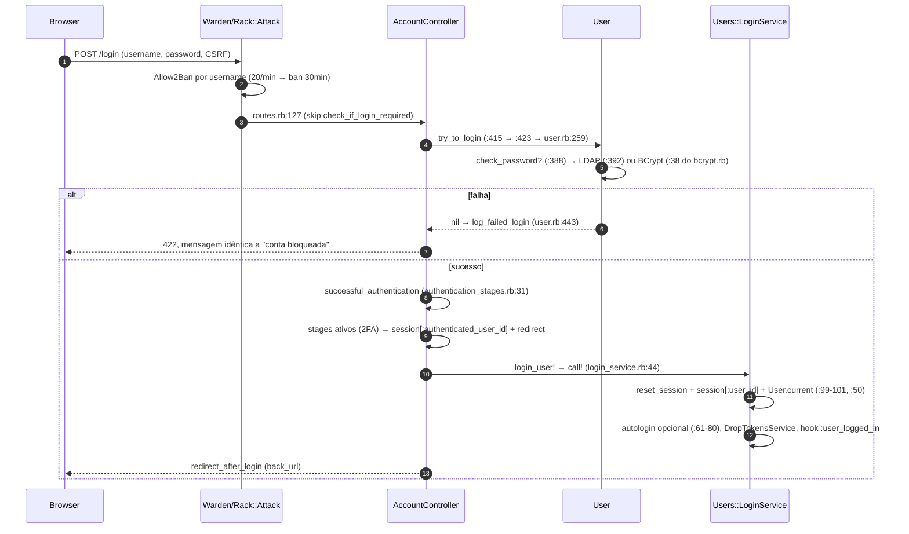
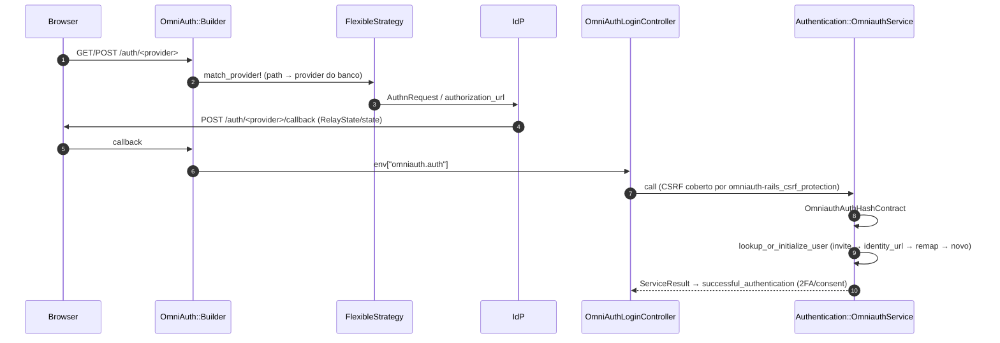

# OpenProject — engenharia do backend (Rails)

> Camada 2: implementação. Complementa `openproject-data-model.md` (entidades, permissões,
> enums) e `openproject-ui-ux.md` (views e shell). Aqui: stack, ciclo de request,
> autenticação, schema físico, domínio, consultas, concorrência, assíncrono, API,
> segurança, performance e testes. Fonte `_REF/openproject`; toda afirmação tem
> `caminho:linha`; dedução está marcada `[INFERENCE]`.

## 1. Stack exato

| Item | Valor | Evidência |
|---|---|---|
| Ruby | 4.0.9 | `.ruby-version:1`; `Gemfile.lock:2366` |
| Rails | `~> 8.1.3` (lock 8.1.4), `load_defaults 6.1` | `Gemfile:42`; `Gemfile.lock:1254`; `config/application.rb:63` |
| Bundler | 4.0.21 | `Gemfile.lock:2369` |
| Node / npm | `^24.22.1` / `^11.12.0` | `package.json:13-16` |
| App server | Puma 8.0.2, cluster + `preload_app!` | `Gemfile:189`; `config/puma.rb:35-61` |
| Banco | PostgreSQL 17 (único suportado; MySQL aborta o boot) | `docker-compose.yml:116`; `config/initializers/03-db_check.rb` |
| Cache externo | memcached (dev) ou memcache/redis (prod); default `file_store` | `docker-compose.yml:140`; `config/constants/settings/definition.rb:953-958` |
| Fila | GoodJob 4.19.4 no Postgres | `Gemfile:123`; `config/application.rb:201` |
| Schema | `schema_format = :sql` (sem dump versionado) | `config/application.rb:190` |
| Deploy | 4 processos: `web`, `worker`, `backup`, `check` | `Procfile` |

Não há Sidekiq, DelayedJob, Resque nem ActionCable. Redis existe só como opção de cache
(`Gemfile:176-180`, `config/constants/settings/definition.rb:271-273`) — nunca como broker.

**Gems estruturantes**: `warden 1.2.9` + `warden-basic_auth` (`Gemfile:56-57`),
`doorkeeper 5.9.9` (`:51`), `omniauth 2.1.4` + `omniauth-rails_csrf_protection` (`:52-53`),
`grape 4.0.1` + `roar` (`:383-385`), `activerecord-session_store` (`:40`),
`bcrypt` + `openproject-token` (`:119,204`), `disposable` + `dry-validation` (`:395,217`),
`with_advisory_lock` (`:412`), `paper_trail` + `statesman` (`:161,164`),
`carrierwave` + `carrierwave_direct` + `fog-aws` + `ssrf_filter` (`:195-202`),
`op-clamav-client` (`:168`), `rack-attack` (`:131`), `pagy`/`will_paginate` (`:59-60`),
`view_component` + `turbo-rails` + `turbo_power` (`:239,251-252`),
`lograge` + `okcomputer` + `appsignal` + `yabeda-*` (`:140,137,223-229`).

**Montagem**: `require "rails/all"` + `Bundler.require(*Rails.groups(:opf_plugins))`
(`config/application.rb:42`); `Gemfile.modules` registra 32 engines em `modules/`
(`Gemfile.modules`; `ls modules` = 32); plugins core são carregados por `eval` de `init.rb` em
`config/initializers/00-load_plugins.rb`; `lib_static` entra em `autoload_once_paths`
(`config/application.rb:140`) — patches ali **nunca** são recarregados.

## 2. Bootstrap e ciclo de request/resposta

### 2.1 Middleware na ordem efetiva

Base = padrão do Rails 8.1 (`[INFERENCE]`, não há reordenação global); posições abaixo são
verificáveis:

| # | Middleware | Registro | Âncora |
|---|---|---|---|
| 1 | `Rack::Cors` | `config/initializers/rack-cors.rb:30` | `insert_after Rails::Rack::Logger`; só `/api/v3*` e `/oauth/*`, `credentials: true` |
| 2 | `Rack::Timeout` | `config/initializers/rack_timeout.rb:39-46` | `insert_before Rack::Runtime`, só se `web_workers >= 2` |
| 3 | `Session::ActiveRecordStore` | `config/initializers/session_store.rb:43` | posição padrão (após `Cookies`) |
| 4 | `ContentSecurityPolicy::Middleware` | `config/initializers/content_security_policy.rb:37-39` | padrão |
| 5 | `OpenProject::Authentication::Manager` (Warden) | `config/initializers/warden.rb:61` | `use` |
| 6 | `Rack::Attack` | `config/application.rb:126` | `use` |
| 7 | `Rack::TempfileReaper` | `config/application.rb:129` | `use` |
| 8 | `Rack::Deflater` | `config/application.rb:117-124` | `insert_before Rack::ETag`; não deflate `application/x-gzip` |
| 9 | `OmniAuth::Builder` | `config/initializers/omniauth.rb:40` | `use`, intercepta `/auth/*` antes do router |

Consequências: `OmniAuth` roda depois de Warden e antes do router — por isso
`config/routes.rb:82` é um proc que devolve 404 (fallback); `Rack::Attack` (posição 6) não vê
`User.current` e discrimina por form/header/cookie (`lib/open_project/rate_limiting/base.rb:110-130`).

### 2.2 Pipeline do controller

```ruby
layout "base"          # app/controllers/application_controller.rb:70
protect_from_forgery   # :72
before_action :authorization_check_required, :user_setup, :set_localization,
              :tag_request, :check_if_login_required, :log_requesting_user,
              :check_session_lifetime, :stop_if_feeds_disabled,
              :set_cache_buster, :action_hooks, :reload_mailer_settings!   # :158-168
```

| Etapa | Efeito |
|---|---|
| `authorization_check_required` | falha alto se a action não declarou `authorize`/`no_authorization_required!` (`app/controllers/concerns/accounts/authorization.rb:33-49`) |
| `user_setup` | `User.current = find_current_user` (`.../current_user.rb:45-47`) |
| `find_current_user` | API key → sessão → autologin cookie → RSS key (`:60-75`) |
| `set_localization` | locale do usuário → `Accept-Language` → default; usa `session[:authenticated_user_id]` (2FA em curso) (`app/controllers/application_controller.rb:242-252`) |
| `check_session_lifetime` | TTL de inatividade com refresh amortizado (`.../session_lifetime.rb:47-60`) |
| `handle_unverified_request` | CSRF inválido: apaga autologin, `logged_user = nil`, 422 salvo `api_request?` (`:92-134`) |

**`User.current` não usa `CurrentAttributes`** — vive em `RequestStore`:

```ruby
# app/models/user.rb:587-592
def self.current=(user) = RequestStore[:current_user] = user
def self.current = RequestStore[:current_user] || User.anonymous
```

`anonymous` e `system` são linhas reais em `users` (`:641-646`); `User.execute_as` troca
usuário **e** locale/timezone (`:595-601`, `lib/open_project/locale_helper.rb:29-40`).

**Escrita em dois filtros**: `PermittedParams` (702 linhas, `app/models/permitted_params.rb:28-63`)
filtra o form HTML; `BaseContract#reduce_by_writable_permissions`
(`app/contracts/base_contract.rb:247-262`) remove atributos sem permissão antes de persistir —
mesmo caminho para HTML e API.

**Resposta**: HTML+Turbo (`respond_with_turbo_streams`,
`app/controllers/work_packages_controller.rb:156,190-197`; `turbo_frame_request?` em `:82-88`),
API em `application/hal+json` (`lib/api/root.rb:30-34`), exceções via `exceptions_app = routes`
(`config/application.rb:151`).

## 3. Autenticação e sessão

### 3.1 Camadas

| Camada | Arquivo | Papel |
|---|---|---|
| Warden | `lib_static/open_project/authentication/manager.rb:38-71` | escopos `api_v3`, `scim_v2`, `mcp`; `default_strategies :session` |
| Registro | `config/initializers/warden.rb:32-59` | 8 strategies + ordem por escopo |
| HTML | `app/controllers/concerns/accounts/*.rb` | login/logout/2FA/stages |
| API | `lib/api/root_api.rb:71-81` | `warden.authenticate!` |

```ruby
# config/initializers/warden.rb:41-59
API_V3,    store: false → [:global_basic_auth, :user_basic_auth, :basic_auth_failure,
                            :user_api_token, :oauth, :jwt_oidc, :session, :anonymous_fallback]
SCIM_V2,   store: false → [:oauth, :jwt_oidc]
MCP_SCOPE, store: false → [:user_api_token, :oauth, :jwt_oidc, :user_basic_auth,
                            :basic_auth_failure, :session]
```

`store: false` em todos os escopos de API: autenticar não grava usuário na sessão.

### 3.2 Métodos

| Método | Arquivo | Fluxo |
|---|---|---|
| Senha | `app/controllers/account_controller.rb:423` | bcrypt via `UserPassword::Bcrypt` (`app/models/user_password/bcrypt.rb:38-42`) |
| Sessão | `.../warden/session.rb:39-72` | `session[:user_id]`; não-GET exige `Sec-Fetch-Site: same-origin` (ou `X-Requested-With` só sem HTTPS) |
| Autologin cookie | `app/controllers/concerns/accounts/current_user.rb:83-97` | `Token::AutoLogin` |
| Bearer API token | `.../user_api_token.rb:38-70` | prefixo + `Token::API.find_by_plaintext_value` |
| Basic `apikey:<token>` | `.../user_basic_auth.rb:38-52` | exige `apiv3_enable_basic_auth?` |
| Basic global (admin) | `.../global_basic_auth.rb:38-90` | credenciais de `configuration.yml`, recusa colidir com `apikey` |
| OAuth2 provider | `.../doorkeeper_oauth.rb:38-79` | Bearer não-JWT; checa expirado/revogado/app desabilitada/escopo |
| JWT OIDC | `.../jwt_oidc.rb:38-93`; `.../jwt_parser.rb:34-72` | alg RS256/384/512, issuer→provider no banco, JWKS por `kid`, `aud`/`exp` |
| LDAP | `app/models/ldap_auth_source.rb:126-140` | bind direto + criação on-the-fly (`app/models/user.rb:305-314`) |
| SAML | `modules/auth_saml/lib/open_project/auth_saml/engine.rb:37-80` | providers no banco, `RelayState` carrega back_url |
| OIDC consumidor | `modules/openid_connect/lib/open_project/openid_connect/engine.rb:52-98` | providers no banco, backchannel logout |
| Header SSO | `app/controllers/concerns/auth_source_sso.rb:34-72` | `login:$secret` vindo do proxy |
| SCIM | `config/initializers/scimitar.rb:38-72` | escopo `scim_v2` + `ServiceAccount` de `ScimClient` |
| Convite/recovery | `app/controllers/account_controller.rb:140,163` | `Token::Recovery`/`Token::Invitation` por plaintext |
| 2FA | `modules/two_factor_authentication/.../engine.rb:78` | stage pós-senha (TOTP, WebAuthn, SMS, backup) |

Não existe impersonation no core; só o flag `oauth.client_credentials_impersonation`
(`app/forms/oauth/applications_form.rb:95`).

### 3.3 Login por senha



Detalhes: senha vazia nunca loga (`app/models/user.rb:259-262`); a mensagem de erro é igual
para senha errada e bloqueio quando `brute_force_block_after_failed_logins > 0`
(`app/controllers/concerns/accounts/user_login.rb:69-75`); `reset_session` no login previne
fixation e `drop_old_sessions_on_logout?` apaga todas as sessões do usuário
(`app/services/users/logout_service.rb:38-48`); `disable_api` bloqueia POST de login
classificado como API, evitando **login CSRF** (`app/controllers/account_controller.rb:58,476-481`).

### 3.4 OIDC / SAML



Evidências: `modules/auth_plugins/lib/omni_auth/flexible_strategy.rb:36-70`;
`app/controllers/omni_auth_login_controller.rb:38-46` (skips de CSRF e `user_setup`);
`app/services/authentication/omniauth_service.rb:48-75,139-152`. SLO: OIDC usa
`end_session_endpoint` e backchannel (`.../openid_connect/engine.rb:78-90`), SAML usa
`idp_slo_service_url` com `saml_session_index` (`.../auth_saml/engine.rb:66-78`), disparado em
`app/controllers/concerns/accounts/current_user.rb:131-150`.

### 3.5 Política de senha, bloqueio e rate limit

| Controle | Default | Evidência |
|---|---|---|
| Mínimo 10 (máx 128) | — | `.../definition.rb:924-928`; `app/models/setting.rb:33` |
| Regras | lowercase+uppercase+numeric+special (todas) | `.../definition.rb:882-886`; `lib/open_project/passwords.rb:76-86` |
| Expiração | 0 dias (off) | `.../definition.rb:892-895` |
| Bloqueio por conta | 20 falhas / 30 min | `.../definition.rb:247-255`; `app/models/user.rb:435-441` |
| `/login` | 20 req/min por username → ban 30 min | `lib/open_project/rate_limiting/login.rb:44-66` |
| `lost_password` | 3/hora por e-mail **off** | `.../lost_password.rb:39-55` |
| API `/form` | 6 req/3 s **off** | `.../api_v3.rb:33-42` |
| Registro | por IP/hora, condicionado | `.../registration.rb:38-55` |
| TTL de sessão | off; 120 min se ligado | `.../definition.rb:1224-1229` |
| Bcrypt cost | default da gem, mín. 8 | `config/initializers/bcrypt.rb:1-12` |
| Modo de login | `all`/`except_sso`/`none` + bypass | `app/models/users/password_login.rb:52-84` |

`Rack::Attack` é reconstruído em `to_prepare` (`config/initializers/rack-attack.rb:30-52`).

## 4. Schema físico

### 4.1 Padrão de migrations

Sem `schema.rb`/`structure.sql` versionado, com `schema_format = :sql`
(`config/application.rb:190`). 99 arquivos em `db/migrate/tables/*.rb` descrevem tabelas em
classes Ruby (`db/migrate/tables/base.rb:32-44`); `db/migrate/1000016_aggregated_migrations.rb:29-36`
carrega todos e executa via `SquashedMigration`. O squasher decide entre criar ou apagar
versões de `schema_migrations` (`db/migrate/migration_utils/migration_squasher.rb:40-70`),
e o agregado tem `down` irrecuperável (`db/migrate/migration_utils/squashed_migration.rb:75-78`).
Restam 191 migrations datadas (`ls db/migrate/*.rb` = 191). Extensões: `pg_trgm`, `btree_gist`, `unaccent`, collation
`versions_name` (`db/migrate/1000016_aggregated_migrations.rb:32-36`). Em produção, migration
pendente aborta o boot (`config/initializers/06-pending_migrations_check.rb:31-33`).

### 4.2 DDL resumido

**`work_packages`** (`db/migrate/tables/work_packages.rb:31-61`)

```ruby
t.references :type, :project, :status, null: false, index: true,
             foreign_key: {on_delete: :cascade}          # 3 FKs reais
t.string  :subject, default: "", null: false
t.text    :description
t.date    :due_date, :start_date                       # ambos indexados
t.bigint  :category_id, :assigned_to_id, :priority_id, :version_id,
          :author_id(null:false), :parent_id, :responsible_id   # índices, SEM FK
t.integer :lock_version, default: 0, null: false       # optimistic locking
t.integer :done_ratio, :duration, :derived_done_ratio
t.float   :estimated_hours, :derived_estimated_hours, :derived_remaining_hours
t.boolean :schedule_manually, default: true, null: false
t.boolean :ignore_non_working_days, default: false, null: false
t.index %i[project_id updated_at]
t.index :schedule_manually, where: :schedule_manually
t.check_constraint "due_date >= start_date", name: "work_packages_due_larger_start_date"
```

Extra: `identifier` único + `[project_id, sequence_number]`
(`db/migrate/20260330100000_create_work_package_semantic_ids.rb:50-56`), GIN trigram em
`subject` (`db/migrate/20260911142735_add_gin_trigram_index_to_work_packages_subject.rb:38`).

**`journals`** (`db/migrate/tables/journals.rb:31-58`) — snapshot por versão:

```ruby
t.references :journable, polymorphic: true, index: false
t.bigint :user_id, null: false, index: true
t.text :notes;  t.integer :version, default: 0, null: false
t.references :data, polymorphic: true, null: false     # → work_package_journals etc.
t.jsonb :cause, default: {};  t.tstzrange :validity_period
t.boolean :restricted, default: false, null: false
t.index %i[journable_type journable_id version], unique: true
t.index %i[data_id data_type], unique: true
t.index :notes, using: "gin", opclass: :gin_trgm_ops
t.exclusion_constraint "journable_id WITH =, journable_type WITH =, validity_period WITH &&",
                       using: :gist, deferrable: :immediate
```

**`work_package_journals`** (`db/migrate/tables/work_package_journals.rb:31-55`): cópia
colunar (`type_id, project_id, subject, description, due_date, status_id, assigned_to_id,
priority_id, version_id, author_id, done_ratio, estimated_hours, start_date, parent_id,
responsible_id, derived_*, schedule_manually, duration, ignore_non_working_days`), sem
timestamps nem FKs. Só colunas aqui presentes são journalizadas
(`app/services/journals/create_service.rb:126-135`).

**`projects`** (`db/migrate/tables/projects.rb:31-50`): `name`, `public` (default true),
`parent_id`, `identifier not null`, `lft/rgt` (nested set), `active` (indexado),
`templated`, `status_code`, `settings jsonb default {}`; `UNIQUE (LOWER(identifier))` e
índice `[lft,rgt]`.

**`users`** (`db/migrate/tables/users.rb:31-56`): `login(256)`, `firstname/lastname/mail`,
`admin`, `status int default 1`, `language(5)`, `ldap_auth_source_id`, `type` (STI),
`identity_url`, `first_login`, `force_password_change`, `failed_login_count`,
`last_failed_login_on`, `consented_at`; índices `[id,type]`, `[type]`, `[type,login]`,
`[type,status]` e **unique parcial** de `lastname` para `Group`/`PlaceholderUser`.

**`members` / `roles` / `role_permissions`**

```ruby
# members (db/migrate/tables/members.rb:31-48)
t.references :user, null: false;  t.references :project, null: true
t.references :entity, polymorphic: true, foreign_key: false     # shares por WP
t.index %i[user_id project_id], unique: true,
        where: "entity_type IS NULL AND entity_id IS NULL"
t.index %i[user_id project_id entity_type entity_id], unique: true,
        where: "entity_type IS NOT NULL AND entity_id IS NOT NULL"
# roles (roles.rb:31-40)
t.string :name, default: "", null: false
t.integer :builtin, default: 0, null: false   # 0 normal, 1 non_member, 2 anonymous
t.string :type, limit: 30, default: "Role"
# role_permissions (role_permissions.rb:31-39)
t.string :permission;  t.bigint :role_id;  t.index :role_id   # sem unique, sem FK
```

**`queries` / `views`** (`db/migrate/tables/queries.rb:31-58`; `views.rb:31-40`)

```ruby
# queries
t.bigint :project_id, :user_id (null: false);  t.string :name, null: false
t.text :filters, :column_names, :sort_criteria;  t.string :group_by
t.boolean :display_sums, default: false, null: false
t.boolean :timeline_visible, :show_hierarchies, :starred    # tri-state
t.boolean :include_subprojects, null: false, default: nil   # default nulo explícito
t.string :timestamps                                        # coluna herdada
t.index :project_id;  t.index :user_id;  t.index :updated_at
# views
t.references :query, null: false, foreign_key: true, index: {unique: true}
t.jsonb :options, default: {}, null: false;  t.string :type, null: false
```

**`custom_fields` / `custom_values`** (`db/migrate/tables/custom_fields.rb:31-57`;
`custom_values.rb:31-48`): `type`/`field_format` (STI + formato), `regexp`,
`min_length/max_length`, `is_required`, `is_for_all`, `is_filter`, `position`,
`searchable`, `multi_value`, `default_value`, `custom_field_section_id`; valores em
`(customized_type, customized_id, custom_field_id, value text)` com GIN trigram em `value`
e **sem unique** no trio.

**`attachments`** (`db/migrate/tables/attachments.rb:31-56`): `container_id/type`,
`filename`, `disk_filename`, `filesize bigint`, `content_type`, `digest(40)`,
`downloads default 0`, `author_id`, `file` (fog), `fulltext`, `fulltext_tsv`/`file_tsv`
(GIN), `status int default 0` (`app/models/attachment.rb:33-43`).

**`notifications`** (`db/migrate/tables/notifications.rb:31-53`): `subject`, `read_ian`,
`reason smallint` (14 valores — `app/models/notification.rb:31-48`), `recipient_id` FK,
`actor_id` FK, `resource` polimórfico, `journal_id` FK `on_delete: :cascade`,
`mail_reminder_sent`/`mail_alert_sent`. Sem unique por `(recipient, resource, journal)`.

**Outras**: `enabled_modules(project_id idx, name idx)` sem unique
(`enabled_modules.rb:31-39`); `watchers` com unique `[user_id, watchable_type, watchable_id]`
(`db/migrate/20260130105057_add_uniqueness_for_watchers_table.rb:43`); `relations` com
`from_id/to_id` **integer** e unique nos dois sentidos (`relations.rb:31-45`);
`ordered_work_packages(position, query_id, work_package_id)` com FKs cascade
(`ordered_work_packages.rb:31-40`).

### 4.3 Desnormalizações e ausência de soft delete

- Colunas derivadas em `work_packages` (`derived_estimated_hours`, `derived_remaining_hours`,
  `derived_done_ratio`, `duration`, `start_date`) recalculadas em Ruby
  (`app/services/work_packages/set_attributes_service.rb:104-120`).
- **Sem `counter_cache`** para work packages; só `Comment` (`app/models/comment.rb:31`) e
  `Message` (`app/models/message.rb:36`).
- Fecho de hierarquia materializado em `work_package_hierarchies`
  (`ancestor_id, descendant_id, generations`, unique triplo) via `closure_tree`
  (`app/models/work_package.rb:174-176`).
- Ordem manual em `ordered_work_packages` por `(query, work_package)`.
- Journal é **snapshot completo**, não diff; diffs são calculados comparando snapshots.
- **Sem `deleted_at`** nas tabelas centrais: `WorkPackage` usa `destroy` + `paper_trail`
  (`app/models/work_package.rb:178`), e `users.status` modela locked/invited/active.
- Integridade parcial: existem FKs em `work_packages`(tipo/projeto/status), `notifications`,
  `ordered_work_packages`; **não** existem em `members.user_id`,
  `role_permissions.role_id`, `custom_values.*`, `watchers.*`, `relations.from_id/to_id`.

## 5. Camada de domínio

**Serviços** herdam `BaseServices::BaseContracted` e rodam um pipeline fixo
(`app/services/base_services/base_contracted.rb:54-70`):

```ruby
validate_params → before_perform → validate_contract → after_validate
→ persist → after_persist → after_perform
```

`service_context` (`app/services/shared/service_context.rb:34-70`) abre
`with_advisory_lock_transaction(model)` + transação, faz `User.execute_as` e reverte com
`raise ActiveRecord::Rollback` em falha. Ou seja: **todo service com modelo é serializado
por advisory lock do Postgres**.

**Contracts**: `ModelContract#valid?` roda `model.valid?` **e** o contract, acumulando erros
no modelo (`app/contracts/model_contract.rb:85-95`); permissões por atributo são declaradas
no contract e o que não é gravável é removido (`app/contracts/base_contract.rb:247-262`).

**Journaling**: `after_save :save_journals` (`.../acts/journalized/save_hooks.rb:52-75`)
chama `Journals::CreateService`, que roda **uma query com CTEs** para comparar estado atual
vs. último snapshot, criar `journals` + linha de dados + `attachable_journals`/
`customizable_journals` e devolver o snapshot
(`app/services/journals/create_service.rb:55-75,116-140,206`). Agregação por tempo/usuário/
causa é configurável (`journal_aggregation_time_minutes`, default 5 —
`config/constants/settings/definition.rb:743-746`) e o e-mail é adiado
(`app/workers/journals/completed_job.rb:33-46`).

**Work package**: cálculo em serviço, não em callback
(`app/services/work_packages/set_attributes_service.rb:104-120`): defaults → unificação de
milestone → `shift_dates_to_soonest_working_days` → duração → data derivável (`:183`) →
progresso → atributos dependentes do projeto → status inválido após troca de tipo.
`SetScheduleService` propaga datas por relações e ancestrais em ordem topológica
(`app/services/work_packages/set_schedule_service.rb:44-80`).

**Workflow** é validação de contrato, não state machine de status:
`validate_status_transition` (`app/contracts/work_packages/base_contract.rb:166`) consulta
`Workflow` filtrado por tipo, status origem, papéis do usuário, autor e assignee
(`:725-757`). `statesman` (`Gemfile:164`) serve outras máquinas.

## 6. Consultas server-side

```ruby
# app/models/query.rb:415-427
def statement
  statement_filters.map { |filter| "(#{filter.where})" }.compact_blank.join(" AND ")
end
def results = Results.new(self)

# app/models/query/results.rb:59-110
sorted_work_packages.merge(filtered_work_packages.merge(filter_merges)).visible
# filtered_work_packages = work_package_scope.joins(all_filter_joins).where(query.statement)
# sorted_work_packages   = work_package_scope.joins(sort_criteria_joins)
#                                          .joins(query.group_by_join_statement)
#                                          .order(order_option).order(sort_criteria_array)
# work_package_scope     = WorkPackage.eager_load(all_includes)
```

- `where(query.statement)` é **SQL montado por string** a partir dos filtros; cada filtro
  declara `joins`/`includes` (`app/models/queries/work_packages/filter/status_filter.rb:54-56`).
- `eager_load` (não `includes`) para tudo que ordena/agrupa/filtra — evita N+1 e produz
  joins largos (`app/models/query/results.rb:108-140`).
- Sem ordem determinística, `apply_orders` injeta `id DESC`
  (`app/models/queries/base_query.rb:211-222`) — requisito de paginação estável.
- Aliases de tabela em ORDER BY são reconciliados manualmente
  (`app/models/query/results.rb:142-200`).

**Escopo de permissão** — `WorkPackage.visible` = `allowed_to(user, :view_work_packages)`
(`app/models/work_package.rb:86`); três estratégias
(`app/models/work_packages/scopes/allowed_to.rb:38-80`): admin → `id IN (subquery com
enabled_modules)`; anônimo → `project_id IN Project.allowed_to`; logado → **duas queries**
(`Project.allowed_to_member_union(...)` + `pluck` + `WHERE project_id IN (…) OR id IN (…)`),
porque subquery não é otimizada de forma confiável pelo Postgres (`:73-78`).
`allowed_to_member_union` é `UNION ALL` de memberships e builtin roles
(`app/models/projects/scopes/allowed_to.rb:53-90`).

**Grupos e somas**: `GroupBy` roda segundo SELECT com
`COUNT(DISTINCT work_packages.id)` (`app/models/query/results/group_by.rb:48-70`);
`Sums` monta SQL cru por coluna e executa em `connection.uncached`
(`app/models/query/results/sums.rb:63-80`). `display_sums` é coluna persistida.

**Paginação**: HTML com `will_paginate` (`.page().per_page()`,
`app/controllers/work_packages_controller.rb:373-381`); API com
`OffsetPaginatedCollection` (`offset`/`pageSize` + links `jumpTo`/`changeSize`/
`previousByOffset`/`nextByOffset`, `lib/api/decorators/offset_paginated_collection.rb:39-110`),
evitando `count` extra (`:110-130`).

**Ordenação manual**: `LEFT OUTER JOIN ordered_work_packages … AND query_id = :query_id`
com sanitização (`app/models/queries/work_packages/common/manual_sorting.rb:36-52`).

## 7. Escrita e concorrência

| Camada | Mecanismo | Evidência |
|---|---|---|
| Banco | `READ COMMITTED` fixado por sessão | `config/initializers/enforce_isolation_level.rb:34-48` |
| Aplicação | advisory lock por registro + transação | `lib/open_project/mutex.rb:58-78`; `app/services/shared/service_context.rb:42-50` |
| Registro | optimistic locking (`lock_version`) | `db/migrate/tables/work_packages.rb:44`; `app/contracts/work_packages/update_contract.rb:62-67` |

`lock_version` é exposto na API
(`lib/api/v3/work_packages/work_package_representer.rb:336-339`) e
`ActiveRecord::StaleObjectError` → **409 Conflict** (`lib/api/root_api.rb:303-304`).

**Por que advisory lock**: o comentário em `lib/open_project/mutex.rb:36-57` explica que
dois workers podem criar journals a partir de snapshots e `SELECT … FOR UPDATE` ainda
permitiria leituras concorrentes, gerando journals que "apagam" anexos do outro. O lock é
`mutex_on_<Classe>_<id>` e envolve a transação inteira.

**Anexos** (3 fases): `POST /attachments/prepare` cria `status: prepared`
(`app/services/attachments/prepare_upload_service.rb:31-44`); o browser faz PUT direto no S3
com policy assinada (`app/uploaders/direct_fog_uploader.rb:66-90`); `GET
/attachments/:id/uploaded` dispara `FinishDirectUploadJob`
(`lib/api/v3/attachments/attachments_api.rb:66-73`), que faz `attachment.lock!`, confere
`prepared?` e existência do staged, grava e journaliza o container
(`app/services/attachments/finish_direct_upload_service.rb:79-93`). Segundo `finish` falha
com "already been completed" (`:79-86`). Local: `store_dir = <classe>/<mounted_as>/<id>`
(`app/uploaders/local_file_uploader.rb:47-52`).

**Idempotência de jobs**: `upsert_status` com retry em `RecordNotUnique`
(`modules/job_status/.../application_job_with_status.rb:60-86`); concorrência declarativa
`good_job_control_concurrency_with(perform_limit: 1, key: …)`
(`app/workers/work_packages/progress/job.rb:37-47`); debounce de 4 s por chave em
`RequestStore` (`app/workers/debounceable_job.rb:36-45`).

## 8. Assíncrono e tempo real

`config.active_job.queue_adapter = :good_job`, `execution_mode :external`,
`preserve_job_records = true`, cron e threads vindos de `Setting`/ENV
(`config/application.rb:201-215`). Prioridades nomeadas: high 0, notification 5,
above_normal 7, default 10, below_normal 13, low 20 (`app/workers/job_priority.rb:35-50`).

**112 arquivos em `app/workers`**:

| Grupo | Jobs |
|---|---|
| Export | `Exports::ExportJob`, `WorkPackages::ExportJob`, `Projects::ExportJob` (`app/workers/exports/export_job.rb:33-45`) |
| Bulk | `WorkPackages::BulkJob`, `BulkMoveJob`, `BulkCopyJob` |
| Progresso/datas | `Progress::Job`, `ApplyWorkingDaysChangeJob` (`perform_limit: 1`) |
| E-mail/journal | `Journals::CompletedJob`, jobs `Mails::*`, `Reminders::ScheduleReminderJob` |
| Notificações | `Notifications::{CreateDateAlerts,ScheduleDateAlerts,ScheduleReminderMails,Workflow}Job` |
| Anexos | `ExtractFulltextJob`, `VirusScanJob`, `VirusRescanJob`, `CleanupUncontaineredJob`, `FinishDirectUploadJob` |
| SCM | `Scm::{Create,Delete,Relocate}RepositoryJob`, `StorageUpdaterJob` |
| Import | 22 `Import::Jira*Job` (staged + revert) |
| Manutenção | `Cron::{ClearOldSessions,ClearTmpCache,ClearUploadedFiles,ClearOutboundMailRecipients}Job`, `OAuth::CleanupJob`, `PaperTrailAudits::CleanupJob` |
| Outros | `CopyProjectJob`, `BackupJob`, `Principals::DeleteJob`, `Projects::DeleteProjectJob`, `ProjectIdentifiers::*` |

Cron com 12 entradas em `config/initializers/cronjobs.rb:32-75` (ex.:
`ScheduleDateAlertsNotificationsJob` a cada 15 min, `Ldap::SynchronizationJob` diário).

**Não há WebSocket**: ActionCable está comentado (`config/environments/production.rb:83-85`).
Atualização é polling: notificações a cada 60 s (`config/constants/settings/definition.rb:857-860`,
consumido em `lib/redmine/menu_manager/top_menu_helper.rb:137`) e aba de atividades a cada
10 s (`.../definition.rb:1477-1481`; `app/components/work_packages/activities_tab/lazy_index_component.rb:126-127`).
Mutação de UI usa Turbo Streams (`Gemfile:251-252`) e edição colaborativa usa Hocuspocus,
com host injetado no CSP (`app/controllers/concerns/dynamic_content_security_policy.rb:31-60`).

**Webhooks** (`modules/webhooks`): URL validada, secret por webhook, N:N com projetos
(`modules/webhooks/app/models/webhooks/webhook.rb:31-70`); job por tipo, com
`retry_on Timeout::Error/Faraday::TimeoutError`, `attempts: 3`
(`modules/webhooks/app/workers/webhook_job.rb:28-40`); assinatura
`X-OP-Signature: sha1=HMAC_SHA1` (`.../represented_webhook_job.rb:56-60`); payload
serializado como `User.system` para respeitar visibilidade de custom fields (`:89-93`);
entrega via `OpenProject::SsrfProtection.post`
(`modules/webhooks/app/services/webhooks/outgoing/request_webhook_service.rb:45`).

## 9. Busca, arquivos, cache, i18n, e-mail

**Busca**: por entidade, 6 fontes (`config/initializers/search.rb:30-38`). Texto usa
full-text do Postgres — `<col>_tsv @@ to_tsquery(?, language)` com tokenização e allow-list
(`lib/open_project/full_text_search.rb:33-45`), stemming por `main_content_language` (`:39`).
Fallback/typeahead em `ILIKE` com escape central (`lib/open_project/sql_sanitization.rb:53`)
e índices GIN trigram em `work_packages.subject`, `custom_values.value`, `journals.notes`,
`attachments.fulltext_tsv`. Sem OpenSearch/Elastic.

**Arquivos**: CarrierWave com `LocalFileUploader`, `FogFileUploader`, `DirectFogUploader`;
S3 configurado em `config/initializers/carrierwave.rb:36-58` (`max_put_chunk_size: 100 MB`).
MIME é detectado pelo **conteúdo** com `file`
(`lib/open_project/content_type_detector.rb:79-101`); download normaliza texto para
`text/plain` (`app/models/attachment.rb:126-131`).

**Cache**: Rails.cache em `file_store`/`mem_cache_store`/`redis_cache_store`
(`.../definition.rb:953-958`; `lib_static/open_project/configuration.rb:70-100`) com
serializer MessagePack **estrito**, que recusa o fallback para `Marshal`
(`lib_static/open_project/configuration.rb:42-58`). `Setting` usa `RequestStore` + cache
versionado e advisory lock no primeiro read (`app/models/setting.rb:138-230,190-250`).
Permissões por request: `Users::ProjectAuthorizationCache`
(`app/models/users/project_authorization_cache.rb:29-58`). Providers SSO usam
`OpenProject::ConfidentialCache` (`modules/auth_saml/.../engine.rb:34-40`).

**i18n**: locales do Crowdin em `config/locales/crowdin/*` (`config/application.rb:157`),
default `:en` com fallback (`:159-161`), `PluralizationBackend` + `Fallbacks`
(`config/initializers/i18n.rb:1-44`), `i18n-js` para o frontend
(`config/initializers/i18n-js.rb:34`) e `raise_on_missing_translations` em dev/test
(`config/application.rb:172-180`).

**E-mail**: mailers enfileiram (`Mails::DeliverJob`, `Mails::MailerJob`); `Setting` é
recarregado por request (`reload_mailer_settings!` —
`app/controllers/application_controller.rb:203-205`); limite de destinatários em
`lib/open_project/mail_recipient_limit.rb`.

## 10. Contrato de API (`/api/v3`)

| Aspecto | Implementação | Evidência |
|---|---|---|
| Framework | Grape montado em `/api`, versão por path | `config/routes.rb:158`; `lib/api/root.rb:44-47` |
| Mídia | `application/hal+json` default; parser JSON próprio | `lib/api/root.rb:30-34` |
| Erros | `ErrorRepresenter` (`_type: "Error"`, `errorIdentifier` = `urn:openproject-org:api:v3:errors:<id>`) | `lib/api/v3/errors/error_representer.rb:34-60`; `lib/api/v3.rb:30-42` |
| Mapeamento | 404/409/401+`WWW-Authenticate`/400/500 (500 só em produção) | `lib/api/root_api.rb:303-328` |
| Auth | `warden.authenticate! scope: authentication_scope` | `lib/api/root_api.rb:71-81` |
| Sessão | `request.session_options[:skip] = true` | `:95-97` |
| Content-Type | exigido em POST/PUT/PATCH; 406 se errado | `:99-118` |
| Paginação | offset/pageSize + links templated | `lib/api/decorators/offset_paginated_collection.rb:39-110` |
| Capabilities | derivado de ações ∪ `role_permissions` ∪ `enabled_modules` por SQL | `app/models/capability.rb:30-38`; `app/models/capabilities/scopes/default.rb:37-56` |
| Versionamento | `/api/v2` → **410 Gone** | `config/routes.rb:65` |
| CORS | só `/api/v3*` e `/oauth/*` | `config/initializers/rack-cors.rb:30-45` |
| Descoberta | `/api/v3/openapi.json` + `Link: rel="service-desc"` | `lib/api/v3/root.rb:44-48,109-118` |
| MCP | `/mcp`, escopo próprio | `config/routes.rb:54`; `config/initializers/warden.rb:56-58` |

Endpoints são gerados por `API::Utilities::Endpoints::{Index,Show,Create,Update,Delete}`, que
deduzem representer e service a partir do modelo (`lib/api/utilities/endpoints/index.rb:28-56`);
erros de serviço viram `MultipleErrors` mesclando erros de dependentes
(`lib/api/utilities/endpoints/modify.rb:57-90`).

## 11. Segurança — achados

**Bem resolvido**: CSRF global com tratamento explícito sem vazar erro para API
(`app/controllers/application_controller.rb:72,92-134`); `Sec-Fetch-Site` obrigatório em
métodos não-GET (`.../warden/session.rb:43-56`); cookie `httponly` + `same_site: :lax` +
`secure` com HTTPS (`config/initializers/session_store.rb:34-41`); `reset_session` em
login/logout (`app/services/users/login_service.rb:99-101`); cookies assinados em JSON
(`config/initializers/cookies_serializer.rb:12`); Doorkeeper com `force_pkce`,
`hash_token_secrets`, `hash_application_secrets`, `enforce_configured_scopes`
(`config/initializers/doorkeeper.rb:89-94,120,133-135`); JWT com allow-list de algoritmo e
issuer→provider (`modules/openid_connect/app/services/openid_connect/jwt_parser.rb:34-72`);
download com `Content-Disposition` + `nosniff` (`lib/api/helpers/attachment_renderer.rb:98-112`)
e quarentena de anexo (`:81-96`); logs filtrados (`config/initializers/filter_parameter_logging.rb:12-16`);
escape de nome de usuário contra injeção de CRLF
(`app/controllers/application_controller.rb:237-241`); boot aborta com `SECRET_KEY_BASE`
fraco (`config/initializers/02-secret_key_base_check.rb:34-70`); HSTS/`force_ssl` com
exclusões para `/sys/` e `/health_checks` (`config/environments/production.rb:93-116`);
SSRF por resolução de IP (`lib/open_project/ssrf_protection.rb:30-79`); cache MessagePack
estrito (`lib_static/open_project/configuration.rb:42-58`).

**Achados**:

1. **`style-src 'unsafe-inline'`** (`config/initializers/content_security_policy.rb:134`).
   `script-src` usa nonce e `script-src-attr 'none'` (`:133`), então o risco é exfiltração
   via CSS, não execução de script.
2. **`form-action` herda `default_src`**, que inclui `remote_storage_hosts` e
   `*.chargebee.com` (`:53,106-124`). Um host de storage comprometido vira destino válido de
   form post.
3. **Nonce aceito do cliente**: se `HTTP_X_TURBO_NONCE` vier com `HTTP_TURBO_REFERRER`, ele é
   usado como nonce sem validação de posse (`:142-150`). `[INFERENCE]` depende de o cliente
   só reenviar o nonce recebido.
4. **HMAC de webhook em SHA-1** (`.../represented_webhook_job.rb:58`) — contraria o padrão
   de mercado e quebra interoperabilidade com verificadores modernos.
5. **Header SSO sem segredo aceita qualquer login**: `extract_from_header` devolve
   `[value, true]` quando `secret` está vazio
   (`app/controllers/concerns/auth_source_sso.rb:132-141`) — impersonation total se o proxy
   estiver mal configurado.
6. **Comparação do segredo SSO não é constant-time** (`value.end_with?(":#{secret}")`,
   `:134`) e o segredo é interpolado em regex (`:135`).
7. **Rate limit de API desligado por default** (`lib/open_project/rate_limiting/api_v3.rb:33-42`):
   token vazado não tem throttling de leitura.
8. **Rate limit de `lost_password` desligado** (`.../lost_password.rb:52-54`); a resposta é
   constante e não revela existência de e-mail
   (`app/controllers/account_controller.rb:95-135`), mas o custo de e-mail/DoS fica aberto.
9. **`role_permissions` sem unique** (`db/migrate/tables/role_permissions.rb:31-39`):
   duplicatas de `(role_id, permission)` são possíveis e inflam joins de permissão.
10. **`custom_values` sem unique nem FK** (`db/migrate/tables/custom_values.rb:31-48`): dois
    valores para o mesmo par podem existir e a leitura vira não determinística.
11. **Sessão serializada em `Marshal`** (`config/initializers/session_store.rb:48-50`): o
    conteúdo vem do banco, mas qualquer write path que insira objetos arbitrários transforma a
    tabela em vetor de RCE no load. Cookies do cliente são JSON
    (`config/initializers/cookies_serializer.rb:12`), então a superfície é interna.
12. **`config/credentials.yml` versionado com `secret_key_base` fixo de dev/test**
    (`config/credentials.yml:41-46`); produção usa `ENV["SECRET_KEY_BASE"]` (`:50`) e o boot
    checa valores fracos.
13. **`PermittedParams` com 702 linhas** (`app/models/permitted_params.rb`): cada coluna nova
    exige edição em dois lugares (permit + contract) — ponto mais frágil da escrita HTML.
14. **JWKS por token**: `JwtParser#fetch_key` chama `JSON::JWK::Set::Fetcher.fetch` a cada
    autenticação (`.../jwt_parser.rb:94-96`), sem cache no caminho. `[INFERENCE]` latência e
    dependência do IdP por request.

**Upload**: `content_type` detectado pelo conteúdo (`app/models/attachment.rb:251-254`);
servido com `nosniff` (`lib/api/helpers/attachment_renderer.rb:104-108`); HTML forçado a
`text/plain` (`app/models/attachment.rb:126-131`); ClamAV opcional bloqueia leitura de
terceiros até o scan (`lib/api/helpers/attachment_renderer.rb:81-96`).

## 12. Performance e observabilidade

| Tema | Situação | Evidência |
|---|---|---|
| Índices críticos | `[project_id, updated_at]`, GIN em subject/notes/value/fulltext, unique em `lower(identifier)` | `db/migrate/tables/work_packages.rb:55-59`; migration do trigram (`:38`) |
| Eager loading | `eager_load` derivado de colunas ordenadas/agrupadas/filtradas | `app/models/query/results.rb:108-140` |
| Permissões | cache por request + `pluck` de ids em vez de subquery | `app/models/users/project_authorization_cache.rb:29-58` |
| `Setting` | `RequestStore`, escrita com advisory lock | `app/models/setting.rb:138-230,190-250` |
| Puma | threads/workers configuráveis; `preload_app!` em produção | `config/puma.rb:35-61` |
| Timeouts | `Rack::Timeout` só em cluster | `config/initializers/rack_timeout.rb:30-46` |
| Health | `web` (default+db), `full` (+smtp+worker+puma), auth básica opcional | `config/initializers/health_checks.rb:32-61` |
| Worker health | conta `GoodJob::Process.active` | `lib/open_project/health_checks/good_job_check.rb:30-40` |
| Logs | Lograge `key_value` + payload extensível (user) | `lib/open_project/logging.rb:33-85` |
| Request id | `log_tags = [:request_id]` com `RAILS_LOG_TO_STDOUT` | `config/application.rb:103-110` |
| APM | AppSignal + OpenTelemetry por request | `app/controllers/application_controller.rb:197-202` |
| Métricas | Yabeda/Prometheus via plugin do Puma | `config/puma.rb:68-72` |
| Ruído | `RoutingError` não logado em produção | `config/initializers/suppress_routing_error_logs.rb:31-42` |

`bullet` só em desenvolvimento (`config/initializers/bullet.rb`).

## 13. Testes e qualidade

| Item | Valor | Evidência |
|---|---|---|
| Framework | RSpec + `rspec-rails`, `shoulda-matchers`, `test-prof` | `spec/rails_helper.rb:31-45` |
| Volume | **2 957** arquivos `*_spec.rb` | `find spec -name '*_spec.rb' \| wc -l` |
| System tests | Capybara + Selenium (chrome/firefox) e browserless | `docker-compose.yml:225-275` |
| A11y | `spec/support/a11y.rb`, `spec/features/a11y` | idem |
| Auth/segurança | `spec/requests/auth/*` (10 specs: SSO, LDAP, API key, OAuth CSP, sessão), `spec/security/*` | diretórios citados |
| CSP | helpers + specs dedicadas (`dynamic_content_security_policy_spec.rb`, `oauth_login_csp_spec.rb`) | `spec/support/csp_helper.rb` |
| Schema em teste | `ActiveRecord::Migration.maintain_test_schema!` (exceto CI) | `spec/rails_helper.rb:74` |
| Isolamento | `attachments_storage_path = tmp/files#{TEST_ENV_NUMBER}` | `spec/rails_helper.rb:99` |
| Lint | RuboCop (+rspec/perf), ERB lint, Brakeman, `active_record_doctor`, `i18n-tasks` | `Gemfile:359-375` |

### 13.1 Acessibilidade tocada pelo backend

- Testes automatizados com **axe**: `spec/support/a11y.rb:30` (`require "axe-rspec"`) e a suíte
  `spec/features/a11y`; qualquer regressão de markup (label ausente, contraste, role) quebra CI.
- Flash de Turbo Stream é anunciado por **live region** com politeness derivada da urgência
  (`assertive` para erro, `polite` para o resto) em
  `app/components/op_primer/flash_component.rb:53-63`, e a mensagem é **texto puro extraído do
  HTML** (`Nokogiri::HTML5.fragment(...).xpath(".//text()")`), evitando leitura de markup.
- O anúncio é centralizado no `live-region-element` do controller, não no banner
  (`app/components/op_primer/flash_component.rb:74-76`) — evita anúncio duplicado quando o
  flash aparece dentro de um Turbo frame.
- Mensagens de validação podem omitir o prefixo do atributo via
  `config.active_model.i18n_customize_full_message = true` (`config/application.rb:172-179`),
  o que evita "Subject subject can't be blank" lido em duplicidade quando o campo já tem
  `<label>`; o builder Primer (`config/initializers/primer_forms.rb:30-40`) é o que liga
  label/hint/erro aos inputs.

A checagem `authorization_check_required` (`app/controllers/concerns/accounts/authorization.rb:33-49`)
funciona como teste de regressão permanente: qualquer action nova sem `authorize` explode em
qualquer request, em qualquer suíte.

## 14. Lições objetivas para o meraki

1. **Uma camada de autorização só.** OpenProject valida em controller, contract e SQL scope; o
   que evita divergência é o "falhe alto" do `authorization_check_required`. No meraki,
   centralize a decisão e derive dela tanto o filtro SQL quanto o `allowed_actions` do payload.
2. **`lock_version` no contrato + 409.** Copiar o par (`update_contract.rb:62-67`,
   `root_api.rb:303-304`) resolve edição concorrente sem locking pessimista.
3. **Journal como snapshot + exclusão de range no banco.** O `EXCLUDE USING gist (…,
   validity_period WITH &&)` (`db/migrate/tables/journals.rb:52-55`) dá histórico "as of" sem
   tabela de deltas e sem race de escrita, porque a constraint é do banco.
4. **Advisory lock por agregado no write path.** O comentário em `mutex.rb:36-57` descreve o
   bug de "última escrita ganha" que journals concorrentes produzem. Serializar por
   `(entity, id)` dentro da transação é mais simples que retry otimista.
5. **Materialize só o que a lista precisa.** `ordered_work_packages`,
   `work_package_hierarchies` e `derived_*` existem porque a lista é a tela mais quente. Se a
   view é ordenada ou hierárquica, persistir ordem e fecho.
6. **Fila no mesmo banco.** GoodJob + `job_statuses` entrega fila, cron, concorrência
   declarativa e progresso de UI sem Redis — remove um serviço de infraestrutura inteiro.
7. **Polling é decisão de produto.** O OpenProject assume 60 s de defasagem em notificações e
   10 s na aba de atividades; documentar o intervalo como contrato evita "tempo real" falso.
8. **Edição colaborativa é projeto à parte.** Hocuspocus + CSP dinâmico mostra que exige
   serviço com estado e allow-list de host. Fora do escopo inicial.
9. **Rate limit por conta e por IP, ligado por default.** O OpenProject tem três camadas e
   deixa duas desligadas; meraki deve ligar login e API e responder 429 com `RateLimit-*`.
10. **Assinatura de webhook em SHA-256 desde o dia 1**, e header SSO **sempre** com segredo
    comparado via `secure_compare` (nunca aceitar header sem segredo, como em
    `auth_source_sso.rb:132-141`).
11. **Um schema declarativo, duas portas.** `PermittedParams` + contracts duplicam a mesma
    informação; gerar strong params e validação do mesmo schema corta uma classe inteira de bug.
12. **Não versionar schema só em migrations.** `schema_format = :sql` sem `structure.sql`
    faz o onboarding depender de replay de 191 migrations + squashed; commitar o DDL gerado.
