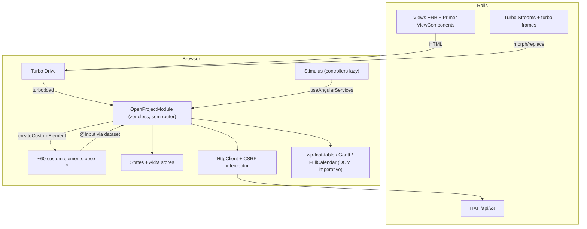
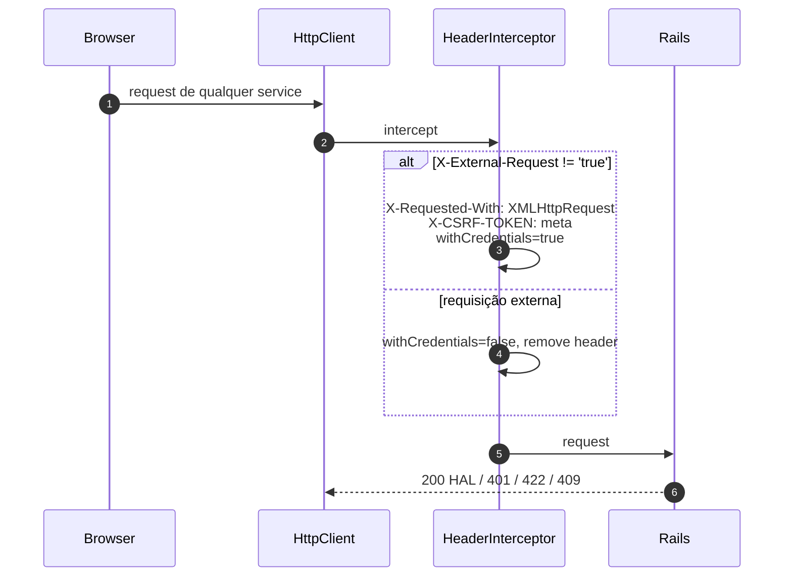

# OpenProject — camada de frontend (interação, estado, a11y, performance)

> Fonte: `_REF/openproject` (mesmo checkout dos documentos anteriores); caminhos relativos à raiz do repositório; `arquivo:linha` verificados. `[INFERENCE]` marca dedução a partir do código.
> Não repete `openproject-data-model.md` (`§OP`) nem `openproject-ui-ux.md` (`§OP-UI`): aqueles dizem *o quê*, este diz *como é construído*.

## 1. Stack exato

| Camada | Escolha | Evidência |
|---|---|---|
| Runtime | Node `^24.22.1`, npm `^11.12.0` | `frontend/package.json:8-9` |
| Framework | Angular `^22.2.3`, CDK `^22.2.4`, CLI `^22.2.4` | `frontend/package.json:71-83` |
| TS | `^6.0.3`, `strict`, `ES2022`, `moduleResolution: bundler` | `frontend/package.json:64`, `frontend/tsconfig.json:6,16,18-19` |
| Build | `@angular-builders/custom-esbuild:application` + plugins próprios | `frontend/angular.json:17-18` |
| Testes | `custom-esbuild:unit-test`, Vitest 5 + Playwright/Chromium | `frontend/angular.json:140-149`, `frontend/package.json:61,66` |
| CD | **zoneless** (`provideZonelessChangeDetection`) | `frontend/src/main.ts:71` |
| Roteamento | Rails + Turbo; `@angular/router` no manifesto, **0 imports** no código | `grep -rn "from '@angular/router'" frontend/src` → 0 |
| HTTP | `HttpClient` + `withXhr()` + `withInterceptorsFromDi()` | `frontend/src/app/app.module.ts:356` |
| Estado | `@openproject/reactivestates` (legado) + `@datorama/akita` | `frontend/package.json:121,92` |
| DnD | `@atlaskit/pragmatic-drag-and-drop` 2.x; `dragula` só em admin; `@angular/cdk/drag-drop` em grids/boards | `frontend/src/common/drag-and-drop/sortable-lists-engine.ts:28-36` |
| Timeline/calendário | `@fullcalendar/*` 6.1.22 | `frontend/package.json:94-106` |
| i18n | `i18n-js` 4.3, dicionário por `import()` do locale | `frontend/src/app/core/setup/init-locale.ts:33` |

Escala (medida): **1.672 `.ts` / ~217.800 linhas / 248 `.html` / 332 `@Component`**; **323 usam `OnPush`** — o schematic já gera OnPush (`frontend/angular.json:167`).

### 1.1 Build e code splitting

- Saída em `public/assets/frontend`, sem `index.html` gerado (`"index": false`): Angular é **embutido** em páginas Rails (`frontend/angular.json:33-37`).
- Único budget: `anyComponentStyle` 6 kB (`:81-84`). **Não há budget de bundle inicial.**
- Plugins esbuild: `keepNames` quando minificado (Catalyst do Primer deriva tags de nomes de classe) e `chunkNames = '[dir]/[name]-[hash]'` para o chunk optimizer não quebrar imports relativos (`frontend/esbuild/plugins.ts:35-43`).
- Estilos em bundles nomeados (`spot`, `blocknote`, `styles`, CodeMirror, flatpickr, CKEditor — `frontend/angular.json:44-70`). Polyfills: só `(window as any).global = window` (`frontend/src/polyfills.ts:27-29`).
- Splitting real em 3 pontos: `LinkedPluginsModule` gerado em build (`frontend/ci-plugins-generator.mjs`); controllers Stimulus por `import()` derivado de `data-controller="a--b"` → `./dynamic/a/b.controller.ts` (`frontend/src/stimulus/controllers/op-application.controller.ts:87-93,108-110`); locale (`init-locale.ts:33`).
- Build de produção usa `--named-chunks --source-map` (`frontend/package.json:204`).

## 2. Bootstrap e ciclo de request/resposta

### 2.1 Camadas



### 2.2 Boot

```ts
// frontend/src/main.ts:66-72 (resumido)
void initializeLocale().then(() => {
  initializeGlobalListeners();
  void platformBrowser().bootstrapModule(OpenProjectModule,
    { applicationProviders: [provideZonelessChangeDetection()] });
});
```

Ordem: `init-js-patches` → `init-vendors` → `init-globals` → `stimulus/setup` (`installElements()`, preregistro, `start()`) → `turbo/setup` (`Turbo.start()`, `drive = true`, `progressBarDelay = 100`) → `configureErrorReporter()` → `initializeLocale()` → `bootstrapModule` (`frontend/src/main.ts:31-72`, `frontend/src/turbo/setup.ts:46-50`, `frontend/src/stimulus/setup.ts:92-147`).

`OpenProjectModule` não tem `bootstrap: []`; implementa `DoBootstrap` e registra ~60 custom elements:

```ts
// frontend/src/app/app.module.ts:359-366
export class OpenProjectModule implements DoBootstrap {
  ngDoBootstrap(appRef:ApplicationRef) {
    document.body.classList.add('__ng2-bootstrap-has-run');
    this.registerCustomElements(appRef.injector);
```

`registerCustomElement` = `createCustomElement(component,{injector})` + `customElements.define` com guarda (`frontend/src/app/shared/helpers/angular/custom-elements.helper.ts:33-41`). Registros em `app.module.ts:367-428`: `opce-wp-split-view` (:393), `opce-work-packages-view` (:401), `opce-board-view` (:395), `opce-calendar-view` (:398), `opce-team-planner-view` (:399), `opce-modal-overlay` (:408), `opce-toasts-container` (:417).

Providers relevantes: `States` como instância única (`{provide: States, useValue: new States()}`), interceptor CSRF, `provideAppInitializer(initializeServices)`, `OpUploadService` por factory (Fog vs Local) (`frontend/src/app/app.module.ts:341-357`).

### 2.3 Rails → componente

```ruby
# app/helpers/angular_helper.rb:36-46
def angular_component_tag(component, options = {})
  inputs = (options.delete(:inputs) || {})
             .transform_keys { |k| k.to_s.underscore.dasherize }
             .transform_values(&:to_json)
  options[:data] = options.fetch(:data, {}).merge(inputs)
  options[:class] ||= [options[:class], "op-angular-component"].compact.join(" ")
  content_tag(component, "", options)
end
```

Do lado Angular, `populateInputsFromDataset(this)` lê `declaredInputs` do `ɵcmp` e faz `JSON.parse` do dataset (`frontend/src/app/shared/components/dataset-inputs.ts:76,93-94`). **Roda uma vez no construtor** — dataset alterado depois não reflete. Por isso `projectId`/`queryId` chegam congelados, e a lista de WPs não recebe nada: a query vem da URL (`frontend/src/app/features/work-packages/routing/wp-view-page/wp-view-page-entry.component.ts:7-24`).

### 2.4 Ciclo híbrido

```mermaid
sequenceDiagram
  autonumber
  participant U as Usuário
  participant T as Turbo Drive
  participant R as Rails
  participant W as turbo-angular-wrapper
  participant A as Angular (appRef)
  U->>T: clique / Turbo.visit()
  T->>R: GET html (Turbo-Referrer, X-Turbo-Nonce)
  R-->>T: HTML (+ frames/streams)
  T->>T: before-render (scrub de scripts), pinta
  T->>W: turbo:load (skip(1))
  W->>A: detachView + destroy de TODAS as views
  W->>A: bootstrap(opcional); body.__ng2-bootstrap-has-run
  A->>A: custom elements conectam e populam inputs
  A-->>U: ilhas hidratadas
```

- Cada `turbo:load` subsequente **destrói todas as views** e deixa o novo HTML reconectar (`frontend/src/turbo/turbo-angular-wrapper.ts:71-93`).
- Back/Forward Cache: `pageshow` com `persisted` força `Turbo.visit(href,{action:'replace'})` (`:104-108`).
- Morph é proibido em `OPCE-*` (`frontend/src/turbo/openproject-custom-element.ts:28-30`; uso em `turbo-global-listeners.ts:64-69`), protegendo o DOM que o Angular possui.
- Serviços de página re-registram em `turbo:render`/`turbo:load` (`frontend/src/app/app.module.ts:237-241`).
- `NavigationService` não escuta Turbo: usa Navigation API `navigatesuccess` e, sem ela, `setInterval(250)` (`frontend/src/app/core/navigation/navigation.service.ts:46,51`). É a fonte de `UrlParamsService.changed$`, que redesenha a partição list/split (`partitioned-query-space-page.component.ts:135-146`).

## 3. Autenticação, sessão e CSRF

O frontend **não autentica**: não há login, token, refresh ou storage de credencial. Sessão é cookie Rails; CSRF vem de `<meta name="csrf-token">`.



`frontend/src/app/features/hal/http/openproject-header-interceptor.ts:35,40,62-70`. Turbo repete o CSRF em `TurboRequestsService` (`frontend/src/app/core/turbo/turbo-requests.service.ts:61-67`).

| Mecanismo | Onde vive | Nota |
|---|---|---|
| Sessão | cookie Rails | `withCredentials: true`; logout é `DELETE /logout` do Rails |
| CSRF | meta + interceptor | CSP usa `script-src-attr 'none'`; `<meta>` é lida pelo bundle |
| 2FA/SSO/SAML/OIDC/LDAP | só servidor (`modules/two_factor_authentication`, `auth_saml`, `openid_connect`) | o frontend não participa |
| Confirmação de senha | Stimulus `require-password-confirmation`, `submit` em **fase de captura** (antes do CKEditor), diálogo e reenvio | `frontend/src/stimulus/controllers/require-password-confirmation.controller.ts:32-41` |
| Política de senha | `password-requirements.controller.ts:74-75` testa `RULE_PATTERNS[data-rule]` | é feedback, não enforcement |
| Expiração de sessão | **não tratada** em XHR | `grep "401"` em `frontend/src/app` → 0: nenhum redirect global para login |

Duas fontes de permissão: `AuthorisationService.can(model, action)` lê `_links` do HAL (`frontend/src/app/core/model-auth/model-auth.service.ts:37-59`); `CurrentUserService.hasCapabilities$(action, projectContext)` consulta capabilities em store (`frontend/src/app/core/current-user/current-user.service.ts:39-70`). A UI esconde ações com ambas; o servidor decide.

## 4. Estado no cliente — o "schema" do frontend

### 4.1 Duas gerações

| Geração | Tecnologia | Chave | Uso |
|---|---|---|---|
| Legado | `States extends StatesGroup` + `multiInput<T>()` | `id` | tabela/Gantt e todo o domínio de WP |
| Novo | Akita `EntityStore<ResourceState<T>>` | `id` + `collections[url].ids` | views, projects, principals, capabilities, attachments, notificações |

```ts
// frontend/src/app/core/state/resource-store.ts:42-48
export interface ResourceState<T> extends EntityState<T> {
  collections:Record<string, CollectionResponse>;   // url -> { ids }
  loadingResources:Record<string, boolean>;         // url -> loading
}
```

12 stores Akita (medido): `attachments`, `capabilities`, `days`, `weekday`, `file-links`, `in-app-notifications`, `principals`, `projects`, `project-storages`, `storage-files`, `storages`, `views`. Ex.: `@StoreConfig({name:'views'}) ViewsStore extends EntityStore` (`frontend/src/app/core/state/views/views.store.ts:35-36`).

`States` é dicionário tipado com escape para plugins:

```ts
// frontend/src/app/core/states/states.service.ts:49-56,104-109
export class States extends StatesGroup {
  workPackages = multiInput<WorkPackageResource>();
  forResource<T extends HalResource>(resource:T) {
    const stateName = `${camelCase(resource._type)}s`;
    return this.forType<T>(stateName)?.get(resource.id!);
  }
}
```

`additional:Record<string, MultiInputState<unknown>>` (`:92-100`) permite que plugins registrem estado sem tocar a classe.

### 4.2 Cache e invalidação

```ts
// frontend/src/app/core/state/resource-store.service.ts:91-117
public requireCollection(input:ResourceKeyInput):Observable<T[]> {
  const href = this.buildResourceLink(input);
  if (this.collectionExists(href) || this.resourceLoading(href)) return this.loadedCollection(href);
  return this.fetchCollection(href).pipe(switchMap(() => this.loadedCollection(href)));
}
public requireEntity(href:string):Observable<T> {
  const id = idFromLink(href);
  if (this.query.hasEntity(id) || this.resourceLoading(href)) return this.lookup(id);
  return this.fetchEntity(href);
}
```

`loadingResources` funciona como **single-flight por href**; `fetchCollection`/`fetchEntity` fecham com `shareReplay(1)` (`:284,313`).

A tabela não usa esse store: usa `States.workPackages` + `IsolatedQuerySpace`, que é **por view** e permite duas tabelas na mesma página:

```ts
// .../directives/query-space/isolated-query-space.ts:27-72
export class IsolatedQuerySpace extends StatesGroup {
  query = input<QueryResource>();  queryForm = input<QueryFormResource>();
  results = input<WorkPackageCollectionResource>();  columns = input<QueryColumn[]>();
  tableRendered = input<RenderedWorkPackage[]>();  timelineRendered = new Subject<null>();
  initialized = input<unknown>();
```

Invalidação em mutação tem três canais explícitos: `HalEventsService.aggregated$('WorkPackage', 500)` que faz `buffer(debounceTime(500))` para coalescer rajadas (`frontend/src/app/features/hal/services/hal-events.service.ts:70-76`); `committedChanges` do `HalResourceEditingService` (`:100,126`); e `ActionsService.ofType(tableRefreshRequest)` para quem não tem o query space (`work-packages-view.base.ts:243-262`). O refresh só ocorre se o evento tocar algo renderizado **ou** for `created` (`:286-303`).

## 5. Camada de domínio

### 5.1 View services: 20 eixos, dois estados

`frontend/src/app/features/work-packages/routing/wp-view-base/view-services/` tem 20 serviços (columns, sort-by, group-by, filters, sum, timeline, hierarchy, pagination, order, highlight, display-representation, include-subprojects, baseline, collapsed-groups, focus, selection, selection-gestures, relation-columns, additional-elements, hierarchy-indentation). Contrato comum:

```ts
// .../view-services/wp-view-base.service.ts:44-47,82-88,170-182
protected updatesState = input<T>();    // local, não persistido
protected pristineState = input<T>();   // veio do servidor
public live$() { return merge(this.pristineState.values$(), this.updatesState.values$()); }
export abstract class WorkPackageQueryStateService<T> extends WorkPackageViewBaseService<T> {
  abstract hasChanged(query:QueryResource):boolean;
  abstract applyToQuery(query:QueryResource):boolean;  // false = não precisa refetch
}
```

O wiring decide refetch por serviço:

```ts
// work-packages-view.base.ts:209-232
service.updates$().pipe(filter(() => queryState.hasValue() && service.hasChanged(queryState.value!)))
  .subscribe(() => {
    const triggerUpdate = service.applyToQuery(newQuery);
    this.querySpace.query.putValue(newQuery);
    this.wpListChecksumService.updateIfDifferent(newQuery, this.wpTablePagination.current)
      .then(() => { if (triggerUpdate) this.refresh(true, firstPage); });
  });
```

12 serviços entram nessa lista (`:188-199`); só **filtros** pedem `firstPage = true`. É isso que faz "mudar coluna" serinstantâneo e "mudar filtro" refazer a consulta.

### 5.2 Carregar uma query

```ts
// frontend/src/app/features/work-packages/components/wp-list/wp-list.service.ts:90-112
private queryRequests = input<QueryDefinition>();
private queryLoading = this.queryRequests.values$().pipe(
  switchMap((q) => this.streamQueryRequest(q.queryParams, q.projectIdentifier)), // última vence
  mergeMap((query) => { this.wpStatesInitialization.initialize(query, query.results); return of(query); }),
  share(),                                                                       // concorrentes compartilham
);
```

`fromQueryParams` limpa e reemite (`:143-148`); erro cai em `handleQueryLoadingError`, que tenta a query padrão (`:96-111`, ver `wp-list-invalid-query.service.ts`).

### 5.3 Changeset

`ResourceChangeset` guarda `pristineResource`, mapa de alterações e `projectedResource` (Proxy que aplica mudanças sobre o pristine) — `frontend/src/app/shared/components/fields/changeset/resource-changeset.ts:66-108,141-150`. `buildRequestPayload()` **espera o form** (inclusive `pendingFormUpdate`, para não montar payload com schema velho) e delega a `buildPayloadFromChanges()` (`:123-133,444`). `WorkPackageChangeset` adiciona regras de WP.

### 5.4 Eventos delegados

A tabela registra **um** listener por tipo, com seletor CSS, via `@knowledgecode/delegate`:

```ts
// .../wp-view-base/event-handling/event-handler-registry.ts:48-68
this.eventHandlers.forEach((factory) => {
  const handler = factory(viewRef);
  delegate(target).on(type, handler.SELECTOR, callback);
  cleanups.push(() => delegate(target).off(type, handler.SELECTOR, callback));
});
```

11 handlers (hierarquia, edit-cell, state-links, row click/dblclick, group row, context menu em right-click/click/`shift+alt+F10`, relations, share) e 12 `stateTransformers` (`handlers/table-handler-registry.ts:81-104,106+`).

### 5.5 Componente → estado → eventos

| Componente | Lê | Escreve | Consome |
|---|---|---|---|
| `PartitionedQuerySpacePageComponent` | `querySpace.query/initialized`, `urlParams.changed$` | `currentQuery`, `currentPartition` | Navigation API, `queryParamListener.observe$` |
| `WpListViewComponent` | `wpDisplayRepresentation`, `DeviceService` | `showTableView` | `itemClicked`, `stateLinkClicked` |
| `WorkPackageTable` | `tableRendered`, `States.workPackages` | `originalRowIndex`, `ledger` | — |
| `RowsTransformer` | `querySpace.initialized`, `states.workPackages.observeChange()` | chama `table.initialSetup` | HAL events |
| `EditCellHandler` | `states.workPackages`, `editing.forms` | abre `TableEditForm` | click/dblclick/keydown |
| `KeyboardNavigationTransformer` | `tableRendered`, hierarquia, grupos | foco (DOM) | keydown, pointerup/dragend |
| `TreegridSemantics` | `ledger`, seleção, hierarquia | atributos ARIA | — |
| `WorkPackageTimelineTableController` | `timelineVisible`, scroll | `viewParameters` | scroll, resize |
| `WorkPackageCardDragAndDropService` | ordem de `workPackages` | ordem otimista, `tableRendered` | `opSortableListsDrop/Removed` |
| `TeamPlannerComponent` | `currentWorkPackages$`, `assigneeCaps$` | eventos FullCalendar | eventDrop/Resize/Receive |
| `GlobalSearchInputComponent` | `recentItems$`, resultados | `selectedItem` | search/change/enter/escape |
| `InAppNotificationBellComponent` | `unread$` | — | timer, `document:ian-update-immediate` |

## 6. Consultas server-side

### 6.1 `query_props`: a view inteira na URL

```ts
// frontend/src/app/features/work-packages/components/wp-query/url-params-helper.ts:47-73
export interface QueryProps {
  c:string[];            // columns
  s?:boolean;            // sums
  t?:string;             // sort "id:asc,name"
  g:string|null;         // group by
  f:QueryPropsFilter[];  // filters {n,o,v}
  hi:boolean;            // hierarquias
  hl?:string; hla?:string[];     // highlighting
  dr?:string;            // display representation
  is?:boolean;           // include subprojects
  pa?:string|number; pp?:string|number;   // página / page size
  tv?:boolean; tzl?:string; tll?:string;  // timeline visível/zoom/labels
  ts?:string;            // timestamps
}
```

`encodeQueryJsonParams` monta o objeto a partir do `QueryResource` e aplica extensor (objeto ou função) — `:137-166`. O decode é só `decodeURIComponent` (`wp-list.service.ts:157-163`); a validação real é do servidor, com fallback de "query inválida" (`wp-list-invalid-query.service.ts`). Resultado: deep link total e stateless — URL reconstrói tabela, Gantt, agrupamento, filtros, paginação, colunas e destaque sem estado de sessão. `[INFERENCE]` É a decisão mais reaproveitável do produto.

### 6.2 Filtro → parâmetro HAL

`ApiV3ListParameters` carrega `filters`, `sortBy:[[campo,dir]]`, `groupBy`, `select`, `pageSize`, `offset` (`frontend/src/app/core/apiv3/paths/apiv3-list-resource.interface.ts:13-18`); `listParamsString` monta a query string com `sortBy`/filtros JSON-encoded (`:24-65`). Escopo de permissão não é calculado no cliente: o servidor devolve só o visível.

### 6.3 Paginação, ordenação, agrupamento, somas

- Paginação: `PaginationService` persiste `pagination.perPage` em localStorage e valida contra as opções do servidor (`frontend/src/app/shared/components/table-pagination/pagination-service.ts:32-54`); trocar de página invalida por checksum (`work-packages-view.base.ts:175-186`).
- Ordenação manual é modo à parte: as linhas vêm de `orderedWorkPackages()` em vez de `results.elements` (`rows-transformer.ts:58-66`).
- Builder por prioridade `hierarchy → grouped → plain` (`wp-fast-table.ts:92`); `isApplicable` de hierarquia é `hierarchies.isEnabled` (`builders/modes/hierarchy/hierarchy-rows-builder.ts:55-57`).
- Somas em `<tbody>` próprio (`wp-table.component.html:117-122`), vindas no payload da query — não há request por coluna.

### 6.4 N+1 e contenções

| Risco | Contenção |
|---|---|
| Schema/relações por linha | `SchemaCacheService`; WPs já vêm no resultado da query |
| Alvos de relação do Gantt | `requestRelationTargets(ids)` deduplica (`wp-fast-table.ts:159-167`) |
| WPs exigidos por hierarquia | `querySpace.additionalRequiredWorkPackages` |
| Shares por WP | `workPackageSharesCache = multiInput<ShareResource[]>()` (`isolated-query-space.ts:69`) |
| Ordem manual fora do resultado | `buildIndex` resolve por `work_packages.cache.current(id, wp)` (`wp-fast-table.ts:158-170`) — depende do cache já populado |

## 7. Interação — tabela

### 7.1 Builders + render passes + ledger

`WorkPackageTable` **não é componente Angular**: recebe elementos DOM (`tableAndTimelineContainer`, `scrollContainer`, `tbody`, `timelineBody`) e desenha direto (`frontend/src/app/features/work-packages/components/wp-fast-table/wp-fast-table.ts:59-124`).

```mermaid
flowchart LR
  Q["querySpace.results (HAL)"] --> RT["RowsTransformer"]
  RT -->|initialSetup(rows)| T["WorkPackageTable"]
  T --> B{builder}
  B -->|hierarchies| H["HierarchyRowsBuilder"]
  B -->|groupBy| G["GroupedRowsBuilder"]
  B -->|default| P["PlainRowsBuilder"]
  H --> PR["PrimaryRenderPass (DocumentFragment)"]
  G --> PR
  P --> PR
  PR --> HL["Highlighting / Relations / ChildRelations / Timeline passes"]
  PR --> L["RenderedOccurrenceLedger"]
  L --> SEM["TreegridSemantics.paint()"]
  PR -->|"replace tbody"| D[("DOM")]
```

O `ledger` (`:97`) é a verdade sobre "o que está pintado", usado por ARIA, refresh de linha e reconciliação de seleção. Render é instrumentado com `timeOutput('Primary render pass', ...)` (`builders/primary-render-pass.ts:75`).

### 7.2 Inline edit

```mermaid
sequenceDiagram
  autonumber
  participant U as Usuário
  participant D as DOM (célula editável)
  participant H as EditCellHandler
  participant E as TableEditForm
  participant CS as ResourceChangeset
  participant S as HalResourceEditingService
  participant API as API v3
  U->>D: click (ou dblclick, se preferência)
  D->>H: evento delegado
  H->>H: ignora <a> e <macro>; activationEvent
  H->>E: editing.startEditing(wp, classIdentifier)
  H->>CS: form.activate(fieldName)
  CS->>CS: loadFieldSchema; writable? assertActivationActive
  CS-->>H: EditFieldHandler
  H->>D: $onUserActivate.next(); focus(clickOffset)
  U->>D: confirma
  D->>CS: handleUserSubmit() → form.submit()
  CS->>CS: inFlight=true; validateCustomFields=true
  CS->>API: PATCH updateImmediately(payload + lockVersion)
  alt 200
    API-->>S: saved
    S->>S: retainFrom(pristine); commit; reset
    S-->>U: toast + closeEditFields
  else 422
    API-->>CS: ErrorResource
    CS->>CS: errorsPerAttribute = getMessagesPerAttribute()
    CS->>D: setErrors por campo (-error)
  else 409
    API-->>U: flash via /work_packages/show_conflict_flash_message
  end
```

Evidências: `edit-cell-handler.ts:86-94,124-145`; `wp-table-editing.ts:74-84` (um form por `wpId`, reutilizado); `edit-form.ts:194-230`; `hal-resource-editing.service.ts:106-131,182-207`.

Detalhes que importam: gatilho configurável (`requireDoubleClickForInlineEdit`, `edit-cell-handler.ts:86-88`, com limpeza de seleção no dblclick `:53-55`); offset de clique repassado ao foco (`hal-resource-edit-field-handler.ts:75-90`); campo `writable=false` gera aviso e marca a célula como read-only (`edit-cell-handler.ts:138-142`, `edit-form.ts:110-125`); `EditActivationCancelled` existe porque a linha pode morrer durante o await do schema (`edit-form.ts:84-86`); campos que o servidor reclamou são abertos automaticamente, exceto `id` (`:173-187`); save bar separada com `accesskey 3/7` (`edit-actions-bar/wp-edit-actions-bar.html:3-17`).

### 7.3 Tipos de campo

Mapeamento declarativo e extensível:

```ts
// frontend/src/app/shared/components/fields/edit/edit-field.initializer.ts:93-99
editFieldService.defaultFieldType = 'text';
editFieldService
  .addFieldType(TextEditFieldComponent, 'text', ['String'])
  .addFieldType(SelectEditFieldComponent, 'select', ['Status','Type','Version',...])
  .addFieldType(MultiSelectEditFieldComponent, 'multi-select', ['[]CustomOption','[]User',...])
  .addFieldType(DateEditFieldComponent, 'date', ['Date']);
```

Overrides por **(tipo de recurso, campo)** em `addSpecificFieldType` (`:128-153`): `WorkPackage.startDate` usa editor combinado de datas, `TimeEntry.hours` usa duração. 33 arquivos em `field-types/`.

### 7.4 Teclado na grade

`keyboardNavigationEnabled` é **false** por default (`wp-table-configuration.ts:41`).

| Peça | Comportamento | Evidência |
|---|---|---|
| Roving tabindex | foco em `tabindex=0`; todo o resto (inclusive links/botões) em `-1` | `roving-tabindex.ts:69-86` |
| Setas/Home/End/Page* | mapa simples; `Ctrl+Home/End` = primeiro/último | `keyboard-navigation-transformer.ts:76-90` |
| Enter em célula / linha | ativa editor inline / abre detalhe | `:118-121,480`; `:197` |
| Contêineres | saem do tab order (`tabindex=-1`), restaurados no destroy | `:135-140` |
| Inline create | fora da grade (`insideGrid` exclui `tbody[wpInlineCreate]`) | `roving-tabindex.ts:43-49` |

O modelo de foco (`focus-position.ts`, 253 linhas + 222 de teste) cobre posição inicial, vizinho mais próximo após re-render, reconciliação quando a linha desaparece e retorno de foco após fechar editor — com guarda para "usuário moveu o foco entretanto".

### 7.5 Seleção, hierarquia, drag, criação

- **Seleção** em `WorkPackageViewSelectionService`, pintada como `aria-selected` no ledger (`treegrid-semantics.ts:96-99`); gestos de shift-range/ctrl-toggle em `wp-view-selection-gestures.service.ts`; `Escape` limpa seleção respeitando overlays (`common/selection-escape.ts`).
- **Hierarquia**: `paintRowRole(row, level)` escreve `role=row` + `aria-level` (`treegrid-semantics.ts:45-49`); `aria-expanded` só em linha com filhos (`:91-93`). Indent/outdent usa o **predecessor renderizado** e a cadeia de ancestrais (`wp-view-hierarchy-indentation.service.ts:33-60,79-94`).
- **Drag de linha** exige handle `.wp-table--drag-and-drop-handle` (`handlers/state/drag-and-drop-transformer.ts:83-92`); preview é reconstruído, pois `<tr>` clonado perde largura de coluna (`:95-108`); multi-select drag **não** existe — o transformer colapsa a seleção na linha arrastada (`:110-113`).
- **Criação inline** usa `<tbody wpInlineCreate>` (`wp-table.component.html:123-132`) e publica `newInlineWorkPackageCreated`, convertido em posição na ordem manual (`drag-and-drop-transformer.ts:59-76`).
- **Grupos colapsáveis**: `GroupFoldTransformer` + `WorkPackageViewCollapsedGroupsService`; seção toda oculta recebe `aria-hidden` (`treegrid-semantics.ts:51-54`).

### 7.6 Virtualização: não

`cdk-virtual-scroll` aparece só na central de notificações (`in-app-notification-center.component.html:9`) e nos `ng-select`. A tabela renderiza todas as linhas da página em um `DocumentFragment`. Mitigações: paginação, render pass único, refresh de linha isolada. `[INFERENCE]` Com pageSize alto e hierarquia expandida, o custo é O(linhas × colunas) em DOM real.

## 8. Escrita e concorrência

### 8.1 `lockVersion`

```ts
// resource-changeset.ts:396-401
return { lockVersion: this.pristineResource.lockVersion, _links: {} };
```

E o changeset é **descartado** se o recurso em cache ficou mais novo:

```ts
// hal-resource-editing.service.ts:199-206
if (Object.hasOwn(resource, 'lockVersion')
  && (changeset.pristineResource.lockVersion as number) < (resource.lockVersion as number)) {
  return this.edit<V, T>(resource);
}
```

Conflito de servidor não tem UI de resolução: o cliente pede ao Rails para renderizar o flash (`work-package-notification.service.ts:52-58`), com dívida admitida em comentário — "should be refactored once we have a programmatic way to show the primer flash messages" (`:54-56`).

### 8.2 Estratégia por tipo de operação

| Operação | Estratégia |
|---|---|
| Campo único | PATCH `updateImmediately` só com o campo + `lockVersion` |
| Vários campos (split view) | um PATCH com o changeset acumulado; `inFlight` bloqueia reenvio (`edit-form.ts:207-215`) |
| Criação | payload do **form** (herda defaults do servidor), não do recurso vazio (`resource-changeset.ts:452-470`) |
| Ordem manual (tabela) | `prepareAdd`/`persist` com `isCurrent()` contra resposta obsoleta (`drag-and-drop-transformer.ts:59-76`) |

Dirty state: `beforeunload` do Stimulus usa `confirm()` quando `window.OpenProject.pageHasUnsavedChanges`/`pageWasEdited` (`frontend/src/stimulus/controllers/beforeunload.controller.ts:39-40,70-87`); `pageState = 'submitted'` no `submit` (`:36-38`). Não há guard de rota porque não há router.

## 9. Gantt

### 9.1 DOM absoluto, sem SVG

Busca por `createElementNS`/`<svg>` em `wp-table/timeline` → **nenhum**. Tudo é `div` posicionada por `left/width`.

| Elemento | Implementação |
|---|---|
| Escala | `pixelPerDay`: days 30, weeks 15, months 6, quarters 2, years 0.5 (`timeline/wp-timeline.ts:54-71`) |
| Barras | `WorkPackageTimelineCell` escreve `innerHTML` e cria `wpElement` (`cells/wp-timeline-cell.ts:78-94`) |
| Relações | segmentos `div.relation-line` com top/left/width/height (`global-elements/wp-timeline-relations.directive.ts:49-70,82`) |
| Today line | `left = dias desde o início + hora/24` (`global-elements/wp-timeline.today-line.ts:33-39`) |
| Baseline | coluna na tabela (`wp-table.component.html:57-64`) + modo de query (`wp-view-baseline.service.ts`) |
| Header | `getTimeSlicesForHeader` separa slices em viewport/resto — só o visível vira DOM (`wp-timeline.ts:114-136`) |

### 9.2 Zoom e auto-zoom

`zoomLevelOrder = ['days','weeks','months','quarters','years']` (`:50-52`). O auto-zoom escolhe o maior detalhe que ainda cabe:

```ts
// container/wp-timeline-container.directive.ts:586-603 (resumido)
const timelineWidthInPx = this.element.parentElement?.clientWidth! - (2 * requiredPixelMarginLeft);
for (const zoomLevel of zoomLevelOrder) {
  const visibleDays = timelineWidthInPx / getPixelPerDayForZoomLevel(zoomLevel);
  if (visibleDays >= daysSpan || zoomLevel === zoomLevelOrder.at(-1)) {
    if (previousZoomLevel !== zoomLevel) { settings.zoomLevel = zoomLevel; this.wpTableComponent.timeline.scrollLeft = 0; }
    this.wpTableTimeline.appliedZoomLevel = zoomLevel;
    return;
  }
}
```

### 9.3 Drag de datas e duração

Interação manual com `mousedown`/`mousemove`/`mouseup`, listeners no `body` durante o gesto:

```ts
// cells/wp-timeline-cell-mouse-handler.ts:95-113
let gestureActive = false;
let mouseDownStartDay:number|null = null; // também flag de drag ativo
const barMouseDown = (ev) => { if (!ev.button || ev.button === 0) workPackageMouseDownFn(ev); };
bar.addEventListener('mousedown', barMouseDown);
```

- O drag **edita um changeset** (`renderInfo.change = halEditing.changeFor(...)`, `:71`) e persiste no `mouseup` — o usuário vê antes do PATCH; criação em célula vazia e conexão de relação convivem no mesmo handler.
- `canConnectRelations()` exige milestone com data ou WP com start/due (`cells/wp-timeline-cell.ts:69-76`).
- Scheduling manual × automático é **dado do recurso** (`scheduleManually`), refletido no ícone do campo de data (`date-display-field.module.ts:80-94`), não em modo global.

### 9.4 Performance

Scroll tabela↔timeline com um `requestAnimationFrame` por evento e cancelamento no destroy (`wp-table-scroll-sync.ts:36-54,82-90`); hover com `mousemove` passivo + rAF (`wp-table-hover-sync.ts:25-38`); relações recalculadas por `onRefreshRequested('relations', ...)` em componente declaradamente **não** OnPush (`ChangeDetectionStrategy.Eager`, `wp-timeline-relations.directive.ts:58-61` — dívida registrada). Gargalo: cada célula é `<div>` + barra + handles + labels; com 200 linhas em zoom diário e viewport de um ano o DOM passa de milhares de nós, e a grade do header é recalculada a cada zoom. Não há LOD automático.

## 10. Boards, Calendar, Team planner, Backlogs

### 10.1 Boards

Coluna = `Query`; board = `GridWidgetResource[]`. Reordenar **colunas** usa CDK com `cdkDragHandle` (`board-partitioned-page/board-list-container.component.html:15-21`) + `moveItemInArray` e `saveBoard` (`board-list-container.component.ts:180-182`). Cards usam o mesmo motor da tabela (`wp-card-view.component.html:4-8`). Refresh seletivo: `causedUpdates.includes(query)` evita recarregar a coluna que o usuário acabou de alterar (`board-list.component.ts:137,371-376`). Criação alterna `cardView` entre inline e referência (`:310-318`), com capability de create **e** update (`wp-inline-create.service.ts:57-64`).

### 10.2 Drag & drop (biblioteca, eventos, semântica)

| Aspecto | Implementação |
|---|---|
| Biblioteca | `@atlaskit/pragmatic-drag-and-drop` 2.x (`sortable-lists-engine.ts:28-36`) |
| Motor | `draggable` + `dropTargetForElements` + `monitorForElements`, `combine` para cleanups, `preventUnhandled` (`:384-506`) |
| Preview | `setCustomNativeDragPreview` + `preserveOffsetOnSource`; consumidor pode desenhar preview (a tabela faz, para não herdar largura de coluna) |
| Drop indicator | `attachClosestEdge`/`extractClosestEdge` + `renderDropIndicator` (`common/drag-and-drop/drop-indicator.ts`) |
| Itens | `MutationObserver` com `childList` (não `subtree`), seletor `:scope > [data-work-package-id]` (`drag-and-drop.service.ts:40,141-147`) |
| Payload | `createSortableItemPayloadScope` (escopo por root, evita colisão entre listas) |
| Transação | `complete(success)` idempotente + `finalize()`; o flag `busy` do engine **nunca limpa** se o consumidor não settlear — daí o `try/catch` com `complete(false)` (`wp-card-drag-and-drop.service.ts:191-196`) |
| Semântica | `mobility: fixed | confined | free`; `fixed` não arrasta/seleciona, `confined` limita o lote à própria lista (`sortable-lists/README.md:10-12,70`) |
| Teclado | sem drag por teclado; Space/Shift+Space/Ctrl+A selecionam e `collectionMoveUrl` move o lote (`README.md:36-53`) |
| Anúncios | `announcementScope` e `moveAnnouncementScope` separados; anuncia mudança mesmo com contagem igual (`README.md:80-84`) |
| `aria-rowindex` | renumerado após reordenar preservando offset de página (`sortable-lists/aria-row-indices.ts:28,46-59`) |

Otimismo seguro:

```ts
// wp-card-drag-and-drop.service.ts:66,129-131,155-166,189-196
private orderRevision = 0;                              // bump a cada atribuição de workPackages
private stillAt(revision, order) {                      // não sobrescreve estado mais novo
  return this.orderRevision === revision && this.currentOrderEquals(order);
}
handleDrop(event) {
  if (event.sourceListId !== this.cardView.resolvedListId) return this.handleCrossListDrop(event);
  const before = this.currentOrder;
  const after = reorderById({ list: before, sourceId, closestEdge, axis });
  if (after === before) { event.complete(true); return; }  // no-op não persiste
  this.applyLocalOrder(after);                             // render síncrono de States
  void this.persistMove(before, after, event);
}
```

Rollback checa `stillAt(revision, optimistic)` antes de reverter (`:236-243`), e `applyLocalOrder` atualiza `tableRendered` para seleção/select-all não ficarem atrás do drag (`:103-116`).

### 10.3 Calendar

`FullCalendar` 6 com `events` como **função assíncrona**: `calendarEventsFunction({start,end,timeZone})` devolve WPs + meetings (`wp-calendar.component.ts:164-223,242-267`). `editable: true`, `initialView` configurável (default `dayGridWeek`), editabilidade por evento via `dateEditable(wp)` (`:267,343,395`). Arrasto externo usa `new Draggable(container,{itemSelector,eventData})` e o emitter **interno** `dragging` — dependência assumida em comentário (`calendar-drag-drop.service.ts:69-88`, aviso `:74-75`). Erro devolve o item à lista se ele não estiver visível (`:75-83`).

### 10.4 Team planner

`resourceTimeline` com 5 views (`workWeek`, `week`, 2/4/8 semanas), `slotDuration:{days:1}`, `resourceAreaWidth` 60/180px (`team-planner.component.ts:352-353,365-419,542`). Dias não úteis são desenhados como eventos de fundo no início do drag/resize e removidos no stop (`:560-566,571-579`); drop em dia não útil → toast + `revert()` (`:583-599`). `revert()` é a estratégia de consistência: desfaz o visual antes de qualquer persistência. `initialView` é persistido (`:342`).

### 10.5 Backlogs

Fora do Angular: Rails SSR + Turbo frame + Stimulus.

```erb
<%# modules/backlogs/app/views/backlogs/backlog/_backlog_list.html.erb:30-45 %>
<%= turbo_frame_tag "backlogs_container" do %>
  <%= render(Backlogs::SelectionDescriptionComponent.new) %>
  <div id="owner_backlogs_container" class="op-sprint-planning-lists" data-controller="sortable-lists--scrollable">
  <div id="sprint_backlogs_container" class="op-sprint-planning-lists" data-controller="sortable-lists--scrollable">
```

- O frame reconcilia só os filhos; atributos no `turbo_frame_tag` são ignorados (comentário `:29`).
- O motor é adaptado para Stimulus: outlets `sortable-lists--list|-item|-scrollable` (`sortable-lists.controller.ts:86`) e valores `moveUrlTemplate`, `collectionMoveUrl`, `optimistic`, `selectionEnabled`, `maxBatchSize` (`:88-100`).
- Escuta `turbo:morph-element` para "curar" registros após morph (`:131`), e a seleção é reconstruída quando `selectionEnabled` muda sem reconectar (`:156-166`).
- Um único elemento de descrição por página serve todos os cards selecionados via `aria-describedby` (`_backlog_list.html.erb:31-33`).

## 11. Detalhe, split view e formulários

- URL: `GET /work_packages/details/:work_package_id(/:tab)` (`config/routes.rb:706`, idem `1288,1562`). Não há sub-rota Angular: o painel direito é `<turbo-frame id="content-bodyRight">` (`wp-split-view.component.ts:111-114`, `board-list-container.component.ts:176-178`).
- A partição vem do **pathname**, não de estado: `pathname.includes('/details/') ? '-split' : '-left-only'` (`wp-view-page.component.ts:153-155`).
- Erro ao carregar fecha o painel com `Turbo.visit(basePathWithoutDetails()+search, {frame, action:'replace'})` (`:81-89`); abrir detalhe atualiza seleção/foco e os 5 "recentes" em localStorage (`:88-97`, `recent-items.service.ts:38-41`).
- Abas: `role="tablist"`/`role="tab"` com `aria-selected`, navegação por `href` do servidor — sem `aria-controls`, sem roving tabindex (`shared/components/tabs/scrollable-tabs/scrollable-tabs.component.html:6-31`).

Formulários não têm `FormConfiguration` no cliente: a **schema HAL** manda. Validação em camadas:

| Camada | O que faz |
|---|---|
| Schema | `writable` bloqueia edição; `required` → `aria-required`; tipo escolhe o componente (§7.3) |
| Submit | `validateCustomFields = true` no payload (`resource-changeset.ts:434`) |
| 422 | `_embedded.errors` → `getMessagesPerAttribute()` → `setErrors` por campo (`edit-form.ts:271,286`) |
| Campos faltantes | `activateMissingFields()` abre o que o servidor apontou, exceto `id` (`:173-187`) |
| Foco no 1º erro | `focusFirstErroneousField()` no `turbo:render` global (`turbo-global-listeners.ts:52-56`) |

Date pickers são custom elements montados pelo Rails (`app/helpers/custom_fields_helper.rb:48-57`; componente escolhido no servidor em `lib/primer/open_project/forms/date_picker.html.erb:41`). O editor combinado do WP emite `{duration,startDate,dueDate,includeNonWorkingDays,scheduleManually}` e grava no changeset (`date-picker-edit-field.component.ts:107-118`). Multi-select/autocomplete passam por `ng-select` com `virtualScroll` default `true` (`op-autocompleter.component.ts:223`) — um dos poucos pontos com virtualização real.

## 12. Busca global e atalhos

A "command palette" é um `ng-select` customizado (`op-autocompleter`) montado como `opce-global-search`. Busca em `work_packages` com `searchKey:'subjectOrId'`, `deferFetchUntilOpened: true`, `virtualScroll: false` — a lista é curta e o "primeiro item é ação", exigindo índices estáveis (`global-search-input.component.ts:102-107`). Item sem `id` é a opção "buscar por `<termo>` no escopo X" (`GlobalSearchService.submitSearch` monta `/search?q=&scope=&filter=work_packages` — `core/global_search/services/global-search.service.ts:16-41`). Recentes: 5 WPs em localStorage (`recent-items.service.ts:19-41`), mostrados com campo vazio. Live region: `announce(...)` com `politeness:'polite'` para "hit direto" e "N itens" (`:382,387`), escrevendo no `<live-region>` global (`app/views/layouts/base.html.erb:63`).

```ts
// frontend/src/app/shared/directives/a11y/keyboard-shortcut.service.ts:35-52,59-82
const accessKeys = { preview:1, newWorkPackage:2, edit:3, quickSearch:4,
                     projectSearch:5, help:6, moreMenu:7, details:8 };
```

| Atalho | Ação | Implementação |
|---|---|---|
| `s` / `p` | busca global / busca de projeto | access keys 4 / 5 |
| `g m`, `g o`, `g w p`, `g w i`, `g a`, `g c`, `g n` | navegação | `globalAction`/`projectScoped` via `PathHelperService` |
| `n w p` | novo WP | `projectWorkPackageNewPath` |
| `g e` / `g p` / `d w p` | editar / preview / detalhe | access keys 3 / 1 / 8 |
| `m`, `p`, `s` | mais / busca projeto / busca | access keys 7 / 5 / 4 |
| `?` | ajuda de atalhos (nova aba) | `keyboardShortcutsHelpPath()` |
| `j` / `k` | próximo / anterior em `table.keyboard-accessible-list` | `focusItemOffset(±1)` com `checkVisibility()` (`:140-152`) |
| `Shift+Alt+F10` | menu de contexto da linha | `op-context-menu-trigger.directive.ts:71` |
| `Esc` | limpa seleção (respeitando overlays) | `common/selection-escape.ts` |
| `Ctrl/Cmd+Enter` | salvar campo/editor | doc de atalhos + CKEditor |

`disableKeyboardShortcuts()` desliga todos os Mousetrap (`:84-88`); access keys nativas seguem funcionando (`:95-105`).

## 13. Assíncrono, tempo real e Turbo Streams

| Necessidade | Mecanismo | Números |
|---|---|---|
| Notificações não lidas | `timer(10, interval)` + `throttleTime` + `switchMap` + `shareReplay(1)` | 50 s; aba oculta ×3 (app instalado) ou ×10 (`in-app-notification-bell.component.ts:53,78-91`, `app-badge.service.ts:7-8,40-44`) |
| Atividade do WP | `setInterval` Stimulus | 10 s; para em `401/403/404` (`polling.controller.ts:44,65,127-143`) |
| Documentos colaborativos | WebSocket Hocuspocus/Yjs, timeout de sync 5 s | `useCollaboration.ts:15-43`, `elements/block-note-element.ts:108-122` |
| UI vinda do servidor | Turbo Streams com ações `dialog`, `flash`, `live-region`, `input-caption`, `dispatch-event` | `frontend/src/turbo/setup.ts:70-79` |
| Reprocessar Angular após stream | `op:turbo-stream-rendered` + preservação de atributos DnD no morph | `turbo-event-listeners.ts:44-55`, `turbo/pragmatic-dnd-morph-attributes.ts` |

Sem chave de idempotência: proteção contra duplo-submit é `inFlight`/`saving` e single-flight por href. `[INFERENCE]` Retry automático de PATCH poderia duplicar journals; o código não faz retry. Webhooks só no servidor (`modules/webhooks`).

## 14. Segurança

| Vetor | Controle | Evidência |
|---|---|---|
| CSRF | token em toda request autenticada + `X-Requested-With` | `openproject-header-interceptor.ts:62-70` |
| XSS em HTML editável | sanitização no Rails + `@braintree/sanitize-url`; CSP sem `unsafe-inline`/`unsafe-eval` em script | `config/initializers/content_security_policy.rb:132-133` |
| CSP | `base-uri 'self'`, `frame-ancestors 'self'`, `script-src-attr 'none'`, nonce do Turbo reaproveitado | `:122,126,132-133,142-146` |
| Estilo inline | `style-src ... 'unsafe-inline'` (Angular, FullCalendar e Primer escrevem `style`) | `:134` |
| Scripts em HTML morfado | `scrubScriptElements` em `before-render`, `before-stream-render`, `before-frame-render` | `turbo-event-listeners.ts:38-60`, `csp-script-nonce.ts` |
| Upload | multipart local ou direto S3, escolhido por `isDirectUploads()`; progresso por `HttpEvent` | `local-upload.service.ts:19-47`, `app.module.ts:347-352` |
| Request "externa" | header `X-External-Request` remove credencial e CSRF | `openproject-header-interceptor.ts:35-55` |
| Segredos no bundle | nenhum token; só a chave pública do AppSignal via `<meta>` | `appsignal-reporter.ts:53` |

Fragilidades: `X-External-Request` é header **do cliente** — protege contra envio acidental, não contra código malicioso na página `[INFERENCE]`; e `style-src 'unsafe-inline'` é a maior concessão do CSP (não há Trusted Types).

## 15. Performance e observabilidade

| Feito | Onde |
|---|---|
| OnPush em 323/332 componentes | schematic `frontend/angular.json:167` |
| Zoneless + `detectChanges()` pontual | `partitioned-query-space-page.component.ts:119,173` |
| Eventos delegados (1 listener por tipo) | `event-handler-registry.ts:84` |
| Render em `DocumentFragment` (1 mutação) | `primary-render-pass.ts:44,73-93` |
| Refresh de linha única + `rowsRefreshed$` | `rows-transformer.ts:70+`, `wp-fast-table.ts:79-80` |
| Coalescer de refresh (`buffer` 500 ms) | `hal-events.service.ts:70-76` |
| `shareReplay(1)`/single-flight e `track`/`trackBy` | `resource-store.service.ts:284,313`, `wp-list.service.ts:112`; `track column.href`, `track tab.id` |
| rAF para scroll/hover | `wp-table-scroll-sync.ts:82-90`, `wp-table-hover-sync.ts:33` |
| `TableUiWork` (rAF/timeout canceláveis) | `table-ui-work.ts:5-38` |
| Lazy Stimulus e lazy locale | `op-application.controller.ts:87-93`, `init-locale.ts:33` |

| Não feito | Consequência |
|---|---|
| Sem virtualização da tabela (§7.6) | DOM proporcional a linhas × colunas |
| Sem budget de bundle inicial (§1.1) | regressão de tamanho não bloqueia CI |
| Sem cache HTTP (`ETag`) | cache só em memória por `href` |
| Sem Web Worker | parse de HAL/locale na main thread |
| Um componente explicitamente eager | `wp-timeline-relations.directive.ts:58-61` |

Observabilidade: `configureErrorReporter()` escolhe `AppsignalReporter` se houver `<meta>`, senão `LocalReporter` (`core/errors/configure-reporter.ts:33-38`), com breadcrumbs de console e rede (`appsignal-dependency.ts:28-29`). Erros de Stimulus só vão para `console.warn` (`stimulus/setup.ts:151-153`) — não chegam ao reporter. Timings de render via `timeOutput` (debug). Log de eventos Turbo via `whenDebugging()` (`turbo/setup.ts:52-62`). **Não há** `PerformanceObserver` de LCP/INP/CLS no código.

## 16. Temas, i18n, responsivo

- Tokens: Spot (próprio) + Primer primitives/CSS, bundles separados (`frontend/angular.json:44-70`, `frontend/src/app/spot/styles/sass/{common,components,variables}`).
- Dark mode por **atributo no `<body>`**: `data-color-mode="light|dark"` + `data-<mode>-theme` (`light|dark|light_high_contrast|dark_high_contrast`) — `core/setup/globals/theme-utils.ts:53-59`. `sync_with_os` é resolvido por Stimulus com `useMatchMedia('(prefers-color-scheme: light)')` e `(prefers-contrast: more)` (`auto-theme-switcher.controller.ts:40-63`); troca dispara `op:theme-changed` (`theme-utils.ts:58`).
- i18n: `window.I18n` antes do bootstrap; locale, default, primeiro dia/semana vêm de `<meta name="openproject_initializer" data-...>` (`init-locale.ts:29-49`), com pluralização sobrescrita para cair em `other` (`:69`). `I18nService.t('js.*')` é o acesso único (`i18n.service.ts:35-56`), com `instance_locale_translate` para textos do sistema. Strings do `ng-select` são injetadas no construtor (`:18-23`) — tradução de lib de terceiros sem fork. Fonte: `frontend/src/locales/*.json`, sincronizada por Crowdin (`crowdin.yml`).

| Breakpoint | Valor | Uso |
|---|---|---|
| mobile | `< 544` | força card view, detalhe em full view (`device.service.ts:32-38`) |
| tablet | `< 768` | `hidden-for-tablet` na toolbar |
| small desktop | `< 1012` | colapsa navegação (layout) |

`showTableView = !(isMobile || representation === card)` (`wp-list-view.component.ts:198-201`); em mobile o clique no card abre a **full view** (`:222-230`); resizer do split é `hidden-for-mobile` (`wp-split-view.html:51-54`).

## 17. Acessibilidade — auditoria

### 17.1 O que existe (15 itens)

| # | Achado | Evidência |
|---|---|---|
| 1 | `role="treegrid"` + `aria-multiselectable`/`aria-label`/`aria-describedby` **opt-in** | `wp-table.component.html:8-11` |
| 2 | Roving tabindex completo (1 tab stop; links internos viram `-1`; `tbody` de criação inline excluído) | `roving-tabindex.ts:43-49,69-86` |
| 3 | `aria-level` por linha refletindo profundidade | `treegrid-semantics.ts:45-49` |
| 4 | `aria-expanded` **só** em linha expansível | `:91-93` |
| 5 | `aria-selected` sincronizado após re-render; seção toda oculta recebe `aria-hidden` | `:96-99`; `paintSectionExposure`, `:51-54` |
| 6 | `aria-sort` só na ordenação primária, e só com teclado ligado | `wp-table.component.ts:307-319` |
| 7 | `<caption class="sr-only">` descrevendo ordenação, ligada por `aria-describedby` | `wp-table.component.html:31-41` |
| 8 | Skip link para `#content` | `app/views/layouts/base.html.erb:75-79` |
| 9 | `<live-region>` global + ação Turbo `live-region` com `politeness` | `base.html.erb:63`, `turbo/live-region-stream-action.ts:5-21` |
| 10 | Paginação com `aria-live="polite"` | `table-pagination.component.html:89` |
| 11 | Modal com `role/aria-modal/aria-labelledby`, `cdkFocusInitial`, `cdkTrapFocus` auto-capture | `modal-overlay.component.html:8-14` |
| 12 | Erro de campo dentro do `<label class="sr-only">` → leitor anuncia "campo, erro" | `edit-form-portal.component.html:9-13` |
| 13 | Toasts com `role="alert" aria-atomic="true"` | `toast.component.html:2` |
| 14 | Backlogs anunciam seleção e movimento, e renumeram `aria-rowindex` | `sortable-lists/README.md:80-84`, `aria-row-indices.ts:28,46-59` |
| 15 | Atalhos desativáveis; `accesskey` nativo como fallback; 95 `aria-hidden` (medido) | `keyboard-shortcut.service.ts:84-105` |

### 17.2 O que falta ou é frágil

| # | Achado | Evidência | Impacto |
|---|---|---|---|
| 1 | Tabs sem `aria-controls`/`id` e sem roving tabindex; `role="tab"` em `<a href>` | `scrollable-tabs.component.html:6-31` | relação tab↔painel implícita; setas não navegam |
| 2 | `aria-live` em **1** template; `announce()` em 2 pontos do Angular | `grep aria-live`; `global-search-input.component.ts:382,387` | salvar/criar/mover não são anunciados além dos toasts |
| 3 | Gantt sem canal de teclado: barras são `div` com `mousedown`, sem `role`/`tabindex` | `wp-timeline-cell-mouse-handler.ts:102-113` | criar/arrastar datas exige mouse |
| 4 | Reordenar na tabela exige mouse (`canPickup` por handle, motor pointer-based) | `drag-and-drop-transformer.ts:83-92` | sem caminho por teclado, ao contrário dos Backlogs |
| 5 | Foco após fechar modal depende do `cdkTrapFocusAutoCapture`; o overlay recebe `focus()` explícito | `modal-overlay.component.ts:136` | foco pode cair no overlay vazio e depois no `body` `[INFERENCE]` |
| 6 | Nenhum teste de contraste automatizado | `grep contrast --include=*.spec.ts` → 0 | regressão de token/tema não é detectada |
| 7 | Sem navegação por teclado, `ariaSort()` retorna `null` — ordenação invisível a leitor de tela | `wp-table.component.ts:308-310` | tabela "comum" perde informação de sort |
| 8 | `prefers-reduced-motion` honrado só no FLIP de listas e no CSS do CKEditor | `stimulus/helpers/flip-helper.ts:29-35` (26 ocorrências, 3 arquivos) | previews de drag e animações do FullCalendar ignoram a preferência |
| 9 | Alvos de toque compactos (`-short`, menu de coluna) sem mínimo 24×24 garantido | `wp-table.component.html:83-92` | WCAG 2.2 §2.5.8 em risco `[INFERENCE]` |
| 10 | Lupa com `tabindex="-1"`; `aria-busy` ausente na tabela (0 de 6 no repo) | `global-search-input.component.html:23`; `grep aria-busy` em `wp-table` → 0 | busca só por atalho; troca de página não é sinalizada |
| 11 | `<td colspan>` recebendo `role="gridcell"` na linha vazia | `wp-table.component.html:99-112` | célula que ocupa N colunas confunde cálculo de grid `[INFERENCE]` |
| 12 | Locale aplicado em i18n/moment, mas `document.documentElement.lang` não é atualizado no cliente | `init-locale.ts:29-49` | pronúncia errada após troca de idioma `[INFERENCE]` |
| 13 | `title` como único rótulo em alguns botões (ex.: adicionar card) | `board-list.component.html:43-46` | não aparece no toque nem é confiável em leitor |
| 14 | `role="form"` redundante no portal de edição e label apenas `sr-only` | `edit-form-portal.component.html:5-13` | label visual depende do contexto da célula |
| 15 | Contêiner de toasts sem `aria-live`/`role` (só o toast individual tem `role="alert"`) | `toasts-container.component.ts:34-42` vs `toast.component.html:1-2` | inserção de múltiplos toasts pode não ser anunciada `[INFERENCE]` |

### 17.3 Síntese

Acima da média do mercado: treegrid real, roving tabindex, `aria-sort`/`aria-expanded`/`aria-selected` corretos, foco inicial em modal, `live-region` global, skip link, toasts com `role="alert"` e — o mais raro — seleção em lote por teclado nos Backlogs com anúncio e `aria-rowindex` renumerado. As lacunas concentram-se em **ponteiro como único canal** (Gantt; reordenar na tabela), **feedback assíncrono** (sem `aria-busy` na tabela) e **tabs sem painel associado**.

## 18. Testes e qualidade

| Camada | Ferramenta | Escala |
|---|---|---|
| Unitário frontend | Vitest 5 + browser Playwright/Chromium, Testing Library + jest-dom | **281 `*.spec.ts`** |
| Setup | `test-browser-polyfills.ts` + `test-setup.ts` (`installElements()`, `registerDialogStreamAction`, `window.I18n`), providers zoneless (`test-providers.ts:27-30`) | |
| E2E | RSpec + Capybara com page objects em `spec/support/pages` | `spec/features/work_packages/` com ~30 diretórios de cenário |
| Lint | ESLint 10 + angular-eslint 22 + `jsx-a11y` + `@html-eslint` (também em templates) | `frontend/angular.json:152-158` |
| Tipos | `tsc --noEmit` em app e spec | `frontend/package.json:212-214` |

Padrões aproveitáveis: specs de **comportamento de DOM** (`drag-and-drop-lifetime.spec.ts`, `wp-fast-table-lifecycle.spec.ts` 652+ linhas, `keyboard-navigation-transformer.spec.ts` 982, `roving-tabindex.spec.ts` 343, `focus-position.spec.ts` 222); harness reutilizável (`wp-fast-table/testing/`, `timeline/testing/timeline-harness.ts`) que monta tabela/timeline reais; fixtures de tradução por chave (`sortable-lists/testing/selection-translations.ts`); polyfills de browser para evitar "passa no jsdom, quebra no Chromium". Lacuna: nenhum teste de acessibilidade (axe/pa11y) no pipeline — o que explica os itens 1–3 de §17.2 `[INFERENCE]`.

## 19. Lições objetivas para o meraki

1. **Não coloque SPA no comando de uma página HTML-first com muitos satélites.** O modelo "Rails renderiza, Angular hidrata ilhas `<opce-*>` com inputs via `data-*`" dá 60 ilhas independentes, splitting natural e zero router — ao custo de **perder estado entre navegações** (`turbo-angular-wrapper.ts:71-93`). Se o meraki é app interno com views pesadas, o inverso (SPA + endpoints) é melhor; o que não se deve fazer é meio-termo sem contrato.
2. **Serializar a view na URL é o maior ganho por linha de código.** `query_props` (`url-params-helper.ts:47-73`) dá deep link, back/forward, compartilhamento e restauração sem tabela de views no cliente. Toda view do meraki (lista, board, calendário, timeline) deveria ter um codec único definição→URL.
3. **Separe `pristine` de `updates` em cada eixo de visualização** (`wp-view-base.service.ts:44-47,170-182`). É o que evita refetch ao trocar coluna e torna "restaurar" trivial.
4. **Cache por URL com single-flight e `shareReplay`** (`resource-store.service.ts:91-117`) elimina a maior parte dos N+1 de leitura e a corrida "duas telas pedem a mesma coleção"; combine com evento de mutação coalescido (`hal-events.service.ts:70-76`).
5. **Otimismo com revisão, não com flag.** `orderRevision` + `stillAt()` antes do rollback (`wp-card-drag-and-drop.service.ts:129-166`) é a diferença entre rollback correto e rollback que desfaz trabalho mais novo.
6. **Concorrência otimista explícita**: `lockVersion` no payload e descarte do changeset quando o cache é mais novo (`hal-resource-editing.service.ts:199-206`). Mas conflito merece UI de resolução: o OpenProject só mostra flash e perde o texto — **não copie**.
7. **Acessibilidade de grade é caríssima e vale a pena, por partes.** Treegrid + roving tabindex + ARIA é ~1.000 linhas e ~1.500 de teste para uma tabela. Faça desde o início, atrás de flag, e nunca regenere a tabela sem repintar ARIA (o `ledger` existe para isso).
8. **Drag & drop: um motor, transação explícita, caminho por teclado.** `complete(success)` idempotente com `busy` que trava se não for settleado (`wp-card-drag-and-drop.service.ts:191-196`) é fonte de bugs invisíveis; e o meraki deve ter um caminho por teclado para **toda** movimentação (a tabela do OpenProject não tem; os Backlogs têm).
9. **Feedback assíncrono precisa de live region e `aria-busy` desde o design.** Toast com `role="alert"` é bom, mas `aria-busy` na região que carrega e anúncio de mutação não podem ser retrofit.
10. **Zoneless + DOM imperativo só com disciplina de ciclo de vida.** `TableUiWork`, `onDestroySafely`/`runCleanup`, `destroyRef` por tabela e guards `alive()` em cada callback (`wp-timeline-cell-mouse-handler.ts:40-43`) são o preço de dispensar o framework. Com signals/framework reativo, metade desaparece; com DOM direto, copie os guards.
