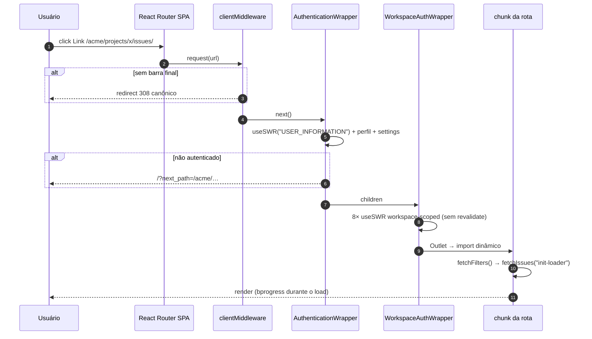
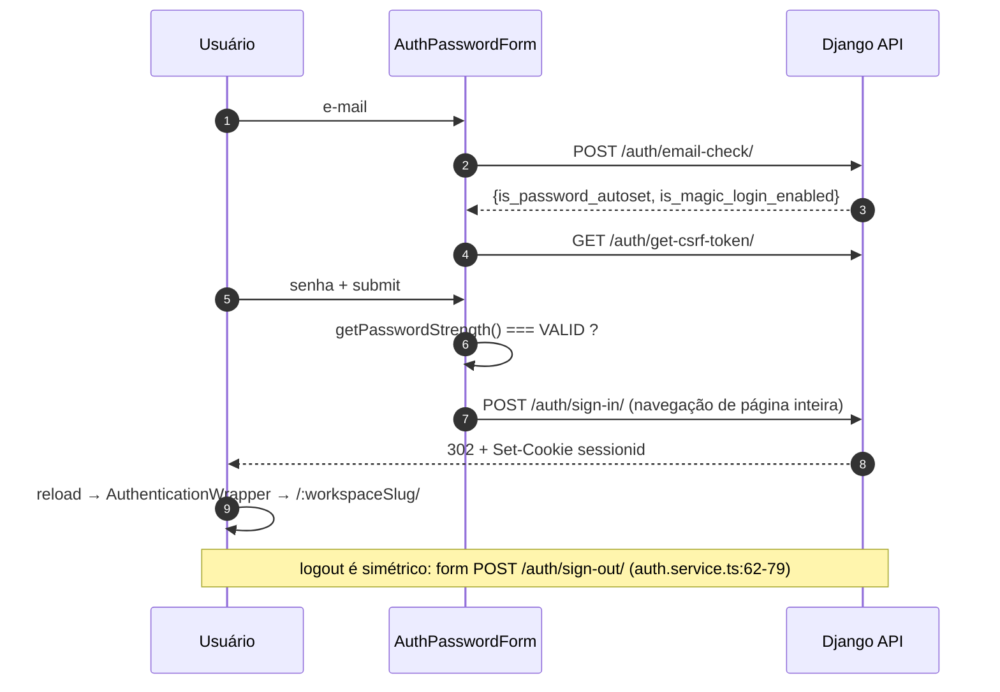
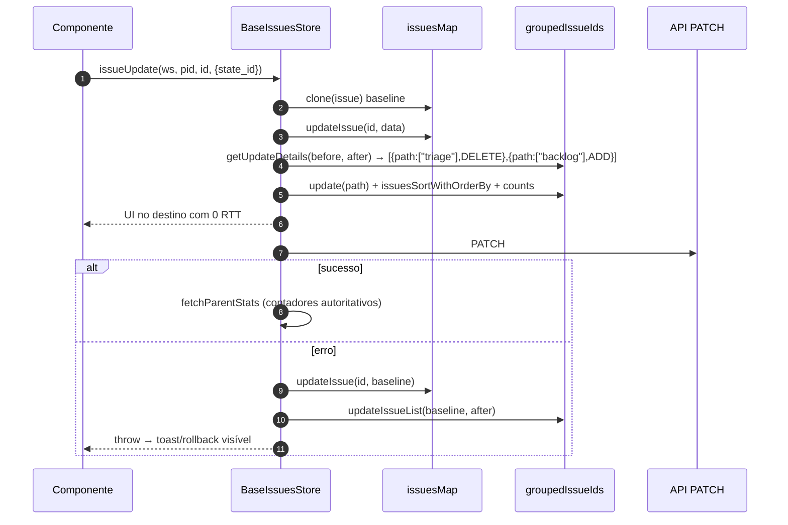
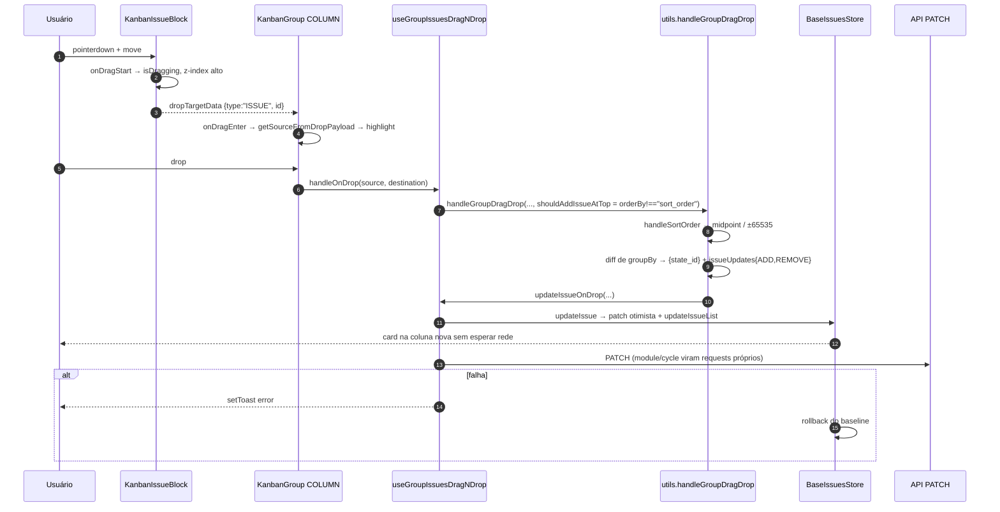

# Plane — Frontend web + editor (engenharia de interação)

Camada de engenharia do `apps/web` (React SPA) e `packages/editor`. Complementa
`plane-ui-ux.md` (telas) e `plane-data-model.md` (backend). Foco: como o cliente carrega,
guarda estado, consulta, escreve, desenha e falha.

Citações relativas a `_REF/plane/`; `[INFERENCE]` = dedução sem leitura direta.

`apps/web`: `app/` 188 arquivos/11.059 linhas · `components/` 1.364/122.636 · `store/`
100/24.796 · `hooks/` 114/6.558 · `services/` 53/4.965 · `layouts|lib|helpers|styles` 27/2.427.

---

## 1. Stack exato

Versões vêm do catálogo pnpm (`pnpm-workspace.yaml`), não dos `package.json` de app.

| Camada | Pacote | Versão | Evidência |
|---|---|---|---|
| Runtime | Node | 22.22.0 (`>=22.22.0`) | `.node-version:1`; `package.json:39-41` |
| PM | pnpm | 11.10.0 | `package.json:42` |
| Orquestração | Turbo | 2.10.11 | `pnpm-workspace.yaml:176` |
| Bundler | Vite | **8.2.4** | `pnpm-workspace.yaml:183` |
| Framework | React Router | **8.3.0**, `ssr:false` | `pnpm-workspace.yaml:156`; `apps/web/react-router.config.ts:11` |
| UI | React / DOM | **19.2.8** | `pnpm-workspace.yaml:146-147` |
| Estado | MobX / mobx-react / mobx-utils | 6.12.0 / 9.2.2 / 6.0.8 | `pnpm-workspace.yaml:134-136` |
| Dados remotos | SWR | 2.4.2 | `pnpm-workspace.yaml:170` |
| HTTP | axios | 1.20.0 | `pnpm-workspace.yaml:92` |
| Estilo | Tailwind v4 + `@makeplane/propel` | 4.1.17 / 0.7.3 | `pnpm-workspace.yaml:172,28` |
| Headless UI | `@base-ui/react` | 1.6.0 | `pnpm-workspace.yaml:11` |
| Palette | `cmdk` | ^1.1.1 | `pnpm-workspace.yaml:97` |
| DnD | pragmatic-drag-and-drop (+auto-scroll, hitbox) | 1.7.4 / 1.4.0 / 1.1.0 | `pnpm-workspace.yaml:8-10` |
| Editor | TipTap + `@tiptap/y-tiptap` | 3.31.3 / 3.0.9 | `pnpm-workspace.yaml:52,88` |
| Colaboração | Yjs / y-indexeddb / Hocuspocus | 13.6.20 / 9.0.12 / 3.4.4 | `pnpm-workspace.yaml:190,188,26` |
| Tipos | TypeScript | 5.8.3 | `pnpm-workspace.yaml:177` |
| Testes | Vitest + Testing Library | ^4.1.11 / 16.3.3 | `pnpm-workspace.yaml:185,56` |
| Lint/format | oxlint / oxfmt | 1.51.0 / 0.35.0 | `pnpm-workspace.yaml:150-151` |

Pontos que mudam projeto:

- **SPA real, sem SSR.** `ssr:false` gera só bundle de cliente; `root.tsx` é construído em
  Node apenas para pré-renderizar o `index.html` de fallback — por isso “Root stays
  shell-thin” e providers/loja/chrome ficam em `app/layout.tsx`, rota *pathless*
  (`apps/web/app/root.tsx:111-113`; `apps/web/app/routes.ts:24`).
- **`unstable_optimizeDeps: true`** existe porque sem entradas estáticas o scanner do Vite
  descobre deps em chunk de rota no meio da sessão → re-otimização + reload
  (`apps/web/react-router.config.ts:5-9`).
- **`assetsInlineLimit: 0`**: nada é inlined em base64 (`apps/web/vite.config.ts:22`).
- `dedupe: ["react","react-dom"]` no Vite + `overrides` no workspace, porque duas cópias de
  React aparecem como “invalid hook call”, não como erro de install
  (`apps/web/vite.config.ts:32`; `pnpm-workspace.yaml:197-201`).
- **Shims `next/*`**: `next/link|navigation|script` são alias para `app/compat/next/*`
  (`apps/web/vite.config.ts:26-31`) — o código “importa next” e recebe React Router.
- **TS mais frouxo no app**: herda `strict:true` (`packages/typescript-config/react-router.json:17`)
  mas desliga `noUnusedLocals/Parameters`, `noImplicitReturns`, `noImplicitOverride`
  (`apps/web/tsconfig.json:8-13`).
- **Lint é orçamento congelado**: `oxlint --max-warnings=11957` em `apps/web`
  (`apps/web/package.json`, script `check:lint`).
- **Deploy estático**: `turbo run build --filter=web` → **Caddy 2.11** com
  `try_files {path} /index.html`, `rate_limit` 300/min por IP e 3 headers de segurança; sem
  Node em produção (`apps/web/Dockerfile.web:73,78,108`; `apps/web/caddy/Caddyfile:13-29`).

---

## 2. Bootstrap e ciclo de request

```
entry.client.tsx  await initPromise(i18n) → hydrateRoot(<HydratedRouter/>)
└─ root.tsx        <html lang="en">, ThemeProvider, #context-menu-portal, #editor-portal
   └─ app/layout.tsx  clientMiddleware (barra final 308) → <AppProvider>
      └─ provider.tsx StoreProvider → AppProgressBar(lazy) → TranslationProvider
                      → PlaneToastProvider → StoreWrapper(lazy) → InstanceWrapper(lazy)
                      → SWRConfig(WEB_SWR_CONFIG) → children
         └─ (all)/layout → /[workspaceSlug]/layout → (projects)/layout → rota
```

Evidência: `apps/web/app/entry.client.tsx:39-52`; `apps/web/app/root.tsx:58-80`;
`apps/web/app/layout.tsx:15-36`; `apps/web/app/provider.tsx:37-54`.

Três não-óbvios:

1. **i18n antes da hidratação** (`entry.client.tsx:39-52`): hidratar antes divergiria do
   shell e React 19 *mantém* o DOM que não conseguiu adotar.
2. **`StoreProvider` é singleton de módulo** — `export let rootStore = new RootStore()` no
   topo e `StoreContext` inicializado com ele (`apps/web/lib/store-context.tsx:12-23`): um
   store por aba, sobrevivendo à navegação.
3. `enableStaticRendering(typeof window === "undefined")` (`apps/web/store/root.store.ts:118`):
   o módulo também é avaliado no build Node.

`StoreWrapper` (`apps/web/lib/wrappers/store-wrapper.tsx`) roda, em ordem: sidebar colapsada
do `localStorage` (`:44`); tema do servidor **uma vez por usuário**, com flag resetada quando
`userProfile.id` muda (`:57-80`); reaplicação das CSS vars do tema `custom` (`:94`); espelho
dos params de rota no `RouterStore` (`:108`). O comentário `:59-64` documenta o loop que esse
desenho evita; o preço é que, após o primeiro load, `localStorage` (next-themes) passa a ser a
fonte de verdade do tema.

**Multi-tenancy**: tenant = primeiro segmento de path (`:workspaceSlug`); sem subdomínio nem
header. Autorização por wrapper: `AuthenticationWrapper` decide sessão/onboarding
(`apps/web/lib/wrappers/authentication-wrapper.tsx:98-153`); `WorkspaceAuthWrapper` carrega
**8 recursos** do workspace em SWR paralelo com `revalidateIfStale/OnFocus:false`
(membership, roles por projeto, projetos parciais, membros, favoritos, estados,
preferências de sidebar/navegação — `layouts/auth-layout/workspace-wrapper.tsx:75-131`),
mostra spinner enquanto `loader`/workspaces não chegam (`:140-146`) e tela de “workspace não
disponível” se o slug não existe (`:147+`).

**Merge core/extended**: `mergeRoutes(coreRoutes, extendedRoutes)` faz merge profundo por
`file` de layout, “extended ganha” em conflito (`apps/web/app/routes/helper.ts:12-63`).
Hoje `extendedRoutes = []` (`apps/web/app/routes/extended.ts:9`): mecanismo para a edição
enterprise estender telas sem fork. Mesmo padrão em `useWorkFlowFDragNDrop`, no-op no OSS com
assinatura final (`apps/web/components/workflow/use-workflow-drag-n-drop.ts:11-23`).

Rotas: 67 `route()` + 43 `layout()` em `core.ts`, mais 11 redirects de compatibilidade
(`app/routes/core.ts:376-404`). Grupos `(all) (projects) (settings) (detail) (list)` não
entram na URL; só escolhem layout.

**Único middleware** é canonicalização: toda rota interna termina em `/` e o middleware
lança `redirect(…,308)` (`app/layout.tsx:15-23`). O shim `router.push` aplica
`ensureTrailingSlash` **e** adia com `setTimeout(…,0)` para não atualizar estado durante
render; `prefetch` é no-op (`app/compat/next/navigation.ts:14-37`). Combina com o Django, e
`normalizeAPIRequestURL` corrige URL de API no interceptor (`services/api.service.ts:29-39`).



---

## 3. Autenticação e sessão

| Mecanismo | Existe | Evidência |
|---|---|---|
| Sessão por cookie Django (`sessionid`) | **Sim**; axios `withCredentials:true` | `services/api.service.ts:21-23` |
| JWT / token em storage | **Não** | nenhum token persistido |
| CSRF | **Sim**, form POST + `X-CSRFTOKEN` pontual | `services/auth.service.ts:19-22,42-50` |
| E-mail + senha | Sim | `components/account/auth-forms/password.tsx:143-155` |
| Magic code | Sim (`/auth/magic-generate/`) | `services/auth.service.ts:54-58` |
| OAuth Google/GitHub/GitLab/Gitea | Sim, redirect de página inteira | `hooks/oauth/core.tsx:38-75` |
| 2FA/TOTP e SSO SAML/OIDC | **Não** no cliente/OSS | sem implementação |
| API tokens | Sim (settings + integrações) | `store/workspace/api-token.store.ts` |
| Rate limit de login | Não no cliente; só assets no Caddy | `caddy/Caddyfile:13-19` |
| Política de senha | Força medida + bloqueio de submit | `password.tsx:149-153` |

**O login não é XHR**: o `<form action="${API_BASE_URL}/auth/sign-in/">` é submetido de
verdade, com `csrfmiddlewaretoken` injetado no submit (`password.tsx:143-155`); o Django
responde `Set-Cookie` + redirect e o browser recarrega o app autenticado. O CSRF token é
pré-buscado guardando a **promise** em state, não o resultado (`:75-80,120-127`).



Erros de auth voltam por `?error_code=` e alimentam uma máquina de telas em `useState`
(SIGN_IN/SIGN_UP × EMAIL/PASSWORD/UNIQUE_CODE) — `components/account/auth-forms/auth-root.tsx:60-104`.

`AuthenticationWrapper` implementa 5 políticas (`lib/wrappers/authentication-wrapper.tsx:98-153`):
`PUBLIC`, `NON_AUTHENTICATED`, `ONBOARDING`, `SET_PASSWORD`, `AUTHENTICATED`; load sem
usuário → spinner (`:91-96`); `AUTHENTICATED` sem onboarding → `/onboarding` (`:140-152`).

Hardening do `next_path`: usa `isValidNextPath` (`@plane/utils`), que **exige `/` inicial e
rejeita `//`**, em vez de comparar com `location.origin` — o comentário registra o bypass
fechado (`http:evil.com` resolvia como relativo quando o app servia em `http:`)
(`authentication-wrapper.tsx:27-40`). **401** → redirect com `next_path`, com guarda para `/`
(senão loop na tela de login) (`services/api.service.ts:41-60`).

Invalidação: `signOut()` → form POST → `resetOnSignOut()` reconstitui **todos** os 30+
sub-stores e força `theme=system` (`store/root.store.ts:140-174`) — invalidação máxima, e por
isso a mais segura.

---

## 4. Modelo de dados do cliente

| Estrutura | Chave → valor | Evidência |
|---|---|---|
| `issuesMap` | `issue_id → TIssue` (fonte única de conteúdo) | `store/issue/issue.store.ts:36` |
| `issuesIdentifierMap` | `"PROJ-123" → issue_id` | `:37,61-75` |
| `groupedIssueIds` | `groupId → id[]` \| `groupId → subGroupId → id[]` \| `ALL_ISSUES → id[]` | `store/issue/helpers/base-issues.store.ts:177,308-328` |
| `groupedIssueCount` | `"groupId_subGroupId" → count` (flat) | `:181,410-435` |
| `issuePaginationData` | `groupKey → {prevCursor,nextCursor,nextPageResults}` | `:180,364-384` |
| `loader` | `groupKey → "init-loader"\|"pagination"\|"mutation"` | `:176,386-398` |
| `IssueDetail` | 10 sub-stores + 12 flags de modal | `store/issue/issue-details/root.store.ts:62-143` |
| `MultipleSelectStore` | `selected[]` + `lastSelected` + `active/prev/next` | `store/multiple_select.store.ts:42-47` |

Persistência local: `theme`, `app_sidebar_collapsed`, `sidebarWidth`, `APP_RAIL_${slug}`,
`userLanguage`, `issue_local_filters` (array por `key/workspaceSlug/viewId/userId`) e
`__plane_chunk_reload` — `store-wrapper.tsx:44`; `(projects)/_sidebar.tsx:30`;
`lib/app-rail/provider.tsx:29-32`; `packages/i18n/src/constants/language.ts:35`;
`issue-filter-helper.store.ts:216-241`; `lib/stale-asset-error.ts:35-47`. Documentos Yjs vão
para IndexedDB (`packages/editor/src/hooks/use-yjs-setup.ts:281-302`).

Único filtro 100% cliente: `kanbanFilters` (colunas colapsadas) por usuário/entidade
(`store/issue/project/filter.store.ts:273-296`). Todo o resto é persistido no servidor.

Integridade frágil: contagem cumulativa de subgrupo usa `groupKey.includes("_" + subGroupId)`
(`base-issues.store.ts:418-422`) — string matching, quebra se id contiver `_`
`[INFERENCE: UUIDs não têm]`; e `handleIssuesLocalFilters.get` tem condição morta
(`!currentFilterIndex && currentFilterIndex.length < 0`, `number.length` é `undefined`),
retornando `{}` em vez de `undefined` quando não acha (`issue-filter-helper.store.ts:236-241`).

---

## 5. Camada de domínio

```
CoreRootStore (store/root.store.ts:75-174) — 30 stores
├─ router · theme(10 sidebars) · user(profile/settings/permission)
├─ workspaceRoot(workspaces, apiToken, webhook, link) · projectRoot(project, member, state,
│  estimate, label, cycle, module) · memberRoot
├─ issue: IssueRootStore (store/issue/root.store.ts)
│   ├─ issues: IssueStore (issuesMap + identifierMap)
│   ├─ issueDetail (activity, comment, attachment, link, relation, subIssues, subscription)
│   └─ 11 pares (BaseIssuesStore + *FilterStore): project, cycle, module, projectView,
│      workspace, profile, archived, draft, team, teamProject, epic
│   └─ issueKanBanView · CalendarStore · GanttStore
├─ multipleSelect · powerK(registry) · commandPalette · workItemFilters(Map<entity, FilterInstance>)
└─ projectPages · sticky · editorAsset · inbox · dashboard · analytics · favorite ·
   notification · timeline · globalView · projectView · instance
```

790 componentes são `observer(...)`.

`BaseIssuesStore` (1.979 linhas, `store/issue/helpers/base-issues.store.ts`) é o contrato dos
5 layouts e faz três coisas:

1. **Deriva agrupamento do filtro, não do componente**: `groupBy` = `"target_date"` no
   calendário, `displayFilters.group_by` em list/kanban, `undefined` em spreadsheet/gantt
   (`:279-306`). O layout nunca pergunta “como agrupar?”.
2. **Mapeia chave → propriedade** via dicionários estáticos `ISSUE_GROUP_BY_KEY`
   (`:118-131`) e `ISSUE_ORDERBY_KEY` (`:143-172`).
3. **Mantém listas de ids por grupo** e as sincroniza em cada mutação (§7).

`FilterInstance<P,E>` (`@plane/shared-state`) é o motor genérico: `expression` +
`initialFilterExpression` (`packages/shared-state/src/store/rich-filters/filter.ts:141-160`);
`hasChanges` por **deep-compare** (`:226-228`); `canSaveView` (`:298-300`);
`canUpdateView` (`:305-312`). Operadores de núcleo: `AND`, `exact`, `in`, `range`
(`packages/types/src/rich-filters/operators/core.ts:9-43`), com `EXTENDED_*` vazios já
plugados (`operators/extended.ts:9-22`) — extensão sem tocar consumidor. Nós: `condition`
(property/operator/value) e `group`
(`packages/types/src/rich-filters/expression.ts:14-70`). `WorkItemFilterStore` mantém
`Map<"entityType:entityId", FilterInstance>` lazy
(`packages/shared-state/src/store/work-item-filters/filter.store.ts:47-84`).

Validação: **react-hook-form** em formulários grandes — issue modal
(`components/issues/issue-modal/form.tsx:141-146`), com `isDirty/dirtyFields` para reset
seletivo ao trocar de projeto (`:164-178`); **estado manual** em formulários críticos
(login/OTP). Não há schema zod no cliente para issue; o tipo `TIssue` é a validação estática e
as regras vivem em `@plane/utils` (ex.: `createIssuePayload` injeta `tempId` explicitamente
“for optimistic updates, not part of the API response”, `packages/utils/src/work-item/base.ts:160-178`).

---

## 6. Consultas server-side

Pipeline único: **expressão → params → cursor**. `computedFilteredParams`
(`store/issue/helpers/issue-filter-helper.store.ts:92-125`) mapeia `group_by` para o valor do
servidor, filtra as chaves que o layout aceita, serializa a árvore inteira em **um param**
`filters=<JSON>`, e adiciona `layout` (+ `expand=issue_relation,issue_related` no gantt).

A matriz do que cada layout aceita é declarativa
(`packages/constants/src/issue/filter.ts:112-296`):

| Layout | `display_filters` | `display_properties` |
|---|---|---|
| list | `group_by`, `order_by`, `type` | todas |
| kanban | `group_by`, `sub_group_by`, `order_by`, `type` | todas |
| calendar | `type` | `key`, `issue_type` |
| spreadsheet | `order_by`, `type` | todas |
| gantt_chart | `order_by`, `type` | `key`, `issue_type` |

Extras (`show_empty_groups`, `sub_issue`) só em list/kanban (`filter.ts:231-256`). É um
endpoint com um vocabulário validado por layout no cliente
(`packages/utils/src/work-item/base.ts:104-136`).

**Cursor composto** `"<perPage>:<page>:<offset>"`; sem cursor, `<perPage>:0:0` (`:1:0` em
página de grupo) (`issue-filter-helper.store.ts:307-315`). `getNextCursor` **deriva do estado
local**, não do `next_cursor` do servidor (`base-issues.store.ts:437-451`).

Paginar **um grupo** não repete a consulta agrupada: `getPaginationParams` remove
`group_by`/`sub_group_by` e traduz para o filtro equivalente (ex. `group_by=state` +
`groupId=X` → `state_id=X`), permitindo “carregar mais” em uma coluna sem recarregar as
outras (`issue-filter-helper.store.ts:325-343`).

| Layout | `perPageCount` | Agrupa | Evidência |
|---|---|---|---|
| List | 50 com grupo / **100** sem | sim | `list/base-list-root.tsx:90` |
| Kanban | **30** / 10 com subgrupo | sim | `kanban/base-kanban-root.tsx:95` |
| Spreadsheet | 100 | não | `spreadsheet/base-spreadsheet-root.tsx:70` |
| Calendar | 4 (mês) / 30 (semana) | por `target_date` | `calendar/base-calendar-root.tsx:93-97` |
| Gantt | 100 | não | `gantt/base-gantt-root.tsx:67` |

Ordenação: com `order_by ≠ sort_order` o servidor manda a ordem; com `sort_order` o cliente
reordena em memória (`issuesSortWithOrderBy`, `base-issues.store.ts:1766+`).

SWR é cache de **contexto de sessão** (`USER_INFORMATION`, `INSTANCE_INFORMATION`,
`WORKSPACE_MEMBERS(slug)`, `ISSUE_DETAIL_{ws}_{ident}_{seq}`), não de listas; a config global
revalida no focus (`packages/constants/src/swr.ts:16-22`), mas quase todo call-site desliga
(`workspace-wrapper.tsx:75-131`).

---

## 7. Escrita e concorrência

`issueUpdate` é o núcleo transacional (`base-issues.store.ts:555-589`): clona baseline →
atualiza mapa → atualiza listas → atualiza stats do pai → `PATCH` → `fetchParentStats`;
em erro, restaura baseline nos dois lados e rethrow.



Quem muda de grupo é calculado por **diff de propriedades**, não por evento de UI:
`getUpdateDetails` compara `issue[issueGroupKey]` antes/depois e emite pares ADD/DELETE por
path, com subgrupo (`:1528-1583`); `getOrderByUpdateDetails` cobre mudança da propriedade de
ordenação sem mudança de grupo, emitindo `REORDER` (`:1591-1640`). Valores array
(labels, modules, assignees) são diffados com `pull`/`concat`/`uniq`.

`sort_order` fracionário no drop: topo = `destino − 65535`, fim = `+65535`, meio = média
(`components/issues/issue-layouts/utils.tsx:506,515,527`), grupo vazio = `65535` (`:533`).
Sem rebalanceamento: ~17 drops no mesmo intervalo esgotam a precisão de `float`
`[INFERENCE, nenhum normalize encontrado]`.

Concorrência entre usuários: **last-write-wins**. Sem versão/ETag/If-Match; `PATCH` manda só
campos alterados e o perdedor só descobre no próximo refetch. Colaboração real existe apenas
no editor (CRDT, §8).

Escritas compostas: **quick add** insere com `tempId`, faz POST, remove o temporário e então
aplica ciclo e módulos em requests separados (3 requests para “criar no ciclo X com módulo Y”,
`base-issues.store.ts:646-676`); **bulk** (`bulkUpdateProperties`, `removeBulkIssues`,
`bulkArchiveIssues`) é **não otimista** (`:678-755`); **anexo** é upload em 2 fases — `POST`
asset → URL assinada → `multipart/form-data` no storage → `PATCH` de status
(`services/file.service.ts:148-175`; `services/file-upload.service.ts:19-46`), com progresso
por bloco no editor (`store/editor/asset.store.ts:32-38,68-79`).

---

## 8. Assíncrono, tempo real, busca, arquivos, cache, i18n

| Mecanismo | Existe | Nota |
|---|---|---|
| WebSocket p/ issues ou notificações | **Não** | nenhum `new WebSocket`/`EventSource` em `apps/web` |
| WebSocket p/ documentos | **Sim** (Hocuspocus) | `packages/editor/src/hooks/use-yjs-setup.ts` |
| SSE / polling | Não | `WEB_SWR_CONFIG` sem `refreshInterval` (`constants/src/swr.ts:16-22`) |
| Fila de jobs no cliente | Não | mutações fire-and-forget com toast |
| Busca server-side | **Não** | palette filtra client-side (§15) |

`useRealtimePageEvents` não é transporte: é um dispatcher de `EventToPayloadMap` que vira
toast/ação de store (`apps/web/hooks/use-realtime-page-events.tsx:46+`).

Máquina de estados da colaboração (`use-yjs-setup.ts`):

| Situação | Reação | Linha |
|---|---|---|
| `onConnect` | `retryCount=0`, `awaiting-sync` | `:73-85` |
| `onSynced` | `synced` | `:99-105` |
| auth falhou | `disconnected{auth-failed}` | `:66-72` |
| close 4000–4003 ou `force_close` | pausa provider (`shouldConnect=false`), **não** reconecta | `:18-22,154-176` |
| close transitório | `retryCount++`; após **3** → `disconnected{max-retries}` | `:34,177-196` |
| IndexedDB | `IndexeddbPersistence(docId)` → edita offline antes do sync | `:281-302` |

`isDocReady = synced || disconnected || (cacheReady && hasCachedContent)` (`:356`): o editor
abre com cache mesmo sem servidor — o motivo de existir o `y-indexeddb`.

- **Arquivos**: `FileService` (asset + URL assinada) + `FileUploadService` (multipart) +
  `sharp` no build (`pnpm-workspace.yaml:167`).
- **Cache** em 3 camadas: MobX (normalizado), SWR (contexto), IndexedDB (Yjs); sem React Query.
- **i18n**: 22 locales, 28 namespaces (`packages/i18n/src/constants/namespaces.ts:9-38`),
  ICU, `import()` por locale/namespace (`packages/i18n/src/core/instance.ts:16-18`) e
  `loadNamespaces(NAMESPACES)` **eager** no idioma inicial para evitar cascata de re-render
  (`:49-52`); `fallbackNS` cobre todos (`:33-36`). CI dedicado (`i18n-sync-check.yml`).
- **E-mail**: só o flag `isSMTPConfigured` decide link vs popover de forgot-password
  (`password.tsx:85-100`); envio é backend.

---

## 9. Contrato de API (cliente)

- Todo service estende `APIService`, que cria `axios.create({baseURL, withCredentials:true})`
  **por instância** (`services/api.service.ts:15-24`) — ~50 services = ~50 clientes e ~100
  interceptors; não há cliente HTTP único.
- Erros: `.catch(e => { throw e?.response?.data })` — o **corpo** substitui o `Error`, então
  o throw pode ser objeto plano sem `stack`; call-sites usam `err?.detail`
  (`hooks/use-group-dragndrop.ts:107-112`).
- Sem versionamento no path; compatibilidade por adição. Toda URL termina em `/`
  (`api.service.ts:29-39`).

---

## 10. Segurança (superfície do cliente)

| Vetor | Situação | Evidência |
|---|---|---|
| XSS em descrição/comentário | `sanitize-html` 2.18.1 (pin com CVE justificado) | `pnpm-workspace.yaml:163-165` |
| Markdown de páginas | `react-markdown` 10 + hast/mdast | `pnpm-workspace.yaml:153` |
| **CSP** | **Ausente** | `caddy/Caddyfile:21-25` só manda `X-Frame-Options: DENY`, `X-Content-Type-Options`, `X-XSS-Protection` |
| CSRF | form POST + `X-CSRFTOKEN` | `services/auth.service.ts:42-50` |
| Segredos no bundle | `define` injeta **só** `VITE_*` | `vite.config.ts:10-20` |
| Open redirect | `isValidNextPath` | `authentication-wrapper.tsx:27-40` |
| Upload | tipo/tamanho no cliente; `file-type` no servidor | `pnpm-workspace.yaml:110` |
| Prototype pollution | `lodash-es` 4.18.1 | `pnpm-workspace.yaml:130` |

`X-XSS-Protection` é header obsoleto; a lacuna real é **CSP** (`script-src`/`connect-src`
abertos, sem nonce). `[INFERENCE: mitigado em parte por não haver `dangerouslySetInnerHTML`
fora do pipeline sanitizado]`

---

## 11. Performance e observabilidade

**Não há virtualização de linhas** nos 5 layouts. Existe `RenderIfVisible`
(`components/core/render-if-visible-HOC.tsx`): placeholder com `IntersectionObserver` cujo
`root` é o container scrollável e `rootMargin` é **percentual** (`:60-68`); invisível →
`<div style={{height}}>`, com altura real medida em `requestIdleCallback` (`:84-93`); `:58-66`
posterga o `setState` para idle; `defaultValue/forceRender` pré-renderizam (kanban renderiza os
11 primeiros: `shouldRenderByDefault={index <= 10}`, `kanban/blocks-list.tsx:53-70`). Custo: um
observer por bloco. `@tanstack/react-virtual` existe no catálogo e é usado só em
selects/`packages/blocks`.

Maior custo escondido: **`useIssues` faz `lodash.merge` do store a cada render**
(`hooks/store/use-issues.ts:82-140`) — O(store) por render em dezenas de componentes e um
snapshot plano que mascara a granularidade reativa do MobX. Item nº 1 a não copiar. Outros: `useSize()` adiciona listener de `resize` **sem debounce** e devolve array
novo (`hooks/use-window-size.tsx:9-22`); `SpreadsheetTable` escreve `style.boxShadow` direto no
DOM para não re-renderizar linhas (`spreadsheet/spreadsheet-table.tsx:73-96`).

Splitting: automático por rota; só **3** `lazy()` manuais (`AppProgressBar`, `StoreWrapper`,
`InstanceWrapper` — `app/provider.tsx:17-27`) para sair do chunk inicial; barra de progresso
ligada a `useNavigation()` (`lib/b-progress/AppProgressBar.tsx:8-11`).

**Chunk obsoleto** é tratado como cidadão de primeira classe: assinaturas de erro por browser
(Chromium/Firefox/Safari/Vite + mensagem sintetizada do React Router)
(`lib/stale-asset-error.ts:9-17`), guarda anti-loop de 30 s em `sessionStorage` (`:33-80`),
reload único, e o mesmo caminho é usado por `vite:preloadError`, `window.error`,
`unhandledrejection` (`app/entry.client.tsx:20-33`) e pelo `ErrorBoundary` de `root.tsx:133-135`.

**Observabilidade é quase inexistente**: nenhum Sentry no `apps/web` (só `VITE_SENTRY_*`
declaradas em `turbo.json:8-27`, sem consumidor), `LayoutErrorBoundary` faz `console.error`
(`components/common/layout-error-boundary.tsx:45-48`), sem Web Vitals nem métricas de store.
As “métricas” são o orçamento de lint e o `react-doctor` no CI.

---

## 12. Layouts: componente → estado → gestos

| Layout | Root / estrutura | Estado específico | Gestos | Página |
|---|---|---|---|---|
| **List** | `list/base-list-root.tsx` → `ListGroup` → `IssueBlockRoot` → `IssueBlock` (sub-issues até nível 3) | `BaseIssuesStore` + `MultipleSelectStore` | drag entre grupos, colapso, inline edit, click→peek, Shift+click e Shift+↑↓ | 50/100 |
| **Kanban** | `kanban/base-kanban-root.tsx` → `KanBan` ou `KanBanSwimLanes` → `KanbanGroup` | `IssueKanBanViewStore` (`kanBanToggle`, `isDragging`) + `kanbanFilters` | drag coluna↔coluna e reorder, auto-scroll, delete zone, colapso | 30/10 |
| **Spreadsheet** | `spreadsheet/base-spreadsheet-root.tsx` → `SpreadsheetTable` (`<table>` real, 1ª coluna sticky) | store + `MultipleSelectStore` | setas navegam células, Enter/Space clicam `.clickable`, edição inline, **sem drag** | 100 |
| **Calendar** | `calendar/base-calendar-root.tsx` → `WeekHeader`/`WeekDays`/`DayTile` → `CalendarIssueBlocks` | `CalendarStore` (mês/semana ativos, payload, 2 computed) | drag issue→dia (`target_date`), quick-add por dia, mês/semana | 4/30 |
| **Gantt** | `gantt/base-gantt-root.tsx` → `components/gantt-chart` (blocks posicionados por `marginLeft/width`) | `GanttStore` (`currentView:"month"`, `activeBlockId`) + `TimeLineStore` | arrastar/resizar com **mouse puro** (`helpers/draggable.tsx:54-58`), reorder no sidebar via dnd | 100 |

Detalhes escondidos: `GanttStore.canUserDragDropVertically/Horizontally` são **`false` fixos**
(`store/issue/issue_gantt_view.store.ts:88-96`; o componente usa `getCanUserDragDrop()`,
`kanban/default.tsx:105`) — API morta. No kanban o drag depende do agrupamento:
`DRAG_ALLOWED_GROUPS = state, priority, assignees, labels, module, cycle`
(`packages/constants/src/issue/common.ts:93-100`); agrupar por `created_by`/`project` permite
ver, não mover, e o card explica via toast (“Drag and drop is disabled for the current
grouping”, `kanban/block.tsx:276-284`).

### 12.1 Drag no kanban

Sensor por bloco (`draggable({element, dragHandle: element, canDrag})`,
`kanban/block.tsx:209-221`); colisão: coluna **e** bloco são drop targets
(`kanban-group.tsx:136-173`; `block.tsx:223-241`); overlay `DropIndicator`; auto-scroll
`autoScrollForElements({element})` no container (`base-kanban-root.tsx:145-158`).



Onde dói: `handleSortOrder` só roda no drop (sem preview por `sort_order`); o destino é
reconstruído escolhendo o **último** `COLUMN` e o **último** `ISSUE` dos `dropTargets`
(heurística por ordem de registro, não geometria — `utils.tsx:401-470`); drop entre grupos com
module/cycle gera 2–3 requests (`hooks/use-group-dragndrop.ts:78-101`); **não existe drag por
teclado**.

---

## 13. Detalhe, peek e URL

| Forma | Como | URL? | Componente |
|---|---|---|---|
| **Peek** | `setPeekIssue({...})` no MobX | **Não** | `components/issues/peek-overview/*` |
| **Página** | `/…/browse/:projectIdentifier-:sequenceId/` | Sim | `app/(all)/[workspaceSlug]/(projects)/browse/[workItem]/page.tsx` |
| Mobile | força `router.push(link)` | Sim | `hooks/use-issue-peek-overview-redirection.tsx:44-52` |

Link canônico: **`/{ws}/browse/{IDENT}-{seq}/`**; a rota antiga
`/projects/:projectId/issues/:issueId` só resolve e redireciona
(`packages/utils/src/work-item/base.ts:315-340`; `…/issues/(detail)/[issueId]/page.tsx:30-50`).

Assimetria: **peek de ciclo usa `?peekCycle=`** (`components/cycles/cycle-peek-overview.tsx:29-47`)
e **peek de issue não usa URL**. Consequência: peek não é compartilhável, não sobrevive a
reload e `Back` sai da tela em vez de fechar o painel.

Foco/fechamento: `Escape` fecha só se nenhum modal/dropbar estiver aberto e o `activeElement`
não for `INPUT` (`peek-overview/view.tsx:104-113`) — checagem por `tagName` (`:107`), que não
cobre `textarea`/`contenteditable`; ao fechar devolve foco com
`getElementById("issue-"+id)?.focus()` (`:109-111`), possível porque os blocos expõem `id` e
`tabIndex`. Clique fora usa `composedPath()` congelado e reconhece
`data-prevent-outside-click`, `data-base-ui-portal` e `data-delay-outside-click`
(`hooks/use-peek-overview-outside-click.tsx:14-64`) — o comentário explica por que
`data-base-ui-inert` não serve (o Base UI o põe no **root**, e todo clique seria ignorado).
**Não há `role="dialog"`/`aria-modal`/focus trap** no painel (`view.tsx:118-131`).

Composição: página e painel renderizam o **mesmo** `IssueView` (`embedIssue` diferente) =
título + descrição TipTap com versões + parent + reações + `IssueActivity` (filtro e ordenação
próprios) + `PeekOverviewProperties` + widgets colapsáveis registrados em
`openWidgets/lastWidgetAction` (`store/issue/issue-details/root.store.ts:80-90,142`). Sub-issues
param no nível 3, onde o chevron abre o peek (`list/block.tsx:144-152`), e só entram na lista
com `displayFilters.sub_issue` (`base-issues.store.ts:1220-1236`).

---

## 14. Power K: registry, atalhos, contexto

Quatro peças desacopladas: **registry** (`Map<id, command>` observável, lookups memoizados por
`computedFn(ctx)` para `shortcut`/`keySequence`/`modifierShortcut`,
`components/power-k/core/registry.ts:105-137`); **context detector** (18 linhas, deriva
`work-item|page|cycle|module` dos params, `core/context-detector.ts`); **ShortcutHandler** (um
listener em `document`, instalado uma vez, `global-shortcuts.tsx:56-80`); **UI** (`cmdk` +
Dialog do propel, com `activePage` transformando a palette em navegação de páginas).

O handler é o melhor código de teclado do repo (`core/shortcut-handler.ts:197-247`), nesta
ordem: `e.repeat` ignorado → `Cmd/Ctrl+K` antes de `defaultPrevented` (para fechar a própria
palette, cujo `cmdk` tem binding de vim) → `defaultPrevented` reseta → `isTypingInInput` reseta
e sai → modificador tenta modifier-shortcut → senão single-key/sequência com timeout de
**1000 ms** (`:315`). `isTypingInInput` (`:129-141`) cobre `input/textarea/select`,
`isContentEditable` (com herança), `role` em `TYPING_ROLES` e
`closest('[role=dialog],[role=alertdialog],[role=menu],[role=listbox],.ProseMirror')`.

Resolução por layout físico: `navigator.keyboard.getLayoutMap()` quando existe, senão fallback
US **validado por `e.code`**, e o atalho é registrado no caractere **não-shiftado** da tecla
física (`:21-100`) — um layout que imprime outro caractere não dispara atalho que não anuncia.

Colisão: `getKeySequenceMap` usa `Map.set` → **o último visível vence, em silêncio**
(`registry.ts:113-121`). Hoje `gr`, `gs` e `os` estão duplicados entre workspace e projeto,
desambiguados só por `isVisible` (`config/navigation/commands.ts:236-260,274-302,344-388,484-525`).

| Sequência | Comando | Escopo |
|---|---|---|
| `cmd/ctrl+k` | abre/fecha Power K (hardcoded) | global |
| `cmd/ctrl+/` | modal de atalhos | global |
| `cmd/ctrl+b` | colapsa sidebar | global |
| `cmd/ctrl+f` | foca busca do top nav | global |
| `cmd/ctrl+shift+c` | copia URL atual | global |
| `n` `i` / `n` `d` / `n` `v` | nova work item / página / view | criação |
| `n` `c` / `n` `m` / `n` `p` | novo ciclo / módulo / projeto | criação |
| `g` `h` | home do workspace | nav |
| `g` `x` | notifications/inbox | nav |
| `g` `y` | seu trabalho | nav |
| `g` `p` | lista de projetos | nav |
| `g` `a` | analytics | nav |
| `g` `j` | drafts | nav |
| `g` `i` / `g` `c` / `g` `m` / `g` `v` / `g` `d` / `g` `k` | work items / ciclos / módulos / views / páginas / intake do projeto | nav |
| `g` `r` | archives (workspace **ou** projeto) | nav |
| `g` `s` | settings (workspace **ou** projeto) | nav |
| `o` `w` | seletor de workspace | nav |
| `o` `p` / `o` `c` / `o` `m` / `o` `v` | abrir projeto / ciclo / módulo / view | nav |
| `o` `s` | abrir settings | nav |

Fonte: `components/power-k/config/creation/command.ts:79-145`,
`config/navigation/commands.ts:99-525`, `config/miscellaneous-commands.ts:60-84`,
`config/help-commands.ts:27`.

Fora da Power K: `Shift+↑/↓` seleciona intervalo (`hooks/use-multiple-select.ts:288-310`),
`Shift+click` seleciona faixa (`:216-253`), setas navegam células
(`hooks/use-table-keyboard-navigation.tsx:24-60`), `Escape` fecha peek.

A busca da palette é **client-side**: `cmdk` com `filter` de substring sobre o título i18n e
`shouldFilter` só quando há termo (`ui/modal/wrapper.tsx:136-141`); entidades vêm dos stores
(`PROJ-123` resolvido sem request, `navigation/top-nav-power-k.tsx:57-60`). Não há busca
global server-side em lugar nenhum.

---

## 15. Filtros na UI e views salvas

- `WorkItemFiltersRow` + `WorkItemFilterStore` + `useWorkItemFiltersConfig` (404 linhas de
  config de propriedades: labels, states, members, cycles, modules, projects —
  `hooks/work-item-filters/use-work-item-filters-config.tsx:74-120`).
- Condição = `{property, operator: exact|in|range, value}`; `in`/`range` aceitam array
  (`MULTI_VALUE_OPERATORS`, `packages/types/src/rich-filters/operators/index.ts:46-49`). Só
  **AND** no core (`operators/core.ts:12-14`) — sem OR na UI pública.
- Dirty state por deep-compare; “Update view” aparece com `hasChanges || hasAdditionalChanges`;
  “Save as” exige filtro ativo (`filter.ts:226-228,298-312`).
- Persistência: display filters/properties/rich filters em
  `PATCH /projects/{id}/user-properties/` — **por usuário**, não na view
  (`store/issue/project/filter.store.ts:174-252`; `services/project/project.service.ts:109-118`);
  só a view compartilhada guarda `rich_filters` (`all-issue-layout-root.tsx:60-72`).
- Coerções no update a copiar: `group_by=null ⇒ sub_group_by=null`; kanban com
  `group_by==sub_group_by` ⇒ zera subgrupo; kanban com `group_by=null` ⇒ força `state`
  (`filter.store.ts:206-226`); troca de layout ⇒ `clear(true)` e às vezes refetch (`:236-243`).
- Erro no PATCH ⇒ `fetchFilters()` e rethrow (`:296-301`), **sem** rollback otimista do filtro.

### 15.1 Formulários e feedback

Propriedades são selects Base UI+propel com edição inline em bloco, peek e spreadsheet, todas
sobre o mesmo `updateIssue` (`issue-layouts/properties/*`); validação é RHF (`onChange`) +
`confirm-issue-discard.tsx` + `useReloadConfirmations`; loading é skeleton por layout
(`components/ui/loader/layouts/*`); feedback é `setToast`/`setPromiseToast`/`updateToast`
imperativos (`@plane/blocks/toast`), com ação no toast (ex.: “criar mais”).

---

## 16. Editor e colaboração

TipTap 3.31.3 com ~20 extensões próprias (`packages/editor/src/extensions`: `slash-commands`,
`custom-image`, `mentions`, `work-item-embed`, `table`, `unique-id`, `side-menu`,
`enter-key`, `keymap`). Slash command usa `Suggestion` com `char:"/"`, desabilitado em code
block (`extensions/slash-commands/root.tsx:47-63`), menu via `ReactRenderer` + floating-ui.
Colaboração: `extension-collaboration` + `@tiptap/y-tiptap` + Hocuspocus (§8); conflito é
resolvido pelo CRDT, não pela aplicação.

A11y do editor: **zero** `aria-label` no container ProseMirror; os únicos `aria-*` do pacote
estão no visualizador de imagem em tela cheia
(`extensions/custom-image/components/toolbar/full-screen/modal.tsx:206-288`). Um
`contenteditable` sem `role="textbox"`/`aria-multiline`/label explícito é o estado atual.

---

## 17. Acessibilidade — auditoria

`apps/web`: 221 `aria-label`, **zero `aria-live`**, 7 `role="button"`, 39 disables de `jsx_a11y`.

| # | Achado | Evidência | Impacto |
|---|---|---|---|
| 1 | **Nenhuma `aria-live`**; toasts dependem do viewport do propel (externo) | `grep -r aria-live apps/web` = 0 | “salvo”, paginação e erros silenciosos |
| 2 | **Kanban sem semântica de lista** (3 ocorrências de `aria` em toda a pasta) | `issue-layouts/kanban/` | colunas não são estrutura navegável |
| 3 | **Lista idem** (3 ocorrências); item é `<a>` dentro de `div`s | `issue-layouts/list/`; `list/block.tsx:186-196` | sem “item 3 de 42” |
| 4 | **`<html lang="en">` fixo** com 22 locales; nada atualiza `lang` | `app/root.tsx:58` | pronúncia errada em 21 locales |
| 5 | **Peek não é dialog**: `div` sem `role`, `aria-modal`, label ou focus trap | `peek-overview/view.tsx:118-131` | Tab escapa; sem contexto |
| 6 | **Create-work-item sem `DialogTitle`** (80 `DialogTitle` existem em outros lugares) | `issue-modal/base.tsx:413-419` | diálogo sem nome acessível |
| 7 | **Modal de criação ignora `onOpenChange`** ⇒ `Escape` não fecha | `issue-modal/base.tsx:412` | teclado preso até achar o botão |
| 8 | **Toda célula do spreadsheet é tab stop**: `<td tabIndex={0}>`, sem roving tabindex nem `role="grid"` | `spreadsheet/issue-column.tsx:46-48`; `issue-row.tsx:264-266` | 100×N tabs antes de sair |
| 9 | **Chevron de sub-issues sem `aria-expanded`/label** | `list/block.tsx:249-258` | estado de expansão invisível |
| 10 | **`role="button"` em `<li onClick>` sem `tabIndex`/keydown** | `components/ui/empty-space.tsx:82` | inalcançável por teclado (WCAG 2.1.1) |
| 11 | **`role="button"` em `div`** que só foca input | `navigation/top-nav-power-k.tsx:224-230` | falso botão |
| 12 | **Splitter `role="separator"`** sem `aria-orientation`/`valuenow` e **só mouse** | `sidebar/resizable-sidebar.tsx:216-219,258-261` | 2.1.1 / 4.1.2 |
| 13 | **`prefers-reduced-motion` ausente** em todo o CSS, com animações de 300 ms | `grep -r` = 0; `workspace/content-wrapper.tsx:36-44` | 2.3.3 |
| 14 | **Drag sem alternativa de teclado** em todos os layouts | pragmatic-dnd sem keymap; gantt só `onMouseDown` | ação essencial inacessível |
| 15 | **`useKeypress("Escape")` global** dispara mesmo em input (guard manual por `tagName`) | `hooks/use-keypress.tsx:18-26`; `view.tsx:107` | fecha o peek enquanto se digita |
| 16 | Sem skip-link para o conteúdo; atalhos só num modal (`cmd+/`) | `power-k/ui/modal/shortcuts-root.tsx` | descoberta fraca |
| 17 | 5 temas + `system` (inclui `light/dark-contrast`), **sem teste automatizado de contraste** | `app/root.tsx:76` | regressão silenciosa |
| 18 | Botões só-ícone sem label (chevron de coluna, clear da busca) | `top-nav-power-k.tsx:237-240` | sem nome acessível |

O que está **certo** e vale copiar: `isTypingInInput` da Power K (§14); `ControlLink` que
recusa `<a>` sem `href` e cai para `<span>` (“an href-less anchor is unreachable by keyboard
yet still reads as a link”, `packages/blocks/src/layout/control-link/control-link.tsx:35-45`);
devolução de foco ao fechar o peek (`view.tsx:109-111`); tabindex explícito por formulário com
`-1` no mobile (`packages/utils/src/tab-indices.ts:11-19`); tratamento de Enter/Space em quick
actions dentro de linha clicável (`quick-action-dropdowns/helper.tsx:30-53`); `aria-label` no
checkbox de seleção (`components/core/multiple-select/entity-select-action.tsx:38-40`);
jsx-a11y ligado no oxlint (`oxlintrc.json:3,18-19`).

---

## 18. Temas, i18n, responsivo

- **Temas**: `next-themes` com `["light","dark","light-contrast","dark-contrast","custom"]` +
  `defaultTheme="system"` (`app/root.tsx:76`); tokens de `@makeplane/propel/styles`, dark
  chaveado por `[data-theme*="dark"]` (`packages/tailwind-config/index.css:2-18`); tema
  `custom` aplica CSS vars em runtime **sem reload** (`store-wrapper.tsx:94-101`).
- **i18n**: ver §8. `lang` do documento não acompanha o idioma (§17.4).
- **Responsivo** com dois sistemas: breakpoints Tailwind (`md:`/`lg:` espalhados — 7 só em
  `list/block.tsx`) e **medição por JS**: `useResponsiveTabLayout` usa `ResizeObserver`,
  calcula quantas tabs cabem (`gap=4`, `overflowButtonWidth=40`) e mantém a ativa visível
  (`components/navigation/use-responsive-tab-layout.ts:46-60`). No mobile o peek vira
  navegação (§13) e o tabindex numérico é desligado.

---

## 19. Testes e qualidade

| Camada | Existe | Evidência |
|---|---|---|
| Vitest em `apps/web` | **Não** — sem config e sem script `test` | `apps/web/package.json` scripts |
| Vitest em `packages/editor` | Sim (2 arquivos, com mock de Hocuspocus/IndexedDB) | `packages/editor/vitest.config.ts`; `src/hooks/__tests__/use-yjs-setup.test.ts:34-60` |
| Vitest em `packages/blocks` | Sim, com setup DOM elaborado para o virtualizer | `packages/blocks/vitest.setup.dom.ts:62-95` |
| Vitest em `apps/live` | Sim | `apps/live/vitest.config.ts` |
| E2E (Playwright/Cypress) | **Não** | nenhum `playwright.config.*` |
| Storybook / tipos | Sim (sem addon-a11y) / `react-router typegen && tsc --noEmit` | `pnpm-workspace.yaml:36-41`; `apps/web/package.json` |

Conclusão dura: **os stores e os layouts de issue não têm teste automatizado**. Toda a lógica
de `getUpdateDetails`, `handleGroupDragDrop`, `handleSortOrder` e paginação por grupo é
validada só manualmente. `[INFERENCE: cobertura real concentra-se em utils/editor/blocks]`

---

## 20. Lições objetivas para o meraki

1. **Normalize por id e compartilhe o mapa.** `issuesMap` + `issuesIdentifierMap`
   (`issue.store.ts:36-37`) é o que permite 5 layouts sem refetch. O antídoto para N+1 é o
   modelo, não o cache.
2. **Separe “onde a issue está” de “como o layout desenha”.** `groupedIssueIds` guarda ids; o
   layout só escolhe `group_by`, e o diff ADD/DELETE/REORDER é calculado uma vez no store
   (`base-issues.store.ts:1528-1640`). Trocar de layout não recarrega na maioria dos casos.
3. **Update otimista com baseline clonado e rollback explícito** (§7), mas **não** faça bulk
   otimista — o Plane não faz e evita divergência em massa.
4. **Não copie `useIssues` com `lodash.merge` por render** (`use-issues.ts:82-140`). Use
   seletores ou observação direta; copiar o grafo anula a granularidade do MobX.
5. **Um único listener de teclado** com detecção de widget por role + `contenteditable` +
   `closest` de overlays (`shortcut-handler.ts:129-141`) e resolução por layout físico
   (`getLayoutMap`). Melhor que handlers por componente e que checar `tagName`.
6. **Comandos com `id` + `isVisible(ctx)`/`isEnabled(ctx)`**, e **detecte colisão de atalho em
   dev**: o Plane falha aqui (`Map` sobrescreve em silêncio, `registry.ts:113-121`) e depende
   de `isVisible` para desambiguar `g r`/`g s`/`o s`.
7. **Trate chunk obsoleto como cidadão de primeira classe** (`lib/stale-asset-error.ts`):
   assinaturas por browser, guarda anti-loop de 30 s, reload único e fallback ao ErrorBoundary.
   Em SPA com deploy frequente isso é obrigatório.
8. **`IntersectionObserver` + placeholder medido em idle** (`RenderIfVisible`) resolve listas
   longas sem custo de virtualização — mas não dá semântica de lista nem escala acima de ~2k
   linhas. Combine com `role="list"` e contagem.
9. **Preferência é por usuário e por entidade** (`user-properties` no servidor) e efêmero não
   vai ao servidor (`kanbanFilters` em localStorage). Visualização ≠ domínio ≠ colapso.
10. **Acessibilidade é decisão estrutural, não `aria-label` no fim.** No Plane faltam
    `aria-live`, semântica de kanban, dialog no peek, teclado no drag e `lang`. O meraki deve
    nascer com `role="list"/listitem`, roving tabindex em tabela, `role="dialog"` + focus trap
    no detalhe lateral, `aria-live` para toasts/paginação, “mover para” por teclado no kanban e
    `prefers-reduced-motion` no design system.

