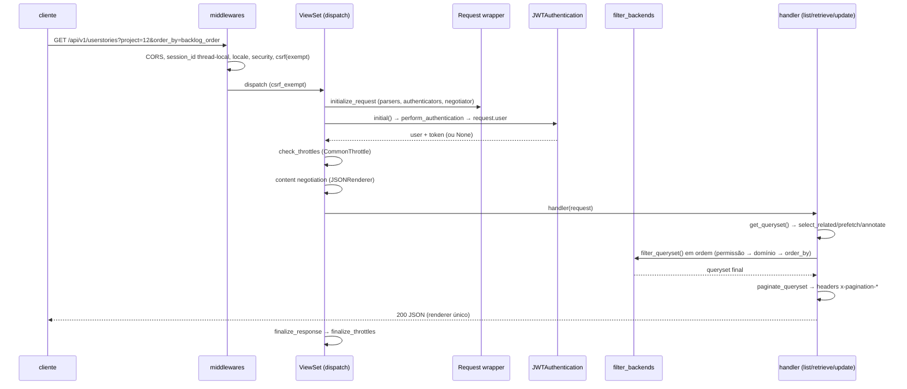
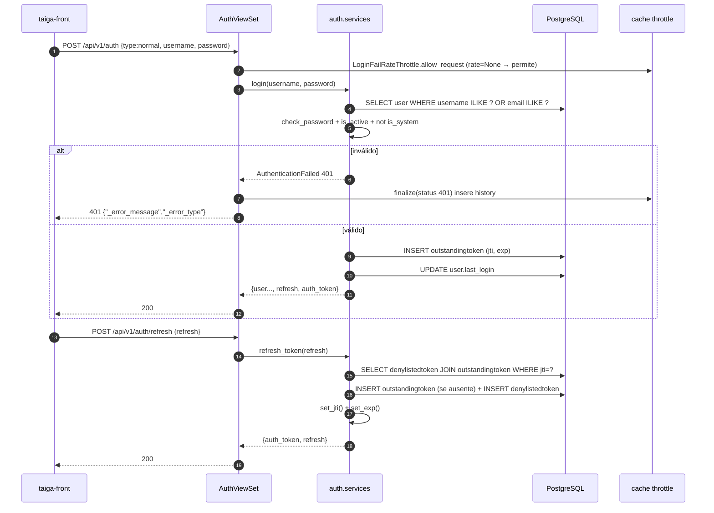
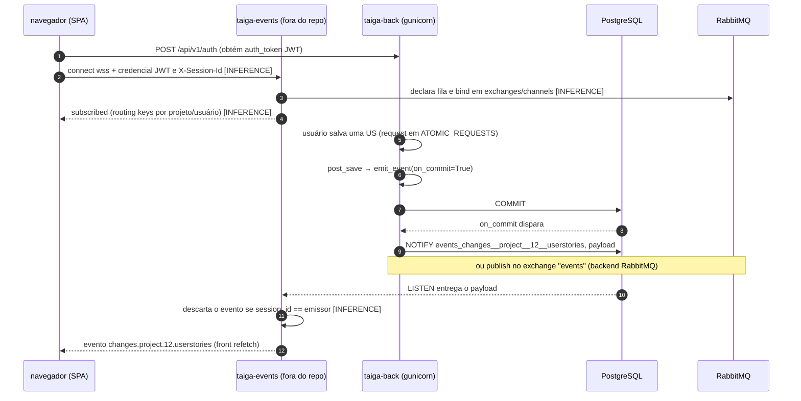

# Taiga backend — engenharia, autenticação, concorrência e tempo real
> Escopo: `_REF/taiga-back`, versão `6.10.2` (`taiga/__init__.py:9`), commit `cb745e9137bda3ee7ee5e70d1e0141cccd2ef26c` (2026-10-29). 796 arquivos `.py`, 68.158 linhas, 269 arquivos de migration, 119 arquivos de teste. **Nada foi executado**; toda afirmação vem de leitura de código, config, migrations e testes. Camada anterior (modelo de dados, permissões funcionais, UI) está em `taiga-data-model.md` e `taiga-ui-ux.md`; aqui o foco é o **como** de engenharia. `[INFERENCE]` marca dedução sem linha de código que a sustente diretamente.
>
> Complementa: `taiga-data-model.md §2–§3` (entidades/campos), `§4` (semântica de permissões). Este documento não repete a matriz role × permissão.

## 1. Stack exato

| Componente | Versão / valor | Evidência |
|---|---|---|
| Linguagem | Python 3.10 no lockfile; 3.11 na imagem | `requirements.txt:2` (`pip-compile ... Python 3.10`), `tox.ini:2` (`envlist = py310`), `docker/Dockerfile:7` (`FROM python:3.11-slim`) |
| Framework | Django 3.2.25 (LTS EOL) | `requirements.txt:67`, `requirements.in:2` (`Django>=3.2.19,<4`) |
| Camada HTTP | **DRF não é dependência**: fork vendorizado em `taiga/base/api` | `requirements.txt` não contém `djangorestframework`; `taiga/base/api/views.py:8-32` ("partially taken from django rest framework") |
| Settings do "DRF" | `taiga/base/api/settings.py` (`APISettings`), popula a chave `REST_FRAMEWORK` | `taiga/base/api/settings.py:64-151`; `settings/common.py:473-507` |
| Banco | PostgreSQL exclusivo (JSONB, `ArrayField`, GIN, `NOTIFY`, advisory locks, sequências) | `settings/common.py:25-33`, `taiga/base/db/models/fields/json.py:15-17` |
| Driver | psycopg2 2.9.11 | `requirements.txt:158` |
| Fila | Celery 5.5.3, broker AMQP (`kombu`) | `requirements.txt:31`; `settings/common.py:45-61` |
| Cache | Redis 7.1.0 instalado **mas não configurado**: default `LocMemCache` | `requirements.txt:184`; `settings/common.py:38-43` |
| Servidor | gunicorn 23.0.0, WSGI, 3 workers | `requirements.txt:96`; `docker/entrypoint.sh:26-33` |
| Templates/e-mail | django-jinja 2.11.0, djmail 2.0.0, premailer 3.10.0 | `requirements.txt:78,90,152`; `taiga/base/mails.py:21-33` |
| HTML/Markdown | markdown 3.10 + pymdown-extensions, bleach 4.1.0, html5lib 1.1 (serializer patch) | `requirements.txt:23,112`; `taiga/mdrender/service.py:14-29` |
| Locks | django-pglocks 1.0.4 | `requirements.txt:80` |
| Sites | django-sites 0.11 (sítios `api` e `front`) | `requirements.txt:86`; `settings/common.py:187-192` |
| Serialização leve | serpy 0.3.1 (`LightSerializer`) | `requirements.txt:209`; `taiga/base/api/serializers.py:1244` |
| Imagens | pillow 12, easy-thumbnails 2.8.5, psd-tools 1.9, scikit-image | `requirements.txt:144,94`; `settings/common.py:536-563` |
| Observabilidade | sentry-sdk 2.45.0 **declarado e nunca inicializado** | `requirements.txt:207`; `grep sentry_sdk` não retorna uso em `taiga/` nem `settings/` |

**Settings reais**: existe apenas `settings/common.py` (688 linhas) como base. Não há `development.py` nem `production.py`. Produção = `settings/config.py`, copiado de `docker/config.py` no build (`docker/Dockerfile:52`), ou o exemplo `settings/config.py.prod.example`. Dev = `settings/config.py.dev.example` ou `settings.common` direto (`manage.py:14`). O container fixa `DJANGO_SETTINGS_MODULE=settings.config` (`docker/Dockerfile:77`).

**Apps**: 50 em `INSTALLED_APPS` (`settings/common.py:312-364`) + `taiga.telemetry` anexado no fim (`settings/common.py:675-678`). O núcleo são `taiga.projects` + 6 sub-apps de entidade (`epics`, `userstories`, `tasks`, `issues`, `milestones`, `wiki`) + `history`, `notifications`, `attachments`, `votes`, `likes`, `custom_attributes`, `references`, `settings`, `contact`, `tagging`.

**Topologia de deploy** (inferida dos entrypoints): `api` (gunicorn) + `async` (`celery -A taiga.celery worker -B --concurrency 4`, `docker/async_entrypoint.sh:14-18`) + `taiga-events` (gateway WebSocket Node, **fora deste repositório**) + PostgreSQL + RabbitMQ. O entrypoint da API roda `migrate` e `loaddata initial_project_templates` a cada boot (`docker/entrypoint.sh:14-19`) — migração acoplada ao start, sem lock explícito entre réplicas.

## 2. Bootstrap e ciclo de request

### 2.1 Entrada

- `manage.py` → `settings.common` por default (`manage.py:14`); `taiga/wsgi.py:36` expõe `application`.
- `taiga/urls.py:20-23`: `api/v1/` → `router.urls`; `admin/`; `handler500 = "taiga.base.api.views.api_server_error"` (`taiga/urls.py:25`), que devolve JSON só se `Accept`/content-type for JSON (`taiga/base/api/views.py:478-482`).
- Rotas opcionais: sitemap do front (`taiga/urls.py:30-53`) e `static/`+`media/` servidos pelo Django apenas em `DEBUG` (`taiga/urls.py:59-70`).
- `DefaultRouter(trailing_slash=False)` (`taiga/routers.py:11`). Rotas dinâmicas vêm de `@list_route`/`@detail_route` (`taiga/base/routers.py:87-114`) e rotas aninhadas de `register(...).register(..., parents_query_lookups=[...])` (`taiga/routers.py:184-187`).

### 2.2 Cadeia de middleware (ordem exata)

`settings/common.py:292-307`:

| # | Middleware | Papel real | Observação |
|---|---|---|---|
| 1 | `taiga.base.middleware.cors.CorsMiddleware` | injeta `Access-Control-*` em toda resposta | `ALLOWED_ORIGINS="*"` + `Allow-Credentials: true` (`taiga/base/middleware/cors.py:12-21,38-45`); o `process_request` devolve resposta de preflight mas o `__call__` **ignora** o retorno (`:29-35`) → o preflight segue para a view |
| 2 | `taiga.events.middleware.SessionIDMiddleware` | copia `X-Session-Id` para thread-local + `request.session_id` | `taiga/events/middleware.py:42-58`; base do eco de eventos |
| 3 | `CommonMiddleware` | `APPEND_SLASH=False` (`:14`) | sem redirect de barra |
| 4 | `LocaleMiddleware` | `Accept-Language` → `request.LANGUAGE_CODE` | com `USE_I18N=True` (`:84`) |
| 5 | `SecurityMiddleware` | `X-Content-Type-Options`, `SECURE_PROXY_SSL_HEADER` | `:73`; sem HSTS/SSL redirect configurados |
| 6 | `CsrfViewMiddleware` | **efetivamente inerte na API** | todas as views de API são `csrf_exempt` (`taiga/base/api/views.py:423-426`) |
| 7 | `XFrameOptionsMiddleware` | `X-Frame-Options: DENY` (default) | — |
| 8-10 | `Session`, `Authentication`, `Message` | só para o admin e para o autenticador `Session` | `settings/common.py:301-305` |

`ATOMIC_REQUESTS = True` (`settings/common.py:80`): **cada request roda em uma transação**. Consequência direta: todos os `connection.on_commit(...)` de eventos, webhooks e timeline só disparam no commit (`taiga/events/events.py:37-40`, `taiga/webhooks/signal_handlers.py:64`, `taiga/timeline/signals.py:28`).

### 2.3 Dispatch da view



Pontos verificáveis:

- `initialize_request` monta o wrapper `Request` com `QUERY_PARAMS` e `DATA` (`taiga/base/api/views.py:349-359`; `taiga/base/api/request.py:216-232`).
- `initial()` faz autenticação → throttle → negociação (`taiga/base/api/views.py:361-373`). Autenticação é **eager** (acessa `request.user`, `:308-316`).
- `get_queryset()` base é `Model._default_manager.all()` (`taiga/base/api/generics.py:180-197`); cada viewset sobrescreve.
- **`get_object()` aplica `filter_queryset` antes do lookup** (`taiga/base/api/generics.py:207-237`). Logo, os `PermissionBasedFilterBackend` são a primeira linha de defesa: um objeto de projeto sem permissão simplesmente não existe no queryset → 404, não 403. `get_object_or_error` converte "não encontrado" em **401 para anônimo** e 404 para autenticado (`taiga/base/api/utils/__init__.py:51-63`).
- Mixins chamam `check_permissions(request, action, obj)` **depois** de materializar o objeto (`taiga/base/api/mixins.py:139-148,156-189`).
- `create` valida antes de checar permissão (`taiga/base/api/mixins.py:81-96`): `validator.is_valid()` → `check_permissions(...,'create', validator.object)`.
- Resposta única `JSONRenderer` (`taiga/base/api/settings.py:66-68`), `ensure_ascii=True` (`taiga/base/api/renderers.py:75-79`).

**Como o `project` é resolvido**: (a) por `filter_fields` contendo `"project"` — ex. `taiga/projects/userstories/api.py:74`; (b) por `NestedViewSetMixin`, que copia **todos** os `kwargs` da URL como filtros (`taiga/base/api/viewsets.py:126-142`) — por isso viewsets aninhados usam `resource_id` e reimplementam `get_queryset`; (c) em rotas de bulk, o `project` vem no **corpo** (`taiga/projects/mixins/ordering.py:38-44`).

## 3. Autenticação e sessão

### 3.1 Autenticadores (ordem importa)

`settings/common.py:473-484`:

| Ordem | Classe | Esquema | Uso |
|---|---|---|---|
| 1 | `taiga.auth.authentication.JWTAuthentication` | `Authorization: Bearer <jwt>` | front SPA / API |
| 2 | `taiga.auth.backends.Session` | cookie de sessão Django, **sem CSRF** | "apenas para debug da API" (`taiga/auth/backends.py:42-49`) |
| 3 | `taiga.external_apps.auth_backends.Token` | `Authorization: Application <token>` | apps de terceiros |

`AUTHENTICATION_BACKENDS` do Django tem só `ModelBackend`, usado pelo admin (`settings/common.py:469-471`).

### 3.2 Configuração JWT efetiva

Base `taiga/auth/settings.py:263-287` (fork de simplejwt 4.7.1) **sobrescrita parcial** por `SIMPLE_JWT` (`settings/common.py:450-454`):

| Setting | Valor efetivo | Origem |
|---|---|---|
| `ACCESS_TOKEN_LIFETIME` | 24 h | `settings/common.py:451` |
| `REFRESH_TOKEN_LIFETIME` | 8 dias | `settings/common.py:452` |
| `CANCEL_TOKEN_LIFETIME` | 100 dias (declarado) / **365 dias real** | `settings/common.py:453`; `taiga/auth/tokens.py:311-313` (hardcoded no `CancelToken` — a setting é ignorada) |
| `ROTATE_REFRESH_TOKENS` | `True` | `taiga/auth/settings.py:267` |
| `DENYLIST_AFTER_ROTATION` | `True` | `taiga/auth/settings.py:268` |
| `UPDATE_LAST_LOGIN` | `True` | `taiga/auth/settings.py:269` |
| `ALGORITHM` | `HS256` | `taiga/auth/settings.py:271` |
| `SIGNING_KEY` | `settings.SECRET_KEY` | `taiga/auth/settings.py:272` |
| `AUTH_HEADER_TYPES` | `Bearer` | `:277` |
| `AUTH_TOKEN_CLASSES` | apenas `AccessToken` | `:282` |
| `TOKEN_USER_CLASS` | `taiga.auth.models.TokenUser` (não usado pela autenticação default) | `:286` |

Claims: `token_type`, `exp`, `jti` (uuid4), `user_id` (`taiga/auth/tokens.py:81-87,143-152,184-197`). `RefreshToken.access_token` copia claims do refresh, exceto `token_type`/`exp`/`jti` (`taiga/auth/tokens.py:282-303`).

### 3.3 Login + refresh (passo a passo)

1. `POST /api/v1/auth` (`type="normal"`) → `AuthViewSet.create` (`taiga/auth/api.py:67-86`).
2. `TokenObtainPairSerializer.validate` → `login()` (`taiga/auth/serializers.py:45-55`).
3. `get_and_validate_user`: busca por `username` **ou** `email` case-insensitive, exige `check_password`, `is_active` e **nega `is_system`** (`taiga/users/services.py:36-65`).
4. `make_auth_response_data`: serializa com `UserAdminSerializer` e acrescenta `refresh` + `auth_token`; chama `update_last_login` (`taiga/auth/services.py:53-65`).
5. `RefreshToken.for_user` **grava `OutstandingToken`** (`taiga/auth/tokens.py:246-264`).
6. `POST /api/v1/auth/refresh` → `refresh_token()`: decodifica, `denylist()` do antigo, gera novo `jti`/`exp`, devolve `auth_token` + `refresh` (`taiga/auth/services.py:81-104`).
7. Falha de credencial → `AuthenticationFailed` com código `invalid_credentials` (`taiga/auth/services.py:71-75`).



### 3.4 Registro, verificação de e-mail e reset

| Fluxo | Endpoint | Regras citáveis |
|---|---|---|
| Registro público | `POST /auth/register` `type=public` | exige `accepted_terms` truthy (`taiga/auth/api.py:129-131`); bloqueado se `PUBLIC_REGISTER_ENABLED=False` (`:107-108`, default `False` em `settings/common.py:523`); username ou e-mail duplicado → 400 (`taiga/auth/services.py:127-141`) |
| Registro privado (convite) | `type=private` + `token` | cria usuário e amarra `Membership.user` pendente (`taiga/auth/services.py:179-211`) |
| Validação de entrada | — | `username` `^[\w.-]+$` (`taiga/auth/serializers.py:79-88`); `full_name` passa por `bleach.clean` e não pode conter `http(s):` (`:90-98`); senha `min_length=6, max_length=128` (`:77`, `PASSWORD_MAX_LENGTH` em `taiga/auth/settings.py:259`) |
| Domínio de e-mail | — | allowlist opcional aplicada no **campo** `EmailField` (`taiga/base/api/fields.py:614-624`) |
| Verificação | `POST /users/send_verification_email` | `verified_email` default `True` no modelo (`taiga/users/models.py:161`), mas o registro grava `False` (`taiga/auth/services.py:165`); **login não exige verificação** |
| Troca de e-mail | `POST /users/change_email` (`AllowAny`) | token `email_token` (uuid4), troca `email`, limpa token, marca verificado (`taiga/users/api.py:279-315`) |
| Reset de senha | `POST /users/password_recovery` | mensagem genérica anti-enumeração, `token` uuid4 + `token_expires_at` (`taiga/users/api.py:157-184`); TTL 1 h (`settings/common.py:456`) |
| Aplicar reset | `POST /users/change_password_from_recovery` | valida expiração, grava hash, zera token (`taiga/users/api.py:186-211`) |
| Trocar senha | `POST /users/change_password` | exige senha atual salvo usuário social sem senha (`taiga/users/api.py:213-243`) |
| Cancelar conta | `POST /users/cancel` | `CancelToken` (365 d) → `user.cancel()`: anonimiza, inativa, apaga memberships e bloqueia projetos (`taiga/users/models.py:271-297`) |

### 3.5 Denylist e invalidação

Tabelas: `OutstandingToken(jti unique, token, expires_at)` e `DenylistedToken(OneToOne outstanding)` (`taiga/auth/token_denylist/models.py:36-77`). Limpeza por task Celery a cada 3 dias (`settings/common.py:458`; `taiga/auth/token_denylist/tasks.py:14-17`; agendada em `taiga/celery.py:41-47`).

Matriz de invalidação:

| Ação | Refresh | Access (24 h) |
|---|---|---|
| Logout no front | não há endpoint; o front descarta os tokens `[INFERENCE]` | continua válido |
| Rotação no refresh | antigo vai para denylist | novo, intocado |
| Suspender usuário (`is_active=False`) | rejeitado no próximo refresh | rejeitado **só** ao revalidar o token: `get_user` checa `is_active`/`is_system` a cada request (`taiga/auth/authentication.py:135-152`) |
| Trocar senha | não invalida tokens existentes | idem |
| `AccessToken` está em `DenylistMixin`? | — | **não**: `class AccessToken(Token)` (`taiga/auth/tokens.py:306-308`), portanto `check_denylist` nunca roda para access tokens |

### 3.6 Rate limiting de autenticação

| Throttle | Escopo | Alvo | Comportamento |
|---|---|---|---|
| `LoginFailRateThrottle` | `login-fail` | `create`, `refresh`, `verify` | só conta a requisição **se a resposta for 400/401** (`taiga/auth/throttling.py:11-21`) |
| `RegisterSuccessRateThrottle` | `register-success` | `register` | conta só 201 (`:24-34`) |
| `CommonThrottle` (global) | `anon`/`user` × `read`/`write` | todas as views | chave = user id ou IP via `django-ipware`; multi-rate; whitelist por id/CIDR (`taiga/base/throttling.py:55-185`) |
| `MembershipsRateThrottle` | `create-memberships` | create/resend/bulk. Pesos = nº de convites (`taiga/projects/throttling.py:11-27`) |

**Todos os `DEFAULT_THROTTLE_RATES` são `None`** (`settings/common.py:481-494`), e `SimpleRateThrottle.allow_request` retorna `True` quando `rate is None` (`taiga/base/api/throttling.py:143-144`). Sem configurar `REST_FRAMEWORK["DEFAULT_THROTTLE_RATES"]`, **não há limite de tentativas de login nem de escrita**. O IP vem de `X-Forwarded-For` quando presente (`taiga/base/throttling.py:22-28`, `taiga/base/api/throttling.py:208-210`) — forjável se o proxy não normalizar.

### 3.7 API tokens de aplicação

`ApplicationToken` = `(application, user)` único + `token = django.core.signing.dumps({"app_token_id": pk})` (`taiga/external_apps/models.py:41-85`); o autenticador casa `Authorization: Application <token>` e resolve o usuário por lookup direto do token em claro (`taiga/external_apps/auth_backends.py:14-28`; `taiga/external_apps/services.py:15-22`). Não há TTL, escopo, nem rotação.

### 3.8 WebSocket: o que existe neste repositório

Não há código de WebSocket em `taiga-back` (`grep -i websocket` retorna vazio). O backend **publica** eventos; o gateway (projeto `taiga-events`, Node) consome e entrega ao browser. O contrato verificável é:

| Elemento | Valor | Evidência |
|---|---|---|
| Backend default | Postgres `NOTIFY` | `settings/common.py:217`; `taiga/events/backends/postgresql.py:14-23` |
| Backend alternativo | RabbitMQ, exchange `topic` `auto_delete` | `settings/common.py:218-219`; `taiga/events/backends/rabbitmq.py:40-62` |
| Canal (PG) | `"{channel}_{routing_key com '.'→'__'}"` | `taiga/events/backends/postgresql.py:16-19` |
| Canal (AMQP) | exchange = `channel` (`events` por default) | `taiga/events/backends/rabbitmq.py:61-62` |
| Mensagem | `{"session_id": <x-session-id>, "data": {...}}` | `taiga/events/events.py:29-35` |
| Routing keys | `changes.project.<project_id>.<app>[.<model>]`, `live_notifications.<user_id>`, `web_notifications.<user_id>`, `notifications` | `taiga/events/events.py:66-70,90-94,165-174`; `taiga/events/management/commands/emit_notification_message.py:24-25` |
| Origem do `session_id` | header `X-Session-Id` (gerado pelo front) | `taiga/events/middleware.py:50-54` |



Handshake (JWT em query/header, formato de subscribe, heartbeat) **não é verificável aqui** → `[INFERENCE]`. Garantias do backend: eventos só saem após commit, e o `session_id` no payload permite ao gateway suprimir o eco da própria aba (presente em todos os emissores via `emit_event(..., sessionid=...)`).

## 4. Schema físico

Convenções: PK `AutoField` (`settings/common.py:36`); tipos abaixo são o mapeamento ORM→PostgreSQL (DDL textual reconstruído — `[INFERENCE]` apenas na forma, não nos campos); `JSONField` é `django.db.models.JSONField` → `jsonb` (`taiga/base/db/models/fields/json.py:15-17`); `ArrayField` → `text[]`; não existe `CheckConstraint`/`UniqueConstraint` em nenhum modelo (`grep` vazio) — só `unique_together` e `db_index`.

### 4.1 Doze tabelas centrais

```sql
-- 1. projects_project (taiga/projects/models.py:162-298)
CREATE TABLE projects_project (
  id serial PRIMARY KEY, name varchar(250) NOT NULL, slug varchar(250) NOT NULL UNIQUE,
  description text NOT NULL, logo varchar(500),
  created_date timestamptz NOT NULL, modified_date timestamptz NOT NULL,
  owner_id integer REFERENCES users_user(id) ON DELETE SET NULL,
  is_private boolean NOT NULL DEFAULT true,
  anon_permissions text[], public_permissions text[],           -- arrays de codenames
  is_contact_activated boolean DEFAULT true, is_epics_activated boolean DEFAULT false,
  is_backlog_activated boolean DEFAULT true, is_kanban_activated boolean DEFAULT false,
  is_wiki_activated boolean DEFAULT true, is_issues_activated boolean DEFAULT true,
  is_featured boolean DEFAULT false, is_looking_for_people boolean DEFAULT false,
  looking_for_people_note text, videoconferences varchar(250), videoconferences_extra_data varchar(250),
  creation_template_id integer REFERENCES projects_projecttemplate(id) ON DELETE SET NULL,
  blocked_code varchar(255), archived_code varchar(255), transfer_token varchar(255),
  epics_csv_uuid varchar(32), userstories_csv_uuid varchar(32),
  tasks_csv_uuid varchar(32), issues_csv_uuid varchar(32),
  totals_updated_datetime timestamptz NOT NULL,
  total_fans integer DEFAULT 0, total_fans_last_week integer DEFAULT 0,
  total_fans_last_month integer DEFAULT 0, total_fans_last_year integer DEFAULT 0,
  total_activity integer DEFAULT 0, total_activity_last_week integer DEFAULT 0,
  total_activity_last_month integer DEFAULT 0, total_activity_last_year integer DEFAULT 0,
  default_epic_status_id integer, default_us_status_id integer, default_task_status_id integer,
  default_issue_status_id integer, default_points_id integer, default_issue_type_id integer,
  default_priority_id integer, default_severity_id integer, default_swimlane_id integer
);   -- 8 FKs default_* vêm de ProjectDefaults (models.py:123-158)
```

```sql
-- 2. projects_membership (models.py:53-120)
CREATE TABLE projects_membership (
  id serial PRIMARY KEY,
  user_id integer REFERENCES users_user(id) ON DELETE CASCADE,     -- NULL = convite pendente
  project_id integer NOT NULL REFERENCES projects_project(id) ON DELETE CASCADE,
  role_id integer NOT NULL REFERENCES users_role(id) ON DELETE CASCADE,
  is_admin boolean NOT NULL DEFAULT false,
  email varchar(255), token varchar(60),
  invited_by_id integer REFERENCES users_user(id) ON DELETE SET NULL,
  invitation_extra_text text, created_at timestamptz NOT NULL,
  user_order bigint NOT NULL, UNIQUE (user_id, project_id)
);

-- 3. users_role (taiga/users/models.py:300-332)
CREATE TABLE users_role (
  id serial PRIMARY KEY, name varchar(200) NOT NULL, slug varchar(250) NOT NULL,
  permissions text[], "order" integer NOT NULL DEFAULT 10,
  project_id integer REFERENCES projects_project(id) ON DELETE CASCADE,
  computable boolean NOT NULL DEFAULT true, UNIQUE (slug, project_id)
);

-- 4. users_user (taiga/users/models.py:117-195)
CREATE TABLE users_user (
  id serial PRIMARY KEY, uuid varchar(32) NOT NULL UNIQUE,
  username varchar(255) NOT NULL UNIQUE, email varchar(255) NOT NULL UNIQUE,
  password varchar(128) NOT NULL, is_active boolean DEFAULT true, is_staff boolean DEFAULT false,
  is_superuser boolean DEFAULT false, full_name varchar(256) DEFAULT '', bio text, photo varchar(500),
  color varchar(9), date_joined timestamptz NOT NULL, date_cancelled timestamptz,
  accepted_terms boolean, read_new_terms boolean, lang varchar(20), theme varchar(100),
  timezone varchar(20), colorize_tags boolean DEFAULT false, last_login timestamptz,
  token varchar(200), token_expires_at timestamptz,                -- reset de senha
  email_token varchar(200), new_email varchar(254),                -- troca de e-mail
  verified_email boolean NOT NULL DEFAULT true, is_system boolean NOT NULL DEFAULT false,
  max_private_projects integer, max_public_projects integer,
  max_memberships_private_projects integer, max_memberships_public_projects integer
);
```

```sql
-- 5. projects_userstorystatus (models.py:601-642); EpicStatus/TaskStatus/IssueStatus análogos
CREATE TABLE projects_userstorystatus (
  id serial PRIMARY KEY, name varchar(255) NOT NULL, slug varchar(255) NOT NULL,
  "order" integer NOT NULL DEFAULT 10, is_closed boolean DEFAULT false,
  is_archived boolean DEFAULT false, color varchar(20) DEFAULT '#999999',
  wip_limit integer,                                   -- SEM check constraint
  project_id integer NOT NULL REFERENCES projects_project(id) ON DELETE CASCADE,
  UNIQUE (project_id, name), UNIQUE (project_id, slug)
);

-- 6. projects_swimlane + WIP por célula (models.py:918-972)
CREATE TABLE projects_swimlane (
  id serial PRIMARY KEY, name varchar(255) NOT NULL, slug varchar(255) NOT NULL,
  "order" integer DEFAULT 10, color varchar(20),
  project_id integer NOT NULL REFERENCES projects_project(id) ON DELETE CASCADE,
  UNIQUE (project_id, name)
);
CREATE TABLE projects_swimlaneuserstorystatus (
  id serial PRIMARY KEY, wip_limit integer,
  swimlane_id integer NOT NULL REFERENCES projects_swimlane(id) ON DELETE CASCADE,
  status_id integer NOT NULL REFERENCES projects_userstorystatus(id) ON DELETE CASCADE,
  UNIQUE (swimlane_id, status_id)
);
```

```sql
-- 7. userstories_userstory (taiga/projects/userstories/models.py:65-152)
CREATE TABLE userstories_userstory (
  id serial PRIMARY KEY, ref bigint,                       -- db_index; unicidade em references_reference
  project_id integer NOT NULL REFERENCES projects_project(id) ON DELETE CASCADE,
  milestone_id integer REFERENCES projects_milestone(id) ON DELETE SET NULL,
  status_id integer REFERENCES projects_userstorystatus(id) ON DELETE SET NULL,
  swimlane_id integer REFERENCES projects_swimlane(id) ON DELETE SET NULL,
  owner_id integer, assigned_to_id integer,
  generated_from_issue_id integer, generated_from_task_id integer,
  is_closed boolean DEFAULT false, subject text NOT NULL, description text DEFAULT '',
  backlog_order bigint NOT NULL, sprint_order bigint NOT NULL, kanban_order bigint NOT NULL,
  created_date timestamptz, modified_date timestamptz, finish_date timestamptz,
  due_date date, due_date_reason text DEFAULT '', tags text[],
  client_requirement boolean, team_requirement boolean,
  external_reference text[], from_task_ref text,
  tribe_gig bytea,                                         -- PickledObjectField
  version integer NOT NULL DEFAULT 1                       -- OCC
);
CREATE TABLE userstories_userstory_assigned_users (        -- M2M implícito
  userstory_id integer REFERENCES userstories_userstory(id) ON DELETE CASCADE,
  user_id integer REFERENCES users_user(id) ON DELETE CASCADE, UNIQUE (userstory_id, user_id)
);
CREATE TABLE userstories_rolepoints (                       -- models.py:25-58
  id serial PRIMARY KEY,
  user_story_id integer NOT NULL REFERENCES userstories_userstory(id) ON DELETE CASCADE,
  role_id integer NOT NULL REFERENCES users_role(id) ON DELETE CASCADE,
  points_id integer REFERENCES projects_points(id) ON DELETE CASCADE,
  UNIQUE (user_story_id, role_id)
);

-- 8. tasks_task (taiga/projects/tasks/models.py:23-104)
CREATE TABLE tasks_task (
  id serial PRIMARY KEY, ref bigint,
  project_id integer NOT NULL REFERENCES projects_project(id) ON DELETE CASCADE,
  user_story_id integer REFERENCES userstories_userstory(id) ON DELETE CASCADE,
  milestone_id integer REFERENCES projects_milestone(id) ON DELETE SET NULL,
  status_id integer REFERENCES projects_taskstatus(id) ON DELETE SET NULL,
  owner_id integer, assigned_to_id integer, subject text NOT NULL, description text DEFAULT '',
  created_date timestamptz, modified_date timestamptz, finished_date timestamptz,
  us_order bigint NOT NULL, taskboard_order bigint NOT NULL, is_iocaine boolean DEFAULT false,
  external_reference text[], due_date date, due_date_reason text, tags text[],
  version integer DEFAULT 1
);   -- unique (ref, project) está COMENTADO em tasks/models.py:104

-- 9. issues_issue (taiga/projects/issues/models.py:23-111)
CREATE TABLE issues_issue (
  id serial PRIMARY KEY, ref bigint,
  project_id integer NOT NULL REFERENCES projects_project(id) ON DELETE CASCADE,
  milestone_id integer REFERENCES projects_milestone(id) ON DELETE SET NULL,
  status_id integer, severity_id integer, priority_id integer, type_id integer,
  owner_id integer, assigned_to_id integer, subject text NOT NULL, description text,
  created_date timestamptz, modified_date timestamptz, finished_date timestamptz,
  due_date date, due_date_reason text, tags text[], external_reference text[], version integer DEFAULT 1
);

-- 10. epics_epic + N:N ordenado (taiga/projects/epics/models.py:23-117)
CREATE TABLE epics_epic (
  id serial PRIMARY KEY, ref bigint,
  project_id integer NOT NULL REFERENCES projects_project(id) ON DELETE CASCADE,
  status_id integer REFERENCES projects_epicstatus(id) ON DELETE SET NULL,
  owner_id integer, assigned_to_id integer, subject text, description text,
  color varchar(32) NOT NULL, epics_order bigint NOT NULL,
  created_date timestamptz, modified_date timestamptz,
  client_requirement boolean, team_requirement boolean, external_reference text[], tags text[],
  version integer DEFAULT 1
);
CREATE TABLE epics_relateduserstory (
  id serial PRIMARY KEY, "order" bigint NOT NULL,
  user_story_id integer NOT NULL REFERENCES userstories_userstory(id) ON DELETE CASCADE,
  epic_id integer NOT NULL REFERENCES epics_epic(id) ON DELETE CASCADE,
  UNIQUE (user_story_id, epic_id)
);

-- 11. projects_milestone (taiga/projects/milestones/models.py:24-66)
CREATE TABLE projects_milestone (
  id serial PRIMARY KEY, name varchar(200) NOT NULL, slug varchar(250) NOT NULL,
  project_id integer NOT NULL REFERENCES projects_project(id) ON DELETE CASCADE,
  owner_id integer REFERENCES users_user(id) ON DELETE SET NULL,
  estimated_start date NOT NULL, estimated_finish date NOT NULL,
  created_date timestamptz, modified_date timestamptz, closed boolean DEFAULT false,
  disponibility double precision DEFAULT 0, "order" smallint DEFAULT 1,
  UNIQUE (name, project_id), UNIQUE (slug, project_id)
);

-- 12. history_historyentry (taiga/projects/history/models.py:33-81)
CREATE TABLE history_historyentry (
  id varchar(255) PRIMARY KEY,                             -- uuid1 em string
  project_id integer NOT NULL REFERENCES projects_project(id) ON DELETE CASCADE,
  "user" jsonb,                                            -- {"pk":..,"name":".."}
  created_at timestamptz NOT NULL, type smallint NOT NULL,  -- create|change|delete
  key varchar(255),                                         -- "<app>.<model>:<pk>" (db_index)
  diff jsonb, values_diff_cache jsonb, snapshot jsonb, values jsonb,
  comment text DEFAULT '', comment_html text DEFAULT '', comment_versions jsonb,
  delete_comment_date timestamptz, delete_comment_user jsonb, edit_comment_date timestamptz,
  is_hidden boolean DEFAULT false, is_snapshot boolean DEFAULT false
);
```

Tabelas satélites (campos-chave): `notifications_notifypolicy` UNIQUE `project,user` com `notify_level`/`live_notify_level`/`web_notify_level` (`taiga/projects/notifications/models.py:21-44`); `notifications_watched` GFK + UNIQUE `content_type,object_id,user,project` (`:86-111`); `notifications_webnotification` com `created` indexado e `data` jsonb (`:114-123`); `webhooks_webhook`/`webhooks_webhooklog` (`taiga/webhooks/models.py:14-49`); 4 `*_customattribute` + 4 `*_customattributesvalues` (`taiga/projects/custom_attributes/models.py:24-178`); `attachments_attachment` com `index_together (content_type, object_id)` e `sha1` (`taiga/projects/attachments/models.py:59-76`); `timeline_timeline` (`taiga/timeline/models.py:18-33`); `references_reference` UNIQUE `project,ref` (`taiga/projects/references/models.py:22-38`); `auth_token_denylist_{outstandingtoken,denylistedtoken}`.

### 4.2 Constraints e ausências

| Tipo | Onde | Nota |
|---|---|---|
| `unique_together` | `projects_membership(user,project)`, `users_role(slug,project)`, statuses `(project,name)` e `(project,slug)`, `projects_milestone(name|slug, project)`, `epics_relateduserstory(user_story,epic)`, `notifications_notifypolicy(project,user)`, `attachments`? (não), `references_reference(project,ref)` | grep de `unique_together` em `taiga/**/models.py` |
| `index_together`/`Index` | `Project(name,id)`; `Attachment(content_type,object_id)`; `CustomAttributesValues(*)`; `Timeline(namespace,-created)` e `(content_type,object_id,-created)` (`taiga/timeline/models.py:29-33`) | — |
| `db_index` | `ref` (US/task/issue/epic), `HistoryEntry.key`, 8 colunas de totais do projeto, `history created_at`, `milestone name/slug` | — |
| **Não existe** | `CHECK` (ex.: `wip_limit > 0`), unicidade de `(project, ref)` no `UserStory/Task/Issue`, unicidade de `order` por coluna kanban, `deferrable`, particionamento | `grep -rn CheckConstraint taiga/` → vazio |
| Integridade de `ref` | garantida por `references_reference` (`UNIQUE(project, ref)`) + sequência PG por projeto (`references_project{id}`) | `taiga/projects/references/models.py:44-62`, `sequences.py:13-49` |

### 4.3 Índice GIN de busca textual

Criado por migration com SQL cru (`taiga/projects/migrations/0033_text_search_indexes.py:19-55`): função `IMMUTABLE inmutable_array_to_string(text[])` + índice `projects_project_textquery_idx` GIN sobre `setweight(to_tsvector('english_nostop', name),'A') || ... tags 'B' || description 'C'`. Depende de uma configuração de dicionário `english_nostop` (não criada por esta migration) — `[INFERENCE]` que vem do deploy/`initdb`.

### 4.4 Soft delete e ciclo de vida

Sem soft delete genérico: `destroy` chama `obj.delete()` (`taiga/base/api/mixins.py:222-239`) e cascateia. Válvulas: `Project.blocked_code` (4 códigos, `taiga/projects/choices.py:23-28`), `Project.archived_code` (`:31-32`), `Attachment.is_deprecated`, `HistoryEntry.delete_comment_*`, `User.cancel()` (anonimiza) e `_importing` (flag em memória que desliga signals, não coluna).

## 5. Camada de domínio

### 5.1 Services por app

| App | Arquivo | Conteúdo |
|---|---|---|
| projects | `services/projects.py`, `services/bulk_update_order.py`, `services/invitations.py`, `services/transfer.py` | criação/duplicação/orfandade, limites de plano, ordenação em massa |
| userstories | `userstories/services.py` | bulk create, reorder backlog/sprint/kanban, open/close, filtros data |
| history | `history/services.py` | `take_snapshot`, `get_modified_fields`, freeze/values por modelo |
| notifications | `notifications/services.py` | destinatários, squash, envio de e-mail, web/live notifications |
| timeline | `timeline/service.py`, `rebuilder.py` | push assíncrono, rebuild por data/projeto |
| webhooks | `webhooks/tasks.py` | entrega assinada + log |
| export_import | `export_import/services/*` | dump/restore por dicionário |

### 5.2 Signals: ligação e desligamento explícito

Cada app expõe `connect_*_signals`/`disconnect_*_signals` chamados em `AppConfig.ready()` (`taiga/projects/apps.py:15-56,111-130`; `taiga/projects/userstories/apps.py:14-90`). O padrão é **desligar signals em operações em massa** e religar no `finally`:

```python
# taiga/projects/userstories/services.py:75-85
disconnect_userstories_signals()
try:
    db.save_in_bulk(userstories, callback, precall)
    project.update_role_points(user_stories=userstories)
finally:
    connect_userstories_signals()
```

O mesmo em `Project.delete_related_content()` (`taiga/projects/models.py:506-541`), que desliga 6 conjuntos de signals antes de apagar em cascata. Isso é rápido, mas significa que **qualquer bulk bypassa histórico, timeline, notificações e webhooks** — e que um `except` fora do `finally` deixa a instância sem signals `[INFERENCE]` (o padrão atual usa `finally`, então o risco é de extensão).

### 5.3 Templates de projeto

`ProjectTemplate` guarda toda a configuração inicial em **18 colunas JSONB** (`taiga/projects/models.py:1028-1044`). `load_data_from_project` fotografa um projeto (`:1066-1246`); `apply_to_project` recria statuses, due dates, points, prioridades, severidades, roles, custom attributes e defaults (`:1248-1445`).

Fluxo de criação de projeto: `Project.post_save` → se `_importing` sai; senão usa `creation_template` ou o template default `scrum` (`taiga/projects/signals.py:41-64`; `DEFAULT_PROJECT_TEMPLATE` em `settings/common.py:520`) → `apply_to_project` → cria `Membership` do owner com `is_admin=True` e o role `default_owner_role` (`taiga/projects/signals.py:66-76`). O `owner_role` é resolvido por slug, com fallback para `roles.first()`.

Templates são carregados por fixture a cada boot (`docker/entrypoint.sh:17-18`).

### 5.4 Permissões em runtime

- `calculate_permissions(is_superuser, is_member, is_admin, role_permissions, anon_permissions, public_permissions)` faz a **união de conjuntos** (`taiga/permissions/services.py:81-110`) — não há negação explícita; permissão é aditiva.
- `get_user_project_permissions` memoiza membership no objeto `user` (`taiga/permissions/services.py:113-129` + `taiga/users/models.py:200-217`).
- `set_base_permissions_for_project`: projeto privado zera `anon/public`; público adiciona todos os `ANON_PERMISSIONS` (`taiga/permissions/services.py:132-141`).
- `CommentAndOrUpdatePerm`: se o payload contém **apenas** `comment`, exige `comment_*`; caso contrário exige `modify_*` (`taiga/permissions/permissions.py:49-71`).
- `TaigaResourcePermission` compõe `enough_perms | (global_perms & {action}_perms)` (`taiga/base/api/permissions.py:39-64,197-198`) — "enough" é atalho de admin/superuser.

### 5.5 Máquinas de estado

Não há FSM formal; o estado é **derivado**:

| Estado | Regra | Evidência |
|---|---|---|
| `UserStory.is_closed` | status `is_closed` quando não há tasks; se há tasks, todas precisam estar em status fechado | `taiga/projects/userstories/services.py:455-471` |
| `finish_date` | setado/limpo junto com `is_closed` | `:473-488` |
| `Milestone.closed` | todas as US + issues + tasks soltas fechadas e existe ao menos um item | `taiga/projects/milestones/services.py:17-33` |
| `Task.is_closed`/`Issue.is_closed` | property derivada do status | `taiga/projects/tasks/models.py:118-120` |
| `EpicStatus.is_closed` | flag manual de taxonomia | `taiga/projects/models.py:569-570` |
| Reação em cascata | `UserStory.post_save` fecha/abre US **e** milestone; `pre_delete` desliga signals de tasks | `taiga/projects/userstories/signals.py:61-115` |

### 5.6 Outros componentes de domínio

- **Histórico**: `take_snapshot` sob `advisory_lock("history-"+key)` calcula `fdiff` (diff+snapshot), `values` (ids→nomes) e já grava `comment_html` renderizado; sem diff nem comentário **não cria linha** (`taiga/projects/history/services.py:367-436`, `:408-413`). `get_modified_fields(obj, n)` une as chaves dos `n` últimos diffs (`:347-364`) — base do OCC.
- **Tags**: `lower()` no `pre_save` (`taiga/projects/tagging/signals.py:8-10`), em `text[]` + `tags_colors text[][]`.
- **Votos/likes**: `Votes` guarda contador desnormalizado com `UNIQUE(content_type,object_id)` e `Vote` único por usuário (`taiga/projects/votes/models.py:14-53`); `Like` idem, sem contador (`taiga/projects/likes/models.py:14-32`).
- **Watchers/anexos**: `NotifyPolicy` por projeto + `Watched` por objeto, com autor e menções do markdown adicionados automaticamente (`taiga/projects/notifications/services.py:97-133`); anexo grava `sha1` no `save` e ordena por `bulk_update_order` (`taiga/projects/attachments/models.py:82-101`, `attachments/api.py:78-104`).

## 6. Consultas server-side

### 6.1 Filtros: composição e ordem

`GenericAPIView.filter_queryset` roda os backends na ordem declarada na view (`taiga/base/api/generics.py:114-128`). Exemplo de US (`taiga/projects/userstories/api.py:56-73`), 18 backends:

```
CanViewUsFilterBackend        → permissão (SQL-level): project_id IN (...) OR public_permissions @> ['view_us']
DashboardFilter / EpicFilter / SwimlanesFilter / UserStoryStatusesFilter / UserStoriesRoleFilter / AssignedUsersFilter
OwnersFilter / AssignedToFilter / TagsFilter / WatchersFilter     → iguais/exclusão por lista de ids
QFilter                       → full-text to_tsquery('simple', ...)
CreatedDateFilter / ModifiedDateFilter / FinishDateFilter / MilestoneEstimated*Filter
OrderByFilterMixin            → whitelist + desempate "-id"
```

- `PermissionBasedFilterBackend` monta `projects_list = [m.project_id ...]` em Python e usa `__in` + `public_permissions__contains`; anônimo usa `anon_permissions__contains` (`taiga/base/filters.py:136-172`).
- `QueryParamsFilterMixin` aceita `filter_fields` como `str` ou `(param, field)` e converte `true/false/null` (`taiga/base/filters.py:64-96`).
- `BaseRelatedFieldsFilter` parseia CSV de ids, aceita `null` e o par `exclude_*` que vira `~Q` (`:372-433`).
- `OrderByFilterMixin` **ignora** qualquer `order_by` fora de `view.order_by_fields` (`:99-122`) — proteção contra ordenação arbitrária.
- `q` textual usa `to_tsquery` com escape de operadores (`taiga/base/utils/db.py:158+`) e `queryset.extra(where=..., params=[...])` — parametrizado (`taiga/base/filters.py:652-667`).

### 6.2 Paginação

`PAGINATE_BY=30`, `PAGINATE_BY_PARAM=page_size`, `MAX_PAGINATE_BY=1000` (`settings/common.py:503-505`). Contrato (`taiga/base/api/pagination.py:134-251`):

| Sinal | Efeito |
|---|---|
| `?page_size=N` | tamanho ≤ 1000 (`:159-167`) |
| header `x-disable-pagination` | retorna a lista inteira, sem paginar (`:151-152,175-176`) |
| header `x-lazy-pagination` | `LazyPaginator`: não conta o total; busca `per_page+orphans+1` (`:73-131,178-179`) |
| resposta | **sem envelope**: o corpo é o array; metadados vão em headers `x-paginated`, `x-paginated-by`, `x-pagination-current/count/next/prev` (`:229-246`) |
| `?page=last` | suportado (`:213-217`) |

### 6.3 Estratégias por view (e custo)

| View | Estratégia | Custo |
|---|---|---|
| US list | `select_related(project,status,assigned_to,milestone,owner,generated_from_*)` + `prefetch_related(assigned_users)` (`userstories/api.py:107-140`) | — |
| US list | `attach_extra_info` adiciona ~10 **subqueries correlacionadas por linha** (pontos, role points como JSON, epics, anexos, votos, watchers, comentários) (`taiga/projects/userstories/utils.py:18-171`) | O(linhas × subqueries): 30 linhas × ~10 = 300 sub-planos por página |
| Project list | escolhe 3 conjuntos de anexos: `discover_mode`, `slight`, default (`taiga/projects/api.py:101-132`) | `attach_extra_info` equivalente |
| US retrieve | `NeighborsSerializerMixin` chama `get_neighbors`, que roda `ROW_NUMBER/LAG/LEAD` sobre **todo** o resultado filtrado | 1 query de janela + 2 lookups (`taiga/base/neighbors.py:19-76`) |
| `filters_data` | executa 7 querysets filtrados em sequência para montar opções de filtro | 7 × custo do list (`userstories/api.py:343-370`) |
| `search` | 5 buscas full-text em paralelo com `ThreadPoolExecutor(max_workers=4)`; 1 conexão por thread | `taiga/searches/api.py:22-63` |
| `history` | `prefetch_owners_in_history_queryset` faz 1 query de usuários e injeta no objeto (`taiga/projects/history/services.py:457-465`) | evita N+1 |

N+1 evitados por `cached_property`: `Project.cached_memberships`, `cached_notify_policies` (`taiga/projects/models.py:383-413`); `User.cached_membership_for_project` (`taiga/users/models.py:200-217`). N+1 **não** evitados: `Milestone.total_points`/`closed_points` iteram `cached_user_stories` e role points em Python (`taiga/projects/milestones/models.py:86-107`).

## 7. Escrita e concorrência

### 7.1 Transações e locks

| Mecanismo | Onde | Escopo |
|---|---|---|
| `ATOMIC_REQUESTS` | `settings/common.py:80` | toda request |
| `@tx.atomic` em `update`/`destroy` | `taiga/base/api/mixins.py:156-158,226-228` | reforço explícito |
| `@model_pk_lock` | `taiga/base/decorators.py:37-51` | `advisory_lock("app.Model:{pk}")` **serializa** updates/deletes do mesmo objeto |
| `advisory_lock` de domínio | `history-<key>` (`history/services.py:379`), `project-creation` (`models.py:327`), `delete-user` (`users/models.py:272`), `create-project-template` (`projects/api.py:244`), `send-notifications-command` (`notifications/services.py:578`) | operações globalmente únicas |
| `select_for_update` | `HistoryChangeNotification` (`notifications/services.py:249-253,280`) | agregação de notificações |
| `F("version") + 1` | `occ/mixins.py:67` | incremento atômico |
| `execute_values` | reordenação e updates em massa (`userstories/services.py:225-233`, `bulk_update_order.py:236-249`) | 1 round-trip por lote |

Não há `select_for_update` em `UserStory`/`Task`/`Issue`: a serialização de updates vem do advisory lock do pk + OCC.

### 7.2 OCC por `version` — análise

`OCCResourceMixin.pre_save` (`taiga/projects/occ/mixins.py:21-77`):

```python
current_version = type(obj).objects.model.objects.get(id=obj.id).version   # :44
param_version   = self._extract_param_version()                            # :22-28
if not self._validate_param_version(param_version, current_version):        # :30-39
    raise exc.WrongArguments({"version": _("The version parameter is not valid")})
if current_version != param_version:
    diff_versions  = current_version - param_version
    modified_fields = set(get_modified_fields(obj, diff_versions))          # últimos N diffs
    both_modified  = set(request.DATA) & modified_fields
    if both_modified:
        raise exc.WrongArguments({"version": ... "doesn't match"})
obj.version = models.F("version") + 1                                       # :67
```

Leitura correta do mecanismo:

1. **Não é OCC de banco.** O `UPDATE` não tem `WHERE version = N`; quem impede lost update é o advisory lock por pk (`@model_pk_lock`) que serializa as duas requisições concorrentes.
2. **A checagem é de campo, não de versão.** Duas edições concorrentes em campos **disjuntos** passam, mesmo com `version` defasada — comportamento intencional (merge por campo), verificado em `tests/integration/test_occ.py:66+` (`test_valid_concurrent_save_for_issue_different_versions`).
3. **Depende do histórico.** `get_modified_fields` lê `HistoryEntry.diff`; se as últimas `N` mudanças produziram entradas `is_hidden` apenas (ex.: reordenação), os campos alterados não aparecem e a proteção afrouxa.
4. **`version` ausente = versão 1 implícita?** Não: `_validate_param_version(None, ...)` retorna `False` **antes** da comparação → clientes antigos que não enviam `version` recebem 400 (`:30-39`). Confirmado por `tests/integration/test_occ.py:37-63` (dois PATCH com `version:1`; o segundo falha).
5. **`post_save` recarrega** o valor real com `db.reload_attribute` porque `F()` deixa o objeto com expressão pendente (`:73-76`).

### 7.3 Reordenação (`reorder`)

Dois algoritmos distintos convivem:

**(a) Update incremental de ordens** — `apply_order_updates(base_orders, new_orders)` (`taiga/projects/services/bulk_update_order.py:19-67`): para cada elemento movido, empurra `+1` nos que caem no intervalo (`moving_backward`/`moving_forward`, `:44-52`), sobrescreve os pedidos (`:55-58`) e remove os não alterados (`:60-67`). Usado por memberships, epics, milestones, statuses. Coberto em `tests/unit/test_order_updates.py`.

**(b) Renumeração total da célula** — `update_userstories_backlog_or_sprint_order_in_bulk` / `..._kanban_order_in_bulk` (`taiga/projects/userstories/services.py:148-260`): recalcula `start_order` a partir de `before_/after_userstory` (`:208-216`), gera `range(start, start+total)` (`:219-222`) e dispara **um** `UPDATE ... FROM (VALUES %s)` (`:225-233`). O kanban idem, incluindo `swimlane_id` (`:284+`). Consequências:

- **Write amplification proporcional ao tamanho da coluna**, não ao número de itens movidos: arrastar 1 card no topo de 500 reescreve 500 linhas.
- **Ordens ficam densas (1..N)** nessa célula; um card criado em paralelo ainda recebe `timestamp_mics` (epoch × 10⁶, `taiga/base/utils/time.py:16-18`) e salta para o fim da coluna até o próximo reorder — inconsistência de posição, não de unicidade.
- **Sem lock**: o endpoint não é `@model_pk_lock` nem `atomic` no nível do service (o `ATOMIC_REQUESTS` garante atomicidade, não isolamento entre requisições). Dois drags simultâneos na mesma coluna podem intercalar leituras.
- Após o UPDATE, dispara task Celery para snapshots e recálculo de milestones (`:241-248`) e emite evento por id (`:251-253`).

`BulkUpdateOrderMixin` genérico exige `project` no corpo, checa `bulk_update_order_perms` e rejeita projeto bloqueado (`taiga/projects/mixins/ordering.py:31-49`).

### 7.4 Escritas em massa e idempotência

- `bulk_create` de US (texto multilinha → 1 US por linha) e de tasks/issues: desliga signals, salva em lote, recalcula role points (`taiga/projects/userstories/services.py:48-85`).
- Import de projeto é `@method_decorator(atomic)` (`taiga/export_import/api.py:88-90`); export gera dump em disco e agenda deleção com `countdown=EXPORTS_TTL` (`:63-67`, 24 h em `settings/common.py:601`).
- **Não existe idempotency key** em nenhum endpoint. Repetir um POST cria duplicata; a única defesa é `unique_together` (membership, role, vote, like, watcher) e a validação de `ref` por sequência.

## 8. Assíncrono e tempo real

### 8.1 Celery

Configuração (`settings/common.py:45-61`): broker AMQP, `RESULT_BACKEND=None`, **`CELERY_ACCEPT_CONTENT=['pickle']` e `TASK_SERIALIZER='pickle'`** (linha 51-53), duas filas — `tasks` (`task.#`) e `transient` (`transient.#`, `delivery_mode=1`). `CELERY_ENABLED=False` por default (`:48`); cada ponto de chamada testa a flag e executa síncrono quando desligado (ex.: `taiga/timeline/signals.py:27-46`, `taiga/webhooks/signal_handlers.py:67-73`, `taiga/projects/api.py:546-549`).

Beat (`taiga/celery.py:24-47`):

| Task | Agenda | Condição |
|---|---|---|
| `taiga.telemetry.tasks.send_telemetry` | 1×/dia em hora/minuto derivados de `SECRET_KEY` | `ENABLE_TELEMETRY` |
| `taiga.projects.notifications.tasks.send_bulk_email` | `CHANGE_NOTIFICATIONS_MIN_INTERVAL` segundos | `SEND_BULK_EMAILS_WITH_CELERY` **e** intervalo > 0 |
| `taiga.auth.token_denylist.tasks.flush_expired_tokens` | 3 dias | app na `INSTALLED_APPS` |

Inventário de tasks:

| Task | Arquivo:linha | Disparo | Efeito |
|---|---|---|---|
| `delete_project`, `delete_projects` | `projects/services/projects.py:273,285` | `Project.destroy` | apaga conteúdo e projeto |
| `_async_tasks_after_backlog_or_sprint_order_change` | `userstories/services.py:263` | reorder backlog/sprint | snapshots + reavalia milestones |
| `_async_tasks_after_kanban_order_change` | `userstories/services.py:388` | reorder kanban | snapshots |
| `send_bulk_email` | `notifications/tasks.py:13` | beat | envia notificações pendentes |
| `push_to_timelines` | `timeline/service.py:85` | novo `HistoryEntry` | grava `Timeline` + `refresh_totals` |
| `dump_project`, `delete_project_dump`, `load_project_dump` | `export_import/tasks.py:31,69,95` | export/import | dump em storage, expiração, restore |
| `create/delete/change/resend/test_webhook` | `webhooks/tasks.py:132,144,156,169,174` | `HistoryEntry` novo | POST assinado + `WebhookLog` |
| `send_contact_email` | `projects/contact/services.py:16` | formulário de contato | e-mail |
| `send_telemetry` | `telemetry/tasks.py:17` | beat | Rudderstack |
| `flush_expired_tokens` | `auth/token_denylist/tasks.py:14` | beat | limpa `OutstandingToken` |
| importers `asana/github/jira/pivotal/trello` | `importers/*/tasks.py:21-22` (`bind=True`) | import | progresso via `self.update_state` |

### 8.2 Eventos de domínio

`emit_event_for_model` só aceita modelos com `project_id` e tipos `create|change|delete` (`taiga/events/events.py:43-79`). A lista de modelos observados vem de `watched_types` de cada `AppConfig` (`taiga/events/apps.py:28-38`): `userstories.userstory`, `tasks.task`, `issues.issue`, `epics.epic`, `milestones.milestone`, `wiki.wiki_page`, `projects.userstorystatus`, `projects.swimlane`, `projects.swimlaneuserstorystatus` (`taiga/projects/userstories/apps.py:96`, `taiga/projects/apps.py:114-118`, `taiga/projects/tasks/apps.py:86`, etc.).

O sinal é `post_save`/`post_delete` globais filtrados por tipo (`taiga/events/signal_handlers.py:16-44`).

**Bug verificável na routing key**: `events.py:66-70` só acrescenta `.<model>` se `app_name in settings.INSTALLED_APPS`, mas `INSTALLED_APPS` contém `taiga.projects.userstories` e `app_name` é `userstories` → a condição é **sempre falsa** e a routing key fica `changes.project.<id>.<app>` (granularidade de app, nunca de modelo).

### 8.3 Webhooks de saída

Só rodam com `WEBHOOKS_ENABLED=True` (`settings/common.py:603`). Trigger: `post_save` de `HistoryEntry`, ignorando `is_hidden`, agendado em `on_commit` por webhook do projeto (`taiga/webhooks/signal_handlers.py:29-64`). Payload `{action,type,by,date,data[,change]}`, assinado com HMAC-SHA1 sobre o JSON canônico em dois headers (`taiga/webhooks/tasks.py:53-74,132-166`). Cada entrega grava `WebhookLog` (status, request/response, duração) e mantém **apenas os 10 últimos** (`:58-64`). `resend_webhook` reenvia o payload armazenado.

### 8.4 Inbound hooks (GitHub/GitLab/Bitbucket/Gogs)

Parser desligado para manter o corpo cru (`taiga/hooks/api.py:19-22`), projeto por `?project=<id>` (`:31-37`), validação por HMAC do provedor antes de processar (`taiga/hooks/github/api.py:23-41`), e `NoContent` no fim (`taiga/hooks/api.py:49-72`).

## 9. Busca, arquivos, cache, i18n e e-mail

**Busca textual**: PostgreSQL nativo com dicionário `simple`, pesos A=subject/ref, B=tags, C=description, ordem por `ts_rank`, corte em `SEARCHES_MAX_RESULTS=150` (`taiga/searches/services.py:13-85`; `settings/common.py:529`); a API paraleliza por tipo e só consulta o que o usuário pode ver (`taiga/searches/api.py:22-63`). Sem Elasticsearch/trigram.

**Storage**: `taiga.base.storage.FileSystemStorage` cria diretórios no `open` e resolve `MEDIA_URL` relativo contra `django-sites` (`taiga/base/storage.py:16-55`). Caminho do arquivo é slug do nome + hash sha256 de `now+urandom` em 5 níveis (`taiga/base/utils/files.py:19-31`). Produção usa `taiga_contrib_protected.storage.ProtectedFileSystemStorage` (`settings/config.py.prod.example`, `docker/config.py` MEDIA) — media só com autorização; em dev é servido direto por `django.views.static` (`taiga/urls.py:59-70`). `FILE_UPLOAD_PERMISSIONS=0o644` (`settings/common.py:247`).

**Cache**: `LocMemCache` por default (`settings/common.py:38-43`) → cache **por processo** de gunicorn (3 workers ⇒ 3 caches independentes). Usos: `mdrender` (chave `mdrender/<sha1>-<project_id>`, TTL 24 h, ignorando textos ≤ 40 chars — `taiga/mdrender/service.py:95-117`, `settings/common.py:668-670`), `stats` com `cache_page` (`taiga/stats/api.py:20-29`), throttles (`taiga/base/api/throttling.py:83`). Nada de cache de permissão entre requests.

**i18n**: 27 locales em `LANGUAGES` com `LANGUAGES_BIDI` (`settings/common.py:96-180`), `LOCALE_PATHS` em `locale/` e `taiga/locale/` (`:183-186`), catálogos Transifex por `.tx/config`, `compilemessages` no build (`docker/Dockerfile:54`), `LocaleMiddleware`, e `lang` por usuário (`taiga/users/models.py:145-146`). Formato de datas por locale via `FORMAT_MODULE_PATH` (`taiga/base/formats/{en,es}`).

**E-mail**: `djmail.MagicMailBuilder` com `TemplateMail` que aplica `premailer.transform` para inlining de CSS (`taiga/base/mails.py:21-33`); `DJMAIL_SEND_ASYNC=True` com 3 retries (`settings/common.py:207-212`). Notificações usam `HistoryChangeNotification` como agregador e são "colapsadas" em janelas de `CHANGE_NOTIFICATIONS_MIN_INTERVAL` (`taiga/projects/notifications/services.py:243-265,577-585`), com `squashing.py` reduzindo entradas.

**Thumbnails**: 7 aliases (avatar, big-avatar, logo, timeline 640px, card 300×200, preview 800px) com `crop` (`settings/common.py:536-563`); geração lazy por `easy_thumbnails`.

## 10. Contrato de API

- Base: `/api/v1/`, sem barra final (`taiga/routers.py:11`). 86 registros de recurso em `taiga/routers.py:24-260`; nomes de rota `"{base_name}-list"`, `"-detail"`, `"-{action}"` (`taiga/base/routers.py:76-114`) e são usados pelo front via `reverse`.
- Verbos: CRUD padrão + `@list_route`/`@detail_route` (POST na maioria das ações). Ações fora do CRUD não têm convenção de nome (`modules`, `stats`, `by_slug`, `bulk_update_order`, `upvote`...).
- Corpo: JSON (`JSONParser`), multipart para upload (`taiga/base/api/settings.py:66-73`). Campos de data em `%Y-%m-%dT%H:%M:%S%z` (`settings/common.py:506`); `DATE_INPUT_FORMATS` aceita 10 formatos na entrada (`:462-466`).
- Paginação: headers, não envelope (§6.2).
- Erros: `{"_error_message": ..., "_error_type": "module.Class"}` quando o detalhe é escalar; dicionário de campos quando vem de validação (`taiga/base/exceptions.py:218-229`; `taiga/base/api/mixins.py:96`).
- Otimizações negociadas por header/query: `x-disable-pagination`, `x-lazy-pagination`, `?slight`, `?dashboard`, `?only_ref`, `?include_attachments`, `?include_tasks`, `?discover_mode` (`taiga/projects/api.py:104-114`; `taiga/projects/userstories/api.py:98-127`).
- Respostas informativas fora do corpo: headers `Taiga-Info-*` (`settings/common.py:510-518`; emissão em `taiga/projects/userstories/api.py:154-171`) e `Taiga-Info-Project-Memberships`/`-Is-Private` em erro de slots (`taiga/base/exceptions.py:250-252`).
- Compatibilidade: **sem versionamento de contrato**; apenas `/api/v1/` fixo. Retrocompatibilidade mantida por campos duplicados (`assigned_to` vs `assigned_users`, `taiga/projects/userstories/api.py:358-359`) e por serializers alternativos por ação (`get_serializer_class`).

Tabela de permissões por endpoint (amostra representativa; `TaigaResourcePermission` = `{action}_perms`, com `enough_perms = IsSuperUser` quando não sobrescrito):

| Endpoint / ação | Permissão declarada | Evidência |
|---|---|---|
| `POST /auth` (login) | `AllowAny` | `taiga/auth/permissions.py:11-15` |
| `POST /auth/refresh`, `/auth/register` | `AllowAny` | idem |
| `GET /projects` (list) | `AllowAny` (filtrado por visibilidade) | `taiga/projects/permissions.py:49` |
| `GET /projects/{id}` | `HasProjectPerm('view_project')` | `:42` |
| `POST /projects` | `IsAuthenticated` | `:44` |
| `PATCH/DELETE /projects/{id}`, `modules`, `change_logo` | `IsProjectAdmin` | `:45-51` |
| `POST /projects/{id}/duplicate` | `IsAuthenticated & view_project` | `:80` |
| `POST /projects/{id}/leave` | `CanLeaveProject` (não ser owner; precisa sobrar admin) | `:27-38,70` |
| `GET /userstories` (list) | `AllowAny` + `CanViewUsFilterBackend` | `userstories/permissions.py:23`; `userstories/api.py:56` |
| `POST /userstories` | `add_us_to_project` **ou** `add_us` | `userstories/permissions.py:19` |
| `PATCH /userstories/{id}` | `CommentAndOrUpdatePerm('modify_us','comment_us')` | `:20-21` |
| `POST /userstories/bulk_update_order` | `modify_us` | `:27` |
| `POST /userstories/{id}/upvote` | `IsAuthenticated & view_us` | `:29` |

## 11. Segurança — achados

| # | Achado | Evidência | Impacto |
|---|---|---|---|
| S1 | Toda a API é `csrf_exempt`, e o autenticador `Session` **existe** e não valida CSRF | `taiga/base/api/views.py:423-426`; `taiga/auth/backends.py:42-59` | se o cookie de sessão for usado contra a API, requisição cross-site logada é possível; mitigado por JWT ser o padrão |
| S2 | CORS `*` com `Allow-Credentials: true` | `taiga/base/middleware/cors.py:12-21,44-45` | combinação inválida por spec; navegadores rejeitam, mas a intenção é "abrir tudo" |
| S3 | JWT HS256 assinado com `SECRET_KEY` (mesma chave de sessão/CSRF), sem `kid` nem rotação | `taiga/auth/settings.py:271-272` | um vazamento de `SECRET_KEY` forja tokens de qualquer usuário; rotação exige logout global |
| S4 | Access token (24 h) **não** é revogável: `AccessToken` fora do `DenylistMixin` | `taiga/auth/tokens.py:267,306-308`; `AUTH_TOKEN_CLASSES` em `:282` do settings | logout/troca de senha não invalidam a sessão ativa |
| S5 | Rate limit desligado por default (`login-fail: None`) | `settings/common.py:481-494`; `taiga/base/api/throttling.py:143-144` | brute force ilimitado em `/auth`; `CommonThrottle` também é no-op |
| S6 | Política de senha só por comprimento (6–128), sem `AUTH_PASSWORD_VALIDATORS` | `taiga/auth/serializers.py:77`; `taiga/users/api.py:231-235`; ausência de `AUTH_PASSWORD_VALIDATORS` em `settings/` | senhas fracas aceitas |
| S7 | `verified_email` não bloqueia login | `taiga/auth/services.py:68-78,165` | cadastro com e-mail alheio é utilizável imediatamente |
| S8 | Upload sem validação de tipo/conteúdo; nome e caminho derivam do cliente (sanitizados por slug), `Content-Disposition` não é forçado | `taiga/projects/attachments/validators.py:18-26`; `taiga/base/utils/files.py:19-31`; `taiga/urls.py:59-70` | SVG/HTML servido same-origin em deploy sem o contrib `protected` → XSS armazenado |
| S9 | SSRF: validação no `create` só reconhece **IP literal**; a checagem de entrega resolve DNS e o `requests` resolve de novo | `taiga/webhooks/validators.py:24-33`; `taiga/base/utils/urls.py:49-64`; `taiga/webhooks/tasks.py:76-99` | DNS rebinding/TOCTOU; redirects e endereços privados são bloqueados por default (bom) |
| S10 | Celery aceita `pickle` | `settings/common.py:51-53` | acesso ao broker ⇒ execução de código arbitrário |
| S11 | `ALLOWED_HOSTS=["*"]`, `SECRET_KEY` default no `common.py`, sem HSTS/CSP em lugar nenhum | `settings/common.py:16,249`; `grep CSP` vazio | config insegura por herança; XSS sem segunda barreira |
| S12 | Chave de webhook em texto plano; tokens de aplicação sem TTL/escopo | `taiga/webhooks/models.py:25`; `taiga/external_apps/models.py:60-85` | vazamento de DB ⇒ impersonação |
| S13 | Hook inbound com `secret` vazio se o módulo não foi configurado → HMAC com chave vazia | `taiga/hooks/github/api.py:38-41` (`config.get("github", {}).get("secret", "")`) | qualquer um assina o payload |
| S14 | Sanitização de HTML é boa (bleach + protocolos), mas libera `style`, `class`, `id` em `*` e a tag `input` | `taiga/mdrender/service.py:48-60` | CSS/atributos exóticos; `style` é filtrado pelo bleach 4.1 (cssutils) mas abre superfície |
| S15 | `User.cancel()` não apaga `HistoryEntry`/`Timeline` | `taiga/users/models.py:271-297` | "direito ao esquecimento" incompleto: o nome do autor fica no JSON `user` do histórico |

Boas práticas presentes: reset de senha com resposta genérica (`taiga/users/api.py:166-175`); `is_system` bloqueado no login e na autenticação JWT (`taiga/auth/authentication.py:149-150`); `full_name` com bleach e bloqueio de URL (`taiga/auth/serializers.py:90-98`); assinatura de webhook comparada com `hmac.compare_digest` (`taiga/hooks/github/api.py:41`); markdown renderizado **no write** e persistido (`history/services.py:431`), não no read.

## 12. Performance e observabilidade

**Índices que faltam** (consultas quentes sem suporte): `userstories_userstory(project_id, milestone_id, backlog_order)`, `(project_id, swimlane_id, status_id, kanban_order)`, `tasks_task(project_id, taskboard_order)`, `issues_issue(project_id, status_id)`, `history_historyentry(key, created_at)`, `notifications_webnotification(user_id, read)`. Todos os filtros usam `project_id IN (...)` + `order_by` + `LIMIT 30` sem índice composto — `[INFERENCE]` de plano Seq Scan/Index Scan + Sort em projetos grandes.

**Custos estruturais**: `refresh_totals` dispara 8 `COUNT(*)` (4 de likes + 4 de timeline) por evento de timeline (`taiga/projects/models.py:336-381`) → escrita de domínio vira 8 agregações; `attach_extra_info` (§6.3); `get_neighbors` (window function por leitura de detalhe); `filters_data` (7 querysets); `Milestone.total_points` em Python (§6.3).

**Logging**: dict `LOGGING` com handlers `console`, `mail_admins` (e-mail em ERROR de `django.request`) e logger `taiga` em DEBUG (`settings/common.py:369-447`). Não há métricas, tracing, nem APM. `sentry-sdk` está instalado e **nunca inicializado** (§1) — telemetria de produto existe (`taiga/telemetry/*`), telemetria operacional não.

**Observabilidade de fila**: sem `RESULT_BACKEND`, sem flower; falhas de task só aparecem no log do worker.

**Banco**: `POSTGRES_DISABLE_SERVER_SIDE_CURSORS` exposto para compatibilidade com PgBouncer (`docker/config.py:27`); `sslmode` configurável (`:26`).

## 13. Testes e qualidade

- Runner: pytest com `pytest.ini` → `DJANGO_SETTINGS_MODULE=tests.config`; `tests/config.py` roda `CELERY_ENABLED=False`, `MEDIA_ROOT=/tmp`, e-mail `locmem`, **todos os throttles em `None`** (`tests/config.py:10-39`); `pytest_configure` força `task_always_eager=True` (`tests/conftest.py:22-25`); opção `--runslow` marca testes lentos (`:13-19`).
- Arquivos: `tests/integration/` (100, sendo 26 em `resources_permissions/`) cobrindo occ, permissions, auth, history, notifications, webhooks (9 arquivos), hooks por provedor (GitHub/GitLab/Bitbucket/Gogs), importers, searches, stats, sitemaps, custom attributes e votes/watch por entidade; `tests/unit/` (19, sendo 4 em `auth/`) cobre `test_order_updates`, `test_timeline`, `test_mdrender`, export/import, `test_base_api_permissions` e `test_common_throttle`.
- Fixtures: factories `factory_boy` com `django_get_or_create` para template (`tests/factories.py:38-64`), `client` que faz `login()` sem `authenticate` (`tests/fixtures.py:31-49`), `outbox` para e-mail (`:52-55`).
- Qualidade estática: `flake8` `max-line-length=120`, `max-complexity=10`, excluindo migrations/tests/management (`setup.cfg:1-9`); sem mypy, sem cobertura mínima no `tox.ini` (só `[coverage:run] relative_files`).
- Lacunas objetivas: nenhum teste de rate limit efetivo (todos `None`), nenhum teste de CORS, nenhum teste de SSRF com DNS rebinding, nenhum teste de contrato/OpenAPI (não há schema publicado).

## 14. Lições objetivas para o meraki

1. **Não copie o OCC "por campo".** O de Taiga depende do log de histórico e de um advisory lock por pk; sem lock, duas escritas disjuntas passam. Se OCC for requisito, use `UPDATE ... WHERE version = :v` (ou `xmin`) com `version` monotônica e resposta 409 explícita — e teste concorrência real, não sequencial como `test_occ.py`.
2. **Separe a chave de assinatura de token do `SECRET_KEY`** e defina revogação de access token desde o início (denylist por `jti` ou TTL curto + refresh). Em Taiga, logout não invalida nada por 24 h (`taiga/auth/tokens.py:306-308`).
3. **Rate limit de login é requisito de segurança, não opcional.** O default de Taiga é `None` (`settings/common.py:481-494`) e o throttle só conta falhas — modele isso como default seguro (ex.: 5 falhas/15 min por IP **e** por conta) e cache compartilhado (Redis), não `LocMemCache` por worker.
4. **Reorder por posição densa é armadilha de escala.** Renumerar a coluna inteira a cada drag custa O(n) escritas; prefira `LexoRank`/fração entre vizinhos (O(1)) e reserve a renumeração para job de compactação — com OCC por linha e evento por item alterado.
5. **Eventos só depois do commit** (`connection.on_commit`) é acerto que vale copiar; o complemento que falta em Taiga é o `session_id` como contrato explícito do gateway e routing key por modelo (a condição em `events.py:69` é sempre falsa).
6. **Permissão aditiva calculada em runtime** é simples e auditável, mas exige cache por request bem definido (`user.cached_membership_for_project`) e índices que sustentem o filtro de visibilidade. Não dependa de `__in` com lista Python materializada para milhares de projetos.
7. **Histórico como snapshot+diff em JSONB** entrega timeline, auditoria e comentários com uma tabela (`history_historyentry`) — copie o desenho, mas inclua: constraint de unicidade `(project, ref)`, índice `(key, created_at)` e uma política de retenção/anonimização (Taiga não tem; S15).
8. **Bulk bypassa domínio**: desligar signals para inserir em massa é rápido e correto só se o chamador refizer history/timeline/notificações depois. No meraki, prefira um caminho de escrita explícito (`create_many` que emite eventos em lote) a `disconnect_signals()`.
9. **Valide upload por conteúdo** (`python-magic` já está na stack de Taiga e não é usado em `attachments`) e sirva mídia de origem separada com `Content-Disposition: attachment`.
