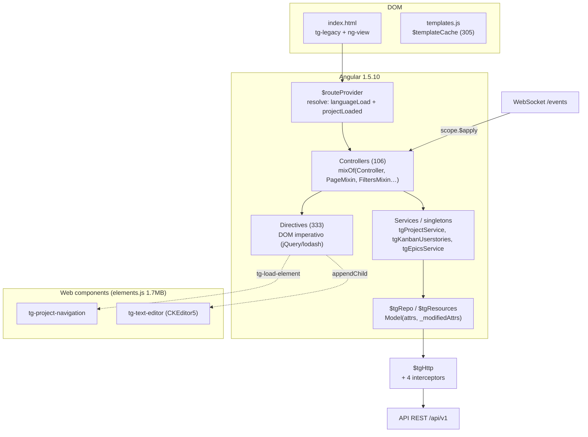
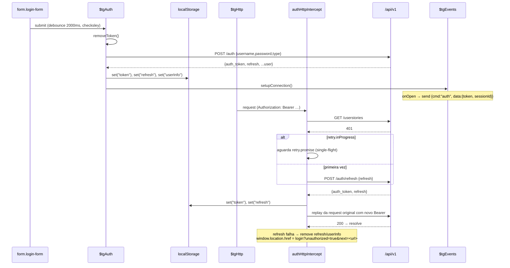

# Taiga — Frontend (AngularJS): engenharia de interação, estado, a11y e performance

Fonte: `_REF/taiga-front` (branch de trabalho, `package.json:3` → **6.10.3**).
Todos os caminhos abaixo são relativos a `_REF/taiga-front/`.
Complementa `taiga-ui-ux.md` (fluxos de tela) e `taiga-data-model.md` (domínio do backend); aqui o recorte é **como o cliente é construído**.

---

## 1. Stack exato

| Camada | Escolha | Evidência |
|---|---|---|
| Framework | AngularJS **1.5.10** (angular, -route, -animate, -aria, -sanitize, todos 1.5.10) | `package.json:106-110` |
| Linguagem | CoffeeScript 1.10 (529 arquivos `.coffee`) | `package.json:36`; contagem própria |
| Templates | Jade/Pug 1.11 → HTML → `$templateCache` | `package.json:44`; `gulpfile.js:272-289` |
| Build | **gulp 4**, sem bundler de módulos: `concat` + `uglify` | `package.json:43`; `gulpfile.js:510-526` |
| Estilo | SCSS via `node-sass` 8 (libsass, deprecado) + `autoprefixer` + `clean-css` | `package.json:87`; `gulpfile.js:327-370` |
| Runtime Node | `.nvmrc` → `v16.19.1` | `.nvmrc:1`; CI fixa a mesma versão `.github/workflows/main.yml:16-17` |
| Deploy | `dist/v-<timestamp>/` + `nginx:1.23-alpine` (imagem Docker) | `gulpfile.js:56-58,717-731`; `docker/Dockerfile:8-15` |
| Teste unit | Karma + Mocha + Chai + Sinon + angular-mocks | `package.json:24-45,78-85`; `karma.conf.js:23-40` |
| Teste e2e | Protractor (via binário global, não é dependência declarada) + suites | `run-e2e.js:47,66`; `conf.e2e.js:1-60` |

Dependências de runtime que **definem a arquitetura** (todas globais, concatenadas em `libs.js`, sem import):

| Lib | Versão | Papel | Evidência |
|---|---|---|---|
| jQuery | ^2.2.3 | manipulação direta de DOM, base de quase toda interação | `package.json:126`; `gulpfile.js:168` |
| lodash | ^4.16.4 | utilitários, `_.template` (render fora do Angular) | `package.json:129`; `gulpfile.js:169` |
| Immutable.js | ^3.8.1 | listas/mapas imutáveis no estado de UI | `package.json:124` |
| angular-translate + partial-loader | 2.18.3 / 2.18.1 | i18n por parte, carregado em runtime | `package.json:111-114` |
| dragula | ^3.7.2 | drag&drop do kanban/backlog/wiki | `package.json:120` |
| dom-autoscroller | ^2.3.4 | auto-scroll durante o arraste | `package.json:119` |
| checksley | fork fork `jespino/checksley-bower` | validação de formulários imperativa | `package.json:118` |
| Pikaday | ^1.8.2 | date picker | `package.json:133` |
| Flot 0.8.3 | git tag | burndown | `package.json:121-123` |
| Awesomplete | ^1.0.0 | autocomplete | `package.json:116` |
| raven-js | ^3.7.0 | Sentry, ligado só se `ravenConfig` existir | `package.json:134`; `app/coffee/modules/common/raven-logger.coffee:13-25` |
| taiga-html-editor | git `#stable` | editor CKEditor5 empacotado em **`elements.js`** | `package.json:136` |

Ordem de concatenação de `libs.js` em `gulpfile.js:167-199`: jQuery, lodash, messageformat, angular(+route, animate, aria), translate(+loaders), moment, checksley, pikaday, Flot, axislabels, tooltip, raven, l.js, infinite-scroll, immutable, intro.js, dragula, awesomplete, autolinker, dom-autoscroller, e então quatro arquivos próprios: `app/js/angular-sanitize.js`, `dragula-drag-multiple.js`, `boards.js`, `tg-repeat.js`, `sha1-custom.js`, `murmurhash3_gc.js` (`gulpfile.js:192-198`). **Não há ES modules, tree-shaking nem code splitting.**

### 1.1 Pipeline (`gulp deploy`)

```
clear → delete-old-version → delete-tmp →
  parallel(copy, jade-deploy, app-deploy, jslibs-deploy, elements, link-images, compile-themes)
```
`gulpfile.js:717-731`

Três artefatos JS, carregados em sequência pelo loader:

| Artefato | Origem | Transformação |
|---|---|---|
| `js/libs.js` | concat das libs globais | `uglify` só em deploy (`gulpfile.js:549-559`) |
| `js/templates.js` | 305 `.jade` fora de `includes/` → `templateCache({standalone:true})` | remove classes `e2e-*` e minifica (`gulpfile.js:272-289`) |
| `js/app.js` | 529 `.coffee` concatenados em ordem explícita | `coffee` + `concat` + `uglify` (`gulpfile.js:510-526`) |
| `js/app-loader.js` | `app-loader/app-loader.coffee` com `___VERSION___` substituído | `gulpfile.js:462-468` |
| `js/elements.js` | **artefato commitado no repo** (`elements.js`, 1.702.525 bytes) | só `uglify` (`gulpfile.js:562-567`) |

`elements.js` é um bundle **webpack** (preâmbulo `!function(e){function r(...)` em `elements.js:1`) contendo CKEditor 5 e custom elements: `tg-text-editor`, `tg-html-editor`, `tg-markdown-editor`, `tg-svg-sprite`, `tg-legacy`, `tg-project-navigation`, `tg-legacy-loader`. Ele **não é gerado neste repo** — não há dependência nem task correspondente; é um binário de ~1,7 MB versionado, atualizado fora do fluxo de build. `app-loader/bootstrap.coffee` existe mas está **vazio (0 bytes)**: resíduo de refatoração.

A ordem de concatenação é significativa e frágil (`gulpfile.js:138-165`): `app.coffee` primeiro (define `taiga` e `angular.module("taiga", …)`), depois `coffee/modules/*.coffee`, depois os submódulos legados, e **por último** `app/modules/**/*.coffee` (a árvore nova de componentes). Ou seja: o código novo depende de o antigo já ter rodado no load, porque usa `taiga` e `angular.module(...)` sem imports.

---

## 2. Bootstrap, camadas e ciclo de digest

### 2.1 Bootstrap em 5 estágios

`app-loader/app-loader.coffee` é o único script no `index.html` (`app/index.jade:66`) e faz, em ordem:

1. `fetch("conf.json")` e *merge* sobre `window.taigaConfig` (`app-loader.coffee:116-130`); `baseHref` é aplicado ao elemento `<base>` (`:122-128`).
2. `mainLoad()`: baixa `emojis/emojis-data.json` em paralelo (`:96-99`).
3. `loadJS(js/libs.js)` → `loadJS(js/templates.js)` → (opcional) **plugins contrib** (`:101-108`, `loadPlugins` `:88-92`).
4. `loadApp()`: `js/elements.js` → `js/app.js` → espera emojis (`:110-113`).
5. `angular.bootstrap(document, ['taiga'])` — **bootstrap manual**, não `ng-app` (`:114`).

Consequência: existem **duas gerações de UI** convivendo no mesmo documento — AngularJS compilado em `app.js` e custom elements registrados por `elements.js`. O ponto de contato é `tg-load-element` (`app/coffee/modules/base/load-element.coffee:17-37`), que copia `component`, `params` e `events` como *properties* do elemento; o menu de projeto usa exatamente isso (`app/modules/components/project-menu/project-menu.controller.coffee:31-39` → `component: 'tg-project-navigation'`). Traduções vão para o web component por atributo JS: `legacy.translations = {translationTable, lan}` (`app/coffee/app.coffee:1005-1009`).

### 2.2 Camadas



Camadas explícitas: `$http` cru é encapsulado por `$tgHttp` (`app/coffee/modules/base/http.coffee:11-71`), que injeta `Authorization` e `Accept-Language` (`:17-33`) e é a **única** porta de escrita (`post/put/patch/delete`). `$tgRepo` (`app/coffee/modules/base/repository.coffee`) traduz `Model` ↔ JSON e `$tgResources` (`app/coffee/modules/resources.coffee`) é um registry de *providers* que se auto-registram via `module.run` com 25 providers (`:261-287`).

### 2.3 Multi-tenant / multi-projeto

Não há multi-tenancy: `baseHref` e `api` vêm do `conf.json` (`conf/conf.example.json:2,4`), um deploy por instância. O "escopo" é o **projeto**, resolvido em cada navegação pelo `resolve` injetado em **todas** as rotas via patch do `$routeProvider.when`:

```coffee
# app/coffee/app.coffee:44-70 (resumido)
originalWhen = $routeProvider.when
$routeProvider.when = (path, route) ->
    route.resolve || (route.resolve = {})
    angular.extend(route.resolve, {
        languageLoad: [...],      # $translate("COMMON.YES").then -> resolve
        projectLoaded: [...]      # setSection + setProjectBySlug(pslug)
    })
    return originalWhen.call($routeProvider, path, route)
```
Isso significa que **toda** rota (inclusive `/login`, `/discover`) paga dois resolves; `projectLoaded` chama `cleanProject()` quando não há `pslug` (`:61-63`).

### 2.4 Ciclo de request e digest

```mermaid
sequenceDiagram
  participant U as Usuário
  participant D as Diretiva (jQuery)
  participant C as Controller
  participant H as $tgHttp
  participant I as Interceptors
  participant A as API
  U->>D: click / drop / submit
  D->>C: callback ($scope.$apply quando fora do Angular)
  C->>H: repo.save()/rs.x.list()
  H->>H: headers(): Bearer token + Accept-Language
  H->>I: loaderIntercept.request (logRequest)
  I->>A: XHR (X-Session-Id fixo da sessão da aba)
  A-->>I: 200/401/451
  I-->>H: authHttpIntercept / versionCheck / blocking
  H-->>C: promise
  C->>C: model._attrs = data; Immutable.set(...)
  C-->>D: $broadcast("usform:edit:success", …)
  D->>D: $el.html(render(vm)) (fora do digest)
  C->>U: $digest (1–10 loops até estabilizar)
```

Interceptors, na ordem de registro (`app/coffee/app.coffee:705-787`):

| # | Nome | Faz | Linha |
|---|---|---|---|
| 1 | `authHttpIntercept` | 401 → refresh *single-flight* + replay; 0/-1 → fecha lightboxes e `errorHandlingService.error()` | `:609-707` |
| 2 | `loaderIntercept` | conta requests e alimenta o `tgLoader` | `:713-738` |
| 3 | `versionCheckHttpIntercept` | 400 com `data.version` → toast `ERROR.VERSION_ERROR` (conflito de versão do modelo) | `:740-757` |
| 4 | `blockingIntercept` | `data.blocked_code` ou HTTP 451 → tela de projeto bloqueado | `:759-788` |

Ajustes globais relevantes: `useApplyAsync(true)` (`:604`), `debugInfoEnabled(false)` por padrão (`:790`), `$animateProvider.classNameFilter(/^(?:(?!ng-animate-disabled).)*$/)` — animação é *opt-out* por classe (`:39`), e `html5Mode({enabled:true, requireBase:true})` (`:588`).

Headers default são **estáticos por página**: `Content-Type: application/json`, `Accept-Language` (do config, não do usuário — o valor real vem do `$tgHttp`), e `X-Session-Id` (`app/coffee/app.coffee:590-602`), um id aleatório gerado no load (`taiga.generateUniqueSessionIdentifier`, `:22-25`) e reusado como sessão do WebSocket (`:606`).

---

## 3. Autenticação e sessão

### 3.1 Modelo

Não há cookie de sessão nem CSRF: **Bearer token em `localStorage`**. `login` faz `POST /auth` com `{username, password, type}` e recebe `auth_token` + `refresh` (`app/coffee/modules/auth.coffee:165-180`), gravando ambos via `$tgStorage` (`localStorage.setItem`, `app/coffee/modules/base/storage.coffee:27-33`). `userInfo` completo também é gravado (`auth.coffee:113-118`) e é a fonte de `$rootScope.user` no próximo load (`:96-111`).

| Método | Fluxo no cliente | Evidência |
|---|---|---|
| Login normal | `checksley.validate()` → `POST /auth` → set tokens → `$tgEvents.setupConnection()` | `auth.coffee:282-330`; `:290-296` |
| Registro público | `POST /auth/register` (`type: public`) → já autentica | `auth.coffee:186-200` |
| Convite | `GET /invitations/:token` → registro `type: private` | `auth.coffee:202-210` |
| Recuperação | `POST /users/password_recovery`; troca via `/users/change_password_from_recovery` | `auth.coffee:212-226`; `app/coffee/modules/base.coffee:26-30` |
| OAuth (github/gitlab) | **plugin externo**: `contribPlugins` carrega JS de terceiros e registra `type: "auth"` | `app-loader.coffee:69-87`; `app.coffee:975-978` |
| 2FA | inexistente no cliente | — |
| API keys | geridas em UI de admin (`/applications`, `/application-tokens`) | `app/coffee/modules/resources.coffee:206-208` |
| Sessão inválida | 401 → refresh; falhou → `location.href = login?unauthorized=true&next=…` | `app.coffee:640-660` |
| Logout | remove `token`, `refresh`, `userInfo`; `$broadcast("auth:logout")` sem chamada ao servidor | `auth.coffee:181-190` |

### 3.2 Fluxo completo (login → 401 → refresh → replay)



O *single-flight* é feito com um objeto `retry = {inProgress, promise}` no closure do interceptor (`app.coffee:610-613`, `:648-660`), o que serializa refreshes concorrentes de N requisições paralelas. Detalhe: `/auth/refresh` é excluído do próprio interceptor (`:617-618`) para evitar recursão.

`isAuthenticated()` é **puramente local**: `getUser() != null` (`auth.coffee:146-150`), e `getUser()` lê `localStorage.userInfo` (`:96-111`). Um token expirado continua "autenticado" até a primeira chamada 401. O objeto do usuário carrega `lang` e `theme`, usados para aplicar locale (`:92-94`) e tema (`:75-90`) antes de qualquer request.

### 3.3 Rate limit / política de senha

O cliente **não implementa** rate limit nem regra de senha: nenhum `maxlength`/`pattern` de senha nos templates e nenhum contador de tentativas; o único freio é `debounce 2000` no submit (`auth.coffee:307`) e a mensagem genérica `LOGIN_FORM.ERROR_AUTH_INCORRECT` (`:299`). Política de senha é responsabilidade do backend; o front apenas exibe o erro de campo devolvido (`form.setErrors(response)`, `app/coffee/modules/common/lightboxes.coffee:806`).

---

## 4. Estado do cliente

### 4.1 Onde vive o estado

| Tipo | Mecanismo | Onde | Risco |
|---|---|---|---|
| Lista de cards do kanban | `Immutable.Map` (`usByStatus`, `usMap`, `usByStatusSwimlanes`) + `userstoriesRaw` (array mutável) | `app/coffee/modules/kanban/kanban-usertories.coffee:24-32` | duas fontes da verdade no mesmo objeto |
| Projeto + permissões | `Immutable.Map` único, singleton | `app/modules/services/project.service.coffee:29-36` | refresh global a cada 10 min |
| Épicos paginados | `Immutable.List` + `_loadVersion` (guarda contra respostas fora de ordem) | `app/modules/epics/epics.service.coffee:22-58` | correto, mas só nesse serviço |
| Filtros selecionados | `localStorage` com chave `sha1(pslug + ":" + ns)` | `app/coffee/modules/controllerMixins.coffee:106-135` | filtros ficam "grudados" entre sessões |
| Filtros nomeados ("custom filters") | **servidor**: `user-project-settings` | `controllerMixins.coffee:211-221` | requer rede para listar |
| Zoom / colunas / swimlanes | `localStorage` por `projectId` | `app/coffee/modules/resources/kanban.coffee:14-38`; `kanban-board-zoom.directive.coffee:15` | por dispositivo, não por usuário |
| Rascunho do editor | `localStorage["<projectId>-<objId>-wiki"] = {version, text}` | `app/modules/components/wysiwyg/wysiwyg.directive.coffee:196-206`; wiki `app/coffee/modules/wiki/main.coffee:256-257` | conflito detectado por `version` |
| Modo do editor | `localStorage["editor-mode"]` | `wysiwyg.directive.coffee:25-28` | global, não por objeto |

### 4.2 Propagação por eventos, não por store

Não há store central nem fluxo unidirecional. A sincronização é **broadcast de `$rootScope`** — 191 `$broadcast` e 43 `$emit` no código. Um único `$digest` pode disparar dezenas de handlers globais; exemplo de cadeia no kanban, ao criar US:

```
genericform → repo.create → broadcast "usform:new:success"
  → KanbanController: refreshTagsColors → add() → "redraw:wip" → generateFilters
    → (se cair em coluna arquivada) filtersReloadContent → loadUserstories (fetch completo)
```
`app/coffee/modules/kanban/main.coffee:186-196`

### 4.3 Refresh global e reconciliação

- `tgProjectService` refaz `GET /projects/:slug` **a cada 10 minutos** enquanto a aba está ativa, e **para** quando fica 5 min idle (`project.service.coffee:60-68`, `app/modules/services/user-activity.service.coffee:14-31`). Também reage a 10 sinais (`admin:project-values:updated`, `sprintform:create:success`, `tags:updated`, …) refazendo o projeto inteiro (`project.service.coffee:37-52`, `:54-56`).
- No kanban, eventos WebSocket disparam `eventsLoadUserstories`, que **refaz `GET /userstories` completo** com os filtros atuais e então reconcilia por id: remove os que sumiram, faz `replaceModel` dos que mudaram e `add` dos novos (`kanban/main.coffee:457-487`). Não há patch incremental — é *re-fetch + diff manual*.
- A UI guarda contadores (`kanban:userstories:loaded`, `usCardVisibility`) que só são recalculados ao final do render (`:400-410`).

### 4.4 Dessincronização — riscos concretos

| Risco | Mecanismo | Evidência |
|---|---|---|
| Duplicação otimista | `add()` remove por id antes de concatenar; se o WS chegar entre o `POST` e a resposta, `add` roda duas vezes | `kanban-usertories.coffee:75-100` |
| Ordem local ≠ servidor | `move()` grava inteiros provisórios e confia no `after/before` do servidor | `kanban-usertories.coffee:150-190` |
| Estado "meio atualizado" | `refresh(false)` não atualiza `usMap`, só `usByStatus`; quem lê `usMap` vê dado velho até o próximo `refresh(true)` | `:254-262` |
| Aba duplicada | dois `X-Session-Id` distintos, mas o mesmo `localStorage` → token compartilhado, eventos duplicados | `app.coffee:22-25,606` |
| Filtro local vs. filtro de URL | `applyStoredFilters` só aplica se a URL está vazia, mas `filtersReloadContent` sempre readiciona `params.q` | `controllerMixins.coffee:106-116`; `kanban/main.coffee:452-455` |
| Lightbox aberta "engole" eventos | eventos de projeto só marcam `isRefreshNeeded` e recarregam ao fechar | `kanban/main.coffee:244-252` |

---

## 5. Schema físico do cliente

O cliente não tem schema relacional; o "schema físico" é o par **(a)** `Model` com `_attrs`/`_modifiedAttrs` e **(b)** o conjunto de chaves de `localStorage`.

### 5.1 `Model`

`app/coffee/modules/base/model.coffee:7-125` — cada atributo vira *accessor* via `Object.defineProperty` (`:67-102`); escrever só marca *dirty* (`:79-92`), e `getAttrs(patch)` **sempre injeta `version`** quando o registro tem esse campo (`:48-51`). É a base do controle de concorrência otimista: o patch enviado é `{..._modifiedAttrs, version}` e o servidor recusa com 400 + `version` (`app.coffee:740-757`).

`casts` só existem para `int` e `float` (`model.coffee:143-152`); datas ficam como string ISO e são convertidas no ponto de uso com `moment`.

### 5.2 Chaves persistidas

| Chave | Formato | Escrita | Leitura |
|---|---|---|---|
| `token` | JWT string | `auth.coffee:137`; `app.coffee:632` | `http.coffee:21` |
| `refresh` | string | `auth.coffee:131`; `app.coffee:633` | `app.coffee:665` |
| `userInfo` | JSON do `users` | `auth.coffee:117` | `auth.coffee:100`; `app.coffee:792` |
| `kanban_zoom`, `taskboard_zoom` | inteiro 0–3 | `kanban-board-zoom.directive.coffee:20-25` | `:15` |
| `editor-mode` | `"html"` \| `"markdown"` | `wysiwyg.directive.coffee:122` | `:25` |
| `sha1(projectId + ":kanban-statuscolumnmodels")` | `{statusId: bool}` | `resources/kanban.coffee:17-19` | `:21-24` |
| `sha1(projectId + ":kanban-swimlanesmodels")` | `{swimlaneId: bool}` | `:26-28` | `:30-33` |
| `sha1(pslug + ":" + ns)` (filtros, tags, burndown, campos custom) | querystring serializada | `controllerMixins.coffee:121-124` | `:126-135` |
| `<projectId>-<objId>-wiki` | `{version, text}` | `wysiwyg.directive.coffee:201-205` | `:171-176` |

O uso de `sha1` é só para achatar a chave (`app/js/sha1-custom.js`, referenciado em `gulpfile.js:197`); não é segurança. `$tgStorage.get` faz `JSON.parse` com `try/catch` e devolve `null` em corrupção (`storage.coffee:17-25`) — ou seja, dado corrompido é descartado silenciosamente.

### 5.3 Integridade entre cliente e servidor

Não há validação de schema no cliente: o objeto é montado por `initialData(data)` por tipo (`us`, `task`, `issue`) em `common/lightboxes.coffee:539-616`, com defaults vindos do projeto (`default_us_status`, `default_task_status`, `default_severity`, `default_priority`, `default_us_type`). Erros de integridade só aparecem no retorno do `POST`, mapeados para o formulário (`:806-816`).

---

## 6. Domínio e validação

| Elemento | Implementação | Evidência |
|---|---|---|
| Herança/mixins | `mixOf(base, mixins...)` copia protótipos; controllers são `class X extends mixOf(taiga.Controller, PageMixin, FiltersMixin, UsFiltersMixin)` | `app/coffee/utils.coffee:58-66`; `kanban/main.coffee:28` |
| Base de erro | `TaigaController.onInitialDataError` mapeia 404→notfound, 403→permissionDenied | `app/coffee/classes.coffee:9-19` |
| Propriedade imutável | `defineImmutableProperty` valida em runtime que o getter devolve algo com `.size` (Immutable) | `utils.coffee:177-190` |
| Validação de form | **checksley**, imperativo: `$el.find("form").checksley({onlyOneErrorElement:true})` + `.validate()` | `auth.coffee:528-545`; `common/lightboxes.coffee:777` |
| Validadores custom | `linewidth`, `pikaday`, `url` (regex com bloqueio de IP privado/loopback) | `app.coffee:905-955` |
| Mensagens de erro i18n | `checksley.updateMessages('default', {...})` traduzido | `app.coffee:864-894` |
| Erros de servidor | `form.setErrors(response)`; `response._error_message` → toast | `common/lightboxes.coffee:806-816` |
| Diálogo de confirmação | `$tgConfirm.ask(title, subtitle, message)` sobre lightbox **única** pré-renderizada em `index.jade`, preenchida com `.text()` (seguro contra HTML) | `confirm.coffee:36-80`; `app/index.jade:47-58` |

Máquinas de estado reais (explícitas):

- **Lightbox**: `closed → open(transitionend) → close-started → close(transitionend) → closed`; o estado "aberto" é consultado globalmente por `$(".lightbox.open:not(.close-started)")` (`common/lightboxes.coffee:26-101`). Navegação bloqueada enquanto aberta: `$locationChangeStart` faz `preventDefault()` e `closeAll()` (`app.coffee:1015-1022`).
- **Coluna do kanban**: `visible → vfold` (colapsada, 36 px) e `vunfold` transitório durante o unfold (`kanban-table.scss:4,75-107`).
- **Card**: `folded/unfolded` — `_setVisibility` inverte a regra no zoom 2 (`card.controller.coffee:76-100`).
- **Sync**: `connected/error` no WebSocket (`events.coffee:18-33`).

---

## 7. Consultas server-side

### 7.1 Filtros → querystring → API

O filtro **é** a URL. `selectFilter`/`unselectFilter` escrevem em `$location.search()` com acumulação CSV e prefixo `exclude_` para exclusão (`controllerMixins.coffee:56-104`). Para não reexecutar a rota, existe `$location.noreload(scope)`, que restaura `$route.current` no próximo `$locationChangeSuccess` (`app/coffee/modules/base/location.coffee:11-19`) — truque que evita recarregar resolves e controllers a cada clique de filtro.

Parâmetros aceitos pelo kanban: `exclude_tags`, `tags`, `exclude_assigned_users`, `assigned_users`, `exclude_role`, `role`, `exclude_epic`, `epic`, `exclude_owner`, `owner` (`kanban/main.coffee:59-68`), mergeados com `exclude_status`/`status__is_archived` (colunas arquivadas) e `q` (busca livre) (`:437-455`).

### 7.2 Escopo de permissão no cliente

Permissões vêm prontas em `project.my_permissions` (array de strings) e são checadas em três lugares:

| Mecanismo | Comportamento | Evidência |
|---|---|---|
| `tg-check-permission` | começa `hidden`, remove a classe se `canEdit(perm)` | `common.coffee:96-119`; `.hidden{display:none!important}` em `styles/core/base.scss:142-144` |
| `tg-class-permission` | aplica/remove classes por permissão, com negação `!perm` | `common.coffee:126-155` |
| `canEdit()` | `false` se projeto arquivado; senão `my_permissions.indexOf(perm) != -1` | `project.service.coffee:98-106` |

Tudo isso é **cosmético**: o array vem do servidor e qualquer requisição continua sendo autorizada (ou não) no backend. Elementos escondidos por classe permanecem no DOM e no `$templateCache`.

### 7.3 Paginação, ordenação, agrupamento

- Paginação é **opt-in**: por padrão `queryMany` envia `x-disable-pagination: 1` (`repository.coffee:136-140`) e recebe o array inteiro. Só quem pede `enablePagination: true` lê `x-pagination-count/current/next` (`:181-196`; `app/modules/services/paginate-response.service.coffee:10-20`).
- Kanban e backlog **desligam paginação** (`resources/userstories.coffee:38-47`, `:61-67`) — o board carrega todas as US do projeto com filtros aplicados.
- Listas grandes (épicos, histórico, notificações) usam `infinite-scroll` com throttle global de 500 ms (`app.coffee:1043`; `epics-table.jade:102-104`).
- Ordenação é sempre client-side após o fetch: `_.sortBy(@userstoriesRaw, [(it) => @order[it.id]])` (`kanban-usertories.coffee:254-258`); a ordenação por coluna das tabelas de issues/épicos é feita pelo servidor via `order_by` no querystring.
- Agrupamento (US por status, por swimlane) é feito em memória com `_.groupBy` + `Immutable.fromJS` (`kanban/main.coffee:413-433`; `kanban-usertories.coffee:296-319`).

### 7.4 N+1 e chamadas em cadeia

O padrão dominante é **fan-out de requests por linha/card**:

- Abrir o card para editar faz duas chamadas sequenciais: `userstories.getByRef()` e depois `attachments.list()` (`kanban/main.coffee:286-303`).
- Cada linha do backlog pode disparar `tg-due-date`, `tg-us-status` e `tg-us-edit-selector`, cada um com seu próprio serviço.
- O `GET /projects/:slug` retorna o projeto inteiro com `members`, `us_statuses`, `points`, `roles`, `tags` — usado como cache de referência para tudo (por isso o refresh de 10 min).
- `epics.listRelatedUserStories` é chamado **por épico expandido**, sem cache (`epics.service.coffee:67-68`).

---

## 8. Escrita e concorrência

| Cenário | Estratégia | Evidência |
|---|---|---|
| Editar campo | patch parcial + `version` do modelo; 400 `version` → toast "recarregue" | `model.coffee:48-51`; `repository.coffee:60-88`; `app.coffee:740-757` |
| Reordenar no backlog | fila `pendingDrag`: o primeiro request carrega os N seguintes e drena em série | `backlog/main.coffee:523-628` |
| Reordenar no kanban | `move()` local + **um** `POST bulk_update_kanban_order` com `after/before` ids | `kanban/main.coffee:617-655`; `resources/userstories.coffee:110-133` |
| Multi-drag | clones em `position:fixed` + `dataset`; um único bulk com todos os ids | `app/js/dragula-drag-multiple.js:160-215`; `kanban/sortable.coffee:109-153` |
| Criar com anexos | cria objeto → `q.all(uploads)` → `q.all(deletes)` → só então notifica | `common/lightboxes.coffee:790-800` |
| Exclusão | lightbox de confirmação; `askResponse.finish()` só após a resposta | `kanban/main.coffee:305-325` |
| Anexos | upload imediato por arquivo; ordenação em lote (`bulkAttachments`) | `attachments.service.coffee:78-95` |

Não existe lock pessimista, `If-Match`/ETag nem fila de retry para escrita. O padrão de concorrência é **last-write-wins com detecção por `version`** apenas em edição de campos (não em reordenação, onde o servidor recalcula a ordem a partir de `after/before`).

**Bug concreto** em `backlog/main.coffee:596-598`: no ramo `else if nextUs`, a posição é calculada com `findIndex (us) -> us.id == previousUs` (variável errada, sempre `null` nesse ramo → `position = -1 + 1 = 0`), então arrastar para o topo de um sprint vazio/antes do primeiro item sempre insere no índice 0 mesmo quando `nextUs` aponta outro lugar.

A escrita otimista do backlog remove o item do DOM **antes** do request (`:557-585`) e não há revert: em erro, a promise rejeita e o item fica fora da lista até o próximo `loadSprints()` (disparado só se o WS estiver desconectado, `:615-620`).

---

## 9. Interação — kanban

### 9.1 Estrutura

Duas variantes no mesmo template: **com swimlanes** (`swimlanesList.size > 0`) e sem (`partials/includes/modules/kanban-table.jade:82-176` vs `:178-260`). A matriz é renderizada como **N loops aninhados** de `div`, sem `<table>`:

```
.kanban-table
  .kanban-table-header > .task-colum-name (ng-repeat s in usStatusList track by s.id)
  .kanban-swimlane (tg-repeat swimlane in swimlanesList)
    .kanban-table-body
      .taskboard-column (ng-repeat s in ::swimlanesStatuses[swimlane.id])
        tg-card (tg-repeat usId in usByStatusSwimlanes.getIn([swimlane.id, s.id]))
```
`kanban-table.jade:15-26, 78-140`

O loop de cards usa `tg-repeat` sobre uma `Immutable.List` de **ids**, e resolve o objeto com `usMap.get(usId)` no binding (`:137`). Isso evita rebuild de objetos, mas cria um watcher por card que reavalia um `Map.get`.

### 9.2 Colunas colapsáveis, WIP e zoom

| Recurso | Implementação | Evidência |
|---|---|---|
| Colapso de coluna | classe `vfold` → `min/max-width: 36px`, cards `display:none`, header vira ícone | `kanban-table.scss:4,75-107` |
| Persistência do colapso | `localStorage` por projeto; colunas arquivadas começam colapsadas | `resources/kanban.coffee:17-24`; `kanban/main.coffee:589-595` |
| Colapso de swimlane | `foldedSwimlane` em `Immutable.Map`, persistido; título "sticky" via `translateX` no scroll | `kanban/main.coffee:346-354`; `:1170-1180` |
| Auto-unfold durante drag | hover de 1 s numa swimlane colapsada, só se existir `tg-card.gu-mirror` | `kanban/main.coffee:1147-1170` |
| WIP marker | `<div class='kanban-wip-limit'>` inserido **depois do card `wip_limit-1`** via jQuery | `kanban/main.coffee:801-840` |
| Contador animado | `tg-animated-counter`: 3 `div.result` empilhadas; troca o número exibido no `transitionend` | `app/modules/components/animated-counter/animated-counter.directive.coffee:12-60` |
| Largura total do board | `ResizeObserver` em cada coluna escreve `--kanban-width` | `kanban/main.coffee:662-686` |
| Header sincronizado | `scroll` do body → `translateX` no header (sem rAF/throttle) | `:719-726` |

Zoom é **4 níveis cumulativos** (`kanban-board-zoom.directive.coffee:19-24`):

| Nível | Campos visíveis | Efeito colateral |
|---|---|---|
| 0 | `assigned_to`, `ref` | card mínimo |
| 1 (default `localStorage`) | + `subject`, `card-data`, `assigned_to_extended` | — |
| 2 | + `tags`, `extra_info`, `unfold` | `include_attachments=1&include_tasks=1` no fetch |
| 3 | + `related_tasks`, `attachments` | se veio de ≤2, dispara `loadUserstories()` completo |

`kanban/main.coffee:127-146`, `:437-455`.

### 9.3 Drag&drop: cálculo de ordem e ida ao servidor

```mermaid
sequenceDiagram
  participant U as Usuário
  participant DG as dragula (+ dragMultiple)
  participant SD as tgKanbanSortable
  participant KC as KanbanController
  participant KS as tgKanbanUserstories
  participant API as API

  U->>DG: arrasta 1..N cards selecionados (ctrl/cmd)
  DG-->>SD: 'drag' → guarda oldIndex; dragMultiple.start()
  Note over DG: clones position:fixed acompanham o mouse
  U->>DG: solta em outra coluna
  DG-->>SD: 'drop' → previousCard/nextCard lidos do DOM (dataset.id)
  DG-->>SD: 'dragend'
  SD->>SD: index = $(parent).find('tg-card').index(first)<br/>newStatus = parent.dataset.status<br/>newSwimlane = parent.dataset.swimlane
  SD->>SD: remove do DOM os cards que mudaram de container
  SD->>KC: $scope.$apply → $broadcast("kanban:us:move", usList, newStatus, newSwimlane, index, prev, next)
  KC->>KS: move(ids, status, swimlane, index, prev, next)
  KS->>KS: previousUsOrder = order[prev] + 1 (ou 0)<br/>afterDestination = slice(coluna, idx(prev)+1)<br/>moved: order = prevOrder + k<br/>resto: order = prevOrder + |moved| + 1 + k
  KS-->>KC: {afterUserstoryId, beforeUserstoryId, bulkUserstories}
  KC->>API: POST /userstories/bulk_update_kanban_order
  API-->>KC: 200
  KC->>KC: $broadcast("redraw:wip"); generateFilters();<br/>se filtro de status ativo → filtersReloadContent()
  API->>KC: WS "changes.project.<id>.userstories"
  KC->>API: GET /userstories (refetch completo com filtros)
  KC->>KS: replaceModel / remove / add + refresh(false)
```

Numeração local (`kanban-usertories.coffee:150-190`):

```coffee
previousUsOrder = if previousCard then @.order[previousCard] + 1 else 0
previousUsIndex = (usByStatus.findIndex (it) => it.id == previousCard) + 1
afterDestination = _.slice(usByStatusWithoutMoved, previousUsIndex)
initialLength    = usList.length + 1
for usModel, key in afterDestination
    @.order[usModel.id] = previousUsOrder + initialLength + key   # abre espaço
for usId, key in usList
    @.order[usId] = previousUsOrder + key                         # bloco movido
```
São **inteiros**, sem *fractional indexing*. O valor local é descartável: o request manda `after_userstory_id`/`before_userstory_id` e o backend recalcula; o cliente sobrescreve `kanban_order` com o que voltar (`kanban/main.coffee:626-640`).

Edge cases tratados:

| Caso | Tratamento | Evidência |
|---|---|---|
| Drop na mesma posição | `if index == oldIndex && initialContainer == parentEl then return` | `kanban/sortable.coffee:120-121` |
| Drop em coluna vazia | `previousCard = null` → `previousUsOrder = 0` | `kanban-usertories.coffee:157-161` |
| Sem permissão | dragula nem é inicializado (`my_permissions.indexOf("modify_us") <= 0`) | `kanban/sortable.coffee:38-42` |
| Projeto arquivado | idem | `:43-44` |
| Filtros ativos | após mover, se o filtro é de `status`, refetch | `kanban/main.coffee:651-653` |
| Swimlane "unclassified" | id `-1` convertido para `null` na API | `kanban/main.coffee:621-625` |
| Coluna arquivada | conteúdo só carregado sob demanda (`showStatus` → fetch por status) | `:521-551` |
| Revert em erro | **não existe**; o card já foi removido do DOM | `kanban/sortable.coffee:145-151` |

### 9.4 Virtualização parcial (IntersectionObserver)

O kanban **não virtualiza a lista**, mas **adia o render do conteúdo do card** por visibilidade:

```js
// app/js/boards.js:23-55
var options = {root: column, rootMargin: '0px', threshold: 0};
callback = entries => entries.map(e => ({id: Number(e.target.dataset.id), visible: e.isIntersecting}))
                           .filter(e => e.visible)
if (entries.length) eventsCallback('SHOW_CARD', entries);
```
`KanbanDirective` registra o callback e liga `usCardVisibility[id] = true` dentro de `$evalAsync` (`kanban/main.coffee:687-704`), e o card só renderiza `.card-inner` se `vm.inViewPort` (`components/card/card.jade:9-12`). Ou seja: o *wrapper* `tg-card` existe no DOM (necessário para dragula), mas o conteúdo interno só aparece quando a coluna entra na viewport.

### 9.5 Batching de render

`renderUserStories` não despeja todas as US de uma vez: intercala as colunas de 10 em 10, drena em lotes de 100 com backoff `[200,100,50]` ms e só então emite `kanban:userstories:loaded` (`kanban/main.coffee:386-433`). Durante o batch, `ctrl.renderInProgress` desliga o contador animado (`kanban-table.jade:122-129`).

---

## 10. Backlog, taskboard, epics e issues

**Backlog** — `partials/backlog/backlog.jade` + `app/coffee/modules/backlog/main.coffee` (1385 linhas):
- Duas listas dragáveis (`$el[0]` = backlog, containers das sprints) + duas "zonas vazias" para permitir drop em backlog/sprint vazio (`backlog/sortable.coffee:44-52`).
- Seleção múltipla por **checkbox com shift-range**: `lastChecked.nextUntil(current)` marca o intervalo (`backlog/main.coffee:834-860`); os selecionados viram `ui-multisortable-multiple` e são clonados no drag.
- **Doom line**: linha horizontal inserida antes da US onde a soma de pontos ultrapassa `stats.total_points` (`:723-757`); recalculada em `userstories:loaded`, `sprint:us:moved` e `$watch("stats")`.
- **Velocity forecasting**: `calculateForecasting` empilha US até `stats.speed` (`:444-465`); quando ativo, a doom line é removida (`:729-731`).
- Pontos por role: `sprintTotalPoints` soma `us.total_points` apenas das US cujo `milestone == sprint.id` (`:435-443`).

**Taskboard** — `/project/:pslug/taskboard/:sslug`: mesmos padrões (dragula + `pendingDrag` não; usa `bulk_update_taskboard_order`), 4 níveis de zoom com **matriz diferente** do kanban (nível 2 já traz `card-data` e `unfold`; default `taskboard_zoom = 2`) — `components/taskboard-zoom/taskboard-zoom.directive.coffee:12-22`. Assina 3 routing keys (`tasks`, `issues`, `userstories`) com debounce 500 ms (`taskboard/main.coffee:380-392`).

**Epics** — tabela em `div.row` com `tg-repeat` sobre `Immutable.List` paginada por `infinite-scroll` (`epics-table.jade:99-114`). Expansão de linha busca US relacionadas sob demanda e guarda em `ctrl.epicStories` (`epic-row.controller.coffee:48-58`). O `ng-click` de expandir está no **container da linha**, que contém o `<a>` do épico → clicar no link também dispara o toggle (`epic-row.jade:9-31`). Larguras/colunas visíveis são persistidas em `localStorage` por projeto (`epics-table.controller.coffee:24-38,56-57`).

**Issues** — `section.issues-table.basic-table` com `div.row.title` + `div.row.table-main`; ordenação por coluna via `data-fieldname` e setas SVG inline (`issues-table.jade:51-80`). Mesma estrutura de tabela "fake".

**Filtros nomeados** — `tg-filter` com categorias colapsáveis e dois modos (include/exclude) (`components/filter/filter.jade:104-130`); salvar cria uma entrada em `user-project-settings` no servidor (`controllerMixins.coffee:211-221`).

**Lightbox create/edit** — um único componente serve `us`, `task` e `issue`, escolhendo o *schema* por `objType` (`common/lightboxes.coffee:539-616`). Eventos de abertura: `genericform:new` (kanban/backlog), `genericform:new-or-existing` (adicionar item existente a sprint), `genericform:edit` (`:620-636`). `submit` é `debounce 2000` para evitar duplo-envio (`:777`).

---

## 11. Detalhe de objeto e wiki

**Página de detalhe** (`/project/:pslug/us/:usref`) — `partials/us/us-detail.jade` + `app/coffee/modules/userstories/detail.coffee`:
- Cabeçalho editável inline (`tg-detail-header`) com `required-perm="modify_us"`, salva em Enter, cancela em ESC (`detail-header.controller.spec.coffee:99-108`).
- Abas comments/activity são **links**, não tabs ARIA: `nav.history-tabs > a.history-tab` com `ng-class="{active:…}"` (`history-tabs.jade:7-30`).
- `tg-history-diff` é um *switch* de template por `type` (`points`, `attachments`, `milestone`, `priority`, `severity`, `status`, `subject`, …) — `history/history-diff.jade:9-50`; a lógica só trata `tags` e `promoted_to` (`history-diff.controller.coffee:17-25`).
- Prev/next: usa `item.neighbors` do backend; quando a US é de backlog, recalcula pelo índice em `getBacklog()` (`detail-nav.controller.coffee:23-52`).
- Deep link genérico `/project/:pslug/t/:ref` resolve **qualquer** tipo via `GET /resolver` e redireciona (`app/coffee/modules/detail.coffee:29-60`), com cache exceto para wiki/sprint (`repository.coffee:208-224`).
- Permissões: o container recebe `tg-class-permission="{'readonly': '!modify_task'}"` e cada campo tem seu `tg-check-permission`; "readonly" é só classe CSS (`kanban-table.jade:20-23`; `kanban-table.scss:108-110`).

**Wiki** (`/project/:pslug/wiki/:slug`) — `partials/wiki/wiki.jade`:
- Árvore de links é **re-renderizada inteira** a cada mudança: `$compile(html)($scope)` + `$el.html(html)`, depois `$el.off()` e re-bind de todos os handlers (`wiki/nav.coffee:37-140`). O drag de reordenação usa dragula + `autoScroll(window)` (`:76-92`).
- Editor: `tg-wysiwyg` cria o custom element `document.createElement('tg-text-editor')` e injeta props (`projectId`, `slug`, `mode`, `uploadFunction`, `members`) — `wysiwyg.directive.coffee:89-131`. Eventos `modeChanged`, `focusChanged`, `changed` voltam por `addEventListener` e são embrulhados em `$evalAsync` (`:113-130`).
- Autosave **local**: `_.throttle(change, 200)` grava `{version, text}` no `localStorage` (`:196-214`). Conflito: se `store.version != $scope.version` → `$scope.outdated = true` (`:171-178`), sinalizado na UI.
- Histórico: `tg-wiki-history` + `wiki-history-diff`; restauração via `POST /wiki/:id/restore` (`app/coffee/modules/resources.coffee:157`).

---

## 12. Assíncrono e tempo real

Não há fila, worker nem Service Worker. O assíncrono é: `$q`, `$timeout`, `setInterval` e WebSocket.

| Mecanismo | Config | Evidência |
|---|---|---|
| WebSocket | `eventsUrl` do `conf.json`; `ws:`/`wss:` derivado do protocolo da página | `events.coffee:41-57` |
| Autenticação do socket | primeira mensagem `{cmd:"auth", data:{token, sessionId}}` no `open` | `:236-249` |
| Heartbeat | `{cmd:"ping"}` a cada 60 s; 5 pongs perdidos → reconecta | `:107-140`; `conf/conf.example.json:8-9` |
| Reconexão | backoff aleatório entre `interval/2` e `interval` (10 s default); após 5 erros desiste | `:272-292` |
| Filas de envio | `pendingMessages` até `connected` | `:155-166` |
| Subscribe | `{cmd:"subscribe", routing_key}`; unsubscribe no `$destroy` do scope | `:193-228` |
| Digest | `subscription.scope.$apply(callback)`; `notifications()` chama `$digest()` direto | `:177-190`, `:69-78` |

Routing keys observadas: `changes.project.<id>.userstories|projects|tasks|issues` (`kanban/main.coffee:261-277`; `taskboard/main.coffee:380-392`), `live_notifications.<userId>`, `web_notifications.<userId>`, `notifications` (`events.coffee:66-107`).

Padrões anti-tempestade: debounce aleatório de 700–1000 ms ao assinar US do kanban (`kanban/main.coffee:259-266`), 500 ms no taskboard, `debounceLeading 100` em `filtersReloadContent` (`:149`), `throttle 200` no rascunho do editor, `debounce 2000` em submits críticos (login `auth.coffee:307`, create/edit `common/lightboxes.coffee:777`, confirmação `confirm.coffee:52`), e throttle global de 500 ms no infinite-scroll (`app.coffee:1043`).

Schedulers: `$interval` de 10 min para o projeto (`project.service.coffee:60-63`), `setInterval(…,50)` para fechar o loader quando os requests zeram (`common/loader.coffee:62-68`), `setInterval(…,1000)` (10 tentativas) para achar o iframe do UserPilot (`navigation-bar.directive.coffee:25-45`).

**Webhooks** são gerenciados pela UI de admin (`/project/:pslug/admin/third-parties/webhooks`), incluindo *test* e *resend* de logs (`app/coffee/modules/resources.coffee:173-176`); o cliente não os dispara.

---

## 13. Busca, arquivos, cache, i18n, e-mail

- **Busca global**: `GET /search` com `text` no querystring; o lightbox de busca usa `awesomplete` e renderiza resultados por tipo via 5 templates em cache (`app/coffee/modules/search.coffee:122-234`). A busca de board é só `params.q` — texto livre passado direto ao backend (`kanban/main.coffee:454`).
- **Arquivos**: upload por `POST` multipart ao endpoint por tipo (`attachments/us`, `/issues`, `/tasks`, `/wiki` — `app/coffee/modules/resources.coffee:160-168`); validação **apenas de tamanho** contra `maxUploadFileSize` do config (`attachments.service.coffee:42-57`), sem checagem de MIME no cliente. Preview de imagem usa Photoswipe (`package.json:90`).
- **Cache**: `$cacheFactory("httpget")` é usado em todo `GET` (`http.coffee:16,42`) mas **`removeAll()` é chamado no `finally`** de cada `GET` (`:44-45`). Resultado: o cache só coalesce requests idênticos *em voo* (mesmo digest); não há cache de resposta entre navegações. O único cache real é o `project`, renovado a cada 10 min.
- **i18n**: partial loader com uma única parte `taiga` (`app.coffee:798-806`), URL `${_version}/locales/taiga/locale-${lang}.json`, fallback `en`, sanitização `escapeParameters`, interpolação MessageFormat, handler de chave faltante logando no console (`:808`). 29 locales em `app/locales/taiga/` (~84 KB cada o `en`), + locales de plugins copiados com nome achatado (`gulpfile.js:470-487`), + locales do moment renomeados (`zh-cn`→`zh-hans`) (`:528-540`).
- **E-mail**: nenhum template no front; só fluxos que disparam e-mails (recuperação, convite, verificação) — `auth.coffee:212-226`, `/users/send_verification_email` (`app/coffee/modules/resources.coffee:39`).

---

## 14. Contrato de API (perspectiva do cliente)

| Aspecto | Regra assumida pelo cliente | Evidência |
|---|---|---|
| Base | `conf.api` + `/:recurso[/:id]`, com `%s` formatado | `base/urls.coffee:27-43` |
| Auth | `Authorization: Bearer <token>` + `Accept-Language` | `http.coffee:17-33` |
| Correlação | `X-Session-Id` em todas as chamadas | `app.coffee:590-602` |
| Paginação | desligada por padrão com `x-disable-pagination: 1`; ligada devolve `x-pagination-count/current/next/paginated-by` | `repository.coffee:136-140,181-196` |
| Erros | corpo JSON; `_error_message` é exibida como toast; `__all__[0]` é erro de unicidade | `common/lightboxes.coffee:806-816`; `wiki/nav.coffee:133-136` |
| Conflito | HTTP 400 com chave `version` | `app.coffee:740-757` |
| Bloqueio | HTTP 451 ou `data.blocked_code` | `app.coffee:759-788` |
| Bulk | `bulk_userstories`/`bulk_stories` como array no corpo do POST | `resources/userstories.coffee:95-133` |
| Versionamento | **nenhum** na URL (só `/api/v1`); cliente e backend devem casar (o Docker empacota 6.10.3 com contribs 6.10.x) | `docker/Dockerfile:20-38` |
| Compatibilidade | tolerada por *feature flags* de projeto (`is_epics_activated`, `is_kanban_activated`, …) e por `conf.json` (`enableAsanaImporter`, `contribPlugins`) | `app/coffee/modules/common.coffee:197-217`; `conf/conf.example.json` |

---

## 15. Segurança

| Vetor | Situação | Evidência |
|---|---|---|
| Token em `localStorage` | legível por qualquer JS da origem, incluindo `userpilot`, `zendesk` e plugins contrib carregados de URLs remotas | `storage.coffee:27-33`; `app/index.jade:68-74` |
| CSRF | não aplicável (Bearer, sem cookie) — mas o WS autentica por token na mensagem, não por cookie | `events.coffee:240-248` |
| XSS por template | `_.template`: 108 usos de `<%-` (escapa) contra **33 de `<%=`** (cru), concentrados em `card-templates/*.jade` renderizados por `$el.html()`; hoje os valores interpolados são numéricos ou chaves traduzidas, mas o padrão não escapa nada por si | `card-assigned-to.jade:40-41`; `card-actions.jade:4`; contagem própria; render em `kanban/main.coffee:857-870` |
| XSS por toast | `el.find("p").html(message)` com `response._error_message` do servidor | `confirm.coffee:286-289` [INFERENCE] |
| `$sce` | `getTrustedHtml` usado em 8 pontos (wysiwyg, bind-wysiwyg, timeline) | `wysiwyg.service.coffee:72,110`; `bind-wysiwyg-html.coffee:24` |
| Sanitização de markdown | pipeline externo (`taiga-html-editor`) com allowlist customizada via `window._extraValidHtmlElments/_extraValidAttrs` | `wysiwyg.service.coffee:66-70,104-108` |
| Upload | cliente valida só tamanho; tipo/extensão validados no backend | `attachments.service.coffee:42-57` |
| Segredos | nenhum no bundle; `conf.json` é público e **substituído no container** por `envsubst` | `docker/config_env_subst.sh:60-64` |
| Headers/CSP | **nenhum** header de segurança no nginx do repo (`X-Frame-Options`, CSP, HSTS ausentes) | `docker/default.conf:1-11` |
| Auditoria | atividades por objeto vêm do backend (`/history/*`); o cliente não registra nada | `app/coffee/modules/resources.coffee:150-156` |
| Erros em produção | `Raven` só se `ravenConfig` existir no config | `raven-logger.coffee:13-25` |
| Debug | `$compileProvider.debugInfoEnabled(config.debugInfo)` — desligado por padrão remove `ng-scope`/`scope()` | `app.coffee:790`; `common/bind-scope.coffee:10-12` |

O `BindScope` é notável: quando `debugInfo` está desligado, ele **reimplementa** `jQuery.fn.scope = () => this.data('scope')` para que o código que depende de `.scope()` (drag, wiki, backlog) continue funcionando (`bind-scope.coffee:10-21`).

---

## 16. Acessibilidade — auditoria concreta

Números do código: **19** ocorrências de `aria-*` em 9 de 378 templates Jade; **9** usos reais de `role` (3 são `role="button"`: um `div` sem `tabindex` e duas âncoras `href=""` com ativação só por mouse); **0** `aria-live`; **0** regiões `role="dialog"`; **6** `tabindex` no projeto inteiro; **0** elementos `<table>`.

| # | Achado | Evidência | Impacto |
|---|---|---|---|
| 1 | Lightbox não é diálogo: nenhum `role="dialog"`/`aria-modal`; foco vai para o primeiro `input`, **sem focus trap** e **sem restaurar o foco** ao fechar | `common/lightboxes.coffee:26-64` | leitor de tela não anuncia contexto; Tab escapa para o fundo |
| 2 | Foco depende de `transitionend` para acontecer — com `prefers-reduced-motion`/transição desabilitada, o `focus()` nunca roda | `common/lightboxes.coffee:41-47` | usuário de teclado/AT fica sem foco no formulário |
| 3 | 239 `ng-click` em elementos não interativos (`div`, `span`, `tg-svg`) sem `tabindex` nem handler de teclado | ex. `card-unfold.jade:9-12` (`role="button"` **sem** `tabindex`) | inacessível por teclado |
| 4 | Links de navegação real são `<a href="" tg-nav>`: o `href` só é preenchido no evento **`pointerenter`** | `base/navurls.coffee:107-146` | teclado/AT nunca recebe URL; `href=""` recarrega no topo |
| 5 | 262 âncoras com `href=""` | contagem própria | foco "vazio", anunciado como link sem destino |
| 6 | Tabelas de issues/épicos/backlog são `div.row` — sem `<table>/<th>/<caption>`, sem `aria-sort` | `issues-table.jade:51-53`; `epics-table.jade:99-110` | sem navegação por células, sem cabeçalho associado |
| 7 | Abas comments/activity são `<a>` com `title` e classe `active`; sem `role="tab"`, `aria-selected`, `aria-controls` | `history-tabs.jade:7-30` | estado não é anunciado |
| 8 | Toasts (`notification-message`) aparecem por classe `.active`, sem `aria-live`/`role="status"` | `confirm.coffee:271-299`; `notification-message.jade:13-35` | mensagens de erro/sucesso silenciosas para AT |
| 9 | Live announcement de WebSocket é um `div` posicionado, sem `aria-live`, com `img alt="Loading..."` numa imagem decorativa | `live-announcement.jade:7-9` | anúncio nunca lido; alt errado |
| 10 | Busca: `<input type="search">` só com `placeholder`, sem `label`/`aria-label` | `input-search.component.coffee:12-19` | placeholder não é nome acessível |
| 11 | Checkbox do backlog: `label[tabindex="0"]` (stop de tab extra) apontando para `input ng-model="vm.filterMode"` — **todos os checkboxes compartilham o mesmo modelo** | `backlog-row.jade:25-36` | dupla parada de tab e estado inconsistente |
| 12 | `label` com `tabindex="0"` em vez de foco no `input` (radios de modo de filtro e de zoom) | `filter.jade:105-118`; `board-zoom.jade:11-20` | duas paradas por opção; `Space` no `label` não marca o radio |
| 13 | Zoom/colunas operados por radio + `ng-model` sem `fieldset`/`legend` | `board-zoom.jade:8-50` | grupo sem nome acessível |
| 14 | Contraste: `$primary #25A28C` = 3,17:1 no branco; `$grey-30 #A9AABC` = 2,29:1; `$grey-40 #8D8EA5` = 3,21:1; `$secondary #A7CB23` = 1,87:1 | `app/themes/taiga/variables.scss:5,11,26,27` | reprovam AA para texto normal (4,5:1) |
| 15 | `outline: 1px dotted` global; `input:focus{outline:none}` trocado por `border: 2px`; `.user-list` zera o outline | `styles/core/base.scss:7-9`; `styles/core/forms.scss:30-33`; `styles/components/user-list.scss:52` | indicador de foco frágil/invisível |
| 16 | Zoom máximo: `meta viewport` com `user-scalable=0` nas rotas `mobileViewport` | `app-meta.service.coffee:78-88` | viola WCAG 1.4.4 |
| 17 | Sem `meta viewport` por padrão (a linha está comentada no `index.jade`) | `app/index.jade:24` | layout desktop em telas pequenas |
| 18 | `title="Activities"` e `title="Order Comments"` hardcoded em inglês | `history-tabs.jade:17,26` | i18n quebrada + nome acessível em outro idioma |
| 19 | `ng-title="COMMON.CLOSE | translate"` — diretiva inexistente; o botão de fechar do anúncio não tem nome acessível | `live-announcement.jade:10-15` | botão sem rótulo |
| 20 | Linha de épico tem `ng-click` no container que envolve o `<a>` do épico | `epic-row.jade:9-31` | clique no link também expande; navegação por teclado com efeito colateral |
| 21 | Drag&drop é a **única** forma de mover cards/US; não há alternativa por teclado ("mover para…" existe só em card actions) | `kanban/sortable.coffee:56-160`; `kanban/main.coffee:1050-1090` | WCAG 2.1.1 / 2.5.7 |

Navegação por teclado que **existe**: `ESC` fecha lightbox (`common/lightboxes.coffee:55-62`), `↑/↓/Enter` na lista de usuários da lightbox (`:112-158`), `Enter` para criar tag (`tags.coffee:149`), `Enter`/`ESC` para salvar/cancelar título inline, `ctrl/cmd+click` para seleção múltipla de cards (`kanban-table.jade:168,244`), `shift+click` para range no backlog (`backlog/main.coffee:834-860`). **Não há command palette nem atalhos globais de navegação**: a única captura global é `keydown.shift-pressed` no backlog (`:834`).

---

## 17. Performance e observabilidade

### 17.1 Pressão de digest

| Métrica | Valor | Implicação |
|---|---|---|
| `$watch` explícitos | 125 | cada um avaliado em **todo** digest |
| `$watchCollection` | 2 | quase tudo usa `$watch`/`tg-repeat` |
| `ng-repeat` / `tg-repeat` | 103 / 42 | `tg-repeat` faz `$watch` **por referência** na coleção imutável |
| one-time `::` | 283 | mitiga parte dos bindings de texto |
| `$broadcast` / `$emit` | 191 / 43 | handlers globais em todo digest |
| `$apply()` explícito | 91 | cada um abre um digest completo |

O ponto crítico é `tg-repeat` (`app/js/tg-repeat.js:205-215`):

```js
$scope.$watch(rhs, function ngRepeatAction(immutable_collection) {
    var collection = []
    if (immutable_collection && immutable_collection.toJS) {
        collection = immutable_collection.toJS();   // ALOCA a cada digest
    }
```
Como o watcher é **por referência** (não `$watchCollection`), ele só dispara quando o `Immutable` é substituído — mas `toJS()` é chamado **em todo ciclo de avaliação**, produzindo uma árvore JS nova a cada digest. No kanban há um `tg-repeat` por coluna×swimlane sobre listas de ids, e um `tg-repeat` por card (`kanban-table.jade:152`), então o custo de `toJS()` cresce com `cards × digests`. `usByStatusSwimlanes.getIn([swimlane, status])` é reavaliado também a cada digest.

Custo adicional: `defineImmutableProperty` faz `_.isObject` + checagem de `.size` a cada leitura (`utils.coffee:177-190`), e esses getters são usados em templates (`usByStatus`, `swimlanesList`, `epics`, `projects`).

Batching mitiga o pior caso: `useApplyAsync(true)` (`app.coffee:604`) coalesce `$apply` num só `$digest`; `renderBatch` escalona a inserção (`kanban/main.coffee:386-410`); `$evalAsync` é usado nos pontos onde o DOM precisa existir (`:694-700`, `:711-714`).

### 17.2 Trabalho fora do Angular

Re-render por string template é o padrão de otimização: `tg-card-assigned-to`, `tg-card-data`, `tg-card-actions` renderizam HTML com `_.template` e escrevem com `$el.html(html)` — **sem** bindings Angular, portanto sem watchers (`kanban/main.coffee:857-1000`). O preço é `$el.off()` a cada re-render, que descarta *todos* os handlers e exige re-bind manual (e quebra qualquer handler adicionado por terceiros).

Laços quentes:

- `scroll` → `translateX` sem rAF (`kanban/main.coffee:719-726`; `:1170-1180`; `kanban/main.coffee:1190-1203`).
- `mousemove` global para multi-drag posiciona N clones a cada evento (`dragula-drag-multiple.js:22-46`).
- `mousemove/mousedown/keypress/mousewheel/touchmove` em `window` resetam o timer de idle a cada evento (`user-activity.service.coffee:21-25`) — `cancel`+`create` de `$timeout` por evento.
- WIP limit redesenha com `$timeout(…,0)` e `$el.find("tg-card")` a cada `redraw:wip` (`kanban/main.coffee:809-836`) — O(n) em cards por coluna.

### 17.3 Peso e carregamento

| Artefato | Tamanho | Observação |
|---|---|---|
| `elements.js` | 1,70 MB (minificado no repo) | CKEditor5 + 6 custom elements, sem code splitting |
| `app.js` (fonte) | 529 `.coffee` / ~2,9 MB de fonte (coffee+jade+scss juntos) | concat único, sem lazy loading |
| `libs.js` | jQuery+lodash+Immutable+Flot+dragula+… | tudo no caminho crítico |
| locales | 29 arquivos, ~84 KB o `en` | carregados por parte/lang sob demanda (bom) |

Carregamento é **sequencial em cascata**: `libs.js` → `templates.js` → `elements.js` → `app.js` → `bootstrap` (`app-loader.coffee:101-114`). Qualquer um dos quatro atrasa o primeiro paint útil. Não há `preload`, `defer` com prioridade, nem *split* por rota. `ngRoute` com `templateUrl` funciona apenas porque os templates já estão em `$templateCache`.

Observabilidade: `$exceptionHandler` customizado → Raven opcional (`raven-logger.coffee`); `tgLoader` conta requests e publica `loader:start/end` (`common/loader.coffee:21-100`); `window.prerenderReady` para prerender (`index.jade:30`; `loader.coffee:43`); `appMetaService` mantém title/description/OG (`app-meta.service.coffee:14-74`). Não há métrica de web vitals, tracing nem feature flags.

---

## 18. Temas, i18n e responsivo

- **Tema = troca de arquivo CSS**. Cada tema em `app/themes/<nome>/` fornece `variables.scss` + `custom.scss`, compilado em `theme-<nome>.css` (`gulpfile.js:342-382`); `tgThemeService.use()` troca o `href` do **primeiro** `<link rel=stylesheet>` (`theme.service.coffee:12-21`). O tema do usuário só é aceito se estiver simultaneamente em `config.themes` **e** em `window._taigaAvailableThemes` (`auth.coffee:75-83`) — proteção contra tema inexistente.
- Só existe **um** tema compilado: `app/themes/taiga/`. O `app-loader` anuncia `["taiga","taiga-legacy","material-design","high-contrast"]` (`app-loader.coffee:20`), mas esses diretórios não existem no repo → os três últimos são silenciosamente rejeitados pelo filtro acima. **Não há tema de alto contraste disponível.**
- Tokens são variáveis SCSS num único arquivo (`app/themes/taiga/variables.scss:1-60`), sem CSS custom properties para cor (só `--kanban-width` e `--kanban-column-margin` são runtime).
- **RTL**: suportado por flag — `rtlLanguages: ["ar","fa","he"]` (`conf/conf.example.json:32-36`), aplicada como `dir` no `<html>` e classe `rtl` no `<body>` (`app/index.jade:9-38`; `app.coffee:968-975`). Pikaday também recebe `isRTL` (`common.coffee:22,60`).
- **Responsivo**: `responsive.scss` define breakpoints (`$tablet:769`, `$desktop:1024`, `$widescreen:1216`, `$fullhd:1408`, `$ultrawide:1960` — `styles/dependencies/responsive.scss:2-6`) e mixins `from/until/mobile/tablet/…`, mas o projeto inteiro tem **11 media queries**. Kanban, backlog e taskboard são boards horizontais com largura fixa e `overflow-x` — não há modo mobile.

---

## 19. Testes e qualidade

| Frente | Config | Cobertura real |
|---|---|---|
| Unit | Karma + Mocha/Chai/Sinon; carrega `dist/**/js/libs.js`, `app.js`, `templates.js` e **compila** `app/**/*spec.coffee` on the fly | `karma.conf.js:27-52` |
| Specs | **110** arquivos `.spec.coffee` | contagem própria |
| Distribuição | 12 em `app/modules/services` (a maior parte), ~2 por componente; `app/coffee/modules/kanban` tem 2 | contagem própria |
| e2e | Protractor + Jasmine/Mocha, 47 arquivos em 17 suites (`auth`, `kanban`, `backlog`, `epics`, …), com `pg_dump` de backup entre suites | `conf.e2e.js:18-46`; `run-e2e.js:20-66` |
| CI | 2 jobs: `scss-lint` e `gulp deploy && karma --single-run ChromeHeadless` | `.github/workflows/main.yml:19-60,92-96` |
| Lint | `coffeelint.json`, `csslintrc.json`, `.stylelintrc.js`, `pre-commit: ["scss-lint"]` | `package.json:101-103` |

Assimetria importante: **controllers legados não têm teste** (kanban tem apenas `main.spec.coffee` + `kanban-template.spec.coffee`); a árvore nova `app/modules/**` tem spec ao lado de quase todo serviço/componente. Não há relatório de cobertura configurado (`karma.conf.js` não define `coverageReporter`).

---

## 20. Lições objetivas para o meraki

1. **Não use o digest como barramento de eventos.** 191 broadcasts globais + 125 `$watch` significam que qualquer mudança reavalia a árvore inteira. Um store com seletores (ou signals) elimina a classe inteira de bugs de "atualizou em um lugar, não no outro" e o custo `O(watchers)` por interação.
2. **Coleção imutável em template é armadilha se o motor não entende imutável.** `tg-repeat` foi escrito para aceitar `Immutable.List`, mas converte com `toJS()` a cada avaliação (`tg-repeat.js:205-214`). Prefira listas de ids + lookup por mapa, ou um motor de render que compare por identidade sem materializar arrays.
3. **Ordenação: mande intenção, não números.** O par `after/before` no bulk update (kanban e backlog) é o padrão correto — o servidor é a autoridade da ordem (`resources/userstories.coffee:110-133`). O cálculo local deve ser descartável. Copie isso; evite `backlog_order` calculado só no cliente.
4. **Coalesça drags.** `pendingDrag` (backlog) reduz N drops a 1 request em voo (`backlog/main.coffee:523-628`). O kanban, que não tem essa fila, sofre com drops rápidos. Um único mecanismo de *command queue* por recurso cobre os dois.
5. **Toda escrita otimista precisa de revert explícito.** O kanban remove o card do DOM e, em erro, não o devolve (`kanban/sortable.coffee:145-151`). Guarde o snapshot (posição, container, ordem) e restaure no `catch`.
6. **Diálogo acessível é infraestrutura, não detalhe.** Lightbox sem `role="dialog"`, sem focus trap, sem restauração de foco e dependente de `transitionend` (`common/lightboxes.coffee:26-64`) é impossível de corrigir caso a caso. Um `<dialog>`/portal com foco gerenciado resolve 100% dos ~40 lightboxes de uma vez.
7. **Gere link real no HTML.** Preencher `href` só no `pointerenter` (`navurls.coffee:109-146`) parece otimização e custa navegação por teclado, abrir-em-nova-aba sem JS e indexação. Se a URL depende de dados assíncronos, resolva antes do render.
8. **Não reimplemente tabela com `div`.** Zero `<table>` no projeto significa zero semântica, zero `aria-sort`, zero navegação por célula. Use `<table>` (ou `role="grid"` com gestão de foco completa) desde a primeira versão dos boards.
9. **Estado de UI por dispositivo e por projeto deve ser explícito.** Zoom, colunas e filtros espalhados por `localStorage` com chave `sha1(...)` (`resources/kanban.coffee:14-38`; `controllerMixins.coffee:121-135`) tornam impossível versionar/migrar. Um único namespace versionado (`v1:project:<id>:ui`) com schema declarado custa nada e evita lixo eterno no browser.
10. **Meça o caminho crítico desde o início.** Quatro bundles concatenados em cascata, com um de 1,7 MB commitado (`elements.js`), e nenhuma métrica de vitals. Um orçamento de bundle por rota + *dynamic import* do editor é a diferença entre um app usável em 3G e um protótipo.

---

### Apêndice A — Mapa de rotas (extrato)

| Rota | Template | `section` | Observação |
|---|---|---|---|
| `/` | `home/home.html` | — | precisa de login |
| `/discover`, `/discover/search` | `discover/*` | — | `reloadOnSearch:false` na busca |
| `/project/new[/scrum\|/kanban\|/duplicate\|/import/:platform?]` | componente inline (`<tg-create-project-form>`) | — | rota sem controller |
| `/project/:pslug/` | `""` + `ProjectRouter` | — | redireciona para a home do projeto |
| `/project/:pslug/t/:ref` | `""` + `DetailController` | — | resolve tipo via `/resolver` |
| `/project/:pslug/timeline` | `projects/project/project.html` | `project-timeline` | |
| `/project/:pslug/epics`, `/epic/:epicref` | `epics/dashboard/*`, `epic/epic-detail.html` | `epics` | |
| `/project/:pslug/backlog` | `backlog/backlog.html` | `backlog` | joyride `backlog` |
| `/project/:pslug/kanban` | `kanban/kanban.html` | `kanban` | joyride `kanban` |
| `/project/:pslug/taskboard/:sslug` | `taskboard/taskboard.html` | `backlog` | |
| `/project/:pslug/us/:usref`, `/task/:taskref`, `/issue/:issueref` | `*/…-detail.html` | `backlog-kanban`/`issues` | detalhe |
| `/project/:pslug/wiki`, `/wiki-list`, `/wiki/:slug` | `wiki/*` | `wiki` | `/wiki` redireciona p/ `/wiki/home` |
| `/project/:pslug/admin/**` | 20+ telas de admin | `admin` | |
| `/blocked-project/:pslug/`, `/error`, `/not-found`, `/permission-denied` | erros | — | `otherwise` → not-found |

Fonte: `app/coffee/app.coffee:70-587`; mapa de nomes↔padrões em `app/coffee/modules/base.coffee:36-125`.

### Apêndice B — Arquivos-chave por tema

| Tema | Arquivo |
|---|---|
| Bootstrap | `app-loader/app-loader.coffee`; `app/index.jade` |
| Config/rotas/interceptors | `app/coffee/app.coffee` |
| HTTP/modelo/repo | `app/coffee/modules/base/{http,model,repository,storage,urls,navurls,location}.coffee` |
| Kanban | `app/coffee/modules/kanban/{main,sortable,kanban-usertories}.coffee`; `app/js/{boards,dragula-drag-multiple,tg-repeat}.js` |
| Backlog | `app/coffee/modules/backlog/{main,sortable}.coffee` |
| Detalhe/histórico | `app/coffee/modules/detail.coffee`; `app/modules/history/**` |
| Editor | `app/modules/components/wysiwyg/wysiwyg.directive.coffee`; `elements.js` |
| Permissões | `app/coffee/modules/common.coffee:90-155`; `app/modules/services/{project,check-permissions}.service.coffee` |
| Realtime | `app/coffee/modules/events.coffee` |
