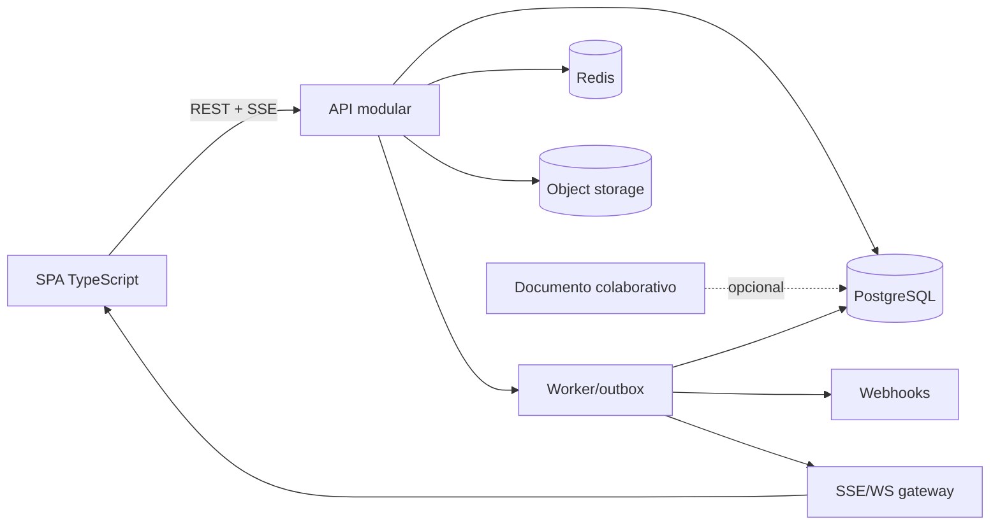

# Arquitetura comparada — decisões de engenharia para o meraki

> Segunda camada dos levantamentos: `01-openproject-backend`, `02-openproject-frontend`, `03-plane-backend`, `04-plane-frontend`, `05-taiga-backend`, `06-taiga-frontend`. Legendas: `§OP-BE` = 01, `§OP-FE` = 02, `§PL-BE` = 03, `§PL-FE` = 04, `§TG-BE` = 05, `§TG-FE` = 06.
> Isto compara **implementação**, não features. Recomendações são decisões de projeto, não fatos observados.

## 1. Forma de deploy e runtime

| Dimensão | OpenProject | Plane | Taiga |
|---|---|---|---|
| Linguagem/backend | Ruby 4.0.9 / Rails 8.1.4 (§OP-BE 1) | Python 3.12 / Django 5.2.17 (§PL-BE 1) | Python 3.10–3.11 / Django 3.2 EOL (§TG-BE 1) |
| Frontend | Angular 22 zoneless em ilhas sobre Rails+Turbo (§OP-FE 1–2) | SPA React 19.2.8 / React Router 8.3, `ssr:false` (§PL-FE 1) | SPA AngularJS 1.5.10 + CoffeeScript/Jade (§TG-FE 1) |
| Processos | web, worker, backup, check (§OP-BE 1) | api, worker, beat, live, web/admin/space, proxy (§PL-BE 1) | api, async, gateway WS externo (§TG-BE 1) |
| Banco | PostgreSQL 17; único suportado | PostgreSQL 15.7 | PostgreSQL (JSONB, `NOTIFY`, advisory locks) |
| Fila | GoodJob **no Postgres**, sem Redis broker (§OP-BE 1, 8) | Celery + RabbitMQ + Redis (§PL-BE 1) | Celery + RabbitMQ; `CELERY_ENABLED=False` default (§TG-BE 8.1) |
| Realtime | polling 60 s/10 s + Turbo Streams; Hocuspocus p/ documentos (§OP-FE 13) | sem WS p/ issues; Hocuspocus p/ páginas (§PL-BE 8) | WS gateway + Postgres NOTIFY/RabbitMQ (§TG-BE 8.2) |
| Entrega do front | bundles Angular + Turbo frames | estático em Caddy, sem Node em produção (§PL-FE 1) | 4 bundles concatenados, `elements.js` 1,7 MB (§TG-FE 17.3) |

Consequências observáveis:

- **OpenProject é o mais monolítico e o mais pesado de operar**: 32 engines, 8.851 arquivos Ruby, schema format `:sql` sem dump versionado, 4 entradas no Procfile (§OP-BE 1). Ganha em consistência transacional (journal + `EXCLUDE USING gist`) e perde em simplicidade de deploy.
- **Plane é o mais próximo de "12-factor"**: 13 serviços no compose, API stateless, front estático, storage S3 presigned, migrações com `AddIndexConcurrently` (§PL-BE 1, 4). É o melhor ponto de partida operacional.
- **Taiga é o mais barato de rodar e o mais frágil**: migração no entrypoint sem lock, `pickle` no Celery, cache local por worker, dependência de um gateway WS fora do repositório (§TG-BE 1, 8.1, 11).

**Recomendação:** monolito modular com dois processos (API e worker) + Postgres + Redis + object storage. Não introduzir um serviço separado antes de colaboração em documento; quando chegar, isolá-lo como o Plane faz (`apps/live`), com o banco relacional fora do caminho crítico do editor.

## 2. Autenticação

### 2.1 Matriz real

| Capacidade | OpenProject | Plane | Taiga |
|---|---|---|---|
| Senha local | bcrypt, custo configurável, mínimo 8 (§OP-BE 3.2) | Django hash + `zxcvbn` (§PL-BE 3.1) | PBKDF2 do Django, só comprimento 6–128 (§TG-BE 11 S6) |
| Sessão | cookie Rails + Warden; `reset_session`; TTL opcional (§OP-BE 3) | tabela `sessions` própria, 7 dias, `device_info` JSONB (§PL-BE 3.2) | JWT HS256, access 24 h, refresh 8 d, rotação + denylist (§TG-BE 3.2) |
| API | Bearer token, Basic `apikey`, Basic global, Doorkeeper OAuth, JWT OIDC (§OP-BE 3.2) | `X-Api-Key` só na API v1 (§PL-BE 3.1) | `Bearer` JWT e `Application <token>` (§TG-BE 3.1) |
| 2FA | TOTP, WebAuthn, SMS, backup codes (§OP-BE 3.2) | **não existe** (§PL-BE 3.1) | **não existe** |
| SSO | LDAP, SAML, OIDC, header SSO, SCIM (§OP-BE 3.2) | Google/GitHub/GitLab/Gitea OAuth; sem SAML/OIDC (§PL-BE 3.1) | só OAuth de app externo; sem SSO |
| CSRF | token + `Sec-Fetch-Site` em não-GET; login classificado como API bloqueado (§OP-BE 3.3) | origin check no lugar de CSRF; Origin ausente aceito (§PL-BE 11) | API inteira `csrf_exempt`; autenticador de sessão sem CSRF (§TG-BE 11 S1) |
| Rate limit | três camadas, duas desligadas por default (§OP-BE 3.3, 14) | 10/min auth, 30/min anônimo, 60/min API key (§PL-BE 3.1) | `login-fail: None` por default (§TG-BE 11 S5) |
| Revogação | sessões por usuário; tokens com escopo (§OP-BE 3) | só sessão corrente; troca de senha não derruba dispositivos (§PL-BE 3.2) | access token irrevogável por 24 h (§TG-BE 11 S4) |

### 2.2 O que cada fluxo ensina

- **OpenProject** tem o modelo mais completo e o mais auditável: Warden com escopos separados (`api_v3`, `scim_v2`, `mcp`), `store: false` para não contaminar sessão, strategies ordenadas e mensagens de erro iguais para senha errada e conta bloqueada (§OP-BE 3.1–3.3). O custo é 15 métodos e vários pontos de configuração.
- **Plane** acerta no essencial: sessão em tabela com `device_info`, cookie `HttpOnly`, CSRF token exposto por endpoint e origin check para SPA. Erra ao aceitar `Origin` ausente e ao ignorar o esquema na comparação, e não tem revogação por dispositivo (§PL-BE 3.2, 11).
- **Taiga** é o exemplo do que não fazer: JWT de 24 h não revogável, `SECRET_KEY` como chave de assinatura, rate limit desligado e sessão Django paralela sem CSRF (§TG-BE 11).

### 2.3 Autenticação recomendada

```mermaid
sequenceDiagram
  autonumber
  participant B as Browser (SPA)
  participant A as API
  participant D as DB
  participant I as IdP
  B->>A: GET /auth/csrf (cookie HttpOnly + token no corpo)
  alt senha + 2FA
    B->>A: POST /auth/login {email, password, csrf}
    A->>D: verifica hash + política + rate limit
    A->>D: cria challenge 2FA (TOTP/WebAuthn)
    B->>A: POST /auth/2fa {code, challenge}
    A->>D: cria session(device, ip, ua, expires_at)
    A-->>B: Set-Cookie __Host-session; HttpOnly; Secure; SameSite=Lax
  else OIDC
    B->>I: authorization_code + PKCE
    I-->>A: code
    A->>I: troca code, valida nonce/email_verified
    A->>D: upsert user + session
  end
```

Decisões:

1. **Sessão por cookie para o app, token para integração.** Cookie `__Host-`, `HttpOnly`, `Secure`, `SameSite=Lax`, rotação no login e tabela `sessions` com `last_seen`, `ip`, `user_agent` e `revoked_at`. Logout revoga a linha; "sair de todos" revoga o usuário.
2. **CSRF em duas camadas**: token sincronizador no header para mutações e verificação de `Origin`/`Sec-Fetch-Site`. Nunca aceitar ausência de `Origin` em produção sem allowlist explícita de clientes.
3. **OIDC antes de SAML.** SAML só quando um cliente exigir; manter um adaptador por provedor sem acoplar ao core (OpenProject faz isso com engines; Taiga não tem).
4. **API tokens com hash no banco**, prefixo identificável, escopos e `last_used_at`. Plane guarda o token em claro; não copiar (§PL-BE 11).
5. **2FA desde o schema**: `mfa_methods` e `mfa_challenges`; TOTP + WebAuthn, códigos de recuperação com hash. Adicionar depois exige migração de sessão.
6. **Rate limit ligado por default**: login por IP **e** por conta, API por token, 429 com `Retry-After`. O erro de login não distingue "usuário inexistente" de "senha errada" (OpenProject).
7. **Sem JWT de sessão.** JWT só para integrações stateless de curta duração; sessão de navegador revogável vence em produto multiusuário.

## 3. Autorização e tenancy

| Aspecto | OpenProject | Plane | Taiga |
|---|---|---|---|
| Modelo | 4 classes de papel, permissão por contexto, shares por WP (§OP-BE 4) | 3 papéis numéricos em workspace/projeto (§PL-BE 4) | papéis por projeto com array de codenames (§TG-BE 4) |
| Resolução | SQL scopes + `allowed_in_*` + cache por request (§OP-BE 4.2) | `allow_permission`, admin de workspace sobrepõe projeto (§PL-BE 4) | `calculate_permissions` em runtime + `my_permissions` (§TG-BE 4) |
| Isolamento | `project_id` em toda entidade; sem RLS | filtro por queryset; **sem** `request.workspace`; sem RLS (§PL-BE 4) | `project_id` + membership; sem RLS |
| Item | share table (`WorkPackageRole`, `ProjectQueryRole`) | nenhum ACL por item | nenhum ACL por item |
| UI | `_links` HAL + capabilities (§OP-BE 4, 10) | `allowPermissions` no store (§PL-FE 4) | `my_permissions` no projeto (§TG-FE 4) |

O erro comum aos três: **cada queryset repete o filtro de tenant**. Plane documenta o custo (suíte `*_scope_*`, §PL-BE 4); OpenProject mitiga com scopes SQL, mas duplica a decisão entre controller, contract e scope; Taiga recalcula permissões em Python e depende de índices.

**Recomendação:**

```text
permission_catalog(key, area, description, scope: global|project|item)
role(id, scope, name, is_system)
role_permission(role_id, permission_key)
member(principal_id, scope_type, scope_id, role_id)
share(item_id, principal_id, permission_key)
```

- Resolver uma vez por request, produzir `capabilities: string[]` no payload do projeto e `allowed_actions` por recurso.
- Filtrar listas **no SQL** com o mesmo conjunto de permissões; nunca carregar e filtrar em memória.
- RLS é opcional: se adotar, uma policy por tabela com `current_setting('app.workspace')`; senão, impor `workspace_id`/`project_id` em um `QuerySet` base (Plane não tem e paga).
- Guest é um papel, não um flag: leitura + comentário, sem transição, sem drag (§PL-FE 4).

## 4. Dados: schema, chaves, constraints

| Decisão | OpenProject | Plane | Taiga |
|---|---|---|---|
| PK | bigint sequencial | UUID em muitas tabelas; `sequence_id` inteiro por projeto | bigint; `ref` inteiro por projeto (sem unique) |
| Numeração | `id` global | `IssueSequence` com advisory lock (§PL-BE 4) | sequência por projeto, sem constraint (§TG-BE 4) |
| Soft delete | quase inexistente | `deleted_at` + unique parcial; cascata em task por item (§PL-BE 4) | inexistente; `cancel()` deixa histórico órfão (§TG-BE 11 S15) |
| Ordem | `ordered_work_packages` por query | `sort_order` float global | 4–5 colunas de ordem + renumeração O(n) |
| Histórico | journal com range `tstzrange` e `EXCLUDE USING gist` | `IssueActivity` por campo, assíncrono | `HistoryEntry` snapshot+diff JSONB |
| Custom fields | STI por formato + `FormConfiguration` | não existem | definição por entidade + valor tipado |
| Schema versionado | `schema_format = :sql` **sem** dump (§OP-BE 1) | migrations Django, índices concorrentes | migrations + fixture de template |
| Constraints | FKs, uniques parciais, exclusion | unique parciais corretas + `unique_together` legado | **sem** `CheckConstraint`, sem unique `(project, ref)` |

Padrões que valem copiar:

1. **Unique parcial com soft delete**: `UNIQUE (project_id, sequence_id) WHERE deleted_at IS NULL`. Plane demonstra o problema de manter as duas formas (§PL-BE 14).
2. **Numeração atômica sem `max()+1`**: `UPDATE counters SET value = value + 1 WHERE project_id = $1 RETURNING value`, dentro da transação. O advisory lock do Plane funciona, mas serializa mais que o necessário (§PL-BE 7).
3. **Histórico como dado imutável**, não como tabela de deltas reconstruída: `activity_event(id, entity, field, old, new, actor, batch_id, created_at)` + índice `(entity_id, created_at)`; descrição versionada separada.
4. **Rank fracionário textual** para ordem por view: `rank text` com índice `(view_id, group_key, rank)`; inserir entre vizinhos é O(1). Evita a renumeração O(n) do Taiga e o esgotamento de float do Plane.
5. **DDL gerado commitado** (ou `structure.sql`): o onboarding do OpenProject depende de replay de migrations squashed; não repetir.
6. **Constraint no banco para invariantes caros**: o `EXCLUDE USING gist` do journal impede dois snapshots sobrepostos; é melhor que validação em serviço (§OP-BE 4).

Schema mínimo recomendado (além de workspace/project/member):

```sql
create table work_item (
  id            bigint generated always as identity primary key,
  project_id    bigint not null references project(id),
  sequence_id   integer not null,
  type_id       bigint not null references work_item_type(id),
  status_id     bigint not null references status(id),
  parent_id     bigint references work_item(id),
  title         text not null,
  description   jsonb not null default '{}',
  rank          text not null,
  version       bigint not null default 0,
  created_by    bigint not null references principal(id),
  created_at    timestamptz not null default now(),
  updated_at    timestamptz not null default now(),
  archived_at   timestamptz,
  deleted_at    timestamptz,
  unique (project_id, sequence_id)
);
create unique index on work_item (project_id, sequence_id) where deleted_at is null;
create index on work_item (project_id, status_id) where deleted_at is null;
create index on work_item (project_id, parent_id) where deleted_at is null;

create table view (
  id         bigint generated always as identity primary key,
  project_id bigint references project(id),
  owner_id   bigint references principal(id),
  name       text not null,
  config     jsonb not null,
  version    integer not null default 1,
  is_shared  boolean not null default false,
  is_locked  boolean not null default false,
  sort_order integer not null default 0
);

create table view_order (
  view_id   bigint not null references view(id) on delete cascade,
  group_key text not null,
  item_id   bigint not null references work_item(id) on delete cascade,
  rank      text not null,
  primary key (view_id, group_key, item_id)
);
create index on view_order (view_id, group_key, rank);
```

## 5. Consulta e API

| Tema | OpenProject | Plane | Taiga |
|---|---|---|---|
| Estilo | REST HAL (`/api/v3`) + representers | REST DRF + envelopes; 4 superfícies | REST DRF fork, routers |
| Filtros | `Query` + `query_props` serializado, ~50 filtros registrados (§OP-BE 6) | **dois dialetos**: dict legado + DSL `and/or/not` com allowlist (§PL-BE 5) | 18 filter backends + `order_by` whitelist (§TG-BE 6) |
| Paginação | offset (`pagy`/`will_paginate`) | offset + cursor composto + `count()` por página (§PL-BE 6) | offset com headers (`X-Total`) |
| Agrupamento | SQL via `Query::Results` | `Window(RowNumber)` por grupo (§PL-BE 6) | cliente + `filters_data` |
| Erros | `urn:openproject…`, 404/409/401 mapeados (§OP-BE 10) | 302 com `error_code` em auth, DRF no resto | DRF padrão |
| N+1 | `eager_load`, schema cache, single-flight no front | `prefetch_related`, mas `useIssues` copia o grafo com `merge` (§PL-FE 11) | `attach_extra_info` com ~10 subqueries por linha (§TG-BE 6) |

**Recomendação:**

- **Um único DSL de filtro**, tipado e versionado: `{field, op, value}` com `and/or/not`, allowlist de campos/operadores, profundidade máxima. Plane tem a implementação correta (`ComplexFilterBackend`), mas convive com o dialeto legado; o meraki deve nascer com um só (§PL-BE 14).
- **Agrupamento no servidor** com `group_key` estável e paginação por grupo (cursor `(group_key, rank, id)`). Isso permite kanban e lista compartilharem exatamente a mesma consulta.
- **Cursor keyset** por `(rank, id)` ou `(updated_at, id)`, com `total_count` opcional. Offset + `count()` por página não escala (§PL-BE 14; §TG-BE 6).
- **Contrato de erro único**: `{code, message, field?, details?}` com códigos estáveis; HTTP 409 para conflito de versão, 422 para validação, 429 com `Retry-After`.
- **Capacidades no payload**, não regras no cliente: `permissions` no projeto e `allowed_actions` no item.

## 6. Escrita e concorrência

| Mecanismo | OpenProject | Plane | Taiga |
|---|---|---|---|
| OCC | `lock_version` + 409 (§OP-BE 7) | **ausente** — último PATCH vence (§PL-BE 7) | "por campo" via diff de histórico + advisory lock; não é OCC de banco (§TG-BE 7) |
| Lock | advisory por agregado, transação inteira | advisory por projeto (numeração), `select_for_update` pontual | advisory por pk no reorder |
| Idempotência | jobs com upsert/retry; upload em 3 fases | webhooks at-least-once sem dedupe; sem `Idempotency-Key` | webhooks com log, mas sem dedupe |
| Ordem | tabela `ordered_work_packages` | `sort_order` float, média entre vizinhos | `after/before` + renumeração da célula |
| Eventos | journal na mesma transação | activity **depois** do 204 (§PL-BE 7) | `on_commit` para eventos (bom) |

**Recomendação:**

1. `version bigint` em `work_item`, incrementado em toda escrita; cliente envia `If-Match` ou `expected_version`; conflito → 409 com o estado atual. Não copiar o "por campo" do Taiga: duas escritas disjuntas ainda se perdem sem lock.
2. **Ordem por intenção**: o cliente envia `{after_id, before_id}` (Taiga) e o servidor calcula o rank; a resposta devolve o rank canônico. Nunca o cliente envia o número final.
3. **Outbox transacional**: `activity_event` e `notification` gravados na mesma transação do item; um worker publica webhooks/WS. Isso corrige a consistência eventual do Plane e o acoplamento síncrono do Taiga.
4. **Idempotency-Key** em POSTs caros (criação em lote, import, webhooks de entrada) com tabela `(key, user, response_hash, expires_at)`.
5. **Upload em três fases** (prepare → PUT assinado → finish) com validação de MIME por conteúdo, limite no servidor e confirmação idempotente. OpenProject e Plane convergem; Taiga não valida conteúdo (§TG-BE 11 S8).

## 7. Assíncrono e tempo real

| Tema | OpenProject | Plane | Taiga |
|---|---|---|---|
| Fila | GoodJob no Postgres; 112 workers, 12 crons (§OP-BE 8) | Celery/RabbitMQ; tasks de activity, export, e-mail, S3 (§PL-BE 8) | Celery com `pickle`; tasks de timeline, webhook, import (§TG-BE 8.1) |
| Eventos | polling + Turbo Streams | 204 antes da activity; sem WS de issue | `post_save` → NOTIFY/RabbitMQ → gateway WS |
| Webhooks | HMAC-SHA1 | HMAC + retry exponencial, sem dedupe | HMAC-SHA1 + log dos 10 últimos |
| Colaboração | Hocuspocus p/ documentos | Hocuspocus/Yjs, `description_binary` como fonte | não tem |

**Recomendação:** começar com **invalidação**, não sincronização. SSE ou WS envia `{entity, id, version, event}`; o cliente refetcha ou aplica patch. Payload completo por WS cria ordering e reconexão difíceis. Webhooks com HMAC-SHA256, `X-Delivery-Id` e tabela de dedupe. Jobs idempotentes por chave natural (`event_id`).

## 8. Frontend: forma, estado e URL

| Dimensão | OpenProject | Plane | Taiga |
|---|---|---|---|
| Forma | ilhas Angular em HTML Rails; sem router Angular; cada `turbo:load` destrói views (§OP-FE 2) | SPA única; rotas pathless; providers em camadas (§PL-FE 2) | SPA AngularJS com `$routeProvider` e resolves (§TG-FE 2) |
| Estado | 2 gerações: reactivestates + 12 stores Akita; `IsolatedQuerySpace` (§OP-FE 3) | 30 stores MobX; mapas normalizados; 11 pares Base/Filter (§PL-FE 5) | singletons com Immutable; refresh global por eventos (§TG-FE 3) |
| View na URL | `query_props` codificado; fonte única (§OP-FE 6) | params de layout/filtro; peek fora da URL (§PL-FE 4) | filtros em query string + storage; kanban params |
| Render de lista | builders imperativos + `DocumentFragment`, sem virtualização (§OP-FE 7) | `RenderIfVisible` + IntersectionObserver; sem virtualização clássica (§PL-FE 11) | `tg-repeat`, `toJS()` a cada digest (§TG-FE 17) |
| DnD | pragmatic-dnd unificado; teclado só em Backlogs (§OP-FE 10) | pragmatic-dnd; sem teclado (§PL-FE 12.1) | dragula; sem teclado (§TG-FE 9) |

**Recomendação:** SPA única + API. O híbrido do OpenProject só se justifica se a maior parte das telas for HTML-first; para um produto com cinco layouts interativos, o custo de ciclo de vida (§OP-FE 2.4) supera o ganho.

Estado:

- **Entidades normalizadas por id** (`Map<id, Entity>`) + listas de ids por consulta (Plane). Evita refetch ao trocar layout.
- **Server-state separado de view-state**: TanStack Query/SWR ou equivalente para fetch/cache; store de view para filtros/agrupamento/colunas. O OpenProject mistura os dois em 20 serviços com `pristine`/`updates`; funciona, mas é caro de manter.
- **View-state na URL** com codec versionado: `?view=<id>&layout=board&group=status&f=<token>`. URL legível para casos simples, token comprimido para filtros complexos. Não copiar o JSON opaco do OpenProject nem o peek fora da URL do Plane.
- **Otimismo com baseline + revisão**: guardar o item antes, aplicar, e no erro restaurar **se** a versão ainda for a mesma (§OP-FE 8, §PL-FE 7). Bulk otimista não.

## 9. Interação: mecânicas que definem o produto

| Mecânica | Melhor implementação | O que copiar | O que evitar |
|---|---|---|---|
| Tabela | OpenProject (§OP-FE 7) | builders por modo, inline edit com barra, treegrid, roving tabindex, sums row | DOM imperativo sem framework; ausência de virtualização |
| Kanban | Taiga para colunas/swimlanes, Plane para estado (§TG-FE 9, §PL-FE 12.1) | colunas colapsáveis, WIP visual, quick-add, drag com semântica de grupo | dragula + DOM fora do framework; renumeração O(n) |
| Gantt | OpenProject (§OP-FE 9) | DOM absoluto (não SVG) para muitas barras, auto-zoom, drag de datas, baseline | dependências só visuais (Plane) |
| Detalhe | OpenProject split view + Plane peek | URL própria, abas, foco gerenciado, dirty state | peek sem dialog/focus trap, sem deep link |
| Command palette | Plane Power K (§PL-FE 14) | registry único, `id` + `isVisible/isEnabled`, layout map, guard de input | colisão silenciosa de atalhos; busca que só acha um tipo |
| Filtros/views | Plane + OpenProject | um DSL, chips com campo/operador/valor, view salva com dirty state | dois dialetos; defaults copiados |
| Densidade | Taiga (§TG-FE 9) | níveis persistentes, campos do card por view | densidade só na tabela ou inexistente |
| Editor | Plane (§PL-FE 9) | TipTap/Yjs isolado, slash commands, offline IndexedDB | CRDT no monólito |

Detalhes de implementação que evitam retrabalho:

- **Drag**: um motor único com `begin/move/drop/cancel`, overlay, auto-scroll e transação idempotente (`complete(success)` travado por `busy`) — o OpenProject documenta o bug de transação não settleada (§OP-FE 19, lição 8). Alternativa por teclado obrigatória: "mover para…" no menu do card e `Ctrl+↑/↓` na lista.
- **Ordenação**: servidor calcula rank; cliente move otimista e reconcilia com o rank devolvido. Fila de comandos por recurso para coalescer drags (Taiga só tem no backlog, §TG-FE 19, lição 4).
- **Inline edit**: célula → editor sobreposto, save no blur/Enter, cancel no Esc, erro por campo, `aria-busy` na linha. Não recriar a tabela inteira a cada edição.
- **Gantt**: barras em DOM com `transform: translateX`, não SVG; renderizar só o viewport; header com slices; relações como camada separada. Escala mínima de 0,5 px/dia (OpenProject).

## 10. Acessibilidade — auditoria comparada

| Métrica | OpenProject | Plane | Taiga |
|---|---|---|---|
| `aria-*` no código | 121 ocorrências, 24 atributos distintos (§OP-FE 17) | 308 ocorrências, 10 atributos; 221 `aria-label` (§PL-FE 17) | 19 ocorrências em 9 de 378 templates (§TG-FE 17) |
| Tabela semântica | `<table>` + `role="treegrid"` opt-in, `aria-sort`, `aria-level` | spreadsheet com `<td tabindex=0>` em toda célula | **zero** `<table>`; divs |
| Foco em modal | `role/aria-modal`, `cdkTrapFocus`, foco inicial | alguns dialogs corretos; peek sem role | lightbox sem `role="dialog"`/focus trap |
| Live region | global `<live-region>` + Turbo action | **zero** `aria-live` | zero |
| Teclado | grade completa; DnD por teclado só em Backlogs | atalhos fortes; DnD sem teclado | quase inexistente |
| `lang` dinâmico | atualiza i18n/moment, não `document.lang` | fixo `en` com 22 locales | não verificado |
| Reduced motion | parcial (FLIP, CKEditor) | ausente | ausente |
| Contraste | sem teste automatizado | temas de contraste, sem teste | `#25A28C` 3,17:1 e `#A9AABC` 2,29:1 |

**Baseline obrigatório (WCAG 2.2 AA) para o meraki:**

1. **Semântica primeiro**: `<table>` real para listas tabulares; `role="treegrid"` só quando houver hierarquia, com `aria-level`, `aria-expanded`, `aria-selected` e `aria-sort` na ordenação primária.
2. **Um tab stop por grade**: roving tabindex, setas para navegar, Enter para editar, Esc para cancelar, Home/End. Excluir a linha de criação inline do ciclo (OpenProject acerta).
3. **Diálogo de verdade**: `<dialog>`/portal com `role="dialog"`, `aria-modal`, `aria-labelledby`, focus trap, retorno de foco ao gatilho e fechamento por Esc. Serve para peek, lightbox e confirmação.
4. **Movimentação por teclado**: toda ação de drag tem alternativa em menu ("Mover para status/coluna/sprint") e anúncio em live region.
5. **Feedback assíncrono**: `aria-live="polite"` para salvar/paginar/criar; `aria-busy` na região; toasts com `role="status"` (não só `alert`).
6. **Idioma e tema**: atualizar `document.documentElement.lang` na troca de locale; `prefers-reduced-motion` no design system; contraste testado por token em CI.
7. **Testes**: axe em cada layout no Playwright + teste de teclado por fluxo (criar, editar, mover, abrir detalhe). Não confiar em `eslint-plugin-jsx-a11y` como cobertura.

## 11. Segurança — baseline

| Controle | OpenProject | Plane | Taiga |
|---|---|---|---|
| CSRF | token + Fetch Metadata (§OP-BE 3) | origin check (com furos) | ausente na API |
| CSP | CSP completo, `style-src 'unsafe-inline'` (§OP-BE 11) | **ausente** em Django/Caddy (§PL-BE 11) | ausente |
| Sanitização HTML | sanitize/loofah | `nh3` allowlist, mas projeto só na API v1 | bleach/markdown no write |
| SSRF | `ssrf_filter` | pinning de IP + bloqueio de metadata (referência) | valida só IP literal; TOCTOU |
| Upload | 3 fases + ClamAV | presigned + MIME allowlist | sem validação de conteúdo |
| Segredos | config + env | fallback + alerta | `SECRET_KEY` default |
| Rate limit | 3 camadas, 2 off | auth 10/min, API 60/min | login off |

**Baseline recomendado:** CSP com nonce/hash (sem `unsafe-inline`), HSTS, `frame-ancestors`, `Referrer-Policy`, sanitização **na escrita e na leitura** com allowlist, upload validado por magic bytes + antivírus assíncrono, SSRF com resolução pinada e bloqueio de link-local/metadata, segredos obrigatórios no boot (falhar fechado), tokens hasheados, rate limit em auth/API e auditoria de ações administrativas.

## 12. Performance e observabilidade

- **OpenProject**: tabela sem virtualização; página pesada, mas cache HAL e single-flight reduzem requests (§OP-FE 6.2). Backend com `eager_load` e scopes SQL; 112 workers e 12 crons exigem operação madura.
- **Plane**: `RenderIfVisible` + store normalizado dão boa percepção; o maior custo é `lodash.merge` por render em `useIssues` (§PL-FE 11). Paginação por cursor composto, mas `count()` por página (§PL-BE 14).
- **Taiga**: pior cenário — `toJS()` por digest, 191 broadcasts, 4 bundles em cascata e 1,7 MB de editor no caminho crítico (§TG-FE 17). É a prova de que "otimizar depois" não funciona em SPA grande.

**Recomendação:** orçamento de bundle por rota, code splitting por layout e editor, virtualização a partir de ~200 linhas, memoização por seletor, cursor pagination, índices para as consultas de lista e um painel de slow queries. OpenTelemetry desde o início; logs estruturados com `request_id`, `workspace_id`, `user_id`.

## 13. Testes

| Sistema | Unit | Integração | E2E | Lacuna |
|---|---|---|---|---|
| OpenProject | RSpec (2.957 arquivos de spec) | contratos, permissões | Capybara + 281 specs de browser | a11y automatizada pontual |
| Plane | 130 arquivos pytest | permissões/API | nenhum em `apps/web` | front sem testes |
| Taiga | 119 arquivos | permissões/histórico | e2e legado | concorrência real, a11y |

**Recomendação:** contrato de API (OpenAPI) + testes de permissão por papel + testes de concorrência (duas escritas, reorder simultâneo) + Playwright por layout com axe + teste de teclado. O teste de concorrência é o que falta nos três e é barato de escrever.

## 14. O que copiar de cada um

| Capacidade | Fonte | Copiar | Não copiar |
|---|---|---|---|
| Autorização granular e auditável | OpenProject | catálogo + contexto + `allowed_actions` + shares por item | 4 classes de papel e duplicação controller/contract |
| Journal/as-of | OpenProject | snapshot com range no banco | complexidade de `Query` + `View` + `PersistedView` |
| Operação simples | Plane | compose enxuto, S3 presigned, front estático, índices concorrentes | soft delete em cascata por task; sem OCC |
| Editor/colaboração | Plane | TipTap + Yjs isolado, offline, slash commands | dependência de estado binário sem fallback |
| Multi-view por rank | Taiga | ordens independentes + `after/before` + coalescing | renumeração O(n), epoch sem unicidade |
| Histórico snapshot+diff | Taiga | uma tabela para timeline/auditoria/comentários | duplicação timeline/histórico; sem retenção |
| Kanban | Taiga + Plane | swimlanes, WIP visual, colunas colapsáveis, sub-grouping | dragula; WIP sem bloqueio opcional |
| Tabela | OpenProject | treegrid, inline edit, sums, teclado | DOM imperativo sem virtualização |
| Gantt | OpenProject | DOM absoluto, auto-zoom, baseline, drag | ausência de caminho crítico e de teclado |
| Command palette | Plane | registry + sequências + guards | colisão silenciosa, sem detecção em dev |
| A11y de grade | OpenProject | treegrid + roving tabindex + live region | cobertura parcial (Gantt/drag) |
| Auth completa | OpenProject | Warden por escopo, 2FA, SSO, revogação | 15 métodos e 2 rate limits desligados |
| Sessão simples e revogável | Plane | tabela de sessão com device_info | Origin ausente aceito; sem revogação por dispositivo |
| Filtros | Plane | um DSL com allowlist e profundidade | dois dialetos convivendo |

## 15. Blueprint recomendado do meraki



Decisões estruturais, em ordem de impacto:

1. **Postgres como fonte de verdade e fila inicial** (GoodJob/outbox). Redis só para cache e rate limit; RabbitMQ só quando houver volume que justifique.
2. **Um `work_item` tipado**, status com categoria, relações tipadas, containers (ciclo/módulo) como associação.
3. **`view` como JSONB versionado** + `view_order.rank` por `(view, group)`, um único DSL de filtro, agrupamento e paginação no servidor.
4. **Sessão + CSRF + OIDC + API tokens + 2FA**, com tabela de sessões e revogação; permissões resolvidas uma vez por request.
5. **OCC por `version`** e outbox transacional para activity/notificação/webhook.
6. **SPA + estado normalizado + view-state na URL**, um motor de DnD com alternativa de teclado.
7. **A11y como componente de infraestrutura**: tabela semântica, diálogo com foco, live region, reduced motion, testes axe por layout.
8. **Schema DDL commitado + OpenAPI + testes de concorrência/permissão** desde o primeiro sprint.

## 16. Riscos e sequência

| Fase | Entrega | Critério de saída |
|---|---|---|
| 1 | auth + workspace/projeto + work item + lista | login/OIDC, CRUD, permissões, paginação, a11y da tabela |
| 2 | views salvas + board + detalhe | view JSON, rank, split view, activity/outbox |
| 3 | calendário + Gantt + ciclos | datas, dependências, baseline, drag com teclado |
| 4 | notificações + inbox + busca | SSE de invalidação, watchers, FTS |
| 5 | custom fields + templates + importação | form config, validação, idempotência |
| 6 | shares + auditoria + workload | ACL por item, export, observabilidade |

Riscos conhecidos: (a) adotar dois dialetos de filtro cedo; (b) drag sem teclado; (c) histórico fora da transação; (d) ordem recalculada no cliente; (e) editor colaborativo antes do modelo de permissões. Cada um tem correção barata no início e cara depois — os três projetos pagaram por pelo menos dois deles.
