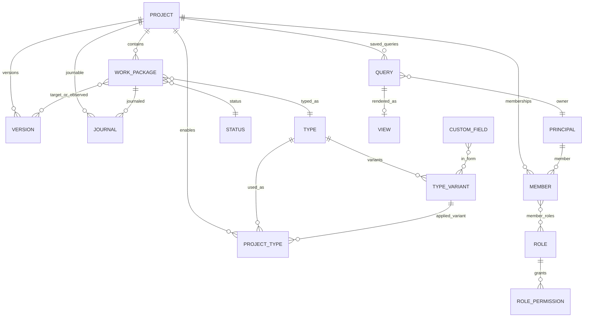
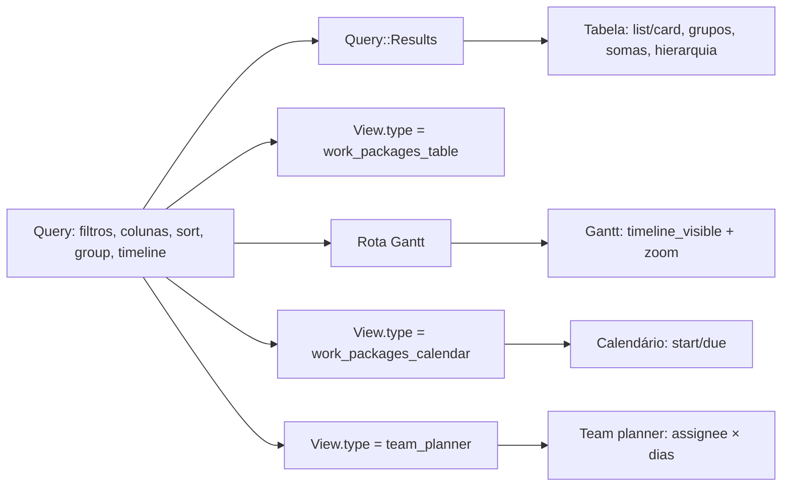

# OpenProject — modelo de dados, permissões e configuração de projeto

> Repositório analisado: `_REF/openproject`, commit `0e8599b3`, versão `18.0.0` em desenvolvimento (`lib/open_project/version.rb:33-35`).
> Escopo: camada Rails/ActiveRecord, RBAC, queries/views, boards/grids, workflows, journaling e o contrato HAL da API v3.
> Fora de escopo: frontend Angular em profundidade, motores de cálculo (custos, BIM), integrações e detalhes de migration histórica.
> Observação importante: esta revisão não possui `db/schema.rb`; o schema é derivado de `db/migrate/tables/*.rb` e das migrations recentes. Várias estruturas estão em transição (por exemplo, `Query`/`View` convivendo com `PersistedQuery`/`PersistedView`).

## 1. Arquitetura em 10 linhas

1. Monólito Rails 8 com PostgreSQL; o domínio principal é `Project` → `WorkPackage`, com `Type`, `Status`, `Priority`, `Version`, `Category` e campos customizados.
2. Projetos formam uma árvore com `awesome_nested_set` (`parent_id`, `lft`, `rgt`) e três `workspace_type`: `project`, `program`, `portfolio` (`app/models/project.rb:44-54`; `app/models/projects/hierarchy.rb:185`).
3. Work packages formam outra árvore via closure table (`has_closure_tree`), materializada em `work_package_hierarchies` (`app/models/work_package.rb:175`; `db/migrate/tables/work_package_hierarchies.rb:34-45`).
4. O tipo de um work package é `Type`; a configuração efetiva vem de um `TypeVariant`, escolhido por projeto na join `ProjectType` (`app/models/work_package.rb:289-293`; `app/models/project_type.rb:30-41`).
5. O formulário dinâmico é um grafo `FormConfiguration` → `FormConfigurationGroup` → `FormConfigurationAttribute`, apontando para atributos nativos ou `CustomField` (`app/models/form_configuration.rb:30-49`; `app/models/form_configuration_attribute.rb:30-39`).
6. Autorização é RBAC com quatro tipos de papel (`GlobalRole`, `ProjectRole`, `WorkPackageRole`, `ProjectQueryRole`) e permissões atômicas registradas em `config/initializers/permissions.rb`.
7. Uma permissão tem contexto (`global`, `project`, `work_package`, `project_query`), dependências e exigência de membro/login (`lib/open_project/access_control/permission.rb:78-123`).
8. Consultas salvas são `Query` (work packages) e `ProjectQuery` (lista de projetos); `View` é um ponteiro persistido para um tipo de visualização (`app/models/query.rb:30-48`; `app/models/view.rb:30-34`).
9. Boards não são queries: são `Grids::Grid` com `Grids::Widget`, e cada widget guarda o `queryId` que renderiza (`modules/boards/app/models/boards/grid.rb:31-59`; `modules/grids/app/models/grids/widget.rb:29-33`).
10. Histórico é journal-based (`acts_as_journalized` + `journals` + `journal.data`), e notificações derivam de journals, watchers e preferências do usuário (`app/models/journal.rb:125-155`; `app/models/notification.rb:30-53`).

## 2. Entidades e relações

### 2.1 Tabela de entidades centrais

| Entidade | Tabela / arquivo | Campos-chave | Cardinalidade |
|---|---|---|---|
| `Project` | `projects` (`db/migrate/tables/projects.rb:34-48`; `workspace_type` em `db/migrate/20250731144436_add_workspace_type_to_project.rb:33`) | `name`, `identifier`, `public`, `active`, `parent_id`, `lft/rgt`, `templated`, `template_id`, `workspace_type`, `status_code`, `settings` (jsonb) | N:1 com pai; 1:N com WPs, membros, versões, categorias, queries, views |
| `WorkPackage` | `work_packages` (`db/migrate/tables/work_packages.rb:34-65`) | `project_id`, `type_id`, `status_id`, `priority_id`, `author_id`, `assigned_to_id`, `responsible_id`, `category_id`, `parent_id`, `start_date`, `due_date`, `duration`, `done_ratio`, `estimated_hours`, `schedule_manually` | N:1 projeto/tipo/status/pai; N:N versões via `work_package_versions` |
| `Type` | `types` (`db/migrate/tables/types.rb:34-49`) | `name`, `position`, `is_milestone`, `is_in_roadmap`, `is_default`, `color_id`, `attribute_groups` (legado) | 1:N `TypeVariant`; N:N projetos via `ProjectType` |
| `TypeVariant` | `type_variants` (`db/migrate/20260807100000_create_type_variants.rb:81-107`; `workflow_id` em `db/migrate/20260916120000_extract_named_workflows.rb:44`; `form_configuration_id` em `db/migrate/20260925100000_extract_named_forms.rb:212`) | `type_id`, `project_id` (opcional), `variant_name`, `is_default_variant`, `enabled_in_new_projects`, `workflow_id`, `form_configuration_id`, `attribute_groups` (legado), `patterns`, `pdf_export_templates_config` | N:1 `Type`; N:1 `Workflow`; N:1 `FormConfiguration` |
| `ProjectType` | `project_types` (`db/migrate/20260804123419_create_project_types.rb:35-44`) | `project_id`, `type_id`, `variant_id` | Join 1:1 por (projeto, tipo) |
| `Status` | `statuses` (`db/migrate/tables/statuses.rb:34-44`) | `name`, `is_closed`, `is_default`, `is_readonly`, `excluded_from_totals`, `default_done_ratio`, `color_id`, `position` | 1:N WPs; N:N workflows |
| `Version` | `versions` (`db/migrate/tables/versions.rb:34-43`) | `project_id`, `name`, `effective_date`, `start_date`, `status`, `sharing` | 1:N `work_package_versions` |
| `Category` | `categories` (`db/migrate/tables/categories.rb:34-42`) | `project_id`, `name`, `assigned_to_id` | N:1 projeto; 1:N WPs |
| `Member` | `members` (`db/migrate/tables/members.rb:34-43`) | `user_id` (= principal), `project_id` (nullable), `entity_type`/`entity_id` (polimórfico) | N:1 principal; N:N roles via `member_roles` |
| `Principal` | `users` (STI; `db/migrate/tables/users.rb:34-53`) | `type` (`User`, `Group`, `PlaceholderUser`, `DeletedUser`, `SystemUser`), `login`, `admin`, `status` | 1:N memberships; 1:N views/queries persistidas |
| `Role` | `roles` (`db/migrate/tables/roles.rb:34-40`) | `name`, `position`, `builtin`, `type` (STI) | 1:N `role_permissions`; N:N members |
| `RolePermission` | `role_permissions` (`db/migrate/tables/role_permissions.rb:34-39`) | `role_id`, `permission` (string) | N:1 role |
| `CustomField` | `custom_fields` (`db/migrate/tables/custom_fields.rb:34-57`) | `type` (STI), `field_format`, `is_required`, `is_for_all`, `multi_value`, `admin_only`, `custom_field_section_id` | 1:N `custom_values`, `custom_options`; N:N formulários |
| `Query` | `queries` (`db/migrate/tables/queries.rb:34-55`) | `project_id`, `user_id`, `name`, `filters`, `column_names`, `sort_criteria`, `group_by`, `display_sums`, `timeline_*`, `highlighting_*`, `display_representation`, `public`, `starred` | N:1 usuário/projeto; 1:0..1 `View` |
| `View` | `views` (`db/migrate/tables/views.rb:34-39`) | `query_id` (unique), `type`, `options` (jsonb) | 1:1 com `Query` |
| `Journal` | `journals` (`db/migrate/tables/journals.rb:34-52`) | `journable_type/id`, `data_type/id`, `user_id`, `notes`, `version`, `restricted`, `cause` (jsonb), `validity_period` | N:1 journable; 1:N notifications |

### 2.2 ER dos 15 nós centrais

> O diagrama representa `Member ↔ Role` de forma direta (a tabela de junção `member_roles` foi omitida) e omite `WorkPackageHierarchy` para não exceder 15 nós; ambos são descritos abaixo. `Version` é N:N com `WorkPackage` via `work_package_versions` (`app/models/work_package_version.rb:30-34`).

### 2.3 Projeto, hierarquia e configuração

- `Project` usa `parent_id` + `lft/rgt`: `acts_as_nested_set order_column: :lft` (`app/models/projects/hierarchy.rb:185`). A árvore é usada para navegação, ordenação e escopo de queries (`lft`/`rgt`), não para herdar papéis automaticamente.
- `workspace_type` distingue `project`, `program` e `portfolio`; os pais permitidos são declarados em `ALLOWED_PARENT_WORKSPACE_TYPES` (`app/models/project.rb:44-54`). `portfolio` não pode ter pai, `program` só pode estar sob `portfolio`.
- `Project#visible?` exige `active` e (`public` ou admin ou `access_to?`) (`app/models/project.rb:230-232`); `access_to?` é admin ou existência de membership no projeto (`app/models/users/permission_checks.rb:99-101`).
- `enabled_modules` são strings (`work_package_tracking`, `board_view`, `calendar_view`, `team_planner_view`, `gantt`, etc.). A presença do módulo filtra as permissões efetivas (`Project#allowed_permissions`, `app/models/project.rb:315-322`; `app/models/enabled_module.rb:30-38`).
- Templates de projeto são uma flag + auto-relação: `templated`, `belongs_to :template`, `templated_projects` (`app/models/project.rb:112-120`); a criação de subprojetos pode fixar um template por `workspace_type` em `SubprojectTemplateAssignment` (`app/models/subproject_template_assignment.rb:30-48`).
- **Não confundir**: `ProjectType` nesta revisão **não** é template. É a join que ativa um `Type` num projeto e escolhe o `TypeVariant` (`app/models/project_type.rb:30-41`). Templates usam `Project.template_id/templated`.

### 2.4 Work package, relações e hierarquia

- Associações principais: `project`, `type`, `status`, `author`, `assigned_to`/`responsible` (`Principal`), `priority`, `category`; `assigned_to` e `responsible` apontam para `Principal`, aceitando usuário, grupo ou placeholder (`app/models/work_package.rb:56-64`).
- `acts_as_watchable(permission: :view_work_packages)` e `acts_as_customizable` (`app/models/work_package.rb:139-146`).
- Hierarquia pai/filho usa closure tree; `WorkPackageHierarchy` guarda `ancestor_id`, `descendant_id`, `generations` (`app/models/work_package.rb:175`; `db/migrate/tables/work_package_hierarchies.rb:34-45`). O pai também é gravado em `work_packages.parent_id` (`db/migrate/tables/work_packages.rb:54`).
- O tipo do WP é fixo, mas a configuração é resolvida por projeto: `WorkPackage#type_variant` consulta `project.type_variant(type)` e cai no `default_variant` (`app/models/work_package.rb:289-293`).
- Relações tipadas ficam em `relations` com `from_id`, `to_id`, `relation_type`, `lag` (`db/migrate/tables/relations.rb:34-46`). Os tipos canônicos e seus inversos estão em `Relation::TYPES` (`app/models/relation.rb:34-101`).
- `Relation` normaliza a direção: relações “inversas” (`follows`, `blocked`, `duplicated`, `partof`, `required`) são invertidas antes de salvar para que exista uma única linha canônica (`app/models/relation.rb:103-104`, `app/models/relation.rb:211-219`).
- Agendamento: `successor_soonest_start` calcula o início mais cedo a partir da data do predecessor + `lag` em dias úteis (`app/models/relation.rb:178-183`); `WorkPackage#soonest_start` pega o máximo entre as relações que influenciam o WP (`app/models/work_package/scheduling_rules.rb:68-81`).
- Datas derivadas de pai/ filhos são calculadas por subquery (`derived_start_date`/`derived_due_date`) e expostas por `WorkPackages::DerivedDates` (`app/models/work_packages/derived_dates.rb:30-60`).

### 2.5 Type, TypeVariant e ProjectType

- `Type` tem sempre uma variante base (`is_default_variant`, sem nome) e variantes nomeadas (`has_many :variants`) (`app/models/type.rb:41-44`, `app/models/type.rb:85-87`). A criação garante a variante base com `Workflow` e `FormConfiguration` implícitos (`app/models/type.rb:104-113`).
- `TypeVariant` carrega os “aspectos” configuráveis: `pdf_export`, `defaults`, `project_attributes` e `form_configuration`; os dois últimos podem excluir elementos (`app/models/type_variant.rb:37-46`). O formulário efetivo é resolvido pela `FormConfiguration`, não pela coluna `type_variants.attribute_groups`: `attribute_groups_record` aponta para a form configuration (`app/models/type_variants/form_reference.rb:101`).
- Uma variante pode ser global (`project_id = nil`) ou pertencer a um projeto; `available_in(project)` retorna globais + a do próprio projeto (`app/models/type_variant.rb:102-104`).
- `ProjectType` valida que a variante pertence ao tipo e que, se for project-owned, pertence ao mesmo projeto; sem variante explícita, usa a base (`app/models/project_type.rb:35-61`).
- `Project#enabled_types` e `#enabled_variants` derivam de `ProjectType` (`app/models/projects/enabled_types.rb:34-55`). A tabela legada `projects_types` foi substituída por `project_types` e depois dropada (`db/migrate/20260807100000_create_type_variants.rb:276`).

### 2.6 Versões, categorias e prioridades

- `Version` pertence a um projeto e tem `status` (`open`, `locked`, `closed`) e `sharing` (`none`, `descendants`, `hierarchy`, `tree`, `system`) (`app/models/version.rb:44-45`). O compartilhamento é resolvido por SQL em `Versions::ProjectSharing` (`app/models/versions/project_sharing.rb:30-63`).
- A ligação WP↔Version é N:N com `kind`: `target` (versão alvo) e `observed_in` (versão em que foi observado) (`app/models/work_package_version.rb:30-34`; `db/migrate/20260622100448_create_work_package_versions.rb:34-45`). A coluna `work_packages.version_id` ainda existe, mas é legada (“no longer written”, `app/models/work_package/journalized.rb:117-118`).
- `Category` pertence ao projeto, tem assignee opcional e é usada como classificação do WP (`app/models/category.rb:30-36`).
- `IssuePriority` é uma `Enumeration` STI, ordenada por posição, com cor (`app/models/issue_priority.rb:30-36`; `app/models/enumeration.rb:30-41`).

## 3. Campos, enums e estados

### 3.1 Enums de domínio

| Entidade | Campo | Valores | Evidência |
|---|---|---|---|
| `Project` | `workspace_type` | `project`, `program`, `portfolio` | `app/models/project.rb:44-48` |
| `Project` | `status_code` | `on_track`, `at_risk`, `off_track`, `not_started`, `finished`, `discontinued` | `app/models/project.rb:221-228` |
| `Version` | `status` | `open`, `locked`, `closed` | `app/models/version.rb:44` |
| `Version` | `sharing` | `none`, `descendants`, `hierarchy`, `tree`, `system` | `app/models/version.rb:45` |
| `Relation` | `relation_type` | `relates`, `precedes`, `follows`, `blocks`, `blocked`, `duplicates`, `duplicated`, `includes`, `partof`, `requires`, `required` | `app/models/relation.rb:34-44` |
| `WorkPackageVersion` | `kind` | `target`, `observed_in` | `app/models/work_package_version.rb:31` |
| `Principal` | `status` | `active`, `registered`, `locked`, `invited`, `deleted` | `app/models/principal.rb:38-45` |
| `Role` | `builtin` | `NON_BUILTIN=0`, `NON_MEMBER=1`, `ANONYMOUS=2`, `WORK_PACKAGE_VIEWER=3`, `WORK_PACKAGE_COMMENTER=4`, `WORK_PACKAGE_EDITOR=5`, `PROJECT_QUERY_VIEW=6`, `PROJECT_QUERY_EDIT=7`, `STANDARD_GLOBAL=8` | `app/models/role.rb:36-44` |
| `Notification` | `reason` | `mentioned`, `assigned`, `watched`, `subscribed`, `commented`, `created`, `processed`, `prioritized`, `scheduled`, `responsible`, `date_alert_start_date`, `date_alert_due_date`, `shared`, `reminder` | `app/models/notification.rb:31-47` |
| `FormConfigurationGroup` | `kind` | `attribute`, `query` | `app/models/form_configuration_group.rb:40` |
| `PersistedView` | `category` | `work_package`, `project`, `resource_management`, `cost_report` | `app/models/persisted_view.rb:40-45` |
| `WorkPackage` | `display_representation` (via Query) | `list`, `card` | `frontend/src/app/features/work-packages/routing/wp-view-base/view-services/wp-view-display-representation.service.ts:35` |

### 3.2 Status: semântica

| Campo | Efeito | Evidência |
|---|---|---|
| `is_closed` | Define “fechado” para progresso, filtros e `WorkPackage#closed?` | `app/models/work_package.rb:266-268` |
| `is_default` | Único status default para novos WPs; `after_save` desmarca o anterior | `app/models/status.rb:66-78` |
| `is_readonly` | Bloqueia edição do WP (feature Enterprise `readonly_work_packages`) | `app/models/status.rb:89-93`; `app/models/work_package.rb:272-274` |
| `excluded_from_totals` | Remove o WP de somatórios/agregações | `app/models/work_package.rb:295-297` |
| `default_done_ratio` | Percentual aplicado quando o modo de progresso é `status` | `app/models/work_package.rb:299-310` |
| `color_id` | Cor do status na UI | `db/migrate/tables/statuses.rb:41` |
| `position` | Ordem global (acts_as_list) | `app/models/status.rb:38-42` |

Status não é escopado por projeto: a lista é global, mas cada `TypeVariant`/`Workflow` define quais status aparecem e quais transições são válidas (`app/models/workflow.rb:41-52`; `app/models/type_variant.rb:167-172`).

### 3.3 Custom fields: formato, seções e valores

- Formatos registrados: `string`, `text`, `link`, `int`, `float`, `list`, `date`, `datetime`, `bool`, `user`, `version`, `hierarchy`, `weighted_item_list`, `calculated_value` e o interno `empty` (`config/initializers/custom_field_format.rb:31-115`).
- `link` só para `WorkPackage`/`Project`; `datetime` só para `WorkPackage`; `hierarchy` para `Project`/`User`/`WorkPackage`; `weighted_item_list` para `Project`/`WorkPackage`; `calculated_value` só para `Project` (`config/initializers/custom_field_format.rb:40-115`).
- `CustomField` é STI: `WorkPackageCustomField`, `ProjectCustomField`, `UserCustomField`, `VersionCustomField`, `GroupCustomField` (arquivos em `app/models/*_custom_field.rb`; ex.: `app/models/work_package_custom_field.rb:30`).
- `field_format` é imutável após criação (`attr_readonly`, `app/models/custom_field.rb:57`); `default_value` é derivado de options/default e validado por um `CustomValue` temporário (`app/models/custom_field.rb:114-160`).
- `CustomOption` guarda opções de listas (`custom_options`), com `position`, `default_value`, `value` (`db/migrate/tables/custom_options.rb:34-42`).
- `CustomValue` é polimórfico (`customized_type`/`customized_id`), com validações de presença/formato/tipo/tamanho/faixa (`app/models/custom_value.rb:30-40`). O parser/formatter vem da estratégia do formato (`app/models/custom_value.rb:68-76`).
- `CustomFieldSection` é STI: `type = nil` → seção de work package; `ProjectCustomFieldSection` → seção de projeto (`db/migrate/tables/custom_field_sections.rb:34-38`; `app/models/project_custom_field_section.rb:30`). A seção tem `attribute_order` e `display_representation.overview` (`sidebar`/`main_area`) (`app/models/custom_field_section.rb:30-49`).
- Campos hierárquicos usam `hierarchical_items` com closure tree (`parent_id`, `sort_order`, `label`, `short`, `is_deleted`) (`app/models/custom_field/hierarchy/item.rb:30-34`; `db/migrate/tables/hierarchical_items.rb:34-44`). O valor referencia o item; a validação confirma descendência da raiz (`app/models/custom_value/hierarchy_strategy.rb:30-54`).

### 3.4 Visibilidade e ativação de custom fields

Há três mecanismos distintos, que não devem ser confundidos:

| Mecanismo | O que controla | Evidência |
|---|---|---|
| `admin_only` + `ProjectCustomField.visible(user)` | Quem vê o campo de projeto: admin; ou `admin_only: false` para quem tem `select_project_custom_fields`, `add_project` ou `view_project_attributes` | `app/models/project_custom_field.rb:58-66`, `:133-135` |
| `ProjectCustomFieldProjectMapping` | Em quais projetos o campo de projeto está ativo | `db/migrate/tables/project_custom_field_project_mappings.rb:34-44`; `app/models/projects/custom_fields.rb:37-51` |
| `FormConfigurationAttribute` com grupo ativo | Em quais formulários/tipos o `WorkPackageCustomField` aparece | `app/models/form_configuration_attribute.rb:30-66`; `app/models/work_package_custom_field.rb:40-56` |
| `CustomFieldsRole` | Restringe um campo de projeto (tipicamente `user`) a um papel | `db/migrate/20251111145039_create_custom_field_role_association.rb:32-36`; `app/models/project_custom_field.rb:45-47` |

Para work packages, “disponível” não é uma coluna do campo: é `FormConfiguration` da variante aplicada ao par (projeto, tipo). `WorkPackageCustomField.project_type_usages` junta `project_types` → variante → form configuration → atributos ativos, excluindo elementos excluídos pela variante (`app/models/work_package_custom_field.rb:34-56`). `WorkPackage.available_custom_fields` resolve a variante por par projeto/tipo e faz cache em `RequestStore` (`app/models/work_package.rb:507-573`).

## 4. Permissões e gestão de acesso

### 4.1 Modelo RBAC

OpenProject tem **quatro classes de papel**, todas STI de `Role` (`roles.type`):

| Papel | Escopo | Onde é atribuído | Evidência |
|---|---|---|---|
| `GlobalRole` | Instância | `Member` com `project_id = nil` e `entity = nil`; o builtin `STANDARD_GLOBAL` vale implicitamente para todos | `app/models/global_role.rb:30-45`; `app/models/members/scopes/global.rb:36-38`; `app/services/authorization/user_global_roles_query.rb:31-34` |
| `ProjectRole` | Projeto | `Member` com `project_id` preenchido; `NON_MEMBER`/`ANONYMOUS` são aplicados implicitamente em projetos públicos | `app/models/project_role.rb:30`; `db/migrate/tables/members.rb:34-43`; `app/services/authorization/user_project_roles_query.rb:31-45` |
| `WorkPackageRole` | Work package compartilhado | `Member` com `entity_type = "WorkPackage"` | `app/models/work_package_role.rb:30-40`; `app/models/member.rb:33-37` |
| `ProjectQueryRole` | Query de projeto compartilhada | `Member` com `entity_type = "ProjectQuery"` | `app/models/project_query_role.rb:30-40` |

`RolePermission` é a tabela de junção N:N entre papel e o nome textual da permissão (`db/migrate/tables/role_permissions.rb:34-39`; `app/models/role_permission.rb:30-34`). `Role#permissions` materializa símbolos (`app/models/role.rb:112-116`).

`Member` é a atribuição: um principal (user/group/placeholder) + um contexto (projeto ou entidade) + N papéis. Restrições:
- `Member::ALLOWED_ENTITIES = ["WorkPackage", "ProjectQuery"]` (`app/models/member.rb:33-37`);
- unicidade por `(user_id, project_id, entity_type, entity_id)` (`db/migrate/tables/members.rb:38-50`);
- um member precisa de ao menos um role (`app/models/member.rb:135-147`);
- `MemberRole#inherited_from` marca papéis herdados de grupo (`app/models/member_role.rb:30-49`);
- `MemberRole` só aceita roles com `member?`; papéis builtin de projeto/global não são atribuíveis, enquanto `WorkPackageRole` e `ProjectQueryRole` sobrescrevem `member?` para `true` (`app/models/role.rb:166-168`; `app/models/member_role.rb:40-45`; `app/models/work_package_role.rb:37-39`; `app/models/project_query_role.rb:37-39`).

**Herança de papéis**: `inherited_from` é herança de **grupo** (o usuário herda o papel dado ao grupo), não herança de subprojeto. `Project.allowed_to` filtra `Member.project_id = projects.id` (`app/models/projects/scopes/allowed_to.rb:193-200`); não há caminhada para ancestrais. Um papel no projeto pai **não** concede acesso ao filho. [INFERENCE] Confirmado pela ausência de condição de ancestralidade na query e pela existência de memberships separadas por projeto.

### 4.2 Contexto e resolução de permissões

Cada permissão registrada declara `permissible_on` (`global`, `project`, `work_package`, `project_query`), `require` (`:member`/`:loggedin`), `public`, `dependencies` e `contract_actions` (`lib/open_project/access_control/permission.rb:40-76`). O resolvedor:

- `Permission#permissible_on?` mapeia o objeto para `:work_package`, `:project`, `:project_query` ou `:global` (`lib/open_project/access_control/permission.rb:94-112`).
- `Users::PermissionChecks` gera dinamicamente `allowed_in_work_package?`, `allowed_in_project_query?`, etc. a partir de `Member::ALLOWED_ENTITIES` e delega o núcleo para `Authorization::UserPermissibleService` (`app/models/users/permission_checks.rb:32-77`).
- `allowed_globally?` consulta permissões sem contexto; `allowed_in_project?` exige que **todos** os projetos passem; `allowed_in_any_project?` testa existência (`app/services/authorization/user_permissible_service.rb:38-66`).
- Para entidade project-scoped (WP/ProjectQuery), a permissão vale se o usuário tem no projeto **ou** por membership na própria entidade (`allowed_in_single_project_scoped_entity?`, `app/services/authorization/user_permissible_service.rb:126-141`).
- `allowed_based_on_permission_context?` é o dispatcher usado por menus/controllers genéricos e escolhe entre global, work package, qualquer work package e projeto (`app/models/users/permission_checks.rb:141-176`).
- Admin bypassa apenas permissões com `grant_to_admin: true`; `work_package_assigned` é explicitamente `grant_to_admin: false` (`config/initializers/permissions.rb:546-554`).
- Módulos habilitados filtram permissões: `permissions_by_enabled_project_modules` intersecta os nomes permitidos com `project.allowed_permissions` (`app/services/authorization/user_permissible_service.rb:175-180`; `app/models/project.rb:315-322`).

Consultas em massa usam SQL, não Ruby:
- `Project.allowed_to` monta union de memberships + papéis builtin (`non_member`/`anonymous`) para projetos públicos, com join em `enabled_modules` e `role_permissions` (`app/models/projects/scopes/allowed_to.rb:34-139`; `app/models/projects/scopes/allowed_to.rb:193-205`).
- `WorkPackage.allowed_to` retorna WPs visíveis por projeto **ou** por share direto; admin usa join em projetos ativos e módulos (`app/models/work_packages/scopes/allowed_to.rb:38-88`).
- `Authorization::UserProjectRolesQuery` e `UserEntityRolesQuery` são as queries de papéis por contexto, incluindo o papel builtin de não-membro/anônimo em projeto público (`app/services/authorization/user_project_roles_query.rb:30-48`; `app/services/authorization/user_entity_roles_query.rb:30-41`).
- `Capability` é um modelo **tableless** usado para expor “principal + action + context” na API; não é a tabela de autorização (`app/models/capability.rb:30-43`). A API `/api/v3/capabilities` materializa esses pares (`lib/api/v3/capabilities/capabilities_api.rb:30-53`; `docs/api/apiv3/paths/capabilities.yml:1-50`).

### 4.3 Permissões relevantes por área

Nomes reais extraídos do registro central. “Contexto” é o `permissible_on`.

| Área | Permissões | Contexto / observação |
|---|---|---|
| Projetos | `add_project`, `add_programs`, `add_portfolios`, `archive_project`, `view_project`, `edit_project`, `select_project_modules`, `view_project_attributes`, `edit_project_attributes`, `select_project_custom_fields`, `copy_projects`, `add_subprojects`, `export_projects` | globais ou de projeto; `view_project` é `public: true` (`config/initializers/permissions.rb:33-253`) |
| Membros | `view_members`, `manage_members`, `invite_members_by_email` | projeto; `manage_members` exige membro (`config/initializers/permissions.rb:208-230`) |
| Versões | `manage_versions`, `assign_versions` | projeto (`config/initializers/permissions.rb:232-238`, `:535-538`) |
| Work packages | `view_work_packages`, `add_work_packages`, `edit_work_packages`, `move_work_packages`, `copy_work_packages`, `delete_work_packages`, `export_work_packages`, `import_work_packages`, `manage_subtasks`, `manage_work_package_relations`, `change_work_package_status`, `work_package_assigned` | WP e/ou projeto; várias com `dependencies: :view_work_packages` (`config/initializers/permissions.rb:290-554`) |
| Comentários | `add_work_package_comments`, `edit_own_work_package_comments`, `edit_work_package_comments`, `view_internal_comments`, `add_internal_comments`, `edit_own_internal_comments`, `edit_others_internal_comments` | WP/projeto; comentários internos são gate por Enterprise e módulo (`config/initializers/permissions.rb:346-399`) |
| Anexos | `add_work_package_attachments` | WP/projeto; separado de `edit_work_packages` (`config/initializers/permissions.rb:400-406`) |
| Tipos/configuração | `manage_types`, `manage_project_variants`, `manage_categories`, `select_project_phases`, `edit_project_phases` | projeto; `manage_project_variants` cobre formulários, workflows e PDF por variante (`config/initializers/permissions.rb:408-453`) |
| Watchers | `view_work_package_watchers`, `add_work_package_watchers`, `delete_work_package_watchers` | projeto (`config/initializers/permissions.rb:506-519`) |
| Compartilhamento de WP | `share_work_packages`, `view_shared_work_packages` | projeto + membro (`config/initializers/permissions.rb:521-533`) |
| Queries de WP | `save_queries`, `manage_public_queries` | projeto (`config/initializers/permissions.rb:494-504`) |
| Queries de projeto | `view_project_query`, `edit_project_query`, `manage_public_project_queries` | `:project_query`; `manage_public_project_queries` é global (`config/initializers/permissions.rb:263-279`) |
| Boards | `show_board_views`, `manage_board_views` | projeto; `manage` depende de `manage_public_queries` + `save_queries` (`modules/boards/lib/open_project/boards/engine.rb:40-51`) |
| Gantt | — (usa `view_work_packages`) | módulo `:gantt` existe, mas não define permissão própria (`modules/gantt/lib/open_project/gantt/engine.rb:42`, `:112-113`) |
| Calendário | `view_calendar`, `manage_calendars`, `share_calendars` | projeto (`modules/calendar/lib/open_project/calendar/engine.rb:43-56`) |
| Team planner (workload) | `view_team_planner`, `manage_team_planner` | projeto + Enterprise `team_planner_view`; `manage` exige add/edit WP e queries (`modules/team_planner/lib/open_project/team_planner/engine.rb:40-56`) |
| Custos | `view_time_entries`, `log_time`, `edit_time_entries`, `view_cost_entries`, `log_costs`, `edit_cost_entries`, `view_hourly_rates`, etc. | projeto (`modules/costs/lib/costs/engine.rb:42-140`) |
| Reuniões | `view_meetings`, `create_meetings`, `edit_meetings`, `delete_meetings`, `manage_agendas`, `manage_outcomes` | projeto (`modules/meeting/lib/open_project/meeting/engine.rb:45-110`) |
| Wiki/documentos | `view_wiki_pages`, `edit_wiki_pages`, `manage_wiki`, `view_documents`, `manage_documents` | projeto/módulo (`modules/wikis/lib/open_project/wikis/engine.rb:92-119`; `modules/documents/lib/open_project/documents/engine.rb:56-66`) |
| Administração | `create_user`, `manage_user`, `view_all_principals`, `manage_placeholder_user`, `create_backup`, `edit_attribute_help_texts` | global (`config/initializers/permissions.rb:33-118`, `:254-260`) |

Papéis semeados (não são “permissões”, mas o preset real):
- `ProjectRole`: Non member, Anonymous, Member, Reader, Project admin (`app/seeders/common.yml:296-395`). `Project admin` recebe `:all_assignable_permissions` (`app/seeders/common.yml:393-396`).
- `WorkPackageRole`: editor, commenter, viewer (`app/seeders/common.yml:264-295`).
- `ProjectQueryRole`: viewer, editor (`app/seeders/common.yml:248-262`).
- `GlobalRole`: “Staff and projects manager” + “Standard global role” (`app/seeders/common.yml:397-411`).

### 4.4 Como a UI esconde/mostra ações

Há três camadas:

1. **Contratos** decidem o que pode ser alterado. Ex.: `WorkPackages::UpdateContract` declara `default_attribute_permission :edit_work_packages` e permite update também com `assign_versions`, `change_work_package_status`, `manage_subtasks` ou `move_work_packages` (`app/contracts/work_packages/update_contract.rb:34-115`). Atributos não writable viram `error_readonly` via `ModelContract#readonly_attributes_unchanged` (`app/contracts/model_contract.rb:106-125`).
2. **HAL** expõe apenas links permitidos. `WorkPackageRepresenter` só renderiza `delete` se `delete_work_packages` no projeto, `move` se `move_work_packages`, etc. (`lib/api/v3/work_packages/work_package_representer.rb:66-118`); `QueryRepresenter` só expõe `updateImmediately`, `delete`, `icalUrl` conforme `QueryPolicy` (`lib/api/v3/queries/query_representer.rb:87-134`).
3. **Frontend** inicializa `AuthorisationService` com os `_links` do recurso e responde `can(model, action)` pela presença da chave (`frontend/src/app/core/model-auth/model-auth.service.ts:35-60`; uso em `frontend/src/app/features/work-packages/components/wp-list/wp-states-initialization.service.ts:144`).

`BasePolicy#allowed?` consulta um cache de ações por objeto; `QueryPolicy` é o exemplo mais completo, com ações `show`, `update`, `destroy`, `create`, `publicize`, `star`, `reorder_work_packages` e `share_via_ical` (`app/policies/query_policy.rb:30-64`).

## 5. Views e organização visual

### 5.1 Anatomia de uma `Query`

Uma `Query` é a definição reutilizável de um recorte de work packages:

| Campo | Função |
|---|---|
| `filters` | Lista serializada de filtros; default `status_id = open` (`app/models/query.rb:50`, `:106-110`) |
| `column_names` | Colunas exibidas; validadas contra `displayable_columns` (`app/models/query.rb:105-112`) |
| `sort_criteria` | Array de `[atributo, direção]`; default `[["id","asc"]]` (`app/models/query.rb:93-97`) |
| `group_by` | Agrupamento (um atributo); `grouped?` e `group_by_column` (`app/models/query.rb:383-413`) |
| `display_sums` | Somatórios no rodapé, calculados por `Query::Results::Sums` (`app/models/query.rb:387-389`; `app/models/query/results/sums.rb`) |
| `show_hierarchies` | Exibe a árvore pai/filho na lista (`app/models/query.rb:71-78`) |
| `timeline_visible`, `timeline_zoom_level`, `timeline_labels` | Estado da timeline/Gantt (`db/migrate/tables/queries.rb:44-47`) |
| `highlighting_mode`, `highlighted_attributes` | Realce condicional de linhas (`db/migrate/tables/queries.rb:48-49`; `app/models/query/highlighting.rb`) |
| `display_representation` | `list` ou `card` na visão de tabela (`frontend/src/app/features/work-packages/routing/wp-view-base/view-services/wp-view-display-representation.service.ts:35`) |
| `include_subprojects` | Inclui subprojetos no escopo (`app/models/query.rb:54-55`) |
| `starred` | Favorito do usuário (`db/migrate/tables/queries.rb:52`) |
| `public` | Visível a outros usuários com acesso ao projeto (`app/models/queries/scopes/visible.rb:35-50`) |
| `manual sort` | Ordenação manual via `ordered_work_packages` (`db/migrate/tables/ordered_work_packages.rb:34-41`; `app/models/query/manual_sorting.rb:30-45`) |

A execução é `Query::Results`: aplica joins de filtros, ordenação, agrupamento, `.visible` e, opcionalmente, histórico por `timestamps` (`app/models/query/results.rb:30-110`). Não existe `Query::Row` nesta revisão: as linhas são os próprios registros ActiveRecord (`WorkPackage`/`Project`) materializados por `Query::Results`, e o agrupamento é feito por `Query::Results::GroupBy` (`app/models/query/results/group_by.rb`). `Query#statement` transforma filtros em SQL e retorna `1=0` se a query for inválida (`app/models/query.rb:415-423`).

Colunas, filtros, ordenações e agrupamentos são **registrados por classe de query**: `Queries::Register` mantém registries separados e `Query.available_columns` instancia os selects registrados (`app/models/queries/register.rb:30-77`; `app/models/query.rb:246-261`). Para work packages, há ~50 filtros registrados e selects de propriedade, fase, campo customizado, relação, ordenação manual e typeahead (`app/models/queries/work_packages.rb:31-95`).

### 5.2 `Query` + `View`: quem é dono do quê

- `Query` guarda a definição. `View` guarda somente `query_id`, `type`, `options` e timestamps (`db/migrate/tables/views.rb:34-39`; `app/models/view.rb:30-34`).
- No schema atual `views.query_id` é **unique**, ou seja, cada `Query` salva tem no máximo um `View` (`db/migrate/tables/views.rb:35`). O `has_many :views` em `Query` é histórico/defensivo [INFERENCE] (`app/models/query.rb:39-41`).
- `View.type` é uma string registrada em `Constants::Views`; o registro canônico inclui `WorkPackagesTable` e os módulos `Gantt`, `WorkPackagesCalendar`, `TeamPlanner`, `Bim` (`config/initializers/register_views.rb:32`; `config/constants/views.rb:33-57`; `modules/gantt/lib/open_project/gantt/engine.rb:112-113`).
- O **renderizador** não é escolhido pelo `View`: a rota/controller escolhe. Gantt carrega `@query` por `query_id`/`query_props` (`modules/gantt/app/controllers/gantt/gantt_controller.rb:42-77`); a tabela de WPs usa a mesma `Query` no `WorkPackagesController` (`app/controllers/work_packages_controller.rb:57-66`). Assim, a mesma definição pode ser aberta em tabela ou Gantt; o `View` é apenas o ponteiro salvo para o módulo.
- `Queries::Views::ViewQuery` lista views filtrando por queries visíveis (`app/models/queries/views/view_query.rb:30-37`); a API `/api/v3/views` cria views por segmento de tipo (`lib/api/v3/views/views_api.rb:32-60`).

Fluxo de composição:

> O mesmo `Query` alimenta tabela e Gantt; calendário/team planner persistem seu próprio `View`. `View` não duplica filtros nem colunas: apenas aponta para a `Query`.

### 5.3 Tipos de visão por módulo

| Visão | Como é armazenada | Composição visual | Evidência |
|---|---|---|---|
| Lista/tabela | `View.type = "work_packages_table"` | Colunas, agrupamento, somas, hierarquia, representação `list`/`card` | `app/seeders/demo_data/query_builder.rb:78-86`; `frontend/src/app/features/work-packages/routing/wp-view-base/view-services/wp-view-display-representation.service.ts:35` |
| Gantt | `Query` com timeline + `Constants::Views.add :Gantt` | Barras por `start_date`/`due_date`, zoom, relação precedes/follows | `modules/gantt/lib/open_project/gantt/engine.rb:112-113`; `db/migrate/tables/queries.rb:44-47` |
| Calendário | `View.type = "work_packages_calendar"` | WPs posicionados por datas | `modules/calendar/app/services/calendar/views/global_create_service.rb:35-37` |
| Team planner | `View.type = "team_planner"` | Grade pessoa × tempo (workload) | `modules/team_planner/app/services/team_planner/views/global_create_service.rb:35-37` |
| BIM/BCF | `View.type = "bim"` + contract strategy | Viewer IFC + issues vinculadas | `modules/bim/lib/open_project/bim/engine.rb:276-277` |
| Board/Kanban | `Boards::Grid` (tabela `grids`) + widgets | Colunas = widgets; cada widget tem uma `Query` | `modules/boards/app/models/boards/grid.rb:31-59`; `modules/grids/app/models/grids/widget.rb:29-33` |
| Lista de projetos | `ProjectQuery` (tabela própria) | Colunas/filtros/ordens de projeto | `db/migrate/tables/project_queries.rb:34-43`; `app/models/queries/projects.rb:31-71` |
| Custos | `CostReport < PersistedView` | Pivot rows/columns | `modules/reporting/app/models/cost_report.rb:32-54` |
| Resource planner | `ResourcePlanner < PersistedView` + views filhas | Timeline/alocação por usuário | `modules/resource_management/app/models/resource_planner.rb:30`; `app/models/persisted_view.rb:33-42` |

### 5.4 Boards e grids

- `Grids::Grid` é a tabela `grids`: `row_count`, `column_count`, `type` (STI), `user_id`, `project_id`, `name`, `options` serializado (`modules/grids/db/migrate/tables/grids.rb:34-43`; `modules/grids/app/models/grids/grid.rb:29-38`).
- `Grids::Widget` (o “GridWidget” do vocabulário de produto) é a tabela `grid_widgets`: posição (`start_row`..`end_column`), `identifier` (ex.: `work_package_query`), `options` serializado, `grid_id` (`modules/grids/db/migrate/tables/grid_widgets.rb:34-42`; `modules/grids/app/models/grids/widget.rb:29-34`).
- `Boards::Grid < Grids::Grid` adiciona `project`, `linked` polimórfico e `name`; o tipo do board vive em `options[:type]` (`free` ou `action`) e o atributo em `options[:attribute]` (`modules/boards/app/models/boards/grid.rb:31-62`).
- Board “action” é uma coluna por valor do atributo; `Boards::BaseCreateService` cria uma query por coluna e grava `options["queryId"]` no widget (`modules/boards/app/services/boards/base_create_service.rb:103-111`; `modules/boards/app/services/boards/basic_board_create_service.rb:44-57`; `modules/boards/app/services/boards/status_board_create_service.rb:50-58`).
- Tipos de board oferecidos: `basic` (free/lists), `status`, `assignee`, `version`, `subproject`, `subtasks` (`modules/boards/app/helpers/boards_helper.rb:36-44`; mapeamento para services em `modules/boards/app/controllers/boards/boards_controller.rb:151-154`).
- Grid layout é 1 linha × 4 colunas por padrão para boards (`row_count_for_board`/`column_count_for_board`, `modules/boards/app/services/boards/base_create_service.rb:120-126`).

### 5.5 A nova geração: `PersistedQuery` + `PersistedView`

Esta revisão convive com uma segunda arquitetura, mais genérica:

- `PersistedQuery` tem `type` (STI), `name`, `project`, `principal`, `filters/selects/orders` em **jsonb** e `manual_elements` (`db/migrate/20260422081417_create_persisted_queries.rb:32-44`; `app/models/persisted_query.rb:30-52`). Os serializers são herdados por subclasse (`app/models/persisted_query.rb:50-57`).
- `PersistedView` tem `type`, `name`, `project`, `principal`, `query` polimórfico, `parent_id`, `options` jsonb, `public` e `category` (`db/migrate/20260422081810_create_persisted_views.rb:32-45`; `app/models/persisted_view.rb:30-46`). Um `parent` pode ter `children`, formando uma árvore de views (ex.: `ResourcePlanner` → sub-views), com `allowed_children` por classe (`app/models/persisted_view.rb:35-37`, `:64-77`; `modules/resource_management/app/models/resource_planner.rb:31-36`).
- `effective_query` sobe para o pai se a view não tiver query própria (`app/models/persisted_view.rb:80-82`). Isso permite que várias views compartilhem a mesma query — o oposto do `View` 1:1.
- Subclasses atuais: `CostReport`, `ResourcePlanner`, `ResourceUserCard`, `ResourceUserTimeline`, `ResourceWorkPackageList`, `ResourceWorkPackageTimeline` (`modules/reporting/app/models/cost_report.rb:32`; `modules/resource_management/app/models/resource_planner.rb:30` e arquivos irmãos).
- `PersistedView#destroy_query_if_orphaned` destrói a query quando nenhuma view pública ainda a referencia (`app/models/persisted_view.rb:105-110`).

**Coexistência**: `UserQuery < PersistedQuery` é usado em filtros de usuários e `CostReportQuery < PersistedQuery` em relatórios (`app/models/user_query.rb:30`; `modules/reporting/app/models/cost_report_query.rb:40`). Work packages ainda usam `Query`/`View`. Não há `SavedView` nesta revisão; o equivalente é `View` (antigo) ou `PersistedView` (novo). Também não existem `QueryMenu`/`QueryRole`: o compartilhamento de query de projeto é feito por `ProjectQueryRole` (`app/models/project_query_role.rb:30-40`).

### 5.6 `ProjectQuery` (lista de projetos)

- Tabela própria: `name`, `user_id`, `filters/selects/orders` (json), `public` (`db/migrate/tables/project_queries.rb:34-43`).
- `visible?` = pública, do próprio usuário, ou `view_project_query` na query (`app/models/project_query.rb:47-57`).
- `editable?` = dono de query privada, `manage_public_project_queries` para pública, ou `edit_project_query` na query (`app/models/project_query.rb:59-66`).
- O modelo consultado é `Project` e o `default_scope` remove projetos invisíveis, exceto para admin (`app/models/project_query.rb:68-83`).
- Registro de filtros/ordens/selects é separado do de work packages (`app/models/queries/projects.rb:31-71`).

## 6. Workflows e status

### 6.1 Estrutura

- `Workflow` é uma entidade nomeada, reutilizável por várias variantes (`has_many :type_variants`) (`app/models/workflow.rb:30-39`). A tabela `workflows` guarda apenas `name`/`description` (`db/migrate/20260916120000_extract_named_workflows.rb:38-42`).
- As transições ficam em `workflows_status_transitions` (modelo `Workflows::StatusTransition`): `workflow_id`, `role_id`, `old_status_id`, `new_status_id`, `author`, `assignee` (`app/models/workflows/status_transition.rb:30-51`; migration `db/migrate/20260916120000_extract_named_workflows.rb:36-44`, `:110-135`).
- A tabela antiga `workflows` (type + role + old/new status) foi renomeada para `workflows_status_transitions` e passou a referenciar um workflow nomeado (`db/migrate/20260916120000_extract_named_workflows.rb:36-44`).
- Cada `TypeVariant` aponta para um `Workflow` (`belongs_to :workflow`, `app/models/type_variant.rb:66`). Portanto o workflow é por **variante**, não globalmente por tipo.

### 6.2 Como uma transição é validada

1. O contrato `WorkPackages::BaseContract` só valida transição se o status mudou e o tipo não mudou (`app/contracts/work_packages/base_contract.rb:365-370`).
2. `status_transition_exists?` consulta `assignable_statuses` (`app/contracts/work_packages/base_contract.rb:708-710`).
3. `new_statuses_by_workflow` chama `type_variant.workflows.from_status(status.id, user_roles, author:, assignee:)` (`app/contracts/work_packages/base_contract.rb:744-755`).
4. `from_status` filtra por `old_status_id`, `role_id` e pelas flags `author`/`assignee` (`app/models/workflows/status_transition.rb:53-66`).
5. O “tab” do editor de workflow (`always`, `author`, `assignee`) é aplicado na consulta (`app/models/workflow.rb:54-62`; `app/models/workflows/matrix_context.rb:34`).
6. Papéis elegíveis para transições: `ProjectRole` e, se Enterprise `work_package_sharing`, o builtin `WORK_PACKAGE_EDITOR` (`app/models/workflows/status_transition.rb:126-140`).

### 6.3 Restrições de edição

- `Status#is_readonly` bloqueia edição do WP; o default não pode ser readonly (`app/models/status.rb:55`, `:89-97`).
- `Status#excluded_from_totals` exclui o WP de somas (`app/models/work_package.rb:295-297`).
- Mudança de status pode ser feita com `edit_work_packages` ou com `change_work_package_status` (permissão dedicada) (`config/initializers/permissions.rb:541-544`; `app/contracts/work_packages/update_contract.rb:34-42`).
- WPs filhos não podem virar milestone: validação `can_move_to_milestone` (`app/contracts/work_packages/update_contract.rb:117-123`).
- Projeto de origem e destino são checados separadamente em moves: `move_work_packages` no projeto de origem e permissão por atributo no destino (`app/contracts/work_packages/update_contract.rb:97-105`).

### 6.4 Status seeds

O seed padrão cria 14 status (New, In specification, Specified, Confirmed, To be scheduled, Scheduled, In progress, Developed, In testing, Tested, Test failed, Closed, On hold, Rejected), com `default_done_ratio` variável, `New` como default e `Closed`/`Rejected` fechados (`app/seeders/standard.yml:990-1078`). Os workflows iniciais ligam Member, Project admin e Work package editor a todas as transições entre os status de cada tipo (`app/seeders/basic_data/workflow_seeder.rb:48-64`).

## 7. Atividade, histórico e tracing

### 7.1 Journaling

- `acts_as_journalized` é aplicado a `WorkPackage`, `Project`, `WikiPage`, `News`, `Message`, `Attachment` e `Changeset` (`app/models/work_package/journalized.rb:34`; `app/models/project.rb:141`; `app/models/wiki_page.rb:56`).
- Cada `Journal` tem `journable` polimórfico, `data` polimórfico (snapshot tipado), `user_id`, `notes`, `version`, `restricted` (comentário interno), `cause` JSONB e `validity_period` (`db/migrate/tables/journals.rb:34-52`; `app/models/journal.rb:125-155`).
- A unicidade é `(journable_type, journable_id, version)`; há exclusion constraint de sobreposição de `validity_period` (`db/migrate/tables/journals.rb:50-65`).
- `restricted` é aliasado como `internal`; a visibilidade de comentários internos passa por Enterprise + módulo do projeto + permissão `view_internal_comments` (`app/models/journal.rb:169`; `app/models/work_package/journalized.rb:36-46`).
- Formatters são registrados por tipo de campo; `Journal` registra ~30 formatters (diff, custom field, attachment, cause, labels, status code etc.) (`app/models/journal.rb:34-77`).
- `cause` tipifica a origem da mudança (`status_changed`, `work_package_parent_changed_times`, `working_days_changed`, etc.) (`app/models/journal.rb:106-123`).

### 7.2 Watchers

- `Watcher` é polimórfico (`watchable_type/id`) e único por usuário/watchable (`db/migrate/tables/watchers.rb:34-43`; `app/models/watcher.rb:30-36`).
- `acts_as_watchable(permission: :view_work_packages)` em WP (`app/models/work_package.rb:139`).
- Watchers são podados quando o usuário perde permissão; `Watcher.prune` reavalia por usuário ou projeto (`app/models/watcher.rb:38-56`; `:58-120`).
- Permissões de watcher são separadas: `view_work_package_watchers`, `add_work_package_watchers`, `delete_work_package_watchers` (`config/initializers/permissions.rb:506-519`).

### 7.3 Notificações

- `Notification` liga `recipient`, `actor`, `resource` polimórfico, `journal` e `reason`; guarda flags `read_ian`, `mail_reminder_sent`, `mail_alert_sent` (`db/migrate/tables/notifications.rb:34-48`; `app/models/notification.rb:30-53`).
- `reason` é o enum de 14 valores (`app/models/notification.rb:31-48`).
- `NotificationSetting` é por usuário e opcionalmente por projeto (`project_id` nullable; unique `(user_id)` quando global e `(user_id, project_id)` quando project) (`db/migrate/tables/notification_settings.rb:34-75`).
- As preferências incluem `watched`, `mentioned`, `assignee`, `responsible`, `shared`, `work_package_created/commented/processed/prioritized/scheduled`, alertas de data e eventos de news/wiki/document/forum/membership (`app/models/notification_setting.rb:30-72`).
- A criação é orientada por estratégia por modelo (`WorkPackageStrategy`, `CommentStrategy`, `NewsStrategy`, `WikiPageStrategy`, `MessageStrategy`) (`app/services/notifications/create_from_model_service.rb:30-150`; `app/services/notifications/create_from_model_service/work_package_strategy.rb:30-55`).
- Para WPs, os motivos são `mentioned assigned responsible watched commented created processed prioritized scheduled shared` (`app/services/notifications/create_from_model_service/work_package_strategy.rb:31-33`).
- “Digest” é representado por `mail_reminder_sent`/`supports_mail_digest?` e enviado por `DigestMailer` (`app/mailers/digest_mailer.rb:30-41`); comentários e WPs suportam digest, menções têm envio imediato (`supports_mail?` só para `:mentioned`) (`app/services/notifications/create_from_model_service/work_package_strategy.rb:46-53`; `app/services/notifications/create_from_model_service.rb:112-118`).
- `read_ian` é “in-app notification read”; `mail_alert_sent` é o alerta imediato (`db/migrate/tables/notifications.rb:35-48`).

## 8. Instância, configuração e multi-tenancy

- **Não há multi-tenancy por tenant/coluna**: `Setting` é uma tabela global chave-valor (`name`, `value`, `updated_at`) validada contra `Settings::Definition` (`db/migrate/tables/settings.rb:34-40`; `app/models/setting.rb:43-57`, `:138-154`). Isolamento é por projeto + visibilidade + memberships, não por tenant.
- `EnterpriseToken` é global; `allows_to?(feature)` agrega tokens ativos (`app/models/enterprise_token.rb:38-60`). Features Enterprise gateiam campos, status readonly, hierarquias, calculated values, internal comments, team planner etc. (`config/initializers/custom_field_format.rb:94-115`; `app/models/status.rb:80-87`).
- `EnabledModule` é 1:N por projeto e é a chave para “quais telas existem” e para o filtro de permissões (`db/migrate/tables/enabled_modules.rb:34-39`; `app/models/enabled_module.rb:30-38`; `app/models/project.rb:315-322`). Módulos podem ser `enabled_by_default!` (`config/initializers/permissions.rb:291`; `modules/boards/lib/open_project/boards/engine.rb:40`).
- `Project` tem `settings` jsonb para flags de instância/projeto: anexos, comentários internos, papéis excluídos na cópia e o wizard de criação (`app/models/project.rb:126-128`; `app/models/projects/creation_wizard.rb:30-50`).
- Templates: `templated` + `template_id` + `SubprojectTemplateAssignment` (template por `workspace_type` do subprojeto) (`app/models/project.rb:112-120`; `app/models/subproject_template_assignment.rb:30-48`).
- `ProjectType` é frequentemente confundido com “tipo de projeto/template”; nesta revisão ele é a ativação de um `Type` num projeto (`app/models/project_type.rb:30-41`). O “tipo de workspace” é `Project#workspace_type` (`project/program/portfolio`).

## 9. API v3 e contrato HAL

### 9.1 Endpoints principais

| Recurso | Endpoint | Evidência |
|---|---|---|
| Work packages | `GET/POST /api/v3/work_packages`, `GET/PATCH/DELETE /api/v3/work_packages/{id}`; sub-recursos watchers, activities, attachments, forms e schema | `lib/api/v3/work_packages/work_packages_api.rb:34-100` |
| Queries | `GET/POST /api/v3/queries`, `/queries/default`, `/queries/{id}`, colunas/filtros/sort/group_by/schema | `lib/api/v3/queries/queries_api.rb:34-90` |
| Relations | `GET /api/v3/relations`, `GET/PATCH/DELETE /api/v3/relations/{id}` | `lib/api/v3/relations/relations_api.rb:30-48` |
| Memberships | `GET/POST /api/v3/memberships`, `GET/PATCH/DELETE /api/v3/memberships/{id}`, available_projects, schema, form | `lib/api/v3/memberships/memberships_api.rb:30-80` |
| Views | `GET /api/v3/views`, `POST /api/v3/views/{type_name}`, `GET /api/v3/views/{id}` | `lib/api/v3/views/views_api.rb:32-60` |
| Capabilities | `GET /api/v3/capabilities`, `/capabilities/contexts/global`, `/capabilities/{id}` | `lib/api/v3/capabilities/capabilities_api.rb:30-53` |
| Grids | montado em `/api/v3/grids` | `lib/api/v3/root.rb:59` |
| Spec | `/api/v3/spec.json`, `/api/v3/spec.yml` | `docs/api/apiv3/README.md:1-12`; `lib/api/v3/root.rb:101-112` |

### 9.2 Formato HAL

- Representers usam `Roar::JSON::HAL`, com `_type`, `_links` e `_embedded` (`lib/api/decorators/single.rb:30-70`).
- Coleções expõem `total` e `count`, além de `_embedded/elements` e `_links/self` (`lib/api/decorators/collection.rb:35-90`).
- Links de ação são **condicionais**: o cliente descobre o que pode fazer pela presença do link. Ex.: `update`, `delete`, `move`, `copy`, `watch`, `addRelation`, `addComment` em WP (`lib/api/v3/work_packages/work_package_representer.rb:66-295`); `star`, `unstar`, `updateImmediately`, `delete`, `icalUrl` em query (`lib/api/v3/queries/query_representer.rb:58-134`).
- Paginação e filtros seguem o formato de `queries`: `filters` (JSON), `sortBy`, `pageSize`, `offset`; o exemplo de `/api/v3/views` documenta filtros `project`, `id` e `type` (`docs/api/apiv3/paths/views.yml:3-28`).
- `_type` de uma view é derivada do registro: `"Views::#{Constants::Views.type(represented.type)}"` (`lib/api/v3/views/view_representer.rb:89-91`).
- O frontend consome HAL diretamente: `initModelAuth(modelName, $links)` + `can(model, action)` (`frontend/src/app/core/model-auth/model-auth.service.ts:35-60`). O contrato, portanto, é “links são capacidades”.

## 10. Padrões aproveitáveis e anti-padrões

### Aproveitáveis para o meraki

1. **Separação Type × Variant × FormConfiguration**: o mesmo “tipo” pode ter formulário, workflow e padrões diferentes por projeto sem duplicar o tipo. É o mecanismo mais poderoso do modelo e o que permite “amigável e flexível” sem proliferar tipos (`app/models/type_variant.rb:30-107`; `app/models/form_configuration.rb:30-49`).
2. **Query como definição + View como ponteiro**: filtros/colunas/ordenação em um único objeto, renderização escolhida pela rota. Evita duplicar a definição por visão (`app/models/query.rb:30-55`; `app/models/view.rb:30-34`).
3. **Permissões como dados + contexto explícito**: `permissible_on`, `dependencies`, `require`, `grant_to_admin` tornam a matriz auditável e permitem gerar UI de administração (`lib/open_project/access_control/permission.rb:40-123`).
4. **RBAC com papéis builtin de não-membro/anônimo**: projetos públicos funcionam sem memberships explícitas, mas com permissões limitadas por papel (`app/seeders/common.yml:296-315`; `app/models/projects/scopes/allowed_to.rb:86-128`).
5. **HAL como fonte de capacidades**: a UI não recalcula permissões; ela lê os links. Reduz divergência entre backend e frontend (`lib/api/v3/work_packages/work_package_representer.rb:66-118`; `frontend/src/app/core/model-auth/model-auth.service.ts:35-60`).
6. **Journal com formatters tipados e validity period**: histórico legível por campo, com suporte a comentários internos e auditoria temporal (`app/models/journal.rb:34-77`, `:106-169`).
7. **Closure table para hierarquia de WP**: consultas de ancestrais/descendentes eficientes e independentes de recursão (`app/models/work_package.rb:175`; `db/migrate/tables/work_package_hierarchies.rb:34-45`).
8. **Boards como grid genérico**: o mesmo motor serve my page, overviews, boards e dashboards; widgets são posicionáveis e reutilizáveis (`modules/grids/app/models/grids/grid.rb:29-38`; `modules/grids/app/models/grids/widget.rb:29-34`).

### Anti-padrões / custos observados

1. **Duas gerações de query/view coexistindo**: `Query`/`View` (work packages) e `PersistedQuery`/`PersistedView` (custos, resource management) têm serializações, APIs e semânticas diferentes. A migração está incompleta e aumenta o custo cognitivo (`db/migrate/20260422081417_create_persisted_queries.rb:32-44`; `db/migrate/tables/queries.rb:34-55`).
2. **`View` 1:1 com `Query`**: apesar de `Query has_many :views`, o banco impõe índice único em `views.query_id` (`db/migrate/tables/views.rb:35`). Isso limita “a mesma query em várias views” no modelo antigo.
3. **Permissões como strings sem enum/check**: `role_permissions.permission` é texto livre; erros de digitação só aparecem em runtime. Não há FK para o registro de permissões (`db/migrate/tables/role_permissions.rb:34-39`).
4. **Dependências de permissão declaradas manualmente**: `dependencies: :view_work_packages` etc. podem divergir da checagem real; não há validação automática no banco (`config/initializers/permissions.rb:311-330`).
5. **Herança de papel só por grupo**: não herdar do projeto pai é contraintuitivo para usuários de portfólio/programa; exige memberships repetidas ([INFERENCE] a partir de `app/models/projects/scopes/allowed_to.rb:193-200` e `app/models/member_role.rb:30-49`).
6. **Board guarda `queryId` dentro de JSON**: `options["queryId"]` não tem FK; apagar uma query deixa widget órfão e a limpeza é feita em Ruby (`modules/boards/app/models/boards/grid.rb:64-73`; `modules/boards/app/services/boards/basic_board_create_service.rb:44-57`).
7. **Lógica de visibilidade replicada** em models, scopes SQL, policies, contracts e representers. Exemplo: `QueryPolicy`, `Query.visible`, `ViewContract#query_visible?` e `ViewQuery#default_scope` repetem a mesma regra em lugares diferentes (`app/policies/query_policy.rb:65-90`; `app/models/queries/scopes/visible.rb:35-50`; `app/contracts/views/base_contract.rb:58-80`; `app/models/queries/views/view_query.rb:30-37`).
8. **Nomenclatura sobrecarregada**: `ProjectType` (ativação de tipo) vs `workspace_type` (project/program/portfolio) vs `templated` (template). Um novo produto deve evitar reutilizar “type” para três conceitos distintos (`app/models/project_type.rb:30`; `app/models/project.rb:44-54`, `:112-120`).
9. **Colunas legadas mantidas nas tabelas centrais**: `work_packages.version_id` (substituída por `work_package_versions`) e `types.attribute_groups` (substituída pela configuração da variante) continuam no schema e exigem disciplina para não voltarem a ser escritas (`db/migrate/tables/work_packages.rb:44`; `db/migrate/tables/types.rb:43`; `app/models/work_package/journalized.rb:117-118`).

## Apêndice: mapa de arquivos

| Tema | Arquivos |
|---|---|
| Schema/tabelas | `db/migrate/tables/*.rb`; migrations recentes em `db/migrate/2026*.rb` |
| Projeto | `app/models/project.rb`; `app/models/projects/{hierarchy,enabled_types,custom_fields,creation_wizard}.rb`; `app/models/project_type.rb`; `app/models/subproject_template_assignment.rb` |
| Work package | `app/models/work_package.rb`; `app/models/work_package/{relations,scheduling_rules,status_transitions,ancestors,journalized}.rb`; `app/models/work_packages/{derived_dates,relations}.rb`; `app/models/work_packages/scopes/allowed_to.rb` |
| Tipos e formulário | `app/models/type.rb`; `app/models/type_variant.rb`; `app/models/type/attribute_groups.rb`; `app/models/form_configuration*.rb`; `app/models/work_package_types/form_field_set.rb` |
| Campos customizados | `app/models/custom_field.rb`; `app/models/custom_field/**`; `app/models/custom_value/**`; `app/models/project_custom_field*.rb`; `app/models/custom_fields_role.rb`; `config/initializers/custom_field_format.rb` |
| Permissões | `app/models/role.rb`; `app/models/{global_role,project_role,work_package_role,project_query_role}.rb`; `app/models/{member,member_role,role_permission,principal,capability}.rb`; `app/services/authorization/*`; `app/models/users/permission_checks.rb`; `lib/open_project/access_control*`; `config/initializers/permissions.rb`; `app/seeders/common.yml` |
| Queries/views | `app/models/query.rb`; `app/models/query/**`; `app/models/queries/**`; `app/models/view.rb`; `app/models/project_query.rb`; `app/models/persisted_{query,view}.rb`; `config/constants/views.rb`; `config/initializers/register_views.rb` |
| Boards/grids | `modules/grids/**`; `modules/boards/**` |
| Workflows/status | `app/models/workflow.rb`; `app/models/workflows/**`; `app/models/status.rb`; `app/seeders/basic_data/{status,workflow}_seeder.rb`; `db/migrate/20260916120000_extract_named_workflows.rb` |
| Histórico/notificações | `app/models/journal.rb`; `app/models/watcher.rb`; `app/models/notification*.rb`; `app/services/notifications/**`; `db/migrate/tables/{journals,watchers,notifications,notification_settings}.rb` |
| API | `lib/api/v3/**`; `lib/api/decorators/{single,collection}.rb`; `docs/api/apiv3/**` |
| Configuração/instância | `app/models/setting.rb`; `app/models/enterprise_token.rb`; `app/models/enabled_module.rb`; `app/models/projects/{creation_wizard,custom_fields}.rb` |
