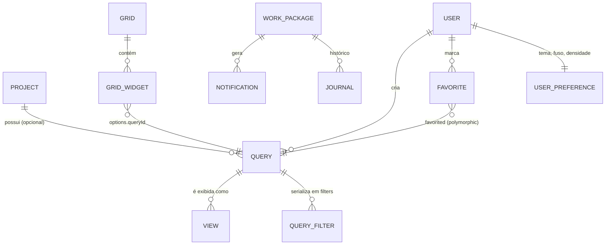

# OpenProject — UI/UX, views e shell de navegação

> **Escopo analisado**: `_REF/openproject` no commit `0e8599b3d1a82b2831857076991662cbd8bdcabc` (2026-10-29), versão `18.0.0` (`lib/open_project/version.rb:33-35`). Foco em `frontend/src/app` (Angular), `app/components` (ViewComponents), `app/views/layouts` (ERB), `frontend/src/app/spot` (design system legado) e nos módulos enterprise em `modules/` (`boards`, `gantt`, `calendar`, `team_planner`, `backlogs`, `grids`, `overviews`, `my_page`). Screenshots de `screenshots/` usados apenas para descrever o que é visível.
>
> **Fora de escopo**: backend/contratos HAL de detalhe (coberto no doc de modelo), BIM, `meeting`, `resource_management`, exportações PDF/CSV, plugins de autenticação.
>
> **Achado estrutural que condiciona tudo**: o produto é híbrido. A *página* é renderizada no servidor (Rails + ViewComponents sobre um fork do Primer) e apenas as ilhas interativas são Angular via `angular_component_tag`. Ex.: a lista de work packages é um `content_for` com uma única tag Angular (`app/views/work_packages/index.html.erb:41-47`); o board idem (`modules/boards/app/views/boards/boards/show.html.erb:31-37`).

---

## 1. Arquitetura em 10 linhas

1. **Layout único com 3 slots**: `base.html.erb` monta header, `nav#main-menu` e `main#content-wrapper`; páginas preenchem `content_header`, `content_body`, `content_body_right` e `sidebar` (`app/views/layouts/base.html.erb:72-160`). Layouts derivados só trocam o menu: `global.html.erb:29` (`:global_menu`), `admin.html.erb:31` (`:admin_menu`).
2. **Menu é dado, não markup**: `render_main_menu` recebe `menu_name` e o projeto e delega ao `Redmine::MenuManager`, que resolve permissões e renderiza recursivamente (`lib/redmine/menu_manager/menu_helper.rb:40-76`).
3. **Sub-menu por módulo é lazy**: cada módulo injeta um `turbo_frame` que carrega `.../menus/show`, que renderiza `OpenProject::Common::SubmenuComponent` com os *views salvos* (`modules/gantt/app/views/gantt/menus/_menu.html.erb:1-5`, `.../menus/show.html.erb:1-3`).
4. **Estado de view = `Query`**: filtros, colunas, ordenação, agrupamento, timeline e visibilidade são serializados no registro `Query` (`app/models/query.rb:37-62`).
5. **Tipo de view = `View`**: uma linha polimórfica (`query_id`, `type`) liga a mesma `Query` a um app (`work_packages_table`, `gantt`, `work_packages_calendar`, `team_planner`) (`app/models/view.rb:30-35`; `app/menus/work_packages/menu.rb:35`; `modules/gantt/app/menus/gantt/menu.rb:35`).
6. **Toolbar e filtros são um shell reutilizável**: `PartitionedQuerySpacePageComponent` (Angular) desenha breadcrumbs, título editável, lista dinâmica de botões de toolbar, área de filtros e duas colunas (`.../partitioned-query-space-page/primerized-partitioned-query-space-page.component.html:1-49`).
7. **A tabela é renderizada imperativamente** por `wp-fast-table` (builders + handlers sobre DOM real) — decisão de performance, para não pagar change detection em milhares de células `[INFERENCE]` (`frontend/src/app/features/work-packages/components/wp-fast-table/wp-fast-table.ts`).
8. **Detalhe é split view de duas colunas independentes**: a coluna direita é um Turbo Frame (`content-bodyRight`) com tabs renderizadas no servidor (`Primer::Alpha::UnderlineNav`) e corpo Angular (`app/components/work_packages/details/tab_component.html.erb:28-56`).
9. **Boards e dashboards compartilham `Grids::Grid`**: board é um grid cujos *widgets* são listas (queries); a página pessoal e a visão geral usam widgets de conteúdo (`modules/boards/app/models/boards/grid.rb:30-62`; `modules/grids/app/models/grids/grid.rb:28-38`).
10. **Design system duplo**: Primer fork como padrão novo (`openproject-primer_view_components 0.95.0`, `Gemfile.lock:920-924`) e Spot como sistema legado de tokens/componentes Angular (`frontend/src/app/spot`), com estilos globais em `frontend/src/global_styles`.

---

## 2. Entidades e relações



| Entidade | Papel na UI | Evidência |
|---|---|---|
| `Query` | view persistida: `name`, `project_id`, `user_id`, `public`, `starred`, `filters` (serialized), `column_names`, `sort_criteria`, `group_by`, `show_hierarchies`, `include_subprojects` | `app/models/query.rb:37-62` |
| `View` | marca em qual app a query aparece (`type`), sem STI | `app/models/view.rb:30-35` |
| `Grids::Grid` | container de board/dashboard; `options` serialized; `has_many :widgets` | `modules/grids/app/models/grids/grid.rb:28-38` |
| `Grids::Widget` | posição/tamanho em colunas + `options` (ex.: `queryId`) | `modules/grids/app/models/grids/widget.rb:28-43`; `frontend/src/app/features/boards/board/board.ts:88-115` |
| `Boards::Grid` | subtipo de grid; `board_type` (`free`/`action`) e `board_type_attribute` | `modules/boards/app/models/boards/grid.rb:54-62` |
| `Favorite` | estrela polimórfica por usuário, unicidade por (user, favorited) | `app/models/favorite.rb:30-36` |
| `Notification` | in-app notification com `reason` enum e `read_ian` | `app/models/notification.rb:31-53` |
| `UserPreference` | tema/claro-escuro, contraste, fuso, `auto_hide_popups` | `app/models/user_preference.rb:40-41,140-174` |

Notas de modelagem úteis para o meraki:

- **A query é o "documento" da view.** Trocar de "Gantt" para "Tabela" mantém filtros/colunas; o que muda é o `View.type` e os parâmetros de render. A mesma query pode ser `starred`, `public` ou privada, e o menu lateral a agrupa exatamente por esses três estados (`app/menus/submenu.rb:66-94`).
- **Favoritos são genéricos**: `Favorite` aceita qualquer `favorited` registrado em `OpenProject::Acts::Favoritable::Registry` (`app/controllers/favorites_controller.rb:49-54`), e o toggle checa visibilidade antes de favoritar (`:35-45`).
- **Grid e widget são o mesmo mecanismo para board e dashboard**, o que explica a reutilização de drag/resize/remoção entre eles (`modules/grids/app/models/grids/grid.rb:34-37`).

---

## 3. Campos, enums e estados

### 3.1 Configuração da tabela (flags de render)

`WorkPackageTableConfiguration` é o contrato que liga a mesma tabela a contextos diferentes (full page, embedded, board, mobile).

| Flag | Default | Efeito visível | Evidência |
|---|---|---|---|
| `compactTableStyle` | `false` | densidade compacta | `.../wp-table/wp-table-configuration.ts:34-35` |
| `keyboardNavigationEnabled` | `false` | `role="treegrid"`, `aria-multiselectable`, roving tabindex | `:40-41`; `.../wp-table/wp-table.component.html:8-11` |
| `contextMenuEnabled` | `true` | menu de contexto (right-click / "⋯") | `:43-44` |
| `columnMenuEnabled` | `true` | menu do cabeçalho / configuração | `:46-47` |
| `inlineCreateEnabled` | `true` | linha "+ Create" no rodapé da tabela | `:55-56`; `wp-table.component.html:123-132` |
| `hierarchyToggleEnabled` | `true` | expandir/recolher subitens na coluna Subject | `:58-59` |
| `dragAndDropEnabled` | `false` | coluna de drag handle + reordenação | `:61-62` |
| `isCardView` | `false` | renderiza `wp-card-view` em vez de tabela | `:67-68` |
| `withFilters` / `filtersExpanded` | `false` | filtros inline no embedded | `:70-77` |

### 3.2 Modos de exibição e agrupamento

| Enum | Valores | Onde |
|---|---|---|
| `displayMode` | `default`, `hierarchy`, `grouped` | `.../configuration-modal/tabs/display-settings-tab.component.html:5-53` |
| conteúdo de `grouped` | select de `availableGroups` (group-by do query) | idem `:43-53` |
| `HighlightingMode` | `status`, `priority`, `type`, `inline`, `none` | `.../builders/highlighting/highlighting-mode.const.ts:28-29` |
| `CardHighlightingMode` | `priority`, `type`, `none`, `inline` | idem `:31` |

### 3.3 Timeline / Gantt

| Enum / campo | Valores | Evidência |
|---|---|---|
| `TimelineZoomLevel` | `auto`, `days` (30px/dia), `weeks` (15), `months` (6), `quarters` (2), `years` (0.5) | `.../timeline/wp-timeline.ts:50-67`; `.../tabs/timelines-tab.component.ts:61-63` |
| labels da barra | `bar`, `left`, `right`, `farRight` (cada um aceita uma coluna ou vazio) | `timelines-tab.component.ts:79-87,99-105` |
| configuração | `visible`, `zoomLevel`, `labels` | `timelines-tab.component.ts:90-97` |
| filtros de baseline | `oneDayAgo`, `lastWorkingDay`, `oneWeekAgo`, `oneMonthAgo`, `aSpecificDate`, `betweenTwoSpecificDates` | `.../wp-baseline/baseline/baseline.component.ts:138-163` |

### 3.4 Boards

| Campo | Valores | Evidência |
|---|---|---|
| `board_type` | `free`, `action` | `modules/boards/app/models/boards/grid.rb:54-62` |
| ação (coluna) | `status`, `assignee`, `version`, `subproject`, `subtasks` | `frontend/src/app/features/boards/board/board-actions/*` |
| `highlightingMode` do board | `priority`/`type`/`none`/`inline` | `board.ts:80-86` |

Boards "action" escrevem um atributo ao soltar o card (`status-action.service.ts`, `assignee-action.service.ts`, `version-action.service.ts`, `subproject-action.service.ts`, `board-subtasks-action.service.ts`); o serviço declara `filterName`, `attributeName` e `watchedAttributes` justamente para o card "saltar" de coluna quando o atributo muda (`.../board-actions/board-action.service.ts:65-101`).

### 3.5 Atividade e notificações

| Enum | Valores | Evidência |
|---|---|---|
| filtro da aba Activity | `ALL`, `ONLY_CHANGES`, `ONLY_COMMENTS`, `HIDE_MEETINGS` | `app/components/work_packages/activities_tab/journals/filter_and_sorting_component.rb:50-64`; menu em `.../filter_and_sorting_component.html.erb:14-46` |
| `Notification::REASONS` | `mentioned`, `assigned`, `watched`, `subscribed`, `commented`, `created`, `processed`, `prioritized`, `scheduled`, `responsible`, `date_alert_start_date`, `date_alert_due_date`, `shared`, `reminder` | `app/models/notification.rb:31-46` |

### 3.6 Tema, fuso e preferências

| Preferência | Valores | Evidência |
|---|---|---|
| `theme` | `light`, `dark`, `sync_with_os` (+ `increase_theme_contrast`) | `app/models/user_preference.rb:40-41,164-170` |
| aplicação no DOM | `body[data-color-mode="dark"]` | `frontend/src/global_styles/layout/_colors.sass:113` |
| fuso | `user_preference.time_zone` com fallback do sistema → `Etc/UTC` | `app/models/user_preference.rb:172-174` |
| detecção de SO | `OpColorMode` e `prefersSystemLightMode()` | `frontend/src/app/core/setup/globals/theme-utils.ts:28-51` |

---

## 4. Permissões e gestão de acesso (o que o usuário vê)

- **Menu é filtrado por permissão e por módulo**: `render_menu_node` retorna vazio quando `allowed_node?` falha; filhos só aparecem se permitidos (`lib/redmine/menu_manager/menu_helper.rb:57-76`). No `admin`, o menu vem de `:admin_menu` (`app/views/layouts/admin.html.erb:31`).
- **Tabs do detalhe são um menu `:work_package_split_view`, filtrado por permissão e com `badge` contador**: Overview, Activity, Files, Relations e Watchers são registradas em `config/initializers/menus.rb:923-965`, com contadores calculados por lambda (`:931-937`, `:942-948`, `:953-955`).
- **Views visíveis**: o submenu lista apenas `Query.visible(User.current)` e separa `starred`, `public`, `custom` (`app/menus/submenu.rb:66-108,96-99`).
- **Boards**: permissões `show_board_views` / `manage_board_views` (declaradas em `modules/boards/lib/open_project/boards/engine.rb:44-53`); o link de apagar só aparece com `manage_board_views` (`modules/boards/app/components/boards/row_component.rb:57-77`).
- **Split view**: só renderiza se `params[:work_package_split_view]` existir, e o WP é buscado por `WorkPackage.visible` (`app/helpers/work_packages/split_view_helper.rb:31-33`; `app/components/work_packages/split_view_component.rb:36-43`).
- **Ações de contexto**: a lista é filtrada por `getPermittedActions` antes de renderizar (`frontend/src/app/shared/components/op-context-menu/wp-context-menu/wp-view-context-menu.directive.ts:79-85`).
- **Enterprise gating** aparece como ícone de upsell dentro do item de menu (`show_enterprise_icon`, `modules/boards/app/views/boards/menus/show.html.erb` via `SubmenuComponent`): `app/components/open_project/common/submenu_component.html.erb:44-47`. Menus também podem declarar `enterprise_feature:` (`modules/team_planner/lib/open_project/team_planner/engine.rb:75-81`).

---

## 5. Shell de navegação

### 5.1 Header global

Estrutura em três zonas, montadas por helpers:

| Zona | Conteúdo | Evidência |
|---|---|---|
| start | skip-link → `#content`, menu do módulo (waffle), logo desktop/mobile | `app/views/layouts/base.html.erb:74-81`; `lib/redmine/menu_manager/top_menu_helper.rb:37-49` |
| center | busca global (Angular `opce-global-search`) | `top_menu_helper.rb:51-53,84-90,100-105` |
| end | upsell, quick-add, "What's new", sino de notificações, ajuda, avatar | `top_menu_helper.rb:107-116` |

O sino é um `Primer::Beta::IconButton` que aponta para `/notifications` **mais** o componente Angular `opce-in-app-notification-bell` com polling configurável (`top_menu_helper.rb:120-140`; intervalo em `Setting.notifications_polling_interval`).

### 5.2 Seletor de projeto

- Trigger no topo do menu lateral: `Header::ProjectSelectComponent` renderiza um `Primer::Alpha::Overlay` com `accesskey: "5"` e um Turbo Frame lazy (`app/components/header/project_select_component.html.erb:40-60`).
- O label é o projeto atual ou "All projects" (`app/components/header/project_select_component.rb:43-45`); pode criar projeto se `add_project` global (`:54-56`).
- A árvore é recursiva (`with_sub_tree`/`with_leaf`), esconde nós que não casam com a busca (`disabled: !matches_query?`), marca o projeto atual com "x-circle" para sair dele e mostra estrela de favorito no rótulo (`app/components/header/projects/node_component.html.erb:29-79`; `node_component.rb:48-59`).
- O menu lateral renderiza o mesmo componente no topo (`base.html.erb:102-110`), com um divisor e o botão de colapsar.

### 5.3 Menu lateral do projeto

- O menu de projeto é uma árvore (`ul.menu_root`) com toggler acessível (`aria-label` "go forward") (`lib/redmine/menu_manager/menu_helper.rb:60-76,84-100`).
- Ordem e ícones vêm do módulo: Gantt `after: :work_packages` com `icon: "op-view-timeline"` (`modules/gantt/lib/open_project/gantt/engine.rb:83-93`), Boards `after: :work_packages` (`modules/boards/lib/open_project/boards/engine.rb:56-62`), Calendar `after: :gantt` (`modules/calendar/lib/open_project/calendar/engine.rb:82-88`), Team planner `after: :work_packages` com flag enterprise (`modules/team_planner/lib/open_project/team_planner/engine.rb:75-81`).
- Cada módulo com views adiciona um filho com `partial:` que carrega o sub-menu lazy (`modules/boards/lib/open_project/boards/engine.rb:63-70`).
- **Submenu de views** (`SubmenuComponent`): busca por nome no topo, grupos colapsáveis com contador e estrela, item selecionado e botão primário de criação no rodapé (`app/components/open_project/common/submenu_component.html.erb:1-30,32-63,65-112,115-128`; API em `submenu_component.rb:33-52`).

### 5.4 Breadcrumbs e título da página

- Angular: `op-breadcrumbs[items][lastItemSection]` no topo do shell de query (`partitioned-query-space-page.component.html:3-5`), montado a partir do projeto + módulo + seção (`.../wp-view-page.component.ts:109-125`).
- Rails: `PageHeader.new.with_breadcrumbs([...</PageHeader>)` nas páginas novas (`modules/calendar/app/views/calendar/calendars/index.html.erb:30-35`).

### 5.5 Busca global ("command palette" de fato)

Não existe paleta de comandos separada; a busca global faz o papel de quick switcher:

- Input `opce-global-search` com `accesskey: 4`, `openOnEnter`, dropdown "Recently viewed" quando o termo está vazio e Enter antes do resultado carregar (`frontend/src/app/core/global_search/input/global-search-input.component.html:27-66`; `.ts:234-265`).
- Resultados são work packages (`id`, `subject`, `status`, `href`, `project`) e um item final "buscar por `<termo>`" que leva a `/search` com `filter=work_packages` por padrão (`frontend/src/app/core/global_search/services/global-search.service.ts:42-67`).
- `RecentItemsService` alimenta o estado vazio (`global-search-input.component.ts:99`), e anúncios acessíveis usam `@primer/live-region-element` (`:52`).

### 5.6 Favoritos

- Estrela em queries aparece na sidebar (`Primer::Beta::Octicon icon: "star-fill"`, `submenu_component.html.erb:93-95`).
- Toggle via `POST/DELETE` em `/favorite`/`/unfavorite` por `object_type`/`object_id`, redirecionando de volta (303) ou 204 em JSON (`app/controllers/favorites_controller.rb:30-61`).
- Existe também widget "Favorite projects" em dashboards (`frontend/src/app/shared/components/grids/widgets/favorite-projects/`).

### 5.7 Central de notificações

- Página `/notifications` renderiza header + subheader (facets/filtros) e o centro Angular (`app/views/notifications/index.html.erb:1-20`).
- Centro: virtual scroll (`cdk-virtual-scroll-viewport itemSize=100`), agrupamento de notificações por WP, estado lido/não lido e seleção sincronizada com a coluna de detalhe (`frontend/src/app/features/in-app-notifications/center/in-app-notification-center.component.html:9-24`).
- Item: status, ID linkado, projeto, "reason" traduzido, contador de agrupadas, botão "mark as read" e "info" que abre o detalhe; suporta Enter/Espaço quando focado (`.../entry/in-app-notification-entry.component.html:1-75`).
- Empty states distintos para "nada com o filtro atual" e "nada no total, ajuste as configurações" (`in-app-notification-center.component.html:25-43`; textos em `in-app-notification-center.component.ts:143-181`).
- A central compartilha a coluna direita com o split view de WP (`notifications/index.html.erb:16-21`).

---

## 6. Work packages: tabela, filtros e detalhe

### 6.1 Toolbar do shell de query

Lista declarativa de botões, renderizada por `ndc-dynamic`:

| Botão | Componente | Observação | Evidência |
|---|---|---|---|
| Create | `WorkPackageCreateButtonComponent` | sempre | `.../wp-view-page.component.ts:66-69` |
| Include projects | `OpProjectIncludeComponent` | escopo de subprojetos | `:70-72` |
| Baseline | `OpBaselineModalComponent` | oculto em tablet | `:73-76` |
| Filter | `WorkPackageFilterButtonComponent` | abre painel de filtros | `:77-79` |
| Fold groups | `WorkPackageFoldToggleButtonComponent` | só com `groupBy` | `:80-83` |
| Details view | `WorkPackageDetailsViewButtonComponent` | liga o split view | `:84-87` |
| Timeline | `WorkPackageTimelineButtonComponent` | liga Gantt + zoom in/out/auto | `:88-91` |
| Zen | `ZenModeButtonComponent` | tela cheia | `:92-95` |
| Settings | `WorkPackageSettingsButtonComponent` | abre o modal de configuração | `:96-98` |

Título editável inline (`editable-toolbar-title`) com save condicional quando há `query_props` (`primerized-partitioned-query-space-page.component.html:8-15`).

### 6.2 A tabela

- `<table class="keyboard-accessible-list generic-table work-package-table">`, `colgroup` gerado por coluna, `thead.-sticky`, caption `sr-only` com resumo de ordenação (`wp-table.component.html:4-50`).
- Colunas opcionais à esquerda: drag handle (se `dragAndDropEnabled`) e baseline; à direita: menu de configuração/actions (`:16-28,66-93`).
- Estado vazio inline **dentro** da tabela, com ícone e texto (`:96-114`).
- Linha de somas no rodapé (`wp-table--sums-row`, `:117-122`) e corpo de criação inline (`wpInlineCreate`, `:123-132`).
- Ordenação: cada `<th>` usa `sortHeader`, com indicador de direção e menu de coluna anexado (`opColumnsContextMenu`) (`wp-table.component.html:66-80`); o indicador vem do **primeiro** critério de ordenação via `primarySortDirection(sortBy, column)` (`.../sort-header/primary-sort-direction.ts:28-50`) e o HTML trata hierarquia/relação/sort como casos distintos (`sort-header.directive.html:1-60`).
- Resizer vertical entre tabela e timeline (`:135-141`).

### 6.3 Renderização rápida (`wp-fast-table`)

- Builders por modo: `plain`, `hierarchy`, `grouped` (`.../wp-fast-table/builders/modes/*`); o `GroupedRowsBuilder` só é aplicável se existem grupos e re-renderiza cabeçalhos preservando `occurrenceKey` (`.../modes/grouped/grouped-rows-builder.ts:59-92,95-139`).
- Handlers por tipo de evento: célula (`edit-cell-handler`), linha (`click`, `double-click`, `hierarchy-click`, `group-row`), contexto (`right-click`, `click`, `keyboard`) (`.../wp-fast-table/handlers/**`).
- **Inline edit**: clique (ou duplo clique, conforme `requireDoubleClickForInlineEdit()`) numa célula `.editable` ativa o edit field na posição do clique (`.../handlers/cell/edit-cell-handler.ts:53-88,104-120`). O salvamento é da barra flutuante `work-packages--edit-actions` com `accesskey=3` (save) e `accesskey=7` (cancel) (`.../edit-actions-bar/wp-edit-actions-bar.html:1-19`).
- Ações de linha: details + menu de contexto, registradas por uma lista substituível (`.../wp-table/table-actions/table-actions.service.ts:44-63`).

### 6.4 Filtros

- Painel com `fieldset#filters`, busca textual fixa ("filter by text") e uma lista de filtros adicionáveis via `ng-select` (`.../filters/query-filters/query-filters.component.html:2-76`).
- Aviso quando o filtro é incompatível com baseline (`:77-81`).
- Toggle do painel (`.../filters/filter-container/filter-container.directive.html:1-16`); o número de filtros ativos aparece como badge no botão "Filter" da toolbar (`.../wp-buttons/wp-filter-button/wp-filter-button.html:13-18`).
- Implementações de valor por tipo: `filter-date-value`, `filter-dates-value`, `filter-date-time-value`, `filter-searchable-multiselect-value`, `filter-toggled-multiselect-value`, `filter-boolean-value`, `filter-integer-value`, `filter-string-value`, `filter-project` (`frontend/src/app/features/work-packages/components/filters/*`).

### 6.5 Modal de configuração da view

6 abas fixas + 1 condicional:

| Aba | Conteúdo | Evidência |
|---|---|---|
| Columns | seleção/ordem de colunas | `.../configuration-modal/wp-table-configuration.service.ts:43-48` |
| Filters | filtros | `:49-53` |
| Sort by | múltiplos critérios + direção | `:54-58` |
| Baseline | comparação histórica (enterprise) | `:59-63` |
| Display settings | default/hierarchy/grouped + group-by | `:64-68`; `display-settings-tab.component.html:1-56` |
| Highlighting | colorir por status/prioridade/tipo/inline | `:69-73` |
| Gantt | visibilidade, zoom, labels — **apenas fora de `/work_packages` e `/bcf`** | `:76-89` |

O modal é `spot-modal spot-modal_wide` com tabs em portal dinâmico e botões Cancel/Apply (`.../wp-table-configuration.modal.html:1-40`); salvar chama `onSave()` de cada aba ativa (`wp-table-configuration.modal.ts:133-140`).

### 6.6 Hierarquia, drag & drop e criação inline

- Modos de DnD registrados: `HierarchyDragActionService` (reparent/reorder) e `GroupByDragActionService` (mover entre grupos), com fallback `TableDragActionService` (`.../wp-table/drag-and-drop/actions/table-drag-actions-registry.service.ts:37-55`).
- Indent/outdent respeita ordem renderizada e ancestrais (`.../view-services/wp-view-hierarchy-indentation.service.ts:56-96`), e só está ativo com hierarquia + lista (`:39-41`).
- Criação inline: linha "+ Create" (e "+ Reference" quando aplicável), ambas com `aria-haspopup` (`.../wp-inline-create/wp-inline-create.component.html:1-40`).

### 6.7 Split view e abas do detalhe

- Coluna direita renderizada pelo servidor: `WorkPackages::SplitViewComponent` → `TabComponent` (UnderlineNav com contador por tab, setas de scroll, expandir e fechar) + `opce-wp-split-view` (`app/components/work_packages/split_view_component.html.erb:14-25`; `details/tab_component.html.erb:3-56,58-80`).
- Tabs: Overview, Activity, Files, Relations, Watchers (`config/initializers/menus.rb:923-965`).
- Corpo Angular: `wp-split-view.html` monta `op-wp-tabs`, `wp-breadcrumb`, `wp-subject`, `edit-form`, o componente da tab ativa e a toolbar inferior de ações (`frontend/src/app/features/work-packages/routing/wp-split-view/wp-split-view.html:1-55`).
- Overview: status button → ID/autor/última atualização → description rica → grupos de atributos; grupos isolados podem ter query própria (`.../wp-single-view/wp-single-view.component.html:1-140`).
- Resizer com largura persistida em `localStorage` (`wp-split-view.html:51-54`).
- URL: `/details/:id/:tab` (opcional, default `overview`) no frame `content-bodyRight` com `turbo_action: advance/replace` (`config/routes.rb:706-708`; `tab_component.html.erb:36-44`; abertura programática em `.../op-work-packages-calendar.service.ts:314-330`); a página cheia é `/work_packages/:id/:tab` (`config/routes.rb:703-704`).

### 6.8 Visualização em cards (mobile/board)

`wp-single-card` é `role="button"`, `tabindex="0"`, aceita click/Enter/Espaço/dblclick/contextmenu, mostra highlighting lateral, botões inline (info, remover), tipo, ID, projeto, assunto e — no modo inline — datas de início/fim (`.../wp-card-view/wp-single-card/wp-single-card.component.html:1-120`). O container é uma lista sortable (`opSortableListsList`, `handleDrop`) (`wp-card-view.component.html:1-39`).

---

## 7. Gantt / timeline

Não existe `features/gantt` no frontend: o Gantt é a **mesma tabela com a coluna de timeline ligada**. A página `/gantt` só reaproveita o shell Angular (`modules/gantt/app/views/gantt/gantt/index.html.erb:37-44`).

| Peça | Realização | Evidência |
|---|---|---|
| Container | `wp-table-timeline--outer` com header, static elements, grid, relations e body | `.../timeline/container/wp-timeline-container.html:1-8` |
| Cabeçalho | duas faixas (ano/trimestre/mês/dia) geradas por `getTimeSlicesForHeader`, que separa viewport do resto para performance | `.../timeline/wp-timeline.ts:140-173` |
| Zoom | `days|weeks|months|quarters|years` + `auto`; px/dia fixo por nível | `wp-timeline.ts:44-68` |
| Auto-zoom | escolhe o maior nível que ainda caiba no span visível e atualiza sem re-render total | `.../container/wp-timeline-container.directive.ts:577-601` |
| Barras | `timeline-cell-renderer` com handles laterais (`classNameLeftHandle`/`classNameRightHandle`) e cursor `col-resize`/`ew-resize` | `.../cells/timeline-cell-renderer.ts:73-74,220-240` |
| Milestones | renderer próprio (`timeline-milestone-cell-renderer.ts`) e label suprimido | `timeline-cell-renderer.ts:603` |
| Dependências | `wp-timeline-relations` desenha elementos entre pares de WPs a partir de `RelationResource` | `.../global-elements/wp-timeline-relations.directive.ts`; `timeline-relation-element.ts:34-43` |
| Hoje / linhas estáticas | linha de "today" e não-úteis | `.../global-elements/wp-timeline.today-line.ts`; `wp-timeline-static-elements.directive.ts:98-113` |
| Baseline | coluna/overlay `.op-table-baseline` + legenda com "added/removed/changed" | `wp-table.component.html:7,57-63`; `.../baseline-legends/baseline-legends.component.html:11-18` |
| Zoom manual | botões in/out e "auto" no botão de timeline | `.../wp-buttons/wp-timeline-toggle-button/wp-timeline-toggle-button.html:18-35`; `.ts:136` |

Sobre agendamento: o modo manual/automático existe por work package (`scheduleManually`) e o calendário/date picker consulta isso (`frontend/src/app/features/calendar/op-work-packages-calendar.service.ts:284-292`; `app/components/work_packages/date_picker/date_form_component.rb:39-73`). O recálculo em cascata é backend (`app/models/work_packages/scopes/for_scheduling.rb:37-60,112-181`). **Não há caminho crítico** — busca por "critical path"/"critical" não retorna nada em código de produto.

O date picker (Rails/Primer) usa dois campos (start/due) com link "Today", botão "+ Start date" quando o campo está vazio, campo de duração e preview via Turbo (`app/components/work_packages/date_picker/date_form_component.html.erb:1-71`).

---

## 8. Boards, Calendar, Team planner, Backlogs

### 8.1 Boards

- Duas naturezas: `free` (listas arbitrárias, ordenação manual) e `action` (colunas ligadas a um atributo) (`board.ts:33,64-78`).
- Página do board é o mesmo shell particionado, com toolbar própria (`.../board-partitioned-page/board-partitioned-page.component.ts:67-70` referencia `primerized-partitioned-query-space-page.component.html`).
- Cada lista: cabeçalho com título editável, menu da lista, botão "+" e `wp-card-view` com `dragOutOfHandler`/`dragInto`/`orderIsMembership` (`.../board-list/board-list.component.html:14-61`). Lista "action" troca o título por um header específico (status/assignee/version/subproject/subtasks) (`:9-20`).
- Criação de lista: modal `spot-modal` com autocompleter do recurso da ação e atalho "create <termo>" para versões (`.../add-list-modal/add-list-modal.html:1-70`).
- Índice de boards (fora de um board) é uma **tabela paginada** com colunas nome/projeto/tipo/criado em e link de delete condicionado a permissão (`modules/boards/app/components/boards/table_component.rb:31-56`; `row_component.rb:36-77`).
- Não há swimlanes no código (`grep -ri swimlane` vazio); a "segunda dimensão" é obtida com board + filtros/grouping `[INFERENCE]`.

### 8.2 Calendar

- Índice lista as *views* de calendário (`Calendar::TableComponent`) e cria por formulário (`modules/calendar/app/views/calendar/calendars/index.html.erb:29-43`; `new.html.erb` com nome, projeto, `public`, `starred`).
- Render com FullCalendar desabilitado para edição direta (`editable: false`), toolbar `prev,next today` + título, primeira coluna do dia conforme configuração da instância e marcação visual de dias não úteis (`frontend/src/app/features/calendar/op-work-packages-calendar.service.ts:369-392`).
- A view (mês/semana) e a data vivem na URL (`cview`, `cdate`) e são reescritas via `history.replaceState` (`:280-282,432-442,462-478`).
- Duplo clique abre o WP completo; clique simples abre o split view só se ele já estiver aberto (`:303-346`).
- Limite de itens com aviso "too many results" (`:155-171`).

### 8.3 Team planner

- FullCalendar com **resource timeline** e um recurso por assignee, 5 durações: work week, 1, 2, 4 e 8 semanas (`frontend/src/app/features/team-planner/team-planner/planner/team-planner.component.ts:126,364-400`).
- Edição habilitada: `selectable`, `editable`, `droppable`, com `eventResize`, `eventDrop`, `eventReceive`; qualquer interação com dia não útil é revertida + toast de erro (`:544-604`).
- Skeleton de carregamento (`skeletonResources`/`skeletonEvents`) e render progressivo (`:520-541`).
- Painel "add existing" à esquerda e seletor de view no toolbar (`planner/team-planner.component.html:5-38`).
- Assignees são removíveis e adicionáveis na própria coluna (`add-assignee.component.html` via `op-tp-add-assignee`, `team-planner.component.html:53-81`).
- Empty state com imagem + CTA (`team-planner.component.html:113-125`).

### 8.4 Backlogs

- Página inteira em Rails + Turbo + Stimulus, com **morph refresh** e uma única `turbo-frame` `backlogs_container` que declara o controller `sortable-lists` com template de URL de move, batch size e escopo de anúncios (`modules/backlogs/app/views/backlogs/backlog/show.html.erb:45-66`).
- Sprints são listas (`WorkPackageCardListComponent`) com drag handle, `accepted_type` e `drop_position` (`modules/backlogs/app/components/backlogs/sprint_component.html.erb:29-47`).
- Cabeçalho do sprint: nome, goal (texto truncado em 3 linhas expansível), badge de status, **story points somados** (`aria-live="polite"`), intervalo de datas (`sprint_component.html.erb:49-70`; soma em `sprint_component.rb:115-117`).
- Ações Start/Finish desabilitadas com regra explícita e `aria-disabled` (`sprint_component.rb:64-97`).
- Backlog agrupado por *bucket* (versão), com filtro por `subject_or_id` e por `bucket_ids` (`backlog_component.html.erb:49-60`; `index_subheader_component.html.erb:39-50`).
- Inbox de itens não planejados reaproveita `OpPrimer::BorderBoxListComponent` (`inbox_component.html.erb:29-42`).
- **Burndown** existe em dois lugares: widget de sprint report em Rails (`modules/backlogs/app/components/backlogs/sprint_reports/widgets/burndown_chart.rb`) e gráfico Angular chart.js com superfície acessível (`role="img"`, `aria-describedby`) e legenda com dias não úteis (`frontend/src/app/features/backlogs/burndown-chart.component.html:1-17`).
- Sprint reports: widgets de goal, added/removed/scope change, created/resolved, overview e unfinished (`modules/backlogs/app/components/backlogs/sprint_reports/widgets/`).

---

## 9. My Page, Overview, Activity

### 9.1 My Page

- Página `my/page` é só header + `opce-my-page` (`modules/my_page/app/views/my/page/show.html.erb:1-10`), que estende `GridPageComponent` com escopo `myPagePath` (`frontend/src/app/features/my-page/my-page.component.ts:32-46`).
- O grid Angular é próprio (não gridster): serviços de área, move, resize, drag-and-drop, add e remove widget (`frontend/src/app/shared/components/grids/grid/grid.component.ts:45-59`), com abort de drag/resize via Escape (`:100-120`).
- Widgets registrados: `wp-table`, `wp-overview`, `wp-calendar`, `wp-graph`, `favorite-projects`, `members`, `news`, `documents`, `subprojects`, `project-status`, `project-description`, `time-entries`, `custom-text` (`frontend/src/app/shared/components/grids/widgets/*`).

### 9.2 Overview de projeto/portfólio

- A página usa **widgets Rails** (`Grids::WidgetGridComponent`), não o grid Angular, e varia por tipo de workspace: project, program, portfolio (`modules/overviews/app/components/overviews/overview_grid_component.html.erb:28-35`).
- Catálogo de widgets do projeto (declarativo, ordem fixa): descrição, status, timeline, subitens, meetings, membros, notícias, budgets, custos e atributos de projeto (`modules/overviews/app/components/overviews/workspaces/project_overview_grid_component.html.erb:29-43`).
- Layout tem sidebar condicional (life cycle + custom fields) via `OpPrimer::ConditionalLayoutComponent` (`modules/overviews/app/components/overviews/show_component.html.erb:29-50`).
- Widget box: header com título/atributo, counter, action button/menu, body com padding (`default`/`none`/`condensed`), footer e rows (`modules/grids/app/components/grids/widget_box_component.rb:44-88`; `header.rb:35-78`; `body.rb:35-52`).

### 9.3 Activity (global e por projeto)

- Página `/activity` com PageHeader (título, descrição de período, breadcrumbs), agrupamento por dia e lista (`app/views/activities/index.html.erb:31-45`; `app/components/activities/days_component.html.erb:29-40`).
- Filtros num formulário lateral com checkboxes por tipo de evento, "incluir subprojetos" e botão Apply (`app/views/activities/menu.html.erb:1-32`), carregado em Turbo Frame `activity_menu` (`_filters_menu.html.erb:1-10`).
- Navegação é paginação por janela de dias ("previous"/"next", com "next" desabilitado no futuro) (`activities/index.html.erb:52-77`), além de Atom feed.

---

## 10. Padrões de interação

### 10.1 Modal vs. página inteira

| Caso | Formato | Evidência |
|---|---|---|
| Configuração de view (colunas/filtros/zoom) | modal largo com tabs | `wp-table-configuration.modal.html:1-40` |
| Criar lista de board | modal | `add-list-modal.html:1-70` |
| Bulk edit de WPs | página inteira `/work_packages/bulk/edit` | `app/views/work_packages/bulk/edit.html.erb:29-51` |
| Delete de WP(s) | diálogo Turbo (dialog component) | `app/components/work_packages/bulk_delete_dialog_component.rb:47-82` |
| Detalhe | coluna split (Turbo Frame) ou página cheia | `wp-split-view.html:1-55`; `app/components/work_packages/details/tab_component.html.erb:58-70` |
| Detalhe de tab em tela cheia | rota `/details/:id/:tab` | `tab_component.html.erb:58-70` |
| Onboarding | modal com wrapper `data-augmented-model-wrapper` | `app/views/layouts/base.html.erb:138-143` |

Overlays globais vivem no layout: `opce-toasts-container`, `opce-modal-overlay`, `opce-spot-drop-modal-portal` e `<live-region>` (`base.html.erb:60-64`).

### 10.2 Atalhos de teclado

Registrados via Mousetrap; desligáveis por configuração (`disableKeyboardShortcuts()`).

| Atalho | Ação | Evidência |
|---|---|---|
| `?` | abre ajuda de atalhos (redirect para docs) | `frontend/src/app/shared/directives/a11y/keyboard-shortcut.service.ts:60`; `app/controllers/help_controller.rb:33-35` |
| `g m` | My page | `:61` |
| `g o` | Overview do projeto | `:62` |
| `g w p` / `g w i` | Work packages / Wiki | `:63-64` |
| `g a` / `g c` / `g n` | Activity / Calendar / News | `:65-67` |
| `n w p` | novo work package | `:68` |
| `g e` / `g p` / `d w p` / `m` / `p` / `s` | accesskeys 3/1/8/7/5/4 | `:70-74`; mapa em `:35-44` |
| `j` / `k` | próxima/anterior linha focável da tabela | `:76-77,140-159` |

Accesskeys visíveis no produto: quick search `4` (`global-search-input.component.html:32`), projeto `5` (`project_select_component.html.erb:46`), save/cancel de edição `3`/`7` (`wp-edit-actions-bar.html:4,14`).

### 10.3 Navegação por teclado na grade

- `keyboardNavigationEnabled` liga `role="treegrid"`, `aria-multiselectable`, `aria-label` e `aria-sort` no cabeçalho (`wp-table.component.html:8-11,66-93`).
- Roving tabindex: apenas a célula/linha focada é `tabindex="0"`, todo o resto (inclusive links/buttons nativos) vira `-1`, exceto o corpo de criação inline e o campo em edição (`.../handlers/state/keyboard/roving-tabindex.ts:68-88`).
- Teclas: setas, `Home`/`End`, `Ctrl+Home`/`Ctrl+End`, `PageUp`/`PageDown` com clamp e pulo de linhas escondidas (`.../keyboard/focus-position.spec.ts:65-155`).
- `Ctrl/Cmd+A` seleciona todas as ocorrências renderizadas; `Escape` limpa a seleção (`.../event-handling/wp-selection-keyboard.ts:43-98`).

### 10.4 Menus de contexto

- Duplo caminho: right-click e o botão "⋯" da coluna de ações (`.../handlers/context-menu/context-menu-rightclick-handler.ts`, `.../context-menu-click-handler.ts`).
- Ações disponíveis (filtradas por permissão): copiar link, log time, mover de projeto, duplicar, copiar para outro projeto, delete, copiar ID numérico, gerar PDF, ver markdown, exportar atom (`frontend/src/app/shared/components/op-context-menu/wp-context-menu/wp-static-context-menu-actions.ts:32-81`).
- Ações de split view fazem `Turbo.visit` no frame da direita (`wp-view-context-menu.directive.ts:152-163`); com múltiplos selecionados, "edit" leva ao bulk edit (`:178-184`).

### 10.5 Densidade, tema, i18n

- Densidade: `compactTableStyle` na tabela (`wp-table-configuration.ts:34-35`) e variantes `-condensed`/`-spacious` no Box de widgets (`modules/grids/app/components/grids/widget_box_component/body.rb:35-40`). **Não há um "modo densidade" global** de produto.
- Tema: `light`/`dark`/`sync_with_os` + "increase contrast", estampado como `data-color-mode` no body (`app/models/user_preference.rb:40-41,164-170`; `_colors.sass:100-113`).
- i18n: uma única instância `window.I18n` (i18n-js) usada por Angular (`frontend/src/app/core/i18n/i18n.service.ts:36-67`) e Rails (chaves `js.*` no backend); `html lang` vem do `I18n.locale` (`base.html.erb:33`), e cada célula pode declarar `lang` próprio para campos traduzíveis (`sort-header.directive.html:19-20`).

### 10.6 Acessibilidade (o que existe de fato)

- Skip link para `#content` (`base.html.erb:75-79`) e `<h1 class="sr-only">` (`:150`).
- `<live-region>` global para anúncios (`base.html.erb:63`), além de `announce()` do Primer em buscas/backlogs (`global-search-input.component.ts:52`) e `aria-live="polite"` no total de story points do sprint (`sprint_component.html.erb:62`).
- Captions `sr-only` com resumo de ordenação (`wp-table.component.html:29-42`), `aria-sort` por coluna (`:66-76`).
- Modais e overlays fecham com Escape e devolvem foco (serviço de modal: `frontend/src/app/shared/components/modal/modal.service.ts:55-66,129-140`).
- Drag cancelável por Escape em grid e timeline (`grid.component.ts:100-120`; `wp-timeline` via container).

### 10.7 Estados vazios, loading e toasts

- Vazio de tabela dentro do `<tbody>` (`wp-table.component.html:96-114`); vazio de card view (`wp-card-view.component.html:41-45`); `op-no-results` e `Primer::Beta::Blankslate` em páginas.
- Skeletons: `op-principal-loading-skeleton`, `op-wp-loading-skeleton` (`frontend/src/app/shared/components/op-content-loader/**`), skeleton de eventos no team planner (`team-planner.component.ts:520-541`) e `Header::WhatsNewSkeletonComponent`.
- Toasts: tipos `success|error|warning|info|upload|loading`; auto-hide só para `success` (respeitando `autoHidePopups`) e pilha que remove toasts anteriores do mesmo tipo (`frontend/src/app/shared/components/toaster/toast.service.ts:44-94`); erros HTTP viram toast via `addError` (`:96-110`).

---

## 11. Configuração de formulário e tipos de projeto

- `FormConfiguration` é editado por tipo, com grupos ordenáveis e "atributos inativos" numa sidebar (drag para ativar): `app/components/work_package_types/form_configuration/inactive_attributes_sidebar_component.html.erb:1-40`; grupos com header, rows e drop target (`group_component.html.erb:29-60`).
- Ações do subheader: "Reset to defaults" e menu "+ Add" com *attribute group* e *query group* (grupo preenchido por query, recurso enterprise) (`main_content_component.html.erb:5-58`).
- Rotas: `resource :form_configuration` com `change_dialog/change`, `start/configure/create` e `rows/:row_key/toggle_required` (`config/routes.rb:193-211`); index por tipo em `/forms` (`:387-415`).
- **Tipos de projeto**: `ProjectType` liga `project` → `type` → `variant` (`TypeVariant`), garantindo que a variante pertence ao tipo e é do próprio projeto quando `project_owned?` (`app/models/project_type.rb:30-62`). Na prática, "template de projeto" = tipo com variante e form configuration própria.
- Criação de projeto é um wizard multi-step com sidebar e barra de progresso/`Back`/`Continue`/`Cancel` (`app/components/step_wizard/*`; `app/components/projects/wizard/footer_component.rb:45-93`).
- Cabeçalho do wizard usa `PageHeader` com botão fechar e `workspace_creation_cancel_href` (`app/views/projects/_new_header.erb:29-40`).

---

## 12. Design system

| Camada | O que é | Evidência |
|---|---|---|
| Primer fork | gem `openproject-primer_view_components 0.95.0` sobre `view_component 4.15.0`; componentes em `Primer::*` e `Primer::OpenProject::*` | `Gemfile:238`; `Gemfile.lock:920-924,1530` |
| Extensões OpenProject | 75 entradas em `app/components/op_primer` (cards, border box list/table, inplace edit, quick filter, spinner, status button, attributes group) | `app/components/op_primer/*` |
| Forms DSL | `lib/primer/open_project/forms` (ex.: `filterable_tree_view_input`) | `lib/primer/open_project/forms/dsl/filterable_tree_view_input.rb:47` |
| Spot (legado) | tokens + componentes Angular: breadcrumbs, checkbox, drop-modal, form-field, selector-field, switch, text-field, toggle, tooltip | `frontend/src/app/spot/components/*` |
| Tokens | `tokens.json`/`tokens.sass` com cores básicas (`spot-color-main`, `danger`, `feedback-*`) e spacing `0.25rem`–`10rem` | `frontend/src/app/spot/styles/tokens/dist/tokens.json` |
| Tipografia | mixins `spot-header-big` (2rem), `spot-header-small` (1.5), `spot-subheader-*`, `spot-body-*` (1/0.875), `spot-caption` (0.75) | `frontend/src/app/spot/styles/sass/variables/typography.sass:1-60` |
| Estilos globais | `frontend/src/global_styles/{common,content,layout,openproject,primer}` | `frontend/src/global_styles` |
| Catálogo | Lookbook com previews e docs (`lookbook/previews`, `lookbook/docs`) | `lookbook/` |

Consequência para o meraki: o OpenProject tem **dois** vocabulários visuais coexistindo (Primer para páginas novas, Spot para o shell Angular legado). Os componentes novos já assumem "Box/BorderBox/UnderlineNav/ActionMenu" como primitivas, o que dá consistência rápida; o custo é ter que manter dois.

---

## 13. Tabela-mestra: view → componente → ação → padrão

| View | Componente principal | O que o usuário faz | Padrão de interação |
|---|---|---|---|
| Work packages (tabela) | `opce-work-packages-view` → `WorkPackageViewPageComponent` + `wp-table` | filtrar, ordenar, agrupar, editar inline, selecionar, arrastar | toolbar + filtros colapsáveis + edição em célula + barra save/cancel |
| Work packages (detalhe) | `opce-wp-split-view` + `wp-single-view` | editar atributos, ler descrição, comentar | split view + tabs servidor + campos in-place |
| Gantt | `wp-table` com `timeline` | zoom, arrastar barras, reagendar, comparar baseline | tabela+timeline sincronizadas, zoom auto/manual |
| Boards | `opce-board-view`, `wp-card-view` | mover cards entre listas, criar lista, filtrar | colunas + DnD + modal de configuração |
| Calendário | `opce-calendar-view`, FullCalendar | navegar mês/semana, abrir WP | grid de datas + URL-driven view/date |
| Team planner | FullCalendar resource timeline | arrastar/redimensionar alocações, adicionar assignee | timeline por pessoa + skeleton + revert em dia não útil |
| Backlogs | Turbo frame + sortable-lists + cards Rails | arrastar histórias entre sprints, iniciar/finalizar sprint | listas empilhadas com morph/otimista |
| My page | `opce-my-page` (grid Angular) | adicionar/mover/redimensionar widgets | dashboard em grid com widgets |
| Overview | `Grids::WidgetGridComponent` (Rails) | ler widgets, adicionar widget | dashboard server-rendered |
| Activity | `Activities::DaysComponent` | filtrar tipos, paginar por dias | lista agrupada por dia + form lateral |
| Notificações | `opce-notification-center` + split view | ler, marcar como lida, abrir WP | virtual list + coluna de detalhe |
| Índice de boards/calendários/team planners | `TableComponent` (Paginated) | abrir, excluir, criar | tabela paginada + PageHeader/SubHeader |

---

## 14. Inventário de componentes reutilizáveis (caminhos)

| Componente | Caminho | Uso |
|---|---|---|
| `SubmenuComponent` | `app/components/open_project/common/submenu_component.rb` | sidebar de views com busca/grupos/estrela |
| `MainMenuToggleComponent` | `app/components/open_project/common/main_menu_toggle_component.rb` | colapsar/expandir menu |
| `ProjectSelectComponent` | `app/components/header/project_select_component.rb` | seletor de projeto |
| `FilterableTreeViewComponent` / `NodeComponent` | `app/components/header/projects/` | árvore filtrável de projetos |
| `PageHeader` / `SubHeader` (Primer::OpenProject) | `app/components` via gem | cabeçalho e barra de ações |
| `Details::TabComponent` | `app/components/work_packages/details/tab_component.rb` | tabs do detalhe com contador |
| `SplitViewComponent` / `SplitCreateComponent` | `app/components/work_packages/` | coluna de detalhe |
| `WidgetBoxComponent` (+ Header/Body/Row/Footer) | `modules/grids/app/components/grids/` | card de dashboard |
| `WidgetGridComponent` | `modules/grids/app/components/grids/widget_grid_component.rb` | layout de dashboard |
| `BorderBoxListComponent` | `app/components/op_primer/border_box_list_component.rb` | listas compactas com header/empty/footer |
| `WorkPackageCardComponent` | `app/components/op_primer/work_package_card_component.rb` | card de WP server-rendered |
| `InplaceEditFieldComponent` (+ fields) | `app/components/op_primer/inplace_edit_field_component.rb` | edição in-place por atributo |
| `AttributeLabelComponent` / `AttributesGroupComponent` | `app/components/op_primer/` | rótulo com help text e agrupamento |
| `ExpandableTextComponent` | `app/components/op_primer/expandable_text_component.rb` | truncar descrições (goal de sprint) |
| `SpinnerButtonComponent` / `SpinnerIconComponent` | `app/components/op_primer/` | loading em ação |
| `QuickFilter` | `app/components/op_primer/quick_filter.rb` | filtro rápido em listas |
| `AsyncDialog` (Stimulus) | `frontend/src/stimulus/controllers/dynamic/` | abrir diálogo server-rendered |
| `sortable-lists` (Stimulus) | `frontend/src/stimulus/controllers/dynamic/sortable-lists/` | DnD de listas Rails (backlogs) |
| `wp-card-view` / `wp-single-card` | `frontend/src/app/features/work-packages/components/wp-card-view/` | cards |
| `OpContextMenu` / `wp-view-context-menu` | `frontend/src/app/shared/components/op-context-menu/` | menu de contexto |
| `OpModalService` + `OpModalComponent` | `frontend/src/app/shared/components/modal/` | modais Angular |
| `ToastService` | `frontend/src/app/shared/components/toaster/` | toasts |
| `OpAutocompleter` | `frontend/src/app/shared/components/autocompleter/op-autocompleter/` | select assíncrono (usado em quase tudo) |
| `OpContentLoader` / skeletons | `frontend/src/app/shared/components/op-content-loader/` | loading |
| `OpResizer` | `frontend/src/app/shared/components/resizer/` | split/timeline resize |
| `OpBreadcrumbs` | `frontend/src/app/shared/components/breadcrumbs/` | breadcrumb Angular |
| `Grids` Angular (`grid`, `areas`, widgets) | `frontend/src/app/shared/components/grids/` | dashboard my page |
| `Submenu` (modelo de menu de views) | `app/menus/submenu.rb` | grupos starred/default/global/custom, `menu_item` e `selected?` |

---

## 15. O que torna a UX amigável (com evidência)

1. **Uma gramática de view para cinco produtos.** Tabela, Gantt, Board, Calendário e Team planner compartilham `Query`, breadcrumb, título editável, filtros e botões de toolbar (`wp-view-page.component.ts:66-99`). O usuário não reaprende filtros ao trocar de visão.
2. **Views salvas e nomeadas na sidebar, com favoritos e busca.** "All open", "Assigned to me", "Project plan" aparecem ao lado das públicas e privadas, com estrela e contador (`app/menus/submenu.rb:41-48,66-94`; screenshot `opencode_openproject_4_gantt_chart.png`).
3. **Edição sem sair do contexto.** Inline edit na célula, split view persistente com resizer e URL própria, criação inline na tabela (`edit-cell-handler.ts:53-120`; `wp-split-view.html:45-54`; `wp-table.component.html:123-132`).
4. **Densidade de informação alta, mas com camadas.** A tabela do Gantt mostra ID+tipo+assunto+timeline em ~29 linhas visíveis, com linha de "hoje", milestones em losango e relações desenhadas — tudo legível na mesma tela (screenshot `..._4_gantt_chart.png`).
5. **Estados vazios e de erro são explícitos e acionáveis.** Vazio de tabela, vazio de cards, vazio de notificação com instrução de ajustar preferências, aviso de "too many results" no calendário e no team planner (`wp-table.component.html:96-114`; `in-app-notification-center.component.html:25-43`; `op-work-packages-calendar.service.ts:155-171`).
6. **Acessibilidade acima da média para um PM tool.** treegrid + roving tabindex + `aria-sort` + captions `sr-only` + anúncios em live region + Escape para cancelar drag/edição (seções 10.3 e 10.6).
7. **Feedback imediato em ações destrutivas/assíncronas**: todo drag inválido é revertido com toast (`team-planner.component.ts:583-601`), toasts têm tipos e auto-hide só de sucesso (`toast.service.ts:44-94`).

## 16. O que é pesado ou confuso (com evidência)

1. **Duas stacks de dashboard.** My page usa grid Angular (`my-page.component.ts:32-46` + `grid.component.ts`), enquanto Overview usa widgets Rails (`overview_grid_component.html.erb:28-35`). Mesmo conceito, implementações e catálogos de widget diferentes.
2. **Duas camadas de toolbar com lógica espalhada.** O botão de timeline só aparece fora de `/work_packages` e `/bcf` (`wp-table-configuration.service.ts:76-89`), mas a aba Gantt também é escondida por pathname — regra de produto embutida em string de URL, não em permissão/capability.
3. **O detalhe é um Frankenstein deliberado.** Tabs no servidor (UnderlineNav), corpo em Angular, toolbar Angular, resizer Angular, URL em Turbo frame. Funciona, mas exige conhecer `turbo_action`, `turbo_frame` e o ciclo de vida das tabs (`tab_component.html.erb:36-44`; `wp-split-view.html:1-55`).
4. **Menu de views com queries duplicadas por tipo.** Cada módulo tem seu próprio `Menu < Submenu` reimplementando `global_queries`, `starred_queries`, `default_queries`, `custom_queries` (ex.: Boards sobrescreve todos e ignora estrelas — `modules/boards/app/menus/boards/menu.rb:41-60`), gerando divergência de comportamento entre módulos.
5. **Ruído de parâmetros na URL.** `query_props` (JSON), `query_id`, `cview`, `cdate`, `work_package_split_view`, `tab`, `details/:id` — a view é reconstruída de strings opacas (`url-params-helper.ts`; `op-work-packages-calendar.service.ts:428-442`). Compartilhar link é poderoso, mas frágil e ilegível.
6. **Densidade sem "modo compacto" global.** Só a tabela tem `compactTableStyle`; o resto depende de variantes locais de Box (`wp-table-configuration.ts:34-35`; `body.rb:35-40`). Quem quer densidade consistente não tem um controle único.
7. **Dois design systems.** Spot + Primer coexistem; `BaseComponent`/`FlexLayout` convivem com classes `spot-*` e `op-*` no mesmo template, por exemplo no modal de board (`add-list-modal.html:1-70`).
8. **Regras de negócio em componentes de UI.** O sprint decide Start/Finish com três regras de compartilhamento de sprint dentro do componente (`sprint_component.rb:64-97,119-140`) — correto, mas acopla apresentação e política.
9. **`js.*` é compartilhado entre Rails e Angular**; renomear uma chave quebra os dois lados `[INFERENCE]` (uso de `I18n.t('js.…')` em ambos, ex.: `timelines-tab.component.ts:65-88` e `sprint_component.html.erb:63`).
10. **Ausência de caminho crítico e de swimlanes.** Quem vem de MS Project/Jira procura ambos e não encontra (grep vazio); a resposta do produto é baseline + relations + grouping.

---

## Apêndice: mapa de arquivos

```
app/views/layouts/base.html.erb                     shell HTML (header, nav, main, overlays, skip link)
app/views/layouts/{global,admin,my,notifications}.html.erb
lib/redmine/menu_manager/menu_helper.rb             render do menu e permissões
lib/redmine/menu_manager/top_menu_helper.rb         zonas do header + sino
lib/redmine/menu_manager/top_menu/projects_menu.rb  entrada do seletor de projeto
app/components/header/project_select_component.*    overlay + turbo-frame lazy
app/components/header/projects/*                    árvore filtrável
app/components/open_project/common/submenu_component.*  sidebar de views
app/menus/submenu.rb                                modelo de grupos de views
app/menus/work_packages/menu.rb                     view_type work_packages_table
config/initializers/menus.rb:923-965                tabs do split view + badges
app/models/{query,view,favorite,notification}.rb    estado de view e notificações
app/services/work_packages/default_query_generator_service.rb  default views
app/components/work_packages/                       split view, tabs, date picker, dialogs
app/components/work_packages/activities_tab/**      activity feed + filtros
app/components/work_package_types/form_configuration/**  editor de formulário
modules/{boards,gantt,calendar,team_planner}/app/menus/*  view types + sidebar
modules/boards/app/{models,components,views}        board como grid
modules/grids/app/{models,components}               grid/widget de dashboard
modules/overviews/app/components/**                 overview de projeto
modules/my_page/app/views/my/page/show.html.erb     ponte para o grid Angular
modules/backlogs/app/{components,views}             sprints, bucket, reports
frontend/src/app/features/work-packages/components/wp-table/timeline/**   gantt
frontend/src/app/features/work-packages/components/wp-fast-table/**      render imperativo
frontend/src/app/features/work-packages/components/{wp-single-view,wp-card-view,wp-baseline}/**
frontend/src/app/features/{boards,calendar,team-planner,backlogs}/**
frontend/src/app/features/in-app-notifications/**
frontend/src/app/core/{global_search,main-menu,top-menu}/**
frontend/src/app/shared/components/grids/**         dashboard Angular
frontend/src/app/shared/components/{modal,toaster,op-context-menu,resizer,breadcrumbs}/**
frontend/src/app/spot/**                            design system legado (tokens/componentes)
frontend/src/global_styles/**                       sass global + overrides Primer
frontend/src/stimulus/controllers/dynamic/sortable-lists/**  DnD Rails
screenshots/opencode_openproject_{4,6,8,9}_*.png    gantt, team planner, detalhe, boards
```
