# Plane — modelo de dados, permissões e views salvas

> **Escopo analisado:** `_REF/plane` @ `b98e1de` (2026-10-29), versão `1.5.0` no `package.json`, migrações até `db/migrations/0125_*`. Foco em `apps/api/plane` (`db/models`, `app/views`, `app/permissions`, `utils`, `bgtasks`, `space`, `api`) e nos tipos compartilhados `packages/types` / `packages/constants` que definem o contrato de `View`.
> **Fora de escopo:** UI/UX detalhada (componentes React de kanban/gantt/timeline), editor colaborativo (`apps/live`, Hocuspocus), autenticação federada (OIDC/SAML em `authentication/provider`).
> **Nota de arquitetura do repo:** `apps/admin` é um SPA React de administração de instância e `apps/live` é o servidor de colaboração de documentos (Hocuspocus). Nenhum dos dois é app Django de modelos; os endpoints de instância ficam em `plane/license/urls.py` (`urls.py:21`).

---

## 1. Arquitetura em 10 linhas

1. Django + DRF monolítico (`apps/api/plane`), com 6 pontos de entrada de URL: `api/` (API do SPA web), `api/public/` (`space`), `api/instances/` (licença/admin), `api/v1/` (API pública com `X-Api-Key`), `auth/` (`urls.py:19-25`).
2. Todo modelo herda de `BaseModel` → `AuditModel` (`created_at`, `updated_at`, `created_by`, `updated_by`, `deleted_at`), com `id` UUID como PK (`db/models/base.py:17-45`).
3. Deleção é **soft** por padrão: `SoftDeleteModel.delete()` grava `deleted_at` e dispara `soft_delete_related_objects.delay(...)` no Celery, que propaga o soft delete pelas relações reversas respeitando `on_delete` (`db/mixins.py:56-82`, `bgtasks/deletion_task.py:16-70`).
4. Dois "envelopes" de escopo: `WorkspaceBaseModel` (workspace + project opcional) e `ProjectBaseModel` (project + workspace desnormalizado, reescrito no `save()` a partir de `self.project.workspace`) (`db/models/workspace.py:185-196`, `db/models/project.py:230-239`).
5. Unicidade quase nunca é `unique=True`: usa `UniqueConstraint(condition=Q(deleted_at__isnull=True))`, permitindo recriar o mesmo nome após soft delete (ex.: `db/models/state.py:103-113`).
6. Ordenação manual é float com gaps (15000/10000) recalculada por `Max()`/`Min()` no `save()` — padrão repetido em `State`, `Label`, `Issue`, `Cycle`, `Module`, `IssueView`, `UserFavorite`, `Sticky`.
7. `sequence_id` por projeto é gerado sob `pg_advisory_xact_lock(project_id)` + `IssueSequence`, garantindo `PROJ-123` sem buraco concorrente (`db/models/issue.py:178-214`).
8. Atividade e notificação são **assíncronas**: a view chama `issue_activity.delay(...)`/`model_activity.delay(...)` e o worker grava `IssueActivity` e `Notification` (`app/views/issue/base.py:689-712`, `bgtasks/issue_activities_task.py:1550-1640`).
9. Permissão é declarativa por decorator `@allow_permission(roles, level, creator, model)` + classes DRF pontuais (`ProjectBasePermission`, `ProjectMemberPermission`, `ProjectPagePermission`) (`app/permissions/base.py:19-103`).
10. Multi-visão é **dado, não código**: `IssueView` guarda `filters`, `rich_filters`, `display_filters` e `display_properties` em JSON; layout (`list|kanban|calendar|spreadsheet|gantt`) é apenas uma chave em `display_filters` (`db/models/view.py:58-97`).

---

## 2. Entidades e relações

### 2.1 Hierarquia e associação

| Entidade | Tabela | Escopo | Papel |
|---|---|---|---|
| `Workspace` | `workspaces` | raiz | `slug` único (48), `owner`, `timezone`; ao soft-deletar, o slug recebe sufixo `__<epoch>` (`workspace.py:119-183`) |
| `WorkspaceMember` | `workspace_members` | workspace | vínculo usuário↔workspace, `role` (5/15/20), `is_active`, `view_props`/`default_props`/`issue_props` (`workspace.py:198-232`) |
| `Project` | `projects` | workspace | `identifier` (≤12, uppercase, único por workspace), `network` (0 secret/2 public), feature flags de views (`project.py:68-215`) |
| `ProjectMember` | `project_members` | project | vínculo usuário↔projeto, `role` (5/15/20), `is_active`, preferências (`project.py:260-312`) |
| `ProjectUserProperty` | `project_user_properties` | project | preferências **por usuário** dentro do projeto: `filters`, `display_filters`, `display_properties`, `rich_filters`, `sort_order` (`project.py:392-423`) |
| `ProjectIdentifier` | `project_identifiers` | workspace | **legado** (`TODO: Remove workspace relation later`), `OneToOne` com `Project`; não é criado em nenhum fluxo atual — o identificador real é `Project.identifier` (`project.py:314-332`) |

```mermaid
erDiagram
  Workspace ||--o{ WorkspaceMember : has
  Workspace ||--o{ Project : contains
  Workspace ||--o{ Label : "workspace labels"
  Workspace ||--o{ IssueType : defines
  Workspace ||--o{ IssueView : "global views"
  Workspace ||--o{ Notification : delivers
  Workspace ||--o{ Webhook : configures
  Workspace ||--o{ UserFavorite : scopes
  Workspace ||--o{ UserRecentVisit : scopes

  Project ||--o{ ProjectMember : has
  Project ||--o{ ProjectUserProperty : "per user"
  Project ||--o{ Issue : contains
  Project ||--o{ State : defines
  Project ||--o{ Cycle : defines
  Project ||--o{ Module : defines
  Project ||--o{ Estimate : configures
  Project ||--o{ Intake : owns
  Project ||--o{ IssueView : "saved views"
  Project ||--o{ Page : "via ProjectPage"

  Issue ||--o{ IssueAssignee : "through"
  Issue ||--o{ IssueLabel : "through"
  Issue ||--o{ IssueSubscriber : "through"
  Issue ||--o{ IssueComment : has
  Issue ||--o{ IssueActivity : traces
  Issue ||--o{ IssueLink : has
  Issue ||--o{ IssueRelation : "relation_type"
  Issue ||--o{ IssueVersion : snapshots
  Issue ||--o{ IssueDescriptionVersion : snapshots
  Issue ||--o{ Issue : "parent/sub-issue"
  Issue }o--|| State : "state"
  Issue }o--o| EstimatePoint : "estimate_point"
  Issue }o--o| IssueType : "type"

  Cycle ||--o{ CycleIssue : "through"
  Module ||--o{ ModuleIssue : "through"
  Intake ||--o{ IntakeIssue : receives
  Page ||--o{ PageLog : traces
  Page ||--o{ PageVersion : snapshots
  Page ||--o{ ProjectPage : "linked"
```



### 2.2 Tabelas de junção explícitas

`Issue.assignees` e `Issue.labels` são `ManyToManyField` **com `through`** (`db/models/issue.py:149-157`), o que permite soft delete e timestamps por vínculo:

| Through | Chave | Campos extras |
|---|---|---|
| `IssueAssignee` (`issue_assignees`) | `issue` + `assignee` | unicidade parcial; `deleted_at` (`issue.py:345-369`) |
| `IssueLabel` (`issue_labels`) | `issue` + `label` | **sem** constraint única — duplicatas possíveis se não filtradas (`issue.py:543-555`) |
| `IssueSubscriber` (`issue_subscribers`) | `issue` + `subscriber` | único quando não deletado (`issue.py:574-598`) |
| `CycleIssue` (`cycle_issues`) | `issue` + `cycle` | — (`db/models/cycle.py:104-128`) |
| `ModuleIssue` / `ModuleMember` / `ModuleLink` | `module` + alvo | — (`db/models/module.py:130-...`) |
| `ProjectPage` (`project_pages`) | `project` + `page` | várias páginas por projeto e vice-versa (`db/models/page.py:135-156`) |

### 2.3 Relações entre issues

Duas abordagens coexistem:

- **`IssueRelation`** (vigente): `issue` → `related_issue` + `relation_type`, com pares bidirecionais declarados em `_RELATION_PAIRS` e mapeamento inverso gerado (`db/models/issue.py:272-293`).
- **`IssueBlocker`** (morto): `block`/`blocked_by` (`db/models/issue.py:258-270`). Não há uso fora de `db/models/__init__.py`; foi substituído por `IssueRelation` com `blocked_by`/`blocking`.

| `relation_type` | Inverso | Simetria |
|---|---|---|
| `duplicate` | `duplicate` | simétrico (`issue.py:285`) |
| `relates_to` | `relates_to` | simétrico |
| `blocked_by` | `blocking` | assimétrico |
| `start_before` | `start_after` | assimétrico |
| `finish_before` | `finish_after` | assimétrico |
| `implemented_by` | `implements` | assimétrico |

---

### 2.4 Modelos satélites: arquivo, conteúdo pessoal e estado de UI

| Modelo | Tabela | Escopo | Chaves relevantes |
|---|---|---|---|
| `FileAsset` | `file_assets` | workspace/projeto (polimórfico) | `asset` (FileField), `entity_type` (`ISSUE_ATTACHMENT`, `ISSUE_DESCRIPTION`, `COMMENT_DESCRIPTION`, `PAGE_DESCRIPTION`, `USER_AVATAR`, `USER_COVER`, `WORKSPACE_LOGO`, `PROJECT_COVER`, `DRAFT_ISSUE_ATTACHMENT`, `DRAFT_ISSUE_DESCRIPTION`), FKs opcionais para `issue`/`comment`/`page`/`draft_issue`, `size`, `is_uploaded` (`db/models/asset.py:32-84`); `is_project_accessible_to()` concentra a regra de membership (`asset.py:106-124`) |
| `IssueLink` | `issue_links` | project | `title`, `url`, `metadata` JSON (preview de link) — N por issue (`issue.py:371-396`) |
| `Sticky` | `stickies` | workspace, **pessoal** | nota livre: `name`, `description` JSON + `description_html`, `color`, `background_color`, `sort_order` (`db/models/sticky.py:16-56`) |
| `DraftIssue` | `draft_issues` | workspace/project | espelho "rascunho" de `Issue` (`state`, `priority`, `assignees`, `labels`, `estimate_point`, `type`) com `Description` própria; **não** tem `sequence_id` (`db/models/draft.py:16-137`) |
| `DraftIssueAssignee` / `DraftIssueLabel` / `DraftIssueModule` / `DraftIssueCycle` | `draft_issue_*` | workspace | junções equivalentes às de `Issue` (`draft.py:139-220`) |
| `UserFavorite` | `user_favorites` | workspace | `entity_type`, `entity_identifier`, `is_folder`, `parent` (pastas aninhadas), `sequence` (`db/models/favorite.py:14-67`); tipos suportados: `cycle`, `issue`, `module`, `view`, `page`, `project`, `folder` (`app/serializers/favorite.py:57-67`) |
| `UserRecentVisit` | `user_recent_visits` | workspace | `entity_name` em `VIEW/PAGE/ISSUE/CYCLE/MODULE/PROJECT`, `entity_identifier`, `visited_at` `auto_now` (`db/models/recent_visit.py:13-39`) — alimentado por `recent_visited_task.delay(...)` em cada leitura de detalhe |
| `Description` / `DescriptionVersion` | `descriptions` / `description_versions` | workspace | conteúdo rico genérico + histórico; usado 1:1 por `IssueComment` (`db/models/description.py:10-56`) |

Não existe modelo "IssueUserProperty": o equivalente é `ProjectUserProperty` (por usuário × projeto) + `WorkspaceUserProperties` (por usuário × workspace) — ver §5.1.

## 3. Campos, enums e estados

### 3.1 `Issue` — campos centrais

| Campo | Tipo | Nota |
|---|---|---|
| `sequence_id` | int | por projeto, monotônico; `PROJ-<seq>` (`issue.py:156,199`) |
| `parent` | FK self | sub-issues (um nível de hierarquia usado pela UI; o modelo permite N) (`issue.py:114-119`) |
| `state` | FK `State` | default: estado `default=True` do projeto ou o primeiro não-triage (`issue.py:228-236`) |
| `priority` | char choices | `urgent/high/medium/low/none`, default `none` (`issue.py:107-112,141-147`) |
| `start_date` / `target_date` | Date | `target_date` é o "due date" da UI (`issue.py:144-145`) |
| `estimate_point` | FK `EstimatePoint` | nullable; `point` (int 0-12) é legado paralelo (`issue.py:128-134`) |
| `type` | FK `IssueType` | feature flag `Project.is_issue_type_enabled` (`issue.py:164-170`, `project.py:101`) |
| `completed_at` | datetime | sincronizado: setado quando `state.group == completed`, limpo caso contrário (`issue.py:240-256`) |
| `archived_at` | **Date** | arquivamento lógico; excluído do manager padrão (`issue.py:160,98`) |
| `is_draft` | bool | drafts de criação inline; excluídos do manager (`issue.py:161,100`) |
| `sort_order` | float | ordem manual dentro do estado (`issue.py:158,210-213`) |
| `description_*` | json/html/stripped/binary | quatro representações da descrição no próprio registro (`issue.py:137-140`) |
| `external_source`/`external_id` | char | origem de importação (`issue.py:162-163`) |

**Manager padrão** (`Issue.issue_objects`) exclui triage, arquivados, projetos arquivados e drafts; `Issue.objects` (herdado) não — endpoints de detalhe usam `Issue.objects` para ver arquivados/da equipe (`db/models/issue.py:92-101`, comentário em `app/views/issue/relation.py:47-53`).

### 3.2 Enums

| Enum | Valores | Fonte |
|---|---|---|
| `StateGroup` | `backlog`, `unstarted`, `started`, `completed`, `cancelled`, `triage` | `db/models/state.py:14-21` |
| Estados default ao criar projeto | Backlog(15000), Todo(25000), In Progress(35000), Done(45000), Cancelled(55000), Triage(65000) | `state.py:24-62`, criados em `app/views/project/base.py:287-303` |
| `Issue.priority` | `urgent`, `high`, `medium`, `low`, `none` | `issue.py:107-112` |
| `IssueRelationChoices` | `duplicate`, `relates_to`, `blocked_by`, `start_before`, `finish_before`, `implemented_by` | `issue.py:272-281` |
| `EstimateType` | `categories`, `points` | `db/models/estimate.py:13-16` |
| `ModuleStatus` | `backlog`, `planned`, `in-progress`, `paused`, `completed`, `cancelled` | `db/models/module.py:58-65` |
| `IntakeIssueStatus` (IntegerChoices) | `PENDING=-2`, `REJECTED=-1`, `SNOOZED=0`, `ACCEPTED=1`, `DUPLICATE=2` | `db/models/intake.py:46-52` |
| `Page.access` | `0=Public`, `1=Private` (default **0**) | `page.py:24-37` |
| `IssueView.access` | `0=Private`, `1=Public` (default **1**) — **inverso de `Page`** | `view.py:66` |
| `IssueComment.access` | `INTERNAL`, `EXTERNAL` | `issue.py:467-471` |
| `PageLog.TYPE_CHOICES` | `to_do, issue, image, video, file, link, cycle, module, back_link, forward_link, page_mention, user_mention` | `page.py:81-96` |
| `APIToken.user_type` | `0=Human`, `1=Bot` | `db/models/api.py:35` |
| `Project.network` | `0=Secret`, `2=Public` | `project.py:76` |
| `ROLE` (int) | `20=Admin`, `15=Member`, `5=Guest` | `project.py:21-25`, `workspace.py:19` |

`State` tem três managers: `objects` exclui triage, `all_state_objects` inclui tudo, `triage_objects` só triage (`state.py:65-77,95-97`). O grupo `triage` é tratado como "inbox" e escondido do board normal.

### 3.3 Campos de ciclo de vida por modelo

| Modelo | `archived_at` | `deleted_at` (soft) | `completed_at` | `is_draft` |
|---|---|---|---|---|
| `Issue` | Date | sim | sim | sim |
| `Cycle` | DateTime + `progress_snapshot` JSON | sim | — | — |
| `Module` | DateTime | sim | — | — |
| `IssueView` | DateTime + `is_locked` | sim | — | — |
| `Page` | Date + `is_global` | sim | — | — |
| `Notification` | DateTime + `read_at` + `snoozed_till` | sim | — | — |

---

## 4. Permissões e gestão de acesso

### 4.1 Semântica de `allow_permission`

```python
allow_permission(allowed_roles, level="PROJECT", creator=False, model=None)
```

Regras reais (`app/permissions/base.py:19-103`):

1. Se `creator=True` e `model`: exige `WorkspaceMember` ativo no slug **e**, quando `level != "WORKSPACE"`, `ProjectMember` ativo no `project_id` da URL; se `model.objects.filter(id=pk, created_by=request.user)` existe, **libera direto** (bypass de role).
2. `level="WORKSPACE"`: exige `WorkspaceMember.role in allowed_roles` (ativo).
3. `level="PROJECT"` (default): exige `ProjectMember.role in allowed_roles`; **ou**, alternativamente, pertencer ao projeto *e* ser `WorkspaceMember` ADMIN — ou seja, admin de workspace sempre passa em endpoints de projeto.
4. Caso contrário → 403.

### 4.2 Matriz role × ação (evidência por endpoint)

| Ação | Endpoint / view | ADMIN (ws=20, proj=20) | MEMBER (15) | GUEST (5) | Evidência |
|---|---|---|---|---|---|
| Criar workspace | qualquer autenticado | ✅ | ✅ | ✅ | `app/permissions/workspace.py:20-25` |
| Editar/deletar workspace | `WorkSpaceBasePermission` PUT/PATCH/DELETE | ✅ | ❌ | ❌ | `app/permissions/workspace.py:31-48` |
| Convidar/gerir membros do workspace | `workspace/member.py` POST/PATCH/DELETE | ✅ | ❌ | ❌ | `app/views/workspace/member.py:92,137` |
| Ver lista de projetos | `project list` (nível WORKSPACE) | todos | todos | todos (filtrado) | `app/views/project/base.py:146,190-214` |
| Criar projeto | `project/base.py:258` | ✅ | ✅ | ❌ | mesma linha |
| Editar projeto (settings) | inline check em `partial_update` | ✅ (ws admin ou proj admin) | ❌ | ❌ | `project/base.py:315-337` |
| Adicionar/remover membros do projeto | `project/member.py:56,218,312` | ✅ | ❌ | ❌ | idem |
| Ver issues | `IssueViewSet.list`/`retrieve` | ✅ | ✅ | ✅ (restrito) | `app/views/issue/base.py:266,493` |
| Criar issue | `IssueViewSet.create` | ✅ | ✅ | ❌ | `app/views/issue/base.py:405` |
| Editar issue | `partial_update` (`creator=True`) | ✅ + autor | ✅ + autor | só autor (creator bypass) | `app/views/issue/base.py:628` |
| Deletar issue | `destroy` (`creator=True`) | ✅ + autor | ❌ (só se autor) | só autor | `app/views/issue/base.py:718` |
| Bulk delete issues | `BulkDeleteIssuesEndpoint` | ✅ | ❌ | ❌ | `app/views/issue/base.py:776` |
| Editar datas em massa | `IssueBulkUpdateDateEndpoint` | ✅ | ✅ | ❌ | `app/views/issue/base.py:1128` |
| Criar/editar/deletar `State` | `state/base.py` | ✅ | ❌ | ❌ | `app/views/state/base.py:57,73,118,128` |
| Criar/editar `Cycle` | `cycle/base.py` | ✅ | ✅ | ❌ | `app/views/cycle/base.py:271,336` |
| Deletar `Cycle` | `cycle/base.py:478` | ✅ + autor | só autor | só autor | idem |
| Criar/editar `Module` | `module/base.py` | ✅ | ✅ | ❌ | `app/views/module/base.py:295,652` |
| Deletar `Module` | `module/base.py:724` | ✅ + autor | só autor | só autor | idem |
| Ver/criar comentário, reação, link, anexo | `issue/comment.py`, `reaction.py`, `attachment.py` | ✅ | ✅ | ✅ | `issue/comment.py:68,82,93`; `issue/attachment.py:37,97,120` |
| Deletar comentário | `issue/comment.py:147` | ✅ + autor | só autor | só autor | idem |
| Arquivar projeto (archive/unarchive) | `archive.py` | ✅ | ✅ | ❌ | `app/views/issue/archive.py:106,220` |
| Webhooks | `webhook/base.py` | ✅ (WORKSPACE) | ❌ | ❌ | `app/views/webhook/base.py:21,41,81` |
| Criar/editar views salvas | `IssueViewViewSet` | ✅ | ✅ | ✅ (mas só as próprias) | `app/views/view/base.py:291-...` |
| Deletar view salva | `IssueViewViewSet.destroy` | ✅ (admin do projeto) ou dono | dono (`owned_by`) | dono | `app/views/view/base.py:408-441` |
| Exportar issues | `ExportIssuesEndpoint` | ✅ | ✅ | ❌ | `app/views/exporter/base.py:23` |
| Notificações (ler/marcar) | `notification/base.py` | ✅ | ✅ | ✅ | `notification/base.py:48-205` |
| Páginas (project) | `ProjectPagePermission` | conforme `access` da página | idem | guest só a própria, salvo `guest_view_all_features` | `app/permissions/page.py:16-77` |

### 4.3 Restrições de Guest (as três camadas reais)

1. **Escopo de projeto:** guest só vê projetos em que é `ProjectMember`; `MEMBER` vê os seus + todos `network=2` (públicos); `ADMIN` vê todos (`app/views/project/base.py:190-214`).
2. **Escopo de issues:** se `ProjectMember.role=5` **e** `Project.guest_view_all_features=False`, o queryset é filtrado por `created_by=request.user` (`app/views/issue/base.py:311-322`; mesma lógica em `view/base.py:340-346`).
3. **Sub-recursos de issue:** `issue_hidden_from_guest()` bloqueia atividade/comentários/anexos/relações de issues de terceiros para guest restrito, sempre com 403 (`app/permissions/base.py:106-141`, uso em `issue/activity.py:43-49`).
4. **Views salvas:** guest de workspace só lista/consulta as `owned_by` ele (`view/base.py:85-90`, retrieve em `128-137`); guest de projeto sem `guest_view_all_features` também (`view/base.py:340-346`).
5. **Feature flags:** `Project.guest_view_all_features` é o único "override" que reabre o acesso (`project.py:102`).

### 4.4 Outras classes de permissão

| Classe | Regra | Fonte |
|---|---|---|
| `ProjectBasePermission` | safe→qualquer membro do ws; POST→ws ADMIN/MEMBER; senão proj ADMIN (ou ws ADMIN no projeto) | `app/permissions/project.py:12-52` |
| `ProjectMemberPermission` | safe→membro do projeto; POST/PUT/PATCH→proj ADMIN/MEMBER | `app/permissions/project.py:109-138` |
| `ProjectEntityPermission` | resolve por `project__identifier` na URL | `app/permissions/project.py:141+` |
| `ProjectPagePermission` | página precisa de `ProjectPage` ativo no projeto da URL; privada exige papel; guest só a própria | `app/permissions/page.py:16-120` |
| `WorkspaceViewerPermission` | membro ativo do workspace | `app/permissions/workspace.py:93-...` |
| `ProjectArchiveUnarchivePermission` | ws ativo + (proj ADMIN/MEMBER ou ws ADMIN) | `project.py:55-100` |

---

## 5. Views e organização visual — o coração da flexibilidade

### 5.1 Três níveis de "view" no modelo

| Nível | Modelo | Escopo | Para quê |
|---|---|---|---|
| Global | `IssueView` com `project = NULL` | workspace | view que cruza todos os projetos (`/workspaces/<slug>/issues/`) |
| Projeto | `IssueView` com `project_id` | projeto | views nomeadas e compartilháveis do projeto |
| Usuário | `ProjectUserProperty` / `WorkspaceUserProperties` | usuário×projeto / usuário×workspace | **estado implícito**: filtros/agrupamento/colunas que o usuário deixou na tela, sem nome nem compartilhamento |

Todos compartilham exatamente o mesmo trio de JSON: `filters`, `display_filters`, `display_properties` (+ `rich_filters`) — defaults idênticos em `db/models/issue.py:47-88`, replicados em `view.py:13-56`, `project.py:34-66`, `cycle.py:17-55`, `module.py:15-53` e `workspace.py:24-95`. **São cinco cópias da mesma estrutura** (ver anti-padrões).

### 5.2 `IssueView` — campos

| Campo | Tipo | Observação |
|---|---|---|
| `name`, `description` | char/text | — |
| `query` | JSON | **derivado**: `save()` grava `issue_filters(self.filters, "POST")`, o dicionário de lookups ORM (`view.py:79-81`) |
| `filters` | JSON | filtro "legado": `{chave: [valores]}` |
| `rich_filters` | JSON | DSL nova: `{campo__operador: valor}` ou `{"and":[...]}` |
| `display_filters` | JSON | layout, agrupamento, ordenação (`view.py:29-38`) |
| `display_properties` | JSON | quais colunas aparecem (`view.py:41-56`) |
| `access` | 0/1 | privada/pública; privada visível só ao `owned_by` |
| `is_locked` | bool | view somente-leitura: `partial_update` devolve 400 se `is_locked` (`view/base.py:390-391`) |
| `sort_order`, `logo_props`, `archived_at` | — | ordenação na sidebar, ícone/cor |

**Ciclo de vida:** `create/update` recalculam `query` a partir de `filters` no serializer (`app/serializers/view.py:56-84`); `partial_update` exige `owned_by == request.user` (mesmo para admin) (`view/base.py:393-398`); `destroy` permite admin do ws/projeto OU dono (`view/base.py:408-441`, workspace em `150-171`).

### 5.3 `display_filters` — só layout, agrupamento e ordenação

Default (`db/models/view.py:29-38`):

```json
{
  "group_by": null,
  "order_by": "-created_at",
  "type": null,
  "sub_issue": true,
  "show_empty_groups": true,
  "layout": "list",
  "calendar_date_range": ""
}
```

| Chave | Valores | Efeito |
|---|---|---|
| `layout` | `list`, `kanban`, `calendar`, `spreadsheet`, `gantt` | Só a UI decide; o servidor devolve sempre a mesma lista paginada. Enum de UI: `EIssueLayoutTypes` + `ISSUE_LAYOUTS` (`packages/types/src/view-props.ts:12`, `packages/constants/src/issue/layout.ts:37-67`) |
| `group_by` / `sub_group_by` | `state`, `priority`, `labels`, `created_by`, `state_detail.group`, `project`, `assignees`, `cycle`, `module`, `target_date`, `team_project`, `null` | UI envia como **campo do servidor** na query (`group_by=state_id`); ver 5.5 |
| `order_by` | `-created_at`, `priority`, `state__name`, `assignees__first_name`, `labels__name`, `issue_module__module__name`, `issue_cycle__cycle__name`, `target_date`, `estimate_point__key`, … | `TIssueOrderByOptions` (`view-props.ts:28-50`); allowlist do servidor em `utils/order_queryset.py:18-34` |
| `type` | `all` \| `active` \| `backlog` | vira `state__group__in` (`utils/issue_filters.py:296-306`) |
| `sub_issue` | bool | `false` ⇒ `parent__isnull=True` (`issue_filters.py:380-389`) |
| `show_empty_groups` | bool | só UI |
| `calendar_date_range` | string | só UI (navegação do calendário) |
| `calendar` | `{show_weekends, layout: month\|week}` | tipo em `view-props.ts:149-160`; não há default no servidor |

### 5.4 `display_properties` — colunas visíveis

```json
{
  "assignee": true, "attachment_count": true, "created_on": true,
  "due_date": true, "estimate": true, "key": true, "labels": true,
  "link": true, "priority": true, "start_date": true, "state": true,
  "sub_issue_count": true, "updated_on": true
}
```

(`db/models/view.py:41-56`.) O tipo de UI já admite `modules`, `cycle`, `issue_type` (`packages/types/src/view-props.ts:161-178`) — campos que o default do servidor não inclui. São flags puramente de renderização: o endpoint `/issues/` do view sempre retorna `series` completa via `ViewIssueListSerializer` (`app/serializers/view.py:15-53`), e o cliente escolhe o que pintar.

### 5.5 Vocabulário de filtros: dois dialetos que convivem

**(a) Legado `filters` (dict de listas)** — o schema persistido em `IssueView.filters` é `get_default_filters()` (`priority`, `state`, `state_group`, `assignees`, `created_by`, `labels`, `start_date`, `target_date`, `subscriber`); a tabela abaixo cobre todas as chaves que `issue_filters()` aceita, inclusive as que só chegam por query string: `priority`, `state`, `state_group`, `assignees`, `created_by`, `labels`, `start_date`, `target_date`, `subscriber` (`view.py:14-25`). Traduzido para ORM em `utils/issue_filters.py` (`issue_filters()` em `utils/issue_filters.py:428-463`):

| Chave | Operador ORM gerado | Detalhe |
|---|---|---|
| `state` | `state__in` | valida UUID; `"null"` descartado (`utils/issue_filters.py:84-97`) |
| `state_group` | `state__group__in` | `[]` |
| `priority` | `priority__in` | — |
| `assignees` | `assignees__in` + `issue_assignee__deleted_at__isnull=True` | `"None"` ⇒ `assignees__isnull` |
| `labels` | `labels__in` + `label_issue__deleted_at__isnull=True` | idem |
| `created_by` | `created_by__in` | `"None"` ⇒ `isnull` |
| `parent` | `parent__in` | `"None"` ⇒ `parent__isnull` |
| `cycle` | `issue_cycle__cycle_id__in` + `issue_cycle__deleted_at__isnull` | `"None"` ⇒ isnull |
| `module` | `issue_module__module_id__in` + `issue_module__deleted_at__isnull` | idem |
| `subscriber` | `issue_subscribers__subscriber_id__in` | + soft-delete filter |
| `mentions` | `issue_mention__mention__id__in` | — |
| `name` | `name__icontains` | sem lista |
| `created_at`/`updated_at`/`completed_at` | `__date__gte`/`__lte`/`__contains` | ver abaixo |
| `start_date`/`target_date` | `__gte`/`__lte`/`__contains` (GET) | em POST/PATCH vira atribuição crua do valor (`issue_filters.py:258-283`) — assimetria |
| `sub_issue` | `parent__isnull` | `"false"` ⇒ raízes (`issue_filters.py:380-389`) |
| `start_target_date` | `target_date__isnull=False` + `start_date__isnull=False` | usado pelo Gantt (`issue_filters.py:406-412`) |
| `type` | `state__group__in` | `active` ⇒ `[unstarted, started]` |

Sintaxe de data (`date_filter`, `issue_filters.py:55-83`):
`"2024-01-01;after"` → `__gte`; `"2024-01-01;before"` → `__lte`; `"2_weeks;after;fromnow"` → `__gte = hoje+14d`; `"3_months;before;fromnow"` → `__lte = hoje+90d`. O padrão relativo exige **três** segmentos; com dois o filtro é silenciosamente ignorado.

**(b) `rich_filters` (DSL nova)** — formato folha ou árvore:

```json
{"priority__in": ["high", "urgent"]}
```
```json
{"and": [
  {"priority__in": ["high", "urgent"]},
  {"state_group__in": ["backlog", "unstarted"]},
  {"target_date__range": ["2026-10-01", "2026-10-31"]}
]}
```

- Campos: `state_group`, `priority`, `start_date`, `target_date`, `assignee_id`, `mention_id`, `created_by_id`, `subscriber_id`, `label_id`, `state_id`, `cycle_id`, `module_id`, `project_id`, `created_at`, `updated_at` (`packages/types/src/view-props.ts:96-112`).
- Operadores: **apenas** `exact`, `in`, `range` (`rich-filters/operators/core.ts:14-46`); `extended` está vazio (`operators/extended.ts:9-25`).
- Combinação na UI: só `and` (`view-props.ts:121-125`). **O servidor aceita mais**: `and`, `or`, `not` recursivos até profundidade 5 (`utils/filters/filter_backend.py:164-215`; `default_max_depth = 5` na linha 27).
- Validação: só campos declarados no `IssueFilterSet` (`filter_backend.py:99-120`), evitando injeção de lookup.
- Conversão legado→rich: `LegacyToRichFiltersConverter.apply` mapeia `state→state_id`, `labels→label_id`, `assignees→assignee_id`, etc., usa `in` para listas e `exact` para escalar, descarta padrões relativos de data e devolve `{"and":[...]}` quando há mais de uma condição (`utils/filters/converters.py:15-45,319-424`). A migração `0107_migrate_filters_to_rich_filters.py` aplicou isso a `IssueView`, `ProjectUserProperty`, `CycleUserProperties`, `ModuleUserProperties`, `WorkspaceUserProperties`.

**Transporte HTTP:** o mesmo dialeto rich é enviado como query param JSON `?filters={"and":[...]}` ao endpoint de issues, lido por `ComplexFilterBackend` (`filter_backend.py:20-57`) via `filter_backends = (ComplexFilterBackend,)` + `filterset_class = IssueFilterSet` (`app/views/issue/base.py:82-83,213-214,978-979`). Os dois dialetos **podem** ser aplicados na mesma requisição: primeiro o `IssueFilterSet`, depois `issue_filters(request.query_params, "GET")` (`issue/base.py:281-285`).

### 5.6 `group_by` → campo do servidor

A UI agrupa por nomes de domínio; o servidor recebe o campo ORM e valida contra allowlist antes de entrar em `F()`, `.values()` e `Window(partition_by=...)`:

| UI (`group_by`) | Servidor (`group_by=`) | Mapper em `issue_queryset_grouper` |
|---|---|---|
| `state` | `state_id` | — |
| `state_detail.group` | `state__group` | — |
| `priority` | `priority` | — |
| `labels` | `labels__id` | `label_ids` |
| `assignees` | `assignees__id` | `assignee_ids` |
| `module` | `issue_module__module_id` | `module_ids` |
| `cycle` | `cycle_id` | — |
| `project` | `project_id` | — |
| `created_by` | `created_by` | — |
| `target_date` / `start_date` | idem | — |

Evidência: `packages/constants/src/issue/filter.ts:24-35` (`EServerGroupByToFilterOptions`), `utils/order_queryset.py:97-110` (`ISSUE_GROUP_BY_ALLOWLIST`), `utils/grouper.py:28-40` (mapper + filtro de soft delete por relação), `utils/paginator.py:195-203` (`FIELD_MAPPER` do `GroupedOffsetPaginator`).

O endpoint recusa `group_by == sub_group_by` com 400 (`app/views/issue/base.py:324-332`) e o paginador agrupado injeta `max_limit`/contagem por grupo via `Window(RowNumber)` (`utils/paginator.py:224-320`).

### 5.7 Exemplo de payload completo de uma view

Um `PATCH /api/workspaces/<slug>/projects/<pid>/views/<vid>/` com corpo como abaixo (chaves conforme o modelo, `db/models/view.py:58-72`):

```json
{
  "name": "Sprint — Bugs em aberto",
  "description": "Alta prioridade que ainda não entrou",
  "access": 1,
  "filters": {
    "state_group": ["unstarted", "started"],
    "priority": ["urgent", "high"],
    "labels": ["<uuid-do-label>"],
    "assignees": ["<uuid-do-user>"],
    "sub_issue": ["false"]
  },
  "rich_filters": {
    "and": [
      {"state_group__in": ["unstarted", "started"]},
      {"priority__in": ["urgent", "high"]},
      {"label_id__in": ["<uuid-do-label>"]}
    ]
  },
  "display_filters": {
    "layout": "kanban",
    "group_by": "state",
    "order_by": "-priority",
    "type": "active",
    "sub_issue": false,
    "show_empty_groups": true,
    "calendar_date_range": ""
  },
  "display_properties": {
    "assignee": true, "priority": true, "state": true, "labels": true,
    "key": true, "start_date": false, "due_date": true,
    "estimate": false, "sub_issue_count": true, "link": false,
    "attachment_count": false, "created_on": false, "updated_on": false
  }
}
```

Após o `save()`, `query` fica gravado como o dicionário ORM equivalente (`db/models/view.py:79-81`), por exemplo:

```json
{
  "state__group__in": ["unstarted", "started"],
  "priority__in": ["urgent", "high"],
  "labels__in": ["<uuid-do-label>"],
  "label_issue__deleted_at__isnull": true,
  "assignees__in": ["<uuid-do-user>"],
  "issue_assignee__deleted_at__isnull": true,
  "parent__isnull": true
}
```

[INFERENCE] O `query` não é lido por nenhum endpoint de issues (grep em `app/` só encontra `AnalyticView.query` em `app/views/analytic/base.py:201`); é artefato de compatibilidade/exportação — o consumidor real é `filters`/`rich_filters`.

---

## 6. Atividade, histórico e tracing

### 6.1 `IssueActivity` — o log universal de delta

| Campo | Papel |
|---|---|
| `verb` | `created`, `updated`, `deleted` |
| `field` | campo alterado: `name`, `description`, `parent`, `priority`, `state` (inclusive mudança de grupo por `closed_to`), `target_date`, `start_date`, `labels`, `assignees`, `estimate_categories`/`estimate_points` (dinâmico: `estimate_<type>`), `archived_at`, `cycles`, `modules`, `link`, `attachment`, `comment`, `vote`, `reaction`, `draft`, `intake`; em relações, o próprio `relation_type` (`blocked_by`, `blocking`, `relates_to`, …) (`bgtasks/issue_activities_task.py:50-600,988-1540`) |
| `old_value` / `new_value` | **sempre strings** (JSON serializado quando o valor é lista/objeto) |
| `actor` | `SET_NULL` — usuário some, histórico fica |
| `epoch` | `int(timezone.now().timestamp())` da requisição; usado para agrupar/renderizar |
| `comment` | texto já pronto para exibição ("created the issue", "updated the name to") |
| `issue_comment` | FK quando o evento origina de um comentário |
| `old_identifier` / `new_identifier` | UUID do sub-recurso afetado (label, anexo, módulo) |
| `attachments` | `ArrayField(URLField, size=10)` |

Definição: `db/models/issue.py:415-449`. `issue` é `DO_NOTHING` — apagar issue **não** apaga o log (auditoria sobrevive à deleção).

**Como o histórico nasce:** cada `partial_update` monta `current_instance` (serializer antes) e empurra `issue_activity.delay(type="issue.activity.updated", requested_data=<payload aceito>, current_instance=..., epoch=...)` (`app/views/issue/base.py:663-712`). O worker resolve `ACTIVITY_MAPPER[type]` (27 tipos, de `issue.activity.created` a `intake.activity.created`) e faz `bulk_create` (`bgtasks/issue_activities_task.py:1586-1630`). Cada `track_*` compara `current` vs `requested` e só emite quando há delta (`track_name` em `issue_activities_task.py:50-77`).

Regra especial: edições consecutivas de descrição pelo **mesmo autor** são coalescidas numa única linha (`created_at` atualizado) em vez de gerar N atividades (`issue_activities_task.py:78-110`).

### 6.2 Renderização do histórico

`GET .../issues/<id>/activities/` (`app/views/issue/activity.py:25-105`):

- filtra `IssueActivity` excluindo `field in [comment, vote, reaction, draft]` e `IssueComment`, junta as duas listas e ordena por `created_at` — comentários e eventos ficam intercalados cronologicamente (`activity.py:66-105`);
- suporta `?created_at__gt=` (delta incremental), `?activity_type=issue-property|issue-comment` (só um dos lados);
- 404 se a issue não pertence ao workspace+projeto da URL, 403 se guest restrito e a issue não é dele (`activity.py:36-50`);
- o "agrupamento" é **client-side por `field`**: um componente por campo (`IssueStateActivity`, `IssueAssigneeActivity`, `IssueParentActivity`, …) e `null` = criação (`apps/web/components/issues/issue-detail/issue-activity/activity/activity-list.tsx:50-97`); filtros de exibição `ACTIVITY/COMMENT/STATE/ASSIGNEE` guardados em localStorage (`root.tsx:48-52`, `packages/constants/src/issue/filter.ts:345-350`); `ends: top|bottom` encadeia visualmente eventos consecutivos (`activity-block.tsx:26-40`).

### 6.3 Comentários e descrição versionada

- `IssueComment` mantém `comment_html`/`comment_json`/`comment_stripped` **e** um `Description` 1:1 sincronizado no `save()` transacional (`issue.py:451-535`). `access=EXTERNAL` existe no schema mas não tem consumidor no código atual (só `db/models/issue.py:468` e a migração `0041`) — campo reservado para o portal público.
- `Description` (`descriptions`) e `DescriptionVersion` (`description_versions`) são genéricos (usados por comentários); issues **não** usam `Description` — a descrição mora no próprio `Issue` (`db/models/description.py:10-56`).
- `IssueDescriptionVersion` fotografa a descrição a cada update (`issue.py:782-...`), disparado por `issue_description_version_task.delay` (`app/views/issue/base.py:711-715`).
- `IssueVersion` fotografa o **estado completo** (FKs convertidas para UUID, M2M para `ArrayField`) com `last_saved_at` e `owned_by` (`issue.py:677-780`, `log_issue_version` em 748-780). Existe também `CommentReaction`, `IssueReaction` e `IssueVote` (+1/-1) como micro-interações versionadas por linha.

### 6.4 `Notification`

| Campo | Nota |
|---|---|
| `entity_name` | `"issue"` nos fluxos atuais; índices otimizados para o par `(workspace, entity_identifier, entity_name)` (`notification.py:18,62-63`) |
| `sender` | namespaced: `in_app:issue_activities:created`, `:assigned`, `:subscribed`, `:mentioned` (`bgtasks/notification_task.py:158-164,313-317`) |
| `triggered_by` / `receiver` | ator e destinatário |
| `read_at`, `snoozed_till`, `archived_at` | três eixos independentes de estado |
| `data` / `message` | payload com snapshot da issue (`issue.id/name/identifier/sequence_id/state_name/state_group`) e da activity (`notification_task.py:375-405`) |

Filtros de listagem: `snoozed=true|false`, `archived=true|false`, `read=true|false`, `mentioned=true|false`, `type=subscribed,assigned,created,all_issues` (`app/views/notification/base.py:49-160`). Contadores separados de menções vs. resto em `/users/notifications/unread/` (`notification/base.py:201-235`). **Não há websocket de notificação**: o badge usa SWR sobre esse endpoint (`apps/web/components/workspace-notifications/notification-app-sidebar-option.tsx:27-30`); `apps/live` é só colaboração de documentos. Preferências por usuário cobrem `property_change`, `state_change`, `comment`, `mention`, `issue_completed` (`notification.py:81-118`), e `EmailNotificationLog` registra o envio (`notification.py:121-...`).

### 6.5 `Webhook`

`Webhook` é por workspace com flags booleanas por entidade: `project`, `issue`, `module`, `cycle`, `issue_comment` (`webhook.py:34-63`). O `webhook_task` filtra `is_active` + a flag do evento (`bgtasks/webhook_task.py:433-451`) e envia com headers `X-Plane-Delivery` (UUID), `X-Plane-Event`, `X-Plane-Signature` (`webhook_task.py:267-304`); payload = `{event, action, webhook_id, workspace_id, workspace_slug, data, activity:{field, old_value, new_value, actor, old_identifier, new_identifier}}` (`webhook_task.py:286-294`), assinado com HMAC-SHA256 do corpo usando `secret_key` no header `X-Plane-Signature` (`webhook_task.py:297-304`). `WebhookLog` guarda request/response e `retry_count`; `ProjectWebhook` existe mas **não é consultado** em nenhum ponto (grep em `apps/api/plane` só retorna a definição) — escopo por projeto não está implementado no envio. Validação de URL bloqueia esquema não-HTTP e `localhost`/`127.0.0.1` (`webhook.py:20-32`).

### 6.6 Páginas

`PageLog` registra **referências** dentro do documento (`entity_name`, `entity_type`, `entity_identifier`, agrupadas por `transaction` UUID) — é o grafo de backlinks do editor (`page.py:80-118`). `PageVersion` versiona conteúdo com `sub_pages_data` (`page.py:158-...`).

---

## 7. Import/export e integrações

**Exportação** é real e assíncrona: `ExporterHistory` (`exporter.py:24-64`) guarda `type` (`issue_exports`/`issue_worklogs`), `provider` (`json|csv|xlsx`), `status` (`queued|processing|completed|failed`), `project` como **ArrayField de UUIDs**, `filters`/`rich_filters` (o export respeita a view atual) e `token` de download. `POST /export-issues/` (`app/views/exporter/base.py:20-60`) cria o registro e enfileira `issue_export_task`; formatação em `utils/exporters/formatters.py`.

**Importação** está **desmontada neste commit**: sobraram apenas o modelo `Importer` (`service: github|jira`, `status: queued|processing|completed|failed`, `metadata`, `config`, `data`, `token` FK para `APIToken`, `project`) (`db/models/importer.py:13-40`), o `ImporterSerializer` (`app/serializers/importer.py:13`) e os utilitários `utils/porters/*` (só `formatters.py` com o pipeline `File/String → Formatter → Serializer → Models`). Não há views nem rotas de import em `app/urls` — nenhum `IssueViewSet.importer*` existe. As rotas que o diretório `app/urls/external.py` expõe são `unsplash` e dois endpoints de AI assistant.

**Integrações** vivem como modelos de sync: `GithubRepository`, `GithubRepositorySync`, `GithubIssueSync`, `GithubCommentSync` (`db/models/integration/github.py:14-87`) e `SlackProjectSync` (`integration/slack.py:14`). O acoplamento é por `external_source`/`external_id` espalhado em `Issue`, `State`, `Label`, `Cycle`, `Module`, `IssueComment`.

---

## 8. API surface, paginação e autenticação

| Superfície | Prefixo | Auth | Uso |
|---|---|---|---|
| App API | `/api/` | sessão + origin-check (`authentication/session.py:52-63`) | SPA web; ~233 `path()` em `app/urls/*` |
| Public API | `/api/v1/` | `X-Api-Key` (`api/middleware/api_authentication.py:24-46`) | integrações; ~52 viewsets/endpoints em `api/views` |
| Boards públicos | `/api/public/` | sem login (token do board) | `space` (ProjectDeployBoard/Intake) |
| Instância | `/api/instances/` | admin | licença/config |

**Token**: `APIToken` (`plane_api_<uuid>`, `is_active`, `expired_at`, `last_used`, `user_type` Human/Bot, `workspace`) autentica como o usuário dono (`api.py:23-47`); cada request é logado em `APIActivityLog` (`api.py:49-...`).

**Rate limits**: `anon 30/min`, `asset_id 5/min` (`settings/common.py:141-145`); API key `60/min` configurável por `API_KEY_RATE_LIMIT` (`common.py:163`), aplicado por `ApiKeyRateThrottle` que emite `X-RateLimit-Remaining`/`X-RateLimit-Reset` (`api/rate_limit.py:13-45`).

**Paginação por cursor** (`utils/paginator.py`):

- cursor no formato `"<value>:<offset>:<is_prev>"` (`Cursor.__str__` linha 28-29, `from_string` 49-60); default `per_page:0:0`.
- `per_page` default e máximo 1000, validado >0 (`BasePaginator.get_per_page`, linhas 642-655); `MAX_LIMIT = 1000` (linha 87).
- `OffsetPaginator` traduz cursor em `offset = page * limit` e ordena por `F(campo).desc(nulls_last=True), -created_at` (linhas 94-190).
- variantes agrupadas: `GroupedOffsetPaginator` (1 nível) e `SubGroupedOffsetPaginator` (2 níveis, com `Window(RowNumber)` por partição) — linhas 195-633.
- envelope de resposta: `grouped_by`, `sub_grouped_by`, `total_count`, `next_cursor`, `prev_cursor`, `next_page_results`, `prev_page_results`, `count`, `total_pages`, `total_results`, `extra_stats`, `results` (linhas 735-756).

**Defesas de query**: `sanitize_order_by` contra allowlist por família de endpoint (issues, views, pages, projects, notifications, export history, cycles, modules) — `utils/order_queryset.py:18-95,112-120`; `group_by`/`sub_group_by` validados contra `ISSUE_GROUP_BY_ALLOWLIST` antes de virar SQL (comentário de segurança `utils/paginator.py:696-712`).

---

## 9. Padrões aproveitáveis / anti-padrões

### Aproveitáveis

1. **View como objeto de primeira classe em três níveis** (global/projeto/usuário), com o mesmo schema JSON. Permite "qualquer tela" sem tabela nova por layout.
2. `display_filters` × `display_properties` × `filters` separados: layout e colunas mudam sem tocar em seleção.
3. Deleção soft + unicidade condicional (`UniqueConstraint(condition=Q(deleted_at__isnull=True))`) resolve "recriar com o mesmo nome" sem lixo.
4. `sequence_id` com `pg_advisory_xact_lock` + tabela `IssueSequence` (`issue` nullable para preservar números de issues apagadas).
5. Atividade como delta genérico (`verb/field/old/new/epoch`) com `comment` pré-renderizado — o frontend não precisa conhecer regra de negócio.
6. Coalescing de edições de descrição por autor (evita flood de histórico).
7. Allowlist de `order_by`/`group_by` e filtros validados por `FilterSet` antes de tocar o ORM — modelo de segurança replicável.
8. `display_filters.type` (`active|backlog`) como atalho semântico para grupos de estado, em vez de obrigar a UI a montar listas.

### Anti-padrões / dívida

1. **Seis cópias** dos defaults de filtros (`issue.py`, `view.py`, `project.py`, `cycle.py`, `module.py`, `workspace.py`) — qualquer campo novo exige seis edições.
2. **Dois dialetos de filtro aplicados em sequência** na mesma request (legado + rich), com semânticas diferentes de data e `start_date` inconsistente entre GET e POST/PATCH (`utils/issue_filters.py:258-283`).
3. `Page.access` e `IssueView.access` usam inteiros com **significados invertidos** (0=public vs 0=private).
4. `IssueView.query` é derivado de `filters` e não é consumido por nenhum filtro de issues (só serializado) — coluna morta que confunde.
5. `IssueBlocker` permanece exportado sem uso; `ProjectIdentifier` idem.
6. `Issue.archived_at` é `Date` enquanto `Cycle/Module/IssueView.archived_at` são `DateTime` — filtros de "arquivados hoje" divergem.
7. `WorkspaceMember.role` e `ProjectMember.role` default = **5 (Guest)**: qualquer criação de vínculo sem `role` explícito gera guest silencioso.
8. Sem `UniqueConstraint` em `IssueLabel` (`issue.py:543-555`), duplicatas dependem de disciplina de aplicação.
9. Importadores: modelos e serializers órfãos, sem API — dívida de schema.
10. Ausência de websocket para notificações; polling SWR.

---

## Apêndice: mapa de arquivos

| Caminho | Conteúdo |
|---|---|
| `apps/api/plane/db/models/base.py` | `BaseModel` (UUID PK, `created_by` via crum) |
| `apps/api/plane/db/mixins.py` | `AuditModel`, `SoftDeleteModel`, `SoftDeletionManager`, `ChangeTrackerMixin` |
| `apps/api/plane/db/models/workspace.py` | `Workspace`, `WorkspaceMember`, `WorkspaceBaseModel`, `WorkspaceUserProperties`, `WorkspaceUserPreference`, `Team` |
| `apps/api/plane/db/models/project.py` | `Project`, `ProjectBaseModel`, `ProjectMember`, `ProjectUserProperty`, `ProjectIdentifier`, `ROLE_CHOICES` |
| `apps/api/plane/db/models/issue.py` | `Issue` + 20 modelos satélite (atividade, comentário, relação, versões, votos) |
| `apps/api/plane/db/models/state.py` | `State`, `StateGroup`, `DEFAULT_STATES`, managers triage |
| `apps/api/plane/db/models/view.py` | `IssueView` + defaults de `filters`/`display_*` |
| `apps/api/plane/db/models/{cycle,module,intake,page,sticky,estimate,label,issue_type}.py` | entidades de planejamento e conteúdo |
| `apps/api/plane/db/models/{notification,webhook,asset,draft,description,favorite,recent_visit,api,importer,exporter}.py` | tracing, arquivos, tokens, import/export |
| `apps/api/plane/utils/issue_filters.py` | tradução do filtro legado → lookups ORM |
| `apps/api/plane/utils/filters/{filter_backend,filterset,converters,filter_migrations}.py` | DSL rich (`and/or/not`), `IssueFilterSet`, conversor legado→rich |
| `apps/api/plane/utils/{order_queryset,grouper,paginator}.py` | allowlists, agrupamento, cursor |
| `apps/api/plane/app/permissions/*.py` | `allow_permission`, permissões de projeto/workspace/página |
| `apps/api/plane/app/views/{issue,view,project,state,cycle,module,page,notification,webhook}/*.py` | endpoints e checagens por ação |
| `apps/api/plane/app/serializers/{view,issue,favorite}.py` | serialização de views e issues, validação de favoritos |
| `apps/api/plane/bgtasks/{issue_activities_task,notification_task,webhook_task,deletion_task}.py` | tracing/notificação/webhook/cascata assíncronos |
| `packages/types/src/view-props.ts`, `packages/types/src/views.ts`, `packages/types/src/rich-filters/operators/*.ts` | contrato TS de `View`, operadores |
| `packages/constants/src/issue/{filter,layout}.ts` | `layout` enum, `EServerGroupByToFilterOptions`, filtros de atividade, `ISSUE_LAYOUTS` |
