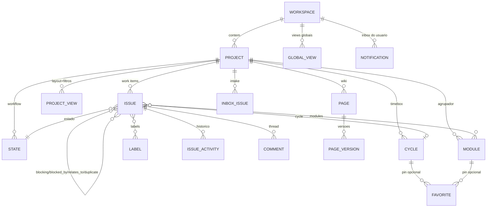

# Plane — UI/UX (apps/web + editor)

> **Escopo**: `_REF/plane` @ `b98e1defb0e089d4505712d89ee9e137fd0935cd` (29/out/2026), monorepo `v1.5.0`.
> Analisados: `apps/web` (React Router v7 em modo SPA, MobX, propulsor de UI `@makeplane/propel@0.7.3`),
> `packages/editor` (TipTap 3 + Yjs/Hocuspocus), `packages/blocks`, `packages/shared-state`,
> `packages/constants` e `packages/types` (só o que a UI consome). Backend (`apps/api`) **não** analisado.
> Todos os caminhos abaixo são relativos a `_REF/plane/`. `[INFERENCE]` marca dedução sem leitura direta.

---

## 1. Arquitetura em 10 linhas

1. **SPA pura**: `react-router.config.ts:1-12` declara `ssr: false`; `app/entry.client.tsx:44-50` hidrata o `HydratedRouter` só depois de `initPromise` do i18n (padrão remix-i18next).
2. `app/root.tsx` é "shell-thin" de propósito: só `<html>`, `ThemeProvider` com 5 temas (`app/root.tsx:76`) e metadados; nada de store/provider ali (`app/root.tsx:111-116`).
3. `app/layout.tsx:28-38` é a rota pathless global: `AppProvider` + `<main>` `h-screen overflow-hidden`.
4. `app/provider.tsx:36-52` empilha: `StoreProvider` (MobX) → `AppProgressBar` → `TranslationProvider` → `PlaneToastProvider` → `StoreWrapper`/`InstanceWrapper` → `SWRConfig`.
5. `app/routes.ts:1-25` junta `coreRoutes` e `extendedRoutes` por *layout* comum (`app/routes/helper.ts:12-40`) — o mesmo mecanismo que injeta a edição paga sobre a OSS.
6. Rotas vivem em `app/(all)/[workspaceSlug]/...`; o layout de workspace (`.../layout.tsx:15-29`) só embrulha auth + conteúdo.
7. O grupo `(projects)` monta o chrome do app: app rail + top nav (`components/workspace/content-wrapper.tsx:15-40`),
   sidebar redimensionável (`app/(all)/[workspaceSlug]/(projects)/_sidebar.tsx:47-71`) e o `(projects)/layout.tsx:14-30` com `ProjectAppSidebar`, `ExtendedProjectSidebar` e `main`.
8. Estado de UI é **MobX** (`store/` raiz + `store/issue` por tipo de store); dados de servidor são
   **SWR** para caches pontuais e serviços Axios para mutações.
9. Cada página de trabalho é um `*LayoutRoot` que injeta um `EIssuesStoreType` via `IssuesStoreContext` (`hooks/use-issue-layout-store.ts:12-43`) e renderiza **um** dos 5 layouts.
10. `packages/editor` é consumido como biblioteca (`@plane/editor`), com editor colaborativo separado do editor "simples" de descrição/comentário.

Stack relevante (de `apps/web/package.json:18-67` e `pnpm-workspace.yaml`): `@base-ui/react` 1.6.0 (não Radix;
Radix aparece só como `@radix-ui/react-scroll-area`), `cmdk` 1.1.1, `@atlaskit/pragmatic-drag-and-drop`
(+ auto-scroll + hitbox), `mobx`/`mobx-react`/`mobx-utils`, `swr`, `recharts`, `next-themes`, `lucide-react`,
`@tiptap/*` 3.31.3, `yjs` 13, `@hocuspocus/provider|server` 3.4.4, `y-indexeddb`.

---

## 2. Entidades e relações

| Entidade | Onde vive na UI | Papel |
|---|---|---|
| `Workspace` | `[workspaceSlug]` em toda rota | escopo de papéis, membros, views globais, inbox global |
| `Project` | `projects/(detail)/[projectId]` | contêiner de work items + feature flags (`cycle_view`, `module_view`, `page_view`, `inbox_view`, `issue_views_view`) |
| Work item (`TIssue`) | 5 layouts + peek + página dedicada | unidade central; `is_epic`, `is_draft`, `is_intake` marcam variantes |
| `State` / `state_group` | colunas de kanban, selects | fluxo: backlog → unstarted → started → completed/cancelled |
| `Label`, `Estimate` | propriedades do card/planilha | classificação e dimensionamento |
| `Cycle` | `cycles/(list|detail)` | timebox com snapshot de progresso |
| `Module` | `modules/(list|detail)` | agrupamento temático com status e lead |
| `View` (project view / global view) | `views/`, `workspace-views/` | "layout + filtros salvos" |
| `Page` (wiki) | `pages/(list|detail)` | documento rico com árvore, versões, acesso |
| `InboxIssue` (intake) | `intake/` | triagem de solicitações (status -2..2) |
| `IssueActivity` / `Comment` | aba de atividade do work item | histórico campo-a-campo + thread |
| `Favorite` | sidebar | pin de project/cycle/module/view/page |
| `Notification` | `notifications/` | inbox de eventos do usuário |

Relações canônicas do work item: `types/src/issues/issue_relation.ts:13` —
`"blocking" | "blocked_by" | "duplicate" | "relates_to"`.
Auto-relação hierárquica via `parent_id` (`types/src/issues/issue.ts:62`), com contagem desnormalizada
`sub_issues_count` (`types/src/issues/issue.ts:57`).

---

## 3. Campos, enums e estados

### 3.1 `TBaseIssue` (`packages/types/src/issues/issue.ts:45-80`)

| Campo | Tipo | Uso na UI |
|---|---|---|
| `id`, `sequence_id` | uuid / int | identificador exibido `PROJ-123` (`components/issues/issue-detail/issue-identifier.tsx`) |
| `name`, `description_html` | string | título inline; corpo no editor |
| `sort_order` | float | ordenação manual (drag real) |
| `state_id`, `priority`, `label_ids`, `assignee_ids`, `estimate_point` | refs | propriedades do card/planilha |
| `sub_issues_count`, `attachment_count`, `link_count` | int | contadores de display |
| `project_id`, `parent_id`, `cycle_id`, `module_ids`, `type_id` | refs | agrupamentos e escopo |
| `start_date`, `target_date`, `completed_at`, `archived_at` | ISO/null | gantt, calendário, arquivamento |
| `created_by`, `updated_by`, `is_draft`, `is_epic?`, `is_intake?` | — | autoria, rascunhos, filtros de contexto |
| `state__group` (extras) | enum | agrupar por grupo de estado sem estado específico |

### 3.2 Enums que a UI expõe

| Enum | Valores | Fonte |
|---|---|---|
| `EIssueLayoutTypes` | `list`, `kanban`, `calendar`, `gantt_chart`, `spreadsheet` | `packages/types/src/issues/issue.ts:15-21` |
| `TStateGroups` | `backlog`, `unstarted`, `started`, `completed`, `cancelled` (rótulos/cores em `STATE_GROUPS`) | `packages/constants/src/state.ts:14-52` |
| Prioridades | `urgent`, `high`, `medium`, `low`, `none` | `packages/constants/src/issue/common.ts:67-91` |
| `TIssueGroupByOptions` | `state`, `state_detail.group`, `priority`, `team_project`, `project`, `cycle`, `module`, `labels`, `assignees`, `created_by`, `null` | `common.ts:113-128` |
| `TIssueOrderByOptions` (menu) | `sort_order`, `-created_at`, `-updated_at`, `start_date`, `target_date`, `-priority` | `common.ts:130-140` |
| Grupos que aceitam drop | `state`, `priority`, `assignees`, `labels`, `module`, `cycle` (`DRAG_ALLOWED_GROUPS`) | `common.ts:93-100` |
| `TModuleStatus` | `backlog`, `planned`, `in-progress`, `paused`, `completed`, `cancelled` (cores em `MODULE_STATUS_COLORS`) | `packages/constants/src/module.ts:10-27` |
| Status de ciclo | `current`, `upcoming`, `completed`, `draft` | `packages/constants/src/cycle.ts:8-47` |
| `EInboxIssueStatus` | `PENDING=-2`, `DECLINED=-1`, `SNOOZED=0`, `ACCEPTED=1`, `DUPLICATE=2` | `packages/types/src/inbox.ts:19-26` |
| `EInboxIssueCurrentTab` | `open`, `closed` | `packages/types/src/inbox.ts:12-15` |
| `ENotificationFilterType` | `created`, `assigned`, `subscribed` | `packages/types/src/enums.ts:55-59` |
| `EPageAccess` | `PUBLIC=0`, `PRIVATE=1` | `packages/constants/src/page.ts:7-10` |
| `EActivityFilterType` | `ACTIVITY`, `COMMENT`, `STATE`, `ASSIGNEE`, `DEFAULT` | `packages/constants/src/issue/filter.ts:311-319` |

### 3.3 Propriedades de exibição (o "show/hide fields")

`IIssueDisplayProperties` tem 16 flags: `assignee`, `start_date`, `due_date`, `labels`, `key`, `priority`,
`state`, `sub_issue_count`, `link`, `attachment_count`, `estimate`, `created_on`, `updated_on`, `modules`,
`cycle`, `issue_type` (`packages/constants/src/issue/common.ts:142-159`). Sub-work-items usam um subconjunto
(`common.ts:161-168`). A planilha tem ordem própria `SPREADSHEET_PROPERTY_LIST` (`common.ts:213-228`) e cada
coluna conhece seus pares de ordenação (`SPREADSHEET_PROPERTY_DETAILS`, `common.ts:230-352`).

---

## 4. Permissões e gestão de acesso

Três papéis numéricos hierárquicos: `ADMIN = 20`, `MEMBER = 15`, `GUEST = 5`
(`packages/constants/src/user.ts:36-41`), avaliados em dois níveis: `WORKSPACE` e `PROJECT`
(`user.ts:29-32`). O cliente guarda `workspaceUserInfo` e `projectUserInfo` e expõe
`allowPermissions(roles[], level, workspaceSlug?, projectId?)`
(`apps/web/store/user/base-permissions.store.ts:46-52`).

A UI **não** esconde tudo: a mesma checagem decide tabs (`components/navigation/use-navigation-items.ts:112-116`),
botões primários de criação (`components/issues/header.tsx:59-62`), drag/drop e edição inline.

| Tab do projeto | Acesso | Feature flag | Fonte |
|---|---|---|---|
| Work items | ADMIN, MEMBER, GUEST | sempre | `use-navigation-items.ts:43-52` |
| Cycles | ADMIN, MEMBER | `project.cycle_view` | `:53-62` |
| Modules | ADMIN, MEMBER | `project.module_view` | `:63-72` |
| Views | ADMIN, MEMBER, GUEST | `project.issue_views_view` | `:73-82` |
| Pages | ADMIN, MEMBER, GUEST | `project.page_view` | `:83-92` |
| Intake | ADMIN, MEMBER, GUEST | `project.inbox_view` | `:93-102` |

Nível de item: `canEditProperties(projectId)` combina permissão de projeto + flag de feature do store
(`components/issues/issue-layouts/kanban/base-kanban-root.tsx:133-143`) e vira `isReadOnly` nos cards
(`kanban/block.tsx:132-140`). Move de drag é bloqueado pela dupla
`DRAG_ALLOWED_GROUPS` + `issueKanBanView.getCanUserDragDrop(...)`
(`store/issue/issue_kanban_view.store.ts:63-71`, `kanban/default.tsx:105`).

Páginas têm acesso binário `PUBLIC`/`PRIVATE` (`packages/constants/src/page.ts:7-10`), alternável por ação
`toggle-access` no menu (`components/pages/dropdowns/actions.tsx:36-48`).

**Open-core explícito**: operações em massa e workflow avançado são *stubs* no OSS —
`hooks/use-bulk-operation-status.ts:1-5` (`() => false`) e
`components/workflow/use-workflow-drag-n-drop.ts:10-23` (todas as funções retornam neutro). Quando ativas,
o bulk aparece como banner de upgrade (`components/issues/bulk-operations/root.tsx:23-59`).

---

## 5. Layout e navegação

### 5.1 Casca

| Camada | Arquivo | Comportamento |
|---|---|---|
| App shell | `apps/web/app/layout.tsx:28-38` | coluna flex, `h-screen`, `overflow-hidden` |
| Workspace | `app/(all)/[workspaceSlug]/layout.tsx:15-29` | `AuthenticationWrapper` → `WorkspaceAuthWrapper` → `AppRailVisibilityProvider` → `WorkspaceContentWrapper` |
| Chrome | `components/workspace/content-wrapper.tsx:15-40` | `TopNavigationRoot` + `AppRailRoot` opcional + `padding` condicional (`pl-0!` quando rail visível) |
| Projeto | `app/(all)/[workspaceSlug]/(projects)/layout.tsx:14-30` | `ProjectAppSidebar` + `ExtendedProjectSidebar` + `main` com `rounded-lg border border-subtle`; `#full-screen-portal` para overlays |
| Conteúdo | `app/(all)/[workspaceSlug]/(projects)/_sidebar.tsx:47-71` | `ResizableSidebar` com largura em `localStorage("sidebarWidth")` (default `SIDEBAR_WIDTH`), `peekDuration: 1500`, colapsável |
| Exceção | `_sidebar.tsx:40-45` | em `/notifications` a sidebar de projeto **não** renderiza |

### 5.2 App rail + top nav

- Rail vertical com largura 3rem/3.75rem conforme `preferences.displayMode` (`icon_only` vs `icon_with_label`), contexto para *dock/undock* e "Icon only"/"Icon with name"
  (`components/navigation/app-rail-root.tsx:36-46,74-82`).
- Top nav: workspace switcher (esquerda), busca Power K (centro), inbox com badge de não lidas, ajuda, stars, user menu (direita) — `components/navigation/top-navigation-root.tsx:56-88`. O badge usa
  `mention_unread_notifications_count` quando > 0, senão o total (`:42-46`).

### 5.3 Sidebar

`SidebarWrapper` com `title="Projects"` + quick actions, depois: itens estáticos (Home), menu colapsável
"Workspace" (pinned: Projects; dinâmicos: Views, Analytics, Archives, ordenáveis por drag), "More"/"Hide"
para a sidebar estendida, favoritos e lista de projetos (`app/(all)/[workspaceSlug]/(projects)/sidebar.tsx:34-42`,
`components/workspace/sidebar/sidebar-menu-items.tsx:95-139`).

- Ordem e pin são **preferências persistidas** (pessoais e de workspace) com reordenação por média de `sort_order` (`app/(all)/[workspaceSlug]/(projects)/extended-sidebar.tsx:66-119`).
- Sidebar estendida de projetos: busca local, criação, drag-reorder com `orderJoinedProjects` (`extended-project-sidebar.tsx:44-79,115-173`).
- Favoritos agrupados por tipo (`groupedFavorites`) e ocultos se vazios (`sidebar.tsx:32-38`); destinos: `issues`, `cycles/:id`, `modules/:id`, `views/:id`, `pages/:id`
  (`packages/constants/src/sidebar-favorites.ts:15-35`).

### 5.4 Header de projeto, breadcrumbs e tabs

`ProjectHeader` é um **switcher de projeto** (Select com logo) que respeita a última tab usada
(`components/navigation/project-header.tsx:36-101`). As tabs (`work_items`, `cycles`, `modules`, `views`,
`pages`, `intake`) medem o container com `ResizeObserver` e jogam o excedente num menu, mantendo a tab ativa
visível (`components/navigation/use-responsive-tab-layout.ts:28-56`). Existe diálogo de customização com
drag (`components/navigation/customize-navigation-dialog.tsx:235-265`).

Headers de página são compostos por `Header`/`Header.LeftItem`/`Header.RightItem` do `@plane/blocks/layout`,
com `Breadcrumbs` + `CountChip` + ações (ex.: `components/issues/header.tsx:64-136`).

### 5.5 Power K (command palette)

- Um único registro de comandos por app: `useProjectsAppPowerKCommands()` concatena navigation, creation,
  contextual, account, miscellaneous, preferences e help (`components/power-k/config/commands.ts:17-35`).
- O `ShortcutHandler` monta mapas de `shortcut` (tecla única), `keySequence` (buffer de 2 letras) e `modifierShortcut`; **Cmd/Ctrl+K alterna de qualquer lugar, inclusive dentro de inputs**
  (`components/power-k/core/shortcut-handler.ts:197-212`).
- Sequências expiram, são canceladas por modificadores/teclas não imprimíveis e **nunca** disparam dentro de widgets de digitação — guarda por tag, `contenteditable`, `role` ARIA e ancestrais
  `[role=dialog|menu|listbox], .ProseMirror` (`shortcut-handler.ts:108-153,253-379`).
- Resolução de tecla é **layout-independente** via `navigator.keyboard.getLayoutMap()` com fallback US (`shortcut-handler.ts:21-105`) — `Cmd+B` funciona em teclado cirílico/grego.
- A paleta em si é `cmdk` dentro de `Dialog` do propel; `Esc` limpa busca antes de fechar, `Backspace` volta da página de seleção ou esconde ações contextuais
  (`components/power-k/ui/modal/wrapper.tsx:69-106`).
- Páginas internas de seleção: `open-workspace`, `open-project`, `open-project-cycle|module|view|setting`,
  `open-workspace-setting` e, para work item, `update-work-item-{state,priority,assignee,estimate,cycle,module,labels}` (`components/power-k/core/types.ts:29-53`).
- Existe busca inline na top nav que reusa os mesmos comandos (`components/navigation/top-nav-power-k.tsx:24-95`) — dois pontos de entrada para o mesmo registry.

### 5.6 Atalhos reais registrados

Todos extraídos de `components/power-k/config/*`. Sequências são duas teclas, sem modificador.

| Atalho | Ação | Fonte |
|---|---|---|
| `Cmd/Ctrl+K` | abrir/fechar palette | `core/shortcut-handler.ts:197-212` |
| `Cmd/Ctrl+/` | abrir modal de atalhos | `config/help-commands.ts:22-31` |
| `Cmd/Ctrl+B` | recolher/expandir sidebar | `config/miscellaneous-commands.ts:53-64` |
| `Cmd/Ctrl+Shift+C` | copiar URL da página | `miscellaneous-commands.ts:65-76` |
| `Cmd/Ctrl+F` | focar busca da top nav (cai no Find do browser sem input) | `miscellaneous-commands.ts:77-88` |
| `n` `i` | criar work item | `config/creation/command.ts:73-84` |
| `n` `d` | criar página | `creation/command.ts:85-97` |
| `n` `v` | criar view | `creation/command.ts:98-112` |
| `n` `c` | criar ciclo | `creation/command.ts:113-125` |
| `n` `m` | criar módulo | `creation/command.ts:126-138` |
| `n` `p` | criar projeto | `creation/command.ts:139-150` |
| `g` `h` | Home | `config/navigation/commands.ts:109-120` |
| `g` `x` | Inbox (notifications) | `:121-132` |
| `g` `y` | Your work (perfil) | `:133-144` |
| `g` `a` | Analytics do workspace | `:230-241` |
| `g` `j` | Drafts | `:242-253` |
| `g` `r` | Archives (workspace) | `:254-267` |
| `g` `p` | lista de projetos | `:172-183` |
| `g` `i` | work items do projeto | `:296-313` |
| `g` `c` | ciclos do projeto | `:338-357` |
| `g` `m` | módulos do projeto | `:382-401` |
| `g` `v` | views do projeto | `:424-441` |
| `g` `d` | páginas do projeto | `:442-459` |
| `g` `k` | intake do projeto | `:460-477` |
| `g` `r` | archives do projeto | `:478-496` |
| `g` `s` | settings do workspace | `:284-295` |
| `g` `s` | settings do projeto | `:519-537` |
| `o` `w` | abrir workspace | `:93-108` |
| `o` `p` | abrir projeto | `:156-171` |
| `o` `c` | abrir ciclo | `:314-337` |
| `o` `m` | abrir módulo | `:358-381` |
| `o` `v` | abrir view | `:402-423` |
| `o` `s` | abrir setting do workspace | `:268-283` |
| `o` `s` | abrir setting do projeto | `:497-518` |

Atalhos locais (fora do registry): `Shift+↑/↓` estende seleção múltipla e `↑/↓` move o item ativo
(`hooks/use-multiple-select.ts:288-370`); `↑/↓/←/→` navegam células da planilha e `Enter`/`Space` acionam
(`hooks/use-table-keyboard-navigation.tsx:24-59`); `Esc`/`Backspace` na palette
(`power-k/ui/modal/wrapper.tsx:80-103`).

---

## 6. Views (layouts) e organização visual

### 6.1 Um store, cinco layouts

| Layout | Componente-raiz | Recursos | Padrão de interação |
|---|---|---|---|
| List | `components/issues/issue-layouts/list/default.tsx` | grupos colapsáveis com contagem, quick-add por grupo, paginação infinita, seleção múltipla | header sticky, click abre peek; drag entre grupos quando `order_by=sort_order` |
| Kanban | `.../kanban/default.tsx` | colunas de 350px, sub-grouping em swimlanes, colapso por coluna, quick-add no rodapé, drag entre colunas | colunas independentes com scroll próprio e auto-scroll horizontal |
| Calendar | `.../calendar/calendar.tsx` | mês/semana, `show_weekends`, "Today", drag de data | dia é drop target; clique do card abre peek |
| Spreadsheet | `.../spreadsheet/spreadsheet-view.tsx` | `<table>` com colunas ordenáveis, edição inline de propriedades, primeira coluna sticky com sombra | navegação por setas + checkbox de seleção por header |
| Gantt | `.../gantt/base-gantt-root.tsx` | 3 escalas (week/month/quarter), resize/move de barras, fullscreen, "Today", hoje destacado | arrastar borda esquerda/direita altera `start_date`/`target_date` em lote |

Todos passam por `IssueLayoutHOC` (`issue-layouts/issue-layout-HOC.tsx:46-63`): loader específico por layout,
empty state automático, e `LayoutErrorBoundary` **com `key={layout}`** para que trocar de layout descarte o
erro anterior.

O roteamento de layout é o próprio `displayFilters.layout` salvo por entidade
(`store/issue/project/filter.store.ts:137-160`); `ProjectLayoutRoot` lê isso e escolhe o componente
(`issue-layouts/roots/project-layout-root.tsx:28-43,53-54`).

### 6.2 Mapa de stores (MobX) que sustentam as views

| Store | Responsabilidade |
|---|---|
| `IssueRootStore` (`store/issue/root.store.ts:111-268`) | espelha params de rota (`projectId`, `cycleId`, `moduleId`, `viewId`, `globalViewId`, `userId`) via `autorun` e injeta mapas (`stateMap`, `labelMap`, `memberMap`, `projectMap`, `moduleMap`, `cycleMap`) |
| `IssueStore` (`store/issue/issue.store.ts:34-169`) | `issuesMap` + `issuesIdentifierMap` (`PROJ-123` → id); update parcial e `computedFn` para leitura |
| `BaseIssuesStore` (`store/issue/helpers/base-issues.store.ts`) | dono de `groupedIssueIds`, `groupedIssueCount`, `issuePaginationData`, `loader`; mutações otimistas e reordenação |
| Filtros por entidade (`project|cycle|module|project-views|workspace|profile|archived/*/filter.store.ts`) | `filters[entityId] = { richFilters, displayFilters, displayProperties, kanbanFilters }` + `getFilterParams` |
| `IssueFilterHelperStore` (`helpers/issue-filter-helper.store.ts:69-350`) | normalização, tradução `group_by` → param de servidor, cursor de paginação por grupo, persistência de filtros locais |
| `IssueKanBanViewStore` | `getCanUserDragDrop`, `kanbanFilters.group_by/sub_group_by` (colunas colapsadas) |
| `CalendarStore` | `calendarFilters { activeMonthDate, activeWeekDate }`, `calendarPayload` por ano/mês |
| `GanttStore` (`store/issue/issue_gantt_view.store.ts:19-40`) e timeline stores | `currentView`, `renderView`, posições dos blocos |
| `MultipleSelectStore` (`store/multiple_select.store.ts:44-237`) | seleção, entidade ativa, vizinhos, limpeza de estado |
| `WorkItemFilterStore` (`packages/shared-state/src/store/work-item-filters/filter.store.ts:49-180`) | instâncias de filtro por `(entityType, entityId)` com `onExpressionChange` |

Agrupamento é derivado, não consultado: `ISSUE_GROUP_BY_KEY` mapeia cada `group_by` para a propriedade real
do issue (`base-issues.store.ts:115-127`) e `ISSUE_ORDERBY_KEY` faz o mesmo para ordenação (`:144-174`).
`sortedIssueIds` é recalculado a cada mutação que afeta a chave de ordenação
(`base-issues.store.ts:1534-1600`).

### 6.3 Filtros: pipeline real

1. `EIssueFilterType` distingue `rich_filters`, `display_filters`, `display_properties`, `kanban_filters` (`packages/constants/src/issue/filter.ts:34-40`).
2. O filtro "rico" é uma **expressão** `{ and: [{ property, operator, value }] }` com apenas 4 operadores:
   `exact`, `in`, `range` (`packages/types/src/rich-filters/operators/core.ts:10-47`) — negações são derivadas
   no cliente (`getOperatorForPayload`, `components/rich-filters/filter-item/root.tsx:58-63`).
3. A UI é uma **linha de chips** (`FiltersRow`) com propriedade | operador | valor, botão "+", e ações contextuais `Clear all` / `Save view` / `Update view`
   (`components/rich-filters/filters-row.tsx:59-125`). A visibilidade da linha é estado do filtro e o toggle
   vira um pill accent quando há alterações não salvas (`components/rich-filters/filters-toggle.tsx:51-76`).
4. Filtros válidos dependem do layout: `ISSUE_DISPLAY_FILTERS_BY_PAGE.issues` define, por layout, `display_properties`, `group_by`, `sub_group_by`, `order_by` e `extra_options`
   (`packages/constants/src/issue/filter.ts:206-278`). Ex.: kanban aceita sub-group e "created_by"; calendário só exibe `key`/`issue_type` (`:246-253`).
5. Alterações de `layout` limpam a lista e mudanças de `order_by`/`sub_issue`/`type` disparam refetch
   (`getShouldClearIssues`/`getShouldReFetchIssues`, `helpers/issue-filter-helper.store.ts:267-289`;
   uso em `store/issue/project/filter.store.ts:239-246`).

### 6.4 Kanban em detalhe

- Colunas vêm de `getGroupByColumns` com `includeNone: true` (`issue-layouts/utils.tsx:119-159`); "All Issues" é a coluna única quando `group_by = null` (`utils.tsx:126-136`).
- Largura fixa `w-[350px]`; header sticky; coluna colapsada deixa de renderizar cards (`kanban/default.tsx:118-139,162-175`).
- **Não há virtualização por janela**: cada coluna é embrulhada em `RenderIfVisible`, um IntersectionObserver que monta/desmonta e preserva altura medida, com `rootMargin` de 100% e placeholder de
  skeleton (`kanban/default.tsx:192-232`, `components/core/render-if-visible-HOC.tsx:28-100`). Colunas com índice < 5 e subgrupo < 2 já nascem montadas (`kanban/default.tsx:206`).
- Drop target de coluna via pragmatic-dnd com `autoScrollForElements`; o payload carrega `{ groupId, subGroupId, type: "COLUMN" }` (`kanban/kanban-group.tsx:129-197`).
- Semântica do drop: quando `order_by !== "sort_order"` o overlay diz "solte para mudar o grupo" e **não**
  reposiciona manualmente; com `sort_order` o drop reordena (`hooks/use-group-dragndrop.ts:101-126` + `kanban/kanban-group.tsx:274-280`).
- Campos não arrastáveis (ex.: agrupar por `created_by`) geram toast de aviso em vez de drop silencioso (`kanban/kanban-group.tsx:165-172`).
- **WIP limit não existe**: nenhuma ocorrência de WIP no app (`grep -rni "wip" apps/web packages/constants` sem resultados). O "peso" da coluna é só contagem (`getGroupIssueCount`).
- Quick add por coluna pré-preenche o grupo e o estado default do projeto (`kanban/kanban-group.tsx:199-249,329-343`).
- Card: identificador, título com tooltip, linha de propriedades conforme `displayProperties`, quick-action menu que só aparece no hover (`kanban/block.tsx:100-140`).

### 6.5 Gantt e Calendar

**Gantt** (`components/gantt-chart/*`): sidebar de 360px + canvas; constantes `BLOCK_HEIGHT=44`,
`HEADER_HEIGHT=48`, `DEFAULT_BLOCK_WIDTH=60` (`gantt-chart/constants.ts:7-15`). Escalas trocáveis
`week|month|quarter` com botões e `aria-pressed` (`chart/header.tsx:50-67`), "Today", fullscreen. O canvas
gera blocos à esquerda/direita conforme o scroll (lazy horizontal, `chart/main-content.tsx:110-137`) e as bordas
esquerda/direita são handles de resize com **preview da data em tooltip** ao passar o mouse
(`helpers/blockResizables/left-resizable.tsx:25-70`). Alterações de data são enviadas em lote
(`updateBlockDates`, `gantt/base-gantt-root.tsx:93-109`).

**Dependências**: a prop `enableDependency` é passada (`gantt/base-gantt-root.tsx:149`) e a interface existe
(`gantt-chart/root.tsx:33`), mas neste repositório o comportamento é neutro:
`getIsCurrentDependencyDragging` retorna `false` fixo (`store/timeline/base-timeline.store.ts:344-346`) e
`ChartDraggable` ignora `enableDependency` (`gantt-chart/helpers/draggable.tsx:30-58`).
**Conclusão**: setas de dependência não são renderizadas na build OSS; o gancho é reservado à edição paga
[INFERENCE], coerente com os demais stubs (`useBulkOperationStatus`, `useWorkFlowFDragNDrop`).

**Calendar**: layout mês/semana e `show_weekends` são `displayFilters.calendar` persistidos
(`calendar/dropdowns/options-dropdown.tsx:58-87`); navegação anterior/próximo/"Today" recalcula
`activeMonthDate`/`activeWeekDate` (`calendar/header.tsx:44-101`). Cada dia é um drop target; o drop chama
`handleDragAndDrop(issueId, projectId, sourceDate, destinationDate)` (`calendar/calendar.tsx:58-63`). Não há
"week starts on" por calendário — usa `start_of_the_week` do perfil (`gantt-chart/chart/root.tsx:96,108`).

---

## 7. Detalhe, peek e atividade

### 7.1 Peek overview (painel lateral)

- Estado vem do MobX (`useIssueDetail().peekIssue`), **não** da URL (`store/issue/issue-details/root.store.ts:127,239-244`) — não é deep-linkable [INFERENCE: nenhum `searchParams` de peek no fluxo].
- Desktop abre peek; mobile navega para a rota cheia (`hooks/use-issue-peek-overview-redirection.tsx:45-51`).
- Três modos: `side-peek` (50% à direita), `modal` (8.33% inset, 5/6), `full-screen` (`m-4`) (`components/issues/peek-overview/view.tsx:57,126-128,158`).
- A página dedicada reaproveita o mesmo conteúdo: `main-content.tsx` detecta `isPeekModeActive` e muda o layout (`issue-detail/main-content.tsx:76`), o que evita duas implementações do detalhe.
- Header do peek expõe: modo, copiar link, subscription, quick actions e edição/duplicar/arquivar/excluir (`peek-overview/header.tsx:39-77`).

### 7.2 Composição do detalhe

Corpo em duas colunas: `IssueDetailsSidebar` (propriedades) + conteúdo (título, descrição, atividade).
Propriedades usam `SidebarPropertyListItem` com `icon + label + select` (state, assignees, priority, dates,
estimate, parent, labels, cycle, module, created by) — `issue-detail/sidebar.tsx:82-120`.
Toda escrita passa por `issueOperations.update(...)`, que faz update otimista no store, refetch de atividades
e toast de erro (`peek-overview/root.tsx:78-94`).

### 7.3 Atividade e histórico

- `IssueActivityStore` mantém `activities` (ids por issue) e `activityMap`; `getActivityAndCommentsByIssueId`
  mescla histórico e comentários ordenados (`store/issue/issue-details/activity.store.ts:38-59`).
- O item é escolhido por `activity.field` e tem um componente por campo: `null` (criação), `name`, `description`, `state`, `assignees`, `priority`, `estimate_*`, `parent`, relação, `start_date`,
  `target_date`, `cycle`, `module`, `labels`, `link`, `attachment`, `archived_at`, `inbox` (`issue-detail/issue-activity/activity/activity-list.tsx:54-100`).
- Filtros rápidos: Updates, Comments, State, Assignee com "all" implícito (`packages/constants/src/issue/filter.ts:323-350`), mais ordenação asc/desc (`issue-activity/sort-root.tsx`).
- Comentários usam o editor rico, reações e "copiar link do comentário" (`#comment-<id>`) (`issue-activity/helper.tsx:57-70`).

---

## 8. Ciclos, módulos e intake/inbox

### 8.1 Ciclos

- Lista agrupada em ativo / próximos / concluídos (`components/cycles/cycles-view.tsx:36-63`), com filtros de status/data e busca (`components/cycles/dropdowns/filters/*`).
- Detalhe tem sidebar de analytics: `ProgressChart` (recharts) com séries **current** e **ideal** — o burn-down "de verdade" é uma linha ideal calculada como `totalIssues * (1 - i/(n-1))`
  (`components/core/sidebar/progress-chart.tsx:20-73`), alternável entre work items e story points (`cycles/analytics-sidebar/sidebar-chart.tsx:38-69`).
- Distribuição por assignee/label/state group com tabs persistidas em `localStorage` (`cycles/analytics-sidebar/progress-stats.tsx:52-78`) — clicar numa barra **aplica filtro** no layout
  (`handleFiltersUpdate`, `progress-stats.tsx:31`).
- Ações: editar, arquivar, restaurar, excluir, copiar link, abrir em nova aba (`cycles/quick-actions.tsx:89-101`).
- Transferência de work items entre ciclos via modal com busca e toast (`cycles/transfer-issues-modal.tsx:36-70`).

### 8.2 Módulos

- Dois layouts: lista/cards e gantt de módulos (`components/modules/gantt-chart/modules-list-layout.tsx:13-14`).
- Card mostra progresso como `(completed + cancelled) / total` (`components/modules/module-list-item.tsx:47`) e usa `LinearProgress` do propel
  (`module-card-item.tsx:18`), além de lead, datas e favoritar com toast promissório (`module-card-item.tsx:77-100+`).
- Status em dropdown próprio (`components/modules/module-status-dropdown.tsx`) com a paleta de `MODULE_STATUS_COLORS`.

### 8.3 Intake (triagem por projeto)

Layout mestre-detalhe: sidebar de 2/6 em desktop que vira drawer no mobile
(`components/inbox/root.tsx:86-116`). Tabs `open`/`closed` (`EInboxIssueCurrentTab`) e filtros de status,
prioridade, assignees, created_by, labels, created/updated date + order-by
(`inbox/inbox-filter/filters/filter-selection.tsx:52-91`). Ações por item: aceitar, recusar, duplicar,
snooze, excluir (`inbox/modals/*`). Estado é por item (`PENDING` → `ACCEPTED`/`DECLINED`/`SNOOZED`/`DUPLICATE`).

### 8.4 Inbox global (notifications)

Sidebar estreita (3/12) com tabs **All** e **Mentions**, cada uma com contador de não lidas
(`packages/constants/src/notification.ts:36-48`; `components/workspace-notifications/sidebar/root.tsx:61-70`),
e lista plana de cards. Ações por hover: marcar lida, arquivar, snooze
(`.../notification-card/options/root.tsx:26-44`); snooze oferece 1/3/5 dias, 1/2 semanas e "custom"
(`notification.ts:65-115`). Filtros são multi-toggle `assigned / created / subscribed`
(`.../sidebar/filters/menu/root.tsx:41-63`), com flags `archived`/`snoozed` no store
(`store/notifications/workspace-notifications.store.ts:134-144`); o header tem "marcar todas como lidas" e
"refresh" (`.../header/options/root.tsx:54-89`).

---

## 9. Páginas/Wiki e editor

### 9.1 Wiki

- Lista plana (não árvore) com tabs `public | private | archived`, busca e order-by (`components/pages/list/tab-navigation.tsx:19-50`, `components/pages/list/root.tsx:23-37`). A hierarquia
  existe nos dados (`parent_id`), mas a lista renderiza `ListLayout` achatado (`pages/list/block.tsx:27-58`) — **não** há árvore expansível na lista [INFERENCE a partir do componente].
- Documento: header com logo/emoji picker (`pages/editor/header/root.tsx:23-71`), título e corpo no editor colaborativo; painel de navegação lateral com tabs **Outline / Info / Assets**
  (`pages/navigation-pane/tabs-list.tsx:13-25`); Info mostra "editado por", "criado por", contagem de palavras e histórico (`navigation-pane/tab-panels/info/*`).
- Versionamento: overlay com lista de versões, preview read-only e restore com toast (`components/pages/version/main-content.tsx:50-84`).
- Publicação: `EPageAccess.PUBLIC` torna a página acessível fora do app; ação `toggle-access` no menu
  (`pages/dropdowns/actions.tsx:36-48`). Ações disponíveis: fullscreen, sticky toolbar, copiar markdown,
  lock, access, abrir em nova aba, copiar link, duplicar, arquivar/restaurar, excluir, histórico, exportar, mover.
- Colaboração: o corpo usa `CollaborativeDocumentEditorWithRef` e constrói a URL `ws(s)://.../live/collaboration` com os params do webhook (`pages/editor/editor-body.tsx:82-104`, uso em `:277`).

### 9.2 Editor (`packages/editor`)

- TipTap 3 com três editores: `document` (colaborativo), `rich-text` (descrição/comentário) e `lite-text` (`src/components/editors/index.ts:7-12`).
- Extensões core enumeradas em `CORE_EXTENSIONS`: blockquote, bold, listas, callout, code block/inline,
  cor custom, imagem, link, heading 1-6, task list, table, text align, underline, typography, emoji, `uniqueID`, `work-item-embed` (`src/constants/extension.ts:7-52`).
- Slash commands em seções com busca por `title`, `description` e `searchTerms`: Texto, H1–H6, lista numerada, com marcadores, to-do, tabela, citação, código, callout, divisor, emoji,
  **Colors** e **Background colors** (paleta fixa) e Image (se não desabilitada) (`src/extensions/slash-commands/command-items-list.tsx:60-336`).
- Menus: bubble (node selector, cor, alinhamento, link), floating (block handle + inserção), side menu por bloco e `ai-menu` (`src/components/menus/*`).
- Embeds: bloco de work item renderizado por NodeView com `workspaceSlug/projectId/issueId` (`src/extensions/work-item-embed/extension.tsx:14-40`); menções e imagens têm extensões próprias
  (`src/extensions/mentions`, `.../custom-image`).
- Upload: o app injeta `fileHandler` no editor e usa `useEditorAsset()` (`uploadEditorAsset`, `duplicateEditorAsset`) para anexos e imagens (`apps/web/hooks/store/use-editor-asset.ts:9-16`).
- Colaboração: `HocuspocusProvider` + `Y.Doc` + `IndexeddbPersistence` com máquina de estados explícita
  `initial → connecting → awaiting-sync → synced`, `reconnecting(attempt)` e `disconnected(error)` com `auth-failed | network-error | forced-close | max-retries` (`src/hooks/use-yjs-setup.ts:36-107`,
  `src/types/collaboration.ts:7-39`). Badges de UI: "Syncing…"/"Connection lost" com aviso de que salva a cada 10s (`apps/web/components/pages/header/syncing-badge.tsx:16-60`) e badge "Offline"
  (`.../offline-badge.tsx:19-34`).

---

## 10. Design system e temas

- **Base**: `@makeplane/propel` (npm, `0.7.3`) fornece tokens, componentes (`button`, `icon-button`, `menu`,
  `dialog`, `tooltip`, `badge`, `banner`, `tabs`, `checkbox`, `input`, `collapsible`, `linear-progress`, `avatar`) e ícones estilo Material Symbols. `@plane/blocks` é a camada interna por cima
  (`breadcrumb`, `layout`, `select`, `property-select`, `context-menu`, `toast`, `empty-state`, `skeleton`, `charts`, `card`, `virtual-list` — `packages/blocks/package.json:12-40`).
- **Primitivas de comportamento**: `@base-ui/react` (padrão `render={<Component/>}` e `MenuRadioGroup`,
  visível em `power-k/ui/modal/wrapper.tsx` e `calendar/dropdowns/options-dropdown.tsx:90-133`), `cmdk` para
  a palette, `@radix-ui/react-scroll-area` pontual, `recharts` nos gráficos, `lucide-react` para ícones avulsos (ex.: `apps/web/components/issues/header.tsx:10`).
- **Tokens**: `packages/tailwind-config/index.css:1-27` importa `tailwindcss` + `@makeplane/propel/styles` e
  declara que **os valores dos tokens agora são os do propel** (aviso explícito de drift visual na migração).
  Classes semânticas usadas em massa: `bg-canvas`, `bg-surface-1/2`, `bg-layer-1/2/3/transparent*`, `text-primary/secondary/tertiary/placeholder`, `border-subtle/strong`, `text-accent-primary`,
  `text-priority-*`, `*-danger-*`, `*-success-*`.
- **Tipografia**: Inter variable pré-carregada (`app/root.tsx:30-54`), IBM Plex Mono para código; escala por
  tokens numéricos (`text-11`, `text-13`, `text-14`, `text-16`, `text-18`) e papéis (`text-body-sm-medium`, `text-body-xs-regular`).
- **Temas**: `light`, `dark`, `light-contrast`, `dark-contrast`, `custom` + `system` como default (`app/root.tsx:76`, `packages/constants/src/themes.ts:21-88`). Custom = cor primária + cor de fundo +
  paleta clara/escura, aplicada por `applyCustomTheme` e seguida de **`window.location.reload()`**
  (`components/appearance/theme-switcher.tsx:43-80`) — recarregar a página para trocar de tema é um atrito visível.
- **Sem controle de densidade**: não há preferência de densidade no app; o equivalente funcional é `displayProperties` por view + colunas da planilha.
- **Empty states**: três variantes (`SimpleEmptyState`, `DetailedEmptyState`, `SectionEmptyState`) com
  ilustrações SVG/webp por contexto em `app/assets/empty-state/*` (`components/empty-state/simple-empty-state-root.tsx:37-52`).
- **Skeletons**: `Loader`/`Loader.Item` com `animate-pulse` e `role="status"` (`packages/blocks/src/skeleton/loader.tsx:15-35`); há loaders por layout (kanban/list/spreadsheet/gantt/calendar).
- **Scrollbars**: utilitários próprios `scrollbar-xs/sm/md/lg` que resetam `scrollbar-width` para reabilitar `::-webkit-scrollbar` (`packages/tailwind-config/index.css:150-215`), com larguras 10→16px.

---

## 11. Padrões transversais

### 11.1 Optimistic update com rollback

`issueUpdate` clona o item antes, aplica no `issuesMap` + lista agrupada, atualiza stats do pai
otimisticamente, chama o PATCH e, no erro, **restaura o clone e a posição na lista**
(`store/issue/helpers/base-issues.store.ts:555-588`). Delete/archive seguem o padrão mas só removem da lista
após o sucesso (`:594-632`). Stores de associação (cycle/module) têm variantes `add*ToIssue` otimistas
(`:873-945`).

### 11.2 Feedback

- Toda criação rápida usa `setPromiseToast` com `loading/success/error` e **action items** no sucesso:
  copiar link, copiar identificador e "View" (primary) (`components/issues/create-issue-toast-action-items.tsx:30-70`).
- Erros de mutation em massa viram toast genérico, não estado de erro inline (`hooks/use-group-dragndrop.ts:65-69`).
- Loader de mutação aparece como spinner flutuante no canto (`project-layout-root.tsx:84-88`).

### 11.3 Offline / erro

- `useOnlineStatus` escuta `online`/`offline` (`hooks/use-online-status.ts:9-26`); usado no badge de página.
- Páginas colaborativas persistem em IndexedDB e caem para fetch binário (`usePageFallback`, `pages/editor/page-root.tsx:77-83`).
- Erro de chunk obsoleto força recuperação (`app/root.tsx:131-138`, `app/entry.client.tsx:20-36`).
- Cada layout tem seu `LayoutErrorBoundary` com `key` (troca de layout descarta o erro).

### 11.4 Acessibilidade

- Botões de ícone recebem `aria-label` semanticamente traduzido (ex.: `t("common.create_project")`, `t("common.full_screen")`, `aria-pressed` em toggles de escala do gantt).
- Padrão Base UI garante foco/teclado em Menu/Dialog/Tooltip; `MenuRadioGroup`/`MenuCheckboxItem` em vez de
  popovers customizados (comentário explícito em `calendar/dropdowns/options-dropdown.tsx:90,116-119`).
- Atalhos globais ignoram widgets de digitação e overlays (`shortcut-handler.ts:108-153`) — evita "atalho rouba tecla" no editor/planilha.
- Navegação por teclado existe na planilha (`use-table-keyboard-navigation.tsx:24-59`) e na seleção múltipla (`use-multiple-select.ts:288-370`).
- `role="status"` em skeletons; `tabIndex` explícito em headers de tabela.
- Ilustrações de empty state usam `` (`components/empty-state/simple-empty-state-root.tsx:42-45`), repetindo o título como texto alternativo.

### 11.5 i18n

`i18next` + `i18next-icu`, com 22 locales em `packages/i18n/locales` e fallback em
`packages/i18n/src/constants/language.ts`. Inicialização acontece **antes** do `hydrateRoot`
(`app/entry.client.tsx:44-50`), e a troca de idioma está na palette (`preferences-commands.ts:153`).
Strings de UI ainda convivem com inglês hardcoded (ex.: `"Work Items"` em
`components/issues/header.tsx:77`, `"Filters"` em `inbox/inbox-filter/root.tsx:23`).

### 11.6 Onboarding

Wizard em passos (`components/onboarding/step-indicator.tsx`), com telas de profile/role/usecase/team e um
tour em modal com passos `welcome → work-items → cycles → modules → views → pages`
(`components/onboarding/tour/root.tsx:28-60`), cada passo com imagem e sidebar de navegação
(`tour/sidebar.tsx`).

---

## 12. Forças e limitações de UX (com evidência)

**Forças**

1. **Uma fonte de verdade por view**: layout, agrupamento, ordenação, campos visíveis e filtros vivem no mesmo
   objeto de filtros por entidade (`filter.store.ts:137-160`), então trocar de layout não perde contexto e "salvar view" é a mesma operação em qualquer lugar.
2. **Filtros como chip com operador explícito**, em vez de sidebar de checkboxes: legível, copiável e combinável (`components/rich-filters/filter-item/root.tsx:84-120`).
3. **Peek lateral reutilizando o detalhe completo** com 3 modos e navegação mobile → rota cheia (`peek-overview/view.tsx:126-128`; `use-issue-peek-overview-redirection.tsx:45-51`).
4. **Paleta de comandos de classe mundial**: layout-independente, respeita widgets de texto, sequências estilo Vim, contexto por URL (`shortcut-handler.ts:21-379`).
5. **Optimistic com rollback disciplinado** e histórico de atividade por campo — a UI sente instantânea sem mentir (`base-issues.store.ts:555-588`; `activity-list.tsx:54-100`).
6. **Feedback de criação acionável** (copiar link/id, abrir em nova aba) em vez de toast genérico.
7. **Colaboração com estados explícitos** e persistência local, incluindo copy de "continuar offline" (`use-yjs-setup.ts`, `syncing-badge.tsx`, `offline-badge.tsx`).

**Limitações / anti-padrões**

1. **Peek não é deep-linkable**: estado em MobX, não em query string (`store/issue/issue-details/root.store.ts:239-244`); compartilhar "a issue aberta no painel" não funciona.
2. **Sem WIP limit e sem swimlane configurável por coluna** — sub-grouping é global à view (`kanban/default.tsx:105-151`), não por coluna.
3. **Gantt sem dependências renderizadas na OSS** (`base-timeline.store.ts:344-346`) apesar da prop existir.
4. **Bulk edit bloqueado no OSS**: `useBulkOperationStatus()` retorna `false` fixo (`hooks/use-bulk-operation-status.ts`), então `MultipleSelectGroup` nasce `disabled` (`issue-layouts/list/default.tsx:134-137`) e qualquer seleção só renderiza o banner de upgrade (`bulk-operations/root.tsx:32-58`).
5. **Duas gerações de filtros convivem**: `richFilters` (novo) e as opções legadas por layout (`ISSUE_DISPLAY_FILTERS_BY_LAYOUT`, `issue-layouts/filters/*`) — custo de manutenção e inconsistência de
   padrão visual.
6. **Troca de tema custom recarrega a página** (`theme-switcher.tsx:74-77`).
7. **Sem controle de densidade** e sem tamanho de linha configurável; planilha usa altura fixa de linha e renderiza todas as linhas carregadas (só a paginação é incremental,
   `spreadsheet-table.tsx:56-75`) — listas longas degradam [INFERENCE].
8. **Strings hardcoded em inglês** ao lado do i18n (`components/issues/header.tsx:77`, `inbox/inbox-filter/root.tsx:23`), o que quebra a experiência em pt-BR.
9. **Estados de erro pobres**: mutations em massa caem em toast genérico; "Error while updating work item" sem campo/issue (`hooks/use-group-dragndrop.ts:65-69`).
10. **Navegação duplicada e densa**: rail + top nav + sidebar + sidebar estendida + tabs de projeto + tabs
    internas. Funciona, mas exige 4 níveis de hierarquia para chegar a um work item [INFERENCE a partir da casca em `content-wrapper.tsx` + `(projects)/layout.tsx` + `project-header.tsx`].

---

## Apêndice A — mapa de arquivos (atalho de leitura)

| Tema | Arquivos-chave |
|---|---|
| Casca / rotas | `apps/web/app/routes.ts`, `app/layout.tsx`, `app/provider.tsx`, `app/root.tsx`, `react-router.config.ts` |
| Navegação | `components/navigation/*`, `components/workspace/content-wrapper.tsx`, `components/workspace/sidebar/*` |
| Layouts de issue | `components/issues/issue-layouts/{list,kanban,calendar,spreadsheet,gantt}/`, `.../quick-add/`, `.../filters/` |
| Filtros ricos | `components/rich-filters/*`, `components/work-item-filters/*`, `packages/shared-state/src/store/{rich-filters,work-item-filters}/*` |
| Stores de issue | `apps/web/store/issue/{issue.store.ts,root.store.ts,helpers/*,*/filter.store.ts,*/issue.store.ts}` |
| Peek / detalhe | `components/issues/peek-overview/*`, `components/issues/issue-detail/*` |
| Power K | `components/power-k/{core,config,ui}/*` |
| Ciclos/módulos | `components/cycles/*`, `components/modules/*`, `components/core/sidebar/progress-chart.tsx` |
| Intake / inbox | `components/inbox/*`, `components/workspace-notifications/*` |
| Páginas | `components/pages/{list,editor,version,navigation-pane}/*`, `store/pages/*` |
| Editor | `packages/editor/src/{extensions,components,hooks,constants}/*` |
| Design system | `packages/blocks/src/*`, `packages/tailwind-config/index.css`, `packages/constants/src/themes.ts` |

## Apêndice B — mapa de stores (MobX) por área

| Área | Store raiz | Sub-stores |
|---|---|---|
| Global | `store/root.store.ts` | `router`, `theme`, `user`, `workspace`, `projectRoot`, `memberRoot`, `issues` (`IssueRootStore`), `cycle`, `module`, `pages`, `favorites`, `powerK`, `commandPalette`, `multipleSelect`, `notifications` |
| Work items | `store/issue/root.store.ts` | `issues` (`IssueStore`), `issueDetail`/`epicDetail`, `{project,cycle,module,projectView,workspace,profile,archived}Issues{,Filter}`, `issueKanBanView`, `issueCalendarView` |
| Detalhe | `store/issue/issue-details/root.store.ts` | `issue`, `activity`, `comment`, `commentReaction`, `reaction`, `relation`, `subIssues`, `subIssuesFilter`, `attachment`, `link`, `subscription`, `peekIssue` |
| Timeline | `store/timeline/{base,issues,modules,timeline}.store.ts` | `currentView`, `blocksMap`, `renderView`, posições |
| Páginas | `store/pages/{base-page,project-page}.ts` | `editor`, `version`, `isContentEditable`, `logo_props` |
| Filtros (novo) | `packages/shared-state` | `WorkItemFilterStore` + `FilterInstance` (config manager, expressão, save/update view) |
