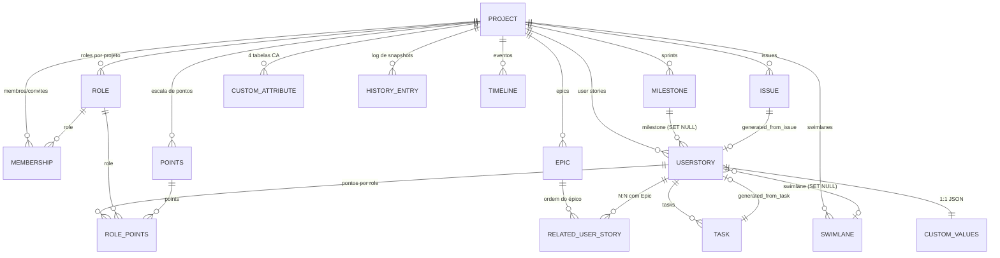

# Taiga — modelo de dados, permissões e atividade
> Escopo: `_REF/taiga-back` (Django + DRF), commit `cb745e9137bda3ee7ee5e70d1e0141cccd2ef26c` (2026-10-29). Analisados: `taiga/projects/*` (models, choices, permissions, filters, serializers, api), `taiga/users/models.py` (Role), `taiga/permissions/*`, `taiga/projects/history`, `taiga/timeline`, `taiga/events`, `taiga/webhooks`, `taiga/routers.py`, `settings/common.py`. Fora de escopo: `taiga/front` (SPA), importers, `export_import`, hooks de repositório, stats. Nada foi executado; toda afirmação vem de leitura de código/fixtures.

## 1. Arquitetura em 10 linhas

1. Monolito Django com apps por domínio; o núcleo é `taiga.projects` (projeto, taxonomias, membership) mais 5 apps de entidade: `epics`, `userstories`, `tasks`, `issues`, `milestones` (`taiga/projects/*`).
2. API REST única em `/api/v1/`, montada por um `DefaultRouter` (`taiga/urls.py:20-22`, `taiga/routers.py:11`).
3. `Role.permissions` é um **array Postgres de codenames**; não há tabela de permissões por objeto (`taiga/users/models.py:305-306`).
4. A permissão efetiva é **calculada em runtime** combinando superuser + `Membership.is_admin` + `Role.permissions` + `Project.public_permissions` + `Project.anon_permissions` (`taiga/permissions/services.py:81-110`).
5. Cada entidade tem estado próprio (`EpicStatus`, `UserStoryStatus`, `TaskStatus`, `IssueStatus`) e taxonomias próprias (`Points`, `Priority`, `Severity`, `IssueType`, `Swimlane`), todas escopadas ao projeto.
6. Cada entidade carrega **ordenações independentes por view** (`backlog_order`, `sprint_order`, `kanban_order`, `epics_order`, `us_order`, `taskboard_order`), persistidas como `BigIntegerField` (epoch em microssegundos).
7. Histórico é um log de snapshots JSON (`HistoryEntry`) com `diff` + `values` + `snapshot`; comentários são linhas do mesmo log (`taiga/projects/history/models.py:33-81`).
8. Timeline é uma tabela desnormalizada de eventos (`Timeline.data` JSON) alimentada a partir do histórico, com namespaces por projeto/usuário (`taiga/timeline/models.py:18-32`).
9. Notificações por watcher/política (`NotifyPolicy`), web notifications e webhooks assinados; push em tempo real via eventos (Postgres `NOTIFY` ou RabbitMQ) (`taiga/events/backends/postgresql.py:12-21`).
10. Autenticação JWT (24h access / 8d refresh), paginação de 30 itens com headers `x-pagination-*` e `x-disable-pagination` (`settings/common.py:450-454,503-506`; `taiga/base/api/pagination.py:136-234`).

## 2. Entidades e relações



| Entidade | Arquivo:linha | Papel | Relações centrais |
|---|---|---|---|
| `Project` | `taiga/projects/models.py:162` | agregado raiz; flags de módulo, privacidade, permissões públicas/anon | owner, members(M2M), roles, statuses, milestones, US, tasks, issues, epics, swimlanes, custom attrs |
| `Membership` | `taiga/projects/models.py:53` | vínculo usuário↔projeto **ou convite pendente** (`user` nullable) | `role` FK, `is_admin`, `user_order`, `token`/`email` para convite |
| `Role` | `taiga/users/models.py:300` | papel nomeado por projeto, com `permissions[]` | `project` FK, `computable` (entra em RolePoints) |
| `Milestone` | `taiga/projects/milestones/models.py:24` | sprint com datas estimadas | project, US/tasks/issues (`SET_NULL`) |
| `Epic` | `taiga/projects/epics/models.py:23` | agrupador de US com ordem própria | project, status, `RelatedUserStory` |
| `RelatedUserStory` | `taiga/projects/epics/models.py:105` | N:N Epic↔US com `order` | unique (`user_story`,`epic`) |
| `UserStory` | `taiga/projects/userstories/models.py:65` | unidade central do backlog | project, milestone, status, swimlane, owner, assigned_to, assigned_users, pontos, tasks, epics |
| `RolePoints` | `taiga/projects/userstories/models.py:25` | ponto por role (through de `UserStory.points`) | unique (`user_story`,`role`) |
| `Task` | `taiga/projects/tasks/models.py:23` | subtarefa de US, também pode existir solta (`user_story` nullable) | project, user_story, status, milestone |
| `Issue` | `taiga/projects/issues/models.py:23` | bug/incidente independente do backlog | project, status, severity, priority, type, milestone |
| `Swimlane` | `taiga/projects/models.py:918` | faixa horizontal do kanban | project; `SwimlaneUserStoryStatus` define WIP por célula |
| `HistoryEntry` | `taiga/projects/history/models.py:33` | snapshot/diff/comentário | project, `key` = `"<app>.<model>:<pk>"` |
| `Timeline` | `taiga/timeline/models.py:18` | evento de atividade já renderizável | generic FK + `namespace`, `event_type` |

Notas estruturais:

- `Project.members` é M2M direto para usuário e convive com `Membership`; a autorização e a UI passam por `Membership` (role, `is_admin`, convites), enquanto o M2M é usado em consultas agregadas (`taiga/projects/models.py:188-190`, `taiga/projects/notifications/services.py:182-185`).
- `Membership` guarda convites pendentes: `user=None`, `email` preenchido, `token` de convite (`taiga/projects/models.py:53-102`). O comentário no modelo é explícito: "stores invitations to memberships that does not have assigned user".
- `UserStory.milestone` e `Task.milestone` são `SET_NULL`; apagar um sprint não apaga itens (`taiga/projects/userstories/models.py:79-84`, `taiga/projects/tasks/models.py:56-64`).
- `Issue` é ligado ao projeto, não ao backlog; `UserStory.generated_from_issue`/`generated_from_task` registram promoção issue/task → US (`taiga/projects/userstories/models.py:128-135`).
- `ProjectTemplate` (`taiga/projects/models.py:989`) é um **blueprint serializado em JSON**: statuses, points, roles, custom attributes, flags de módulo, `default_options` e `default_owner_role`. A criação de projeto aplica o template e cria a membership do owner como admin (`taiga/projects/models.py:1248-1445`, `taiga/projects/signals.py:41-76`).
- Numeração `ref` é **por projeto** e compartilhada entre epics, US, tasks e issues, via sequence Postgres `references_project<pk>` + tabela `Reference` (`taiga/projects/references/models.py:22-66`, `:100-120`). Isso é o que permite `#42` sem ambiguidade de tipo.

## 3. Campos, enums e estados

### 3.1 `Project` (campos relevantes para UI)
| Campo | Tipo | Default | Evidência |
|---|---|---|---|
| `name`, `slug`, `description`, `logo` | char/slug/text/file | slug único gerado | `models.py:163-173` |
| `owner` | FK user | — | `models.py:179` |
| `members` | M2M user | — | `models.py:188` |
| `is_contact_activated` | bool | `True` | `models.py:194` |
| `is_epics_activated` | bool | `False` | `models.py:196` |
| `is_backlog_activated` | bool | `True` | `models.py:198` |
| `is_kanban_activated` | bool | `False` | `models.py:200` |
| `is_wiki_activated` | bool | `True` | `models.py:202` |
| `is_issues_activated` | bool | `True` | `models.py:204` |
| `creation_template` | FK template | — | `models.py:212` |
| `is_private` | bool | `True` | `models.py:221` |
| `anon_permissions` | `ArrayField(Text)` | `[]` | `models.py:223` |
| `public_permissions` | `ArrayField(Text)` | `[]` | `models.py:225` |
| `is_featured` | bool | `False` | `models.py:228` |
| `is_looking_for_people` + `looking_for_people_note` | bool + text | `False`/`""` | `models.py:231-234` |
| `blocked_code` | char(255) | `None` | `models.py:250` |
| `archived_code` | char(255) | `None` | `models.py:254` |
| `total_fans*`, `total_activity*` | int | `0` (contadores por período) | `models.py:262-286` |
| `videoconferences` + `_extra_data` | char | choices | `models.py:206-210`, `choices.py:10-15` |

`blocked_code` usa `BLOCKING_CODES` (`choices.py:17-24`): `blocked-by-nonpayment`, `blocked-by-staff`, `blocked-by-owner-leaving`, `blocked-by-deleting`. `archived_code` usa `ArchivedCode.ARCHIVED_BY_STAFF = "archived-by-staff"` (`choices.py:27-29`). Bloqueio/arquivamento é tratado como *soft state* global que veta escrita em quase todos os endpoints (`BlockeableSaveMixin`, `ArchivedByProjectMixin` — `taiga/base/api/mixins.py`; vetos explícitos em `taiga/projects/userstories/api.py:438-439,478-482`).

Módulos por projeto são **dois níveis**: flags booleanas no `Project` (acima) e um JSON de integrações em `ProjectModulesConfig.config`, exposto em `GET/POST /projects/{id}/modules` (`taiga/projects/models.py:544-560`, `taiga/projects/api.py:352-365`, configuradores em `settings/common.py:575-580`). `is_backlog_activated=False` zera `total_milestones`/`total_story_points` no save (`models.py:310-313`).

### 3.2 `Membership` e `Role`
| Campo | Tipo | Evidência |
|---|---|---|
| `user` | FK nullable (convite sem usuário) | `models.py:58-65` |
| `project`, `role` | FK | `models.py:67-80` |
| `is_admin` | bool | `models.py:82` |
| `email`, `token`, `invited_by`, `invitation_extra_text` | convite | `models.py:85-101` |
| `user_order` | bigint (ordem na lista de membros) | `models.py:103` |
| unique | (`user`,`project`) | `models.py:118-119` |

`Role`: `name`, `slug`, `permissions: ArrayField(Text)`, `order`, `project`, `computable` (`taiga/users/models.py:300-320`); unique (`slug`,`project`) e ordenação por `order, slug` (`:325-328`). `computable=True` significa que o role participa do cálculo de pontos da US — `UserStory.get_roles()` filtra `computable=True` (`taiga/projects/userstories/models.py:190-192`), e `RolePoints` é criado por role computável no save da US (`:157-163`). No fixture, `Product Owner` e `Stakeholder` têm `computable=False` (`taiga/projects/fixtures/initial_project_templates.json:569-608`, `:610-645`).

### 3.3 Taxonomias por projeto (todas `project` FK + `order` + `color`)
| Modelo | Linha | Campos distintivos |
|---|---|---|
| `EpicStatus` | `models.py:562` | `slug`, `is_closed`, `color` |
| `UserStoryStatus` | `models.py:601` | `slug`, `is_closed`, `is_archived`, `color`, `wip_limit` |
| `Points` | `models.py:645` | `value: float|null` (o rótulo `name` é livre; `?` usa `value=null`) |
| `UserStoryDueDate` | `models.py:671` | `by_default`, `days_to_due` |
| `TaskStatus` | `models.py:702` | `slug`, `is_closed`, `color` |
| `TaskDueDate` | `models.py:740` | `by_default`, `days_to_due` |
| `Priority` | `models.py:772` | `color`, `order` |
| `Severity` | `models.py:798` | `color`, `order` |
| `IssueStatus` | `models.py:824` | `slug`, `is_closed`, `color` |
| `IssueType` | `models.py:862` | `color`, `order` |
| `IssueDueDate` | `models.py:888` | `by_default`, `days_to_due` |
| `Swimlane` | `models.py:918` | `order` |
| `SwimlaneUserStoryStatus` | `models.py:944` | `wip_limit` por (swimlane,status) |

Defaults do template "Scrum" (`taiga/projects/fixtures/initial_project_templates.json`):

| Taxonomia | Valores default (ordem) | Linha |
|---|---|---|
| Epic statuses | New, Ready, In progress, Ready for test, Done (closed) | `:30-65` |
| US statuses | New, Ready, In progress, Ready for test, Done (closed), Archived (archived+closed) | `:67-121` |
| Points | `?`, 0, 1/2, 1, 2, 3, 5, 8, 10, 13, 20, 40 | `:146-206` |
| Task statuses | New, In progress, Ready for test, Closed, Needs Info | `:208-243` |
| Issue statuses | New, In progress, Ready for test, Closed, Needs Info, Rejected, Postponed | `:268-317` |
| Issue types | Bug, Question, Enhancement | `:319-334` |
| Priorities | Low(1), Normal(3), High(5) | `:359-374` |
| Severities | Wishlist, Minor, Normal, Important, Critical | `:376-401` |
| Due dates (US/task/issue) | Default (by_default), Due soon (14d), Past due (0d) | `:123-144`, `:245-266`, `:336-357` |

O template "Kanban" (`:647-...`) difere nas flags: `is_backlog_activated=false`, `is_kanban_activated=true`, `is_wiki_activated=false`, `is_issues_activated=false`; as taxonomias são iguais. `get_swimlane_statuses`/WIP: o serializer de swimlane embute as statuses com `wip_limit` por célula (`taiga/projects/serializers.py:69-95`); ao criar uma status nova, `SwimlaneUserStoryStatus` é populado para todos os swimlanes (`taiga/projects/signals.py:119-134`).

### 3.4 `UserStory`
| Campo | Tipo | Default/observação | Evidência |
|---|---|---|---|
| `ref` | bigint indexado | sequence por projeto | `userstories/models.py:73` |
| `milestone` | FK SET_NULL | `null` = backlog | `:79-84` |
| `status` | FK UserStoryStatus SET_NULL | default do projeto | `:85-88`, `:155-156` |
| `is_closed` | bool **materializado** | `False` (≠ task/issue, onde é derivado) | `:89` |
| `points` | M2M Points via `RolePoints` | 1 por role computável | `:90-92`, `:157-163` |
| `backlog_order` | bigint | `timestamp_mics()` | `:94-95` |
| `sprint_order` | bigint | `timestamp_mics()` | `:96-97` |
| `kanban_order` | bigint | `timestamp_mics()` | `:98-99` |
| `created_date`/`modified_date`/`finish_date` | datetime | `finish_date` nullable | `:101-108` |
| `subject`/`description` | text | — | `:109-111` |
| `assigned_to` | FK user SET_NULL | legado (1 responsável) | `:112-119` |
| `assigned_users` | M2M user | múltiplos responsáveis | `:120-123` |
| `client_requirement`/`team_requirement` | bool | `False` | `:124-127` |
| `generated_from_issue`/`_task` | FK SET_NULL | promoção | `:128-135` |
| `from_task_ref`, `external_reference[]` | text/array | integração | `:136-139` |
| `swimlane` | FK SET_NULL | célula do kanban | `:143-146` |
| `version` | int | OCC (lock otimista) | `taiga/projects/occ/mixins.py:79-85` |
| `tags` | `ArrayField(Text)` | `[]` | `taiga/projects/tagging/models.py:14-19` |
| `due_date`, `due_date_reason` | date/text | `None`/`""` | `taiga/projects/due_dates/models.py:14-22` |
| `is_blocked`, `blocked_note` | bool/text | `False`/`""`; note é zerada se `is_blocked=False` | `taiga/projects/mixins/blocked.py:14-28` |

`total_points` da US = soma dos `RolePoints.points.value` não nulos; se todos nulos, `None` (`userstories/models.py:168-185`). É a base de `total_story_points` do projeto e de `Milestone.total_points`/`closed_points` (`milestones/models.py:88-108`).

`watchers` não é coluna: o serializer expande os IDs de `Watched` (`userstories/serializers.py:67`; modelo genérico em `notifications/models.py:86-112`). **Não existe `start_date`** em US/task/issue; o intervalo planejado vive em `Milestone.estimated_start`/`estimated_finish`, e o prazo pontual em `due_date` (`milestones/models.py:46-47`, `due_dates/models.py:13-18`). Em task/issue `assigned_to` é o único responsável (não há `assigned_users`).

### 3.5 `Task` e `Issue`
| Campo | Task (`taiga/projects/tasks/models.py`) | Issue (`taiga/projects/issues/models.py`) |
|---|---|---|
| vínculo | `user_story` **nullable** (`:24-33`) | sem vínculo com US (só `generated_user_stories` reverso) |
| estado | `status` → `TaskStatus` (`:35-41`); `is_closed` é **property** derivada de `status.is_closed` (`:114-116`) | `status` → `IssueStatus` (`:35-41`); `is_closed` idem (`:134-136`) |
| classificação | — | `severity` (`:43`), `priority` (`:51`), `type` (`:59`) |
| ordens | `us_order` (`:78`), `taskboard_order` (`:80`) | — (ordenação implícita `-id`, `issues/models.py:111`) |
| flags | `is_iocaine` (`:94`) — task "venenosa"/arriscada | — |
| responsável | `assigned_to` (`:84-91`) | `assigned_to` (`:86-93`) |
| datas | `created_date`, `modified_date`, `finished_date` | idem |
| defaults no save | status default do projeto | status/type/severity/priority default do projeto (`:113-128`) |

`Epic`: `ref`, `status`→`EpicStatus`, `epics_order` (`epics/models.py:45`), `color` randômica predefinida (`:57-58`), `client_requirement`/`team_requirement` (`:66-69`), `user_stories` M2M via `RelatedUserStory` (`:74-76`). Não possui `is_closed` próprio: fechamento é `status.is_closed`.

`Milestone`: `estimated_start`/`estimated_finish` (date), `closed`, `disponibility` (float), `order` (`milestones/models.py:46-58`); unique (`name`,`project`) e (`slug`,`project`) (`:65-66`).

### 3.6 Enums globais (não por projeto)
| Enum | Valores | Evidência |
|---|---|---|
| `HistoryType` | `change=1`, `create=2`, `delete=3` | `taiga/projects/history/choices.py:11-19` |
| `NotifyLevel` | `involved=1`, `all=2`, `none=3` | `taiga/projects/notifications/choices.py:10-25` |
| `WebNotificationType` | assigned, mentioned, added_as_watcher, added_as_member, comment, mentioned_in_comment (1..6) | `notifications/choices.py:27-41` |
| `HOMEPAGE_CHOICES` (seção inicial por usuário/projeto) | timeline, epics, backlog, kanban, issues, wiki (1..6) | `taiga/projects/settings/choices.py:9-28` |
| `VIDEOCONFERENCES_CHOICES` | whereby-com, jitsi, custom, talky | `taiga/projects/choices.py:10-15` |
| `due_date_status` (derivado no serializer) | `not_set`, `no_longer_applicable`, `past_due`, `due_soon` (14 dias), `set` | `taiga/projects/due_dates/serializers.py:16-34` |
| Custom attribute `type` | text, multiline, richtext, date, url, dropdown, checkbox, number | `taiga/projects/custom_attributes/choices.py:9-29` |

### 3.7 Custom attributes — definição e valores
Há **duas famílias de tabelas**: definição (4 tabelas) e valores (4 tabelas 1:1).

Definição (`AbstractCustomAttribute`, `taiga/projects/custom_attributes/models.py:24-58`):

| Campo | Tipo | Default | Evidência |
|---|---|---|---|
| `name` | char(64) | — | `:25` |
| `description` | text | `""` | `:26` |
| `type` | char(16) escolhas de 8 tipos | `text` | `:27-29` |
| `order` | bigint | `timestamp_ms()` | `:30` |
| `project` | FK (related_name `%(class)ss`) | — | `:31-37` |
| `extra` | JSON | `null` | `:38` |
| `created_date`/`modified_date` | datetime | now / auto no save | `:39-43` |
| unique | (`project`, `name`) | — | `:48-49` |
| ordenação | `project, order, name` | — | `:48` |

Concretizações: `EpicCustomAttribute` (`:61`), `UserStoryCustomAttribute` (`:67`), `TaskCustomAttribute` (`:73`), `IssueCustomAttribute` (`:79`). Não há default de atributos no template Scrum (listas vazias nos dois templates — `initial_project_templates.json` chaves `epic_custom_attributes`, `us_custom_attributes`, `task_custom_attributes`, `issue_custom_attributes`); o template apenas copia as definições existentes (`taiga/projects/models.py:1201-1237`, aplicação em `:1404-1443`).

Valores (`AbstractCustomAttributesValues`, `:89-95`): `attributes_values` JSON (`default=dict`) + `version` (OCC) + OneToOne com a entidade (`EpicCustomAttributesValues` `:97`, `UserStoryCustomAttributesValues` `:118`, `TaskCustomAttributesValues` `:139`, `IssueCustomAttributesValues` `:160`). Cada uma expõe `project` como property para checagem de permissão (`:107-111`, etc.), e as rotas são `/epics/custom-attributes-values`, `/userstories/custom-attributes-values`, `/tasks/custom-attributes-values`, `/issues/custom-attributes-values` (`taiga/routers.py:113-120`). Reordenar definições usa o mesmo `BulkUpdateOrderMixin` (`bulk_epic_custom_attributes` etc. — `custom_attributes/api.py:25-72`).

O histórico trata custom attributes como coleção: `extract_*_custom_attributes` entra no snapshot (`history/freeze_impl.py:311,367,395,424`) e `values_diff` produz `{new, changed, deleted}` com `value_diff` por tipo (`history/models.py:241-288`).

## 4. Permissões e gestão de acesso

### 4.1 Catálogos
`taiga/permissions/choices.py` define três catálogos:

- `ANON_PERMISSIONS` (8): `view_project`, `view_milestones`, `view_epics`, `view_us`, `view_tasks`, `view_issues`, `view_wiki_pages`, `view_wiki_links` (`:10-19`).
- `MEMBERS_PERMISSIONS` (34): os 8 `view_*` + `add/modify/delete` para milestone, epic, us, task, issue, wiki_page, wiki_link, mais `comment_epic`, `comment_us`, `comment_task`, `comment_issue`, `comment_wiki_page` (`:21-63`).
- `ADMINS_PERMISSIONS` (6): `modify_project`, `delete_project`, `add_member`, `remove_member`, `admin_project_values`, `admin_roles` (`:65-72`).

### 4.2 Como a permissão efetiva é calculada
`get_user_project_permissions` (`taiga/permissions/services.py:113-130`) resolve a `Membership` (cacheada em `user.cached_membership_for_project` ou `project.cached_memberships_for_user`) e chama `calculate_permissions` (`:81-110`):

```
superuser   -> ADMINS + MEMBERS + ANON             (public = [])
is_member && is_admin -> ADMINS + MEMBERS + role_permissions + public + anon
is_member             -> role_permissions + public + anon
is_authenticated      -> public + anon
anônimo               -> anon
```

Observações críticas:
- `is_admin=True` na **Membership** concede os 6 ADMINS + todos os 34 MEMBERS, independentemente do `role` (`:89-97`). O role é irrelevante para admins.
- `public_permissions` vale para **qualquer usuário autenticado** (inclusive membros, que as somam ao role); `anon_permissions` vale para anônimos.
- Projeto privado tem `anon_permissions` e `public_permissions` forçados a `[]` (`:132-140`); projeto público recebe ao menos os 8 `view_*` em ambos (`:135-140`), aplicado na criação/atualização (`taiga/projects/api.py:517`, `taiga/projects/services/projects.py:300`).
- `HasProjectPerm(perm)` = `user_has_perm` = `perm in get_user_project_permissions(...)` (`taiga/permissions/permissions.py:19-27`, `services.py:63-71`).
- Filtros de listagem repetem a mesma lógica em SQL: membro precisa `role__permissions__contains=[perm]` ou `is_admin=True`; anônimo precisa `anon_permissions__contains=[perm]` (`taiga/base/filters.py:136-172`).

### 4.3 O que o JSON da API expõe
O serializer de projeto expõe `my_permissions` (array calculado), além de `i_am_owner`, `i_am_admin`, `i_am_member`, `is_private`, `anon_permissions`, `public_permissions`, `total_memberships`, `notify_level`, `total_watchers` (`taiga/projects/serializers.py:302-318`, cálculo em `:344-398`). `ProjectDetailSerializer` acrescenta as taxonomias completas e `roles` (`:413-441`). O front decide botões/ações com `my_permissions` — por isso o array precisa ser idêntico ao usado no backend (mesma função `calculate_permissions`).

`my_role_permissions_attr` vem de SQL bruto que lê `users_role.permissions` da membership do usuário (`taiga/projects/utils.py:530-553`). Para anônimo retorna `'{}'`.

Roles são CRUD por projeto (`/roles?project=`), admin-only para escrita, leitura por `view_project` (`taiga/users/permissions.py:55-61`, `taiga/users/api.py:479-493`); ao apagar um role, `?moveTo=<role_id>` reatribui as memberships (`taiga/users/api.py:487-493`).

### 4.4 Matriz role × permissão (defaults do template Scrum)
Não existe função `default_roles`: os roles iniciais vêm do JSON do `ProjectTemplate` e são materializados em `Role.objects.create(...)` (`taiga/projects/models.py:1368-1375`). O template traz **6 roles**: `ux`, `design`, `front`, `back` (`computable=True`) e `product-owner`, `stakeholder` (`computable=False`) — `taiga/projects/fixtures/initial_project_templates.json:403-645`. Não há role "Scrum Master", "Developer" nem "QA" no fixture atual (`taiga/projects/models.py` não os define; restam apenas strings de tradução em `taiga/projects/translations.py:169-171`).

| Grupo de permissão | UX | Design | Front | Back | Product Owner | Stakeholder |
|---|---|---|---|---|---|---|
| `view_project` | ✅ | ✅ | ✅ | ✅ | ✅ | ✅ |
| `view_milestones` | ✅ | ✅ | ✅ | ✅ | ✅ | ✅ |
| `add/modify/delete_milestone` | ✅ | ✅ | ✅ | ✅ | ✅ | ❌ |
| `view_epics` | ✅ | ✅ | ✅ | ✅ | ✅ | ✅ |
| `add/modify/delete_epic` | ✅ | ✅ | ✅ | ✅ | ✅ | ❌ |
| `comment_epic` | ✅ | ✅ | ✅ | ✅ | ✅ | ✅ |
| `view_us` | ✅ | ✅ | ✅ | ✅ | ✅ | ✅ |
| `add/modify/delete_us` | ✅ | ✅ | ✅ | ✅ | ✅ | ❌ |
| `comment_us` | ✅ | ✅ | ✅ | ✅ | ✅ | ✅ |
| `view_tasks` | ✅ | ✅ | ✅ | ✅ | ✅ | ✅ |
| `add/modify/delete_task` | ✅ | ✅ | ✅ | ✅ | ✅ | ❌ |
| `comment_task` | ✅ | ✅ | ✅ | ✅ | ✅ | ✅ |
| `view_issues` | ✅ | ✅ | ✅ | ✅ | ✅ | ✅ |
| `add/modify/delete_issue` | ✅ | ✅ | ✅ | ✅ | ✅ | ✅ |
| `comment_issue` | ✅ | ✅ | ✅ | ✅ | ✅ | ✅ |
| `view_wiki_pages` / `view_wiki_links` | ✅ | ✅ | ✅ | ✅ | ✅ | ✅ |
| `add/delete_wiki_page` | ✅ | ✅ | ✅ | ✅ | ✅ | ❌ (só `modify_wiki_page`) |
| `add/delete_wiki_link` | ✅ | ✅ | ✅ | ✅ | ✅ | ✅ |
| `modify_wiki_link` | ❌ | ❌ | ❌ | ❌ | ❌ | ❌ |

Fora da matriz: `is_admin` é atributo da **Membership** (não do role) e concede os 6 ADMINS + todos os 34 MEMBERS a qualquer membro marcado como admin (`taiga/projects/models.py:82`; `taiga/permissions/services.py:89-97`). O owner é criado com `is_admin=True` (`taiga/projects/signals.py:66-71`).

### 4.5 Regras de escrita por endpoint (amostra)
| Endpoint | Permissão | Evidência |
|---|---|---|
| `POST /userstories` | `add_us` (ou perm legada `add_us_to_project`) | `taiga/projects/userstories/permissions.py:19` |
| `PATCH /userstories/{id}` | `modify_us`, **mas** se o payload só tem `comment` basta `comment_us` | `taiga/projects/userstories/permissions.py:20-21`; lógica em `taiga/permissions/permissions.py:49-71` |
| `POST /userstories/bulk_update_backlog_order` | `modify_us` | `userstories/permissions.py:27`, `userstories/api.py:427-465` |
| `POST /tasks` / `PATCH` | `add_task` / `modify_task`\|`comment_task` | `tasks/permissions.py:18-20` |
| `POST /issues` | `add_issue` | `issues/permissions.py:19` |
| `POST /epics` | `add_epic` | `epics/permissions.py:18` |
| `POST /milestones` | `add_milestone` | `milestones/permissions.py:17` |
| statuses/points/swimlanes/priorities/severities/tipos | admin do projeto (`IsProjectAdmin`) | `taiga/projects/permissions.py:110-212` |
| memberships (criar/editar/remover) | admin do projeto | `taiga/projects/permissions.py:107-117` |
| timeline do projeto | `view_project` | `taiga/timeline/permissions.py:18-21` |

`CommentAndOrUpdatePerm` (`taiga/permissions/permissions.py:49-71`) é o padrão "comentar sem editar": remove `version` das chaves e, se sobrar só `comment`, exige a permissão de comentário. Isso permite que Stakeholders comentem sem poder alterar campos.

⚠️ **Bug/latência real**: `add_us_to_project` é referenciado em `userstories/permissions.py:19,26` mas **não existe** em `MEMBERS_PERMISSIONS` (só na migração histórica `taiga/projects/migrations/0001_initial.py:62`). Na prática a alternativa cai sempre em `add_us`.

### 4.6 Membership, convites e limites
- Convite = `Membership` sem `user`, com `email` + `token`; aceite em `/invitations` (`taiga/projects/api.py:1173`; envio em `taiga/projects/services/invitations.py:20-27`).
- `total_memberships` no serializer é `len(members_attr)` (inclui convites com `user=None`? não: filtra `m['id'] is not None`, `taiga/projects/serializers.py:498-502`).
- Limite de membros vem do **owner** (`max_memberships_private_projects`/`public_projects`), checado em `taiga/projects/services/members.py:99-121,124-170`; excedeu → `NotEnoughSlotsForProject` (`taiga/projects/api.py:1023-1032`).
- `Membership.user_order` ordena a lista de membros por usuário (drag-and-drop próprio, independente do `user_order` de projetos) (`taiga/projects/models.py:103-104`; bulk em `taiga/projects/services/bulk_update_order.py:92-110`).
- Sair do projeto é bloqueado para owner e para o último admin (`taiga/projects/permissions.py:29-39`).

## 5. Views e organização visual — o padrão de N ordens independentes

Taiga persiste **uma coluna de ordem por view**, em vez de uma ordem única reordenada por filtro. Isso é o núcleo do multi-view:

| View | Campo de ordem | Escopo da ordem | Evidência |
|---|---|---|---|
| Backlog (sem sprint) | `backlog_order` | projeto + `milestone IS NULL` | `userstories/models.py:94-95`; `userstories/services.py:175-183` |
| Sprint | `sprint_order` | projeto + milestone | `:96-97`; `services.py:179-181` |
| Kanban | `kanban_order` | projeto + **swimlane** + status (célula) | `:98-99`; `services.py:304-309` |
| Épicos | `epics_order` | projeto | `epics/models.py:45` |
| US dentro de um épico | `RelatedUserStory.order` | épico | `epics/models.py:108-110` |
| Taskboard | `taskboard_order` | projeto + filtros opcionais enviados (`user_story`, `status`, `milestone`) | `tasks/models.py:80`; `tasks/api.py:287-324`; `tasks/services.py:75-107` |
| US de uma task (lista) | `us_order` | idem, com filtro por `user_story` | `tasks/models.py:78`; `tasks/api.py:326-328` |
| Milestones | `Milestone.order` | projeto | `milestones/models.py:57-58` |
| Statuses/points/swimlanes/priorities/etc. | `order` (`int`/`bigint`) | projeto | `taiga/projects/models.py:562-960` |
| Membros | `Membership.user_order` | projeto | `taiga/projects/models.py:103` |
| Projetos do usuário | `Membership.user_order` (outro uso) | usuário | `bulk_update_order.py:92-110` |

Como o backend mantém consistência:

1. **Default exponencial**: novas entidades recebem `timestamp_mics()` (US) ou `timestamp_ms()` (task/epic/template), então "append no fim" é grátis e colisões são improváveis (`userstories/models.py:66-68`, `tasks/models.py:78-81`).
2. **Endpoints dedicados de reorder** (a UI envia a lista de IDs movidos + âncoras, não a lista inteira):
   - `POST /userstories/bulk_update_backlog_order` com `{project_id, milestone_id?, after_userstory_id?, before_userstory_id?, bulk_userstories[]}` (`userstories/api.py:427-465`; contrato em `userstories/validators.py:94-130`).
   - `POST /userstories/bulk_update_kanban_order` com `{project_id, status_id, swimlane_id?, after/before, bulk_userstories[]}` (`userstories/api.py:467-515`; `validators.py:169-199`).
   - `POST /tasks/bulk_update_taskboard_order` e `/bulk_update_us_order` (`tasks/api.py:322-328`).
   - `POST /epic-statuses/bulk_update_order`, `/userstory-statuses/...`, `/points/...`, `/swimlanes/...`, `/priorities/...`, `/severities/...`, `/issue-types/...`, `/issue-statuses/...`, todos via `BulkUpdateOrderMixin` com `bulk_*` + `project` no corpo (`taiga/projects/mixins/ordering.py:18-48`; configs em `taiga/projects/api.py:582-920`).
   - Épicos e `RelatedUserStory` usam um caminho diferente: `PUT` no recurso com a ordem nova + header **`set-orders`** contendo `{id: order}` das demais posições afetadas (`epics/api.py:102-127`, `:229-253`).
3. **Algoritmo incremental**: `apply_order_updates` recebe `{id: ordem_atual}` e `{id: ordem_nova}`, ordena as mudanças e desloca apenas o intervalo afetado; devolve somente o que mudou (`taiga/projects/services/bulk_update_order.py:19-72`).
4. **Recálculo por célula**: os serviços de backlog/sprint/kanban selecionam os irmãos da célula, excluem os movidos, inserem os movidos na posição pedida e renumeram `range(start, start+n)` via `UPDATE ... FROM (VALUES %s)` (`userstories/services.py:185-230`, `:304-354`).
5. **Mudança de célula = append**: quando `status`, `swimlane` ou `milestone` mudam, o `pre_save` detecta a mudança de "order key" (`project-swimlane-status-order`) e zera a ordem para `NEW_KANBAN_ORDER()` (fim da coluna); depois o `post_save` reordena backlog/sprint se preciso (`userstories/api.py:145-152`, `:178-185`, `:201-208`, `:225-258`). A resposta inclui o header `Taiga-Info-Order-Updated` (JSON) para a UI reconciliar (`userstories/api.py:258`, exposto em `settings/common.py:509-519`).
6. **Recuperação de células**: ao apagar uma status e mover as US para outra, o kanban é renumerado (`UserStoryStatusViewSet.move_on_destroy_reorder_after_moved`, `taiga/projects/api.py:623-630`).

Consequências de UX (para o "meraki"):
- Reordenar no backlog **não** reordena o kanban; mover no kanban **não** reposiciona no backlog. Cada visão tem memória própria.
- O kanban é conceitualmente uma matriz `swimlane × status`; a ordem só é significativa dentro da célula (`kanban_order` é comparado apenas entre US da mesma célula).
- `epic_order` **não é coluna**: é calculado por JOIN em `RelatedUserStory` quando a listagem filtra por épico (`taiga/projects/userstories/utils.py:124-162`; serializer `userstories/serializers.py:98-107`).
- US só entra em `sprint_order` quando tem `milestone`; o mesmo registro tem as três ordens simultaneamente.

### 5.1 Filtros e "filters_data"
User stories, epics, tasks e issues expõem `GET /<recurso>/filters_data?project=` devolvendo as opções **presentes no conjunto filtrado**, com subconjuntos diferentes por recurso. Em US: statuses, `assigned_to`, `assigned_users`, owners, tags, epics e roles (`userstories/api.py:342-369`, payload em `userstories/services.py:1269-1292`); em epics: statuses, `assigned_to`, owners e tags (`epics/api.py:147-165`). O front usa isso para montar os dropdowns de filtro sem carregar o projeto inteiro.

Backends de filtro por recurso (US): `CanViewUs`, `Dashboard`, `Epic`, `Swimlane`, `UserStoryStatuses`, `UserStoriesRole`, `AssignedUsers`, `Owners`, `AssignedTo`, `Tags`, `Watchers`, `Q` (busca textual), `CreatedDate`, `ModifiedDate`, `FinishDate`, `MilestoneEstimatedStart/Finish`, `OrderBy` (`userstories/api.py:56-90`). Filtros de data aceitam sufixos `__lt/gt/lte/gte` (`taiga/base/filters.py:547-586`). O parâmetro `order_by` aceita `backlog_order`, `sprint_order`, `kanban_order`, `epic_order`, `status`, `created_date`, `assigned_to`, `subject`, `total_voters`, etc. (`userstories/api.py:81-93`).

### 5.2 Módulos por projeto e views especializadas
- Flags ligam/desligam painéis inteiros (Backlog, Kanban, Issues, Epics, Wiki, Contact) — `taiga/projects/models.py:194-204`. O template decide o pacote inicial (Scrum: backlog+wiki+issues; Kanban: kanban only) — fixture linhas `:6-29` e `:647-670`.
- `notify_level` e `homepage` são **por usuário e por projeto** (`NotifyPolicy`, `UserProjectSettings`): a home do projeto pode ser Timeline/Epics/Backlog/Kanban/Issues/Wiki (`taiga/projects/settings/models.py:16-31`, `settings/choices.py:9-28`).
- WIP limit existe em dois níveis: na status (`UserStoryStatus.wip_limit`) e por célula (`SwimlaneUserStoryStatus.wip_limit`). A célula herda o valor da status apenas quando existe um único swimlane; com múltiplos swimlanes nasce `None` (`taiga/projects/signals.py:78-99,119-136`), então o valor por célula sobrescreve o global `[INFERENCE]`. O backend **persiste** o limite, mas não bloqueia a escrita — é indicador visual.

### 5.3 Superfície de API (o que a UI consome)
| Grupo | Rotas | Evidência |
|---|---|---|
| Projetos e módulos | `/projects`, `/projects/{id}/modules`, `/projects/{id}/stats`, `/projects/{id}/member_stats`, `/project-templates` | `routers.py:72-75`; `api.py:352-377` |
| Taxonomias | `/epic-statuses`, `/userstory-statuses`, `/points`, `/swimlanes`, `/swimlane-userstory-statuses`, `/task-statuses`, `/issue-statuses`, `/issue-types`, `/priorities`, `/severities`, `/userstory-due-dates`, `/task-due-dates`, `/issue-due-dates` | `routers.py:78-90` |
| Custom attributes | 4 coleções de definição + 4 de valores | `routers.py:104-120` |
| Entidades | `/epics`, `/userstories`, `/tasks`, `/issues`, `/milestones` (+ `/voters`, `/watchers` por recurso) | `routers.py:179-213` |
| Relações | `/epics/{epic}/related-userstories`, `/milestones/{id}/...`, `/memberships`, `/invitations` | `routers.py:76-77,179-198` |
| Histórico | `/history/{epic,userstory,task,issue,wiki}` + `edit_comment`/`delete_comment`/`undelete_comment` | `routers.py:237-241`; `history/api.py:81-175` |
| Timeline | `/timeline/project`, `/timeline/user`, `/timeline/profile` | `routers.py:253-255` |
| Notificações | `/notify-policies`, `/web-notifications` (+ `set-as-read`), `/webhooks` | `routers.py:39-42`; `taiga/webhooks/api.py` |
| Resolver de refs | `/resolver?project=<slug>&ref=<n>` | `references/api.py:20-88` |
| Auth/usuários/roles | `/auth`, `/users`, `/roles`, `/user-storage` | `routers.py:24-27,32` |

- **Autenticação**: `JWTAuthentication` (front), sessão Django (debug) e token de aplicação externa (`settings/common.py:473-482`; `taiga/auth/authentication.py:47-60`). `SIMPLE_JWT`: access 24h, refresh 8d (`settings/common.py:450-454`).
- **Paginação**: 30 por página, `page_size` até 1000; headers `x-pagination-count/current/next/prev`; `X-Disable-Pagination` retorna tudo; `X-Lazy-Pagination` evita count (`taiga/base/api/pagination.py:136-234`, `settings/common.py:503-506`).
- **Formato de data**: `%Y-%m-%dT%H:%M:%S%z` (`settings/common.py:507`).
- **Tempo real**: o Django não serve WebSocket; ele **publica** eventos num broker — Postgres `NOTIFY` (default, canal `events_<routing_key>`) ou RabbitMQ — e um consumidor externo entrega aos clientes, que ignoram o eco do próprio `session_id` (`events/events.py:23-41`, `events/backends/postgresql.py:12-21`, `events/backends/base.py:14-19`).
- **Headers de conveniência** (`APP_EXTRA_EXPOSE_HEADERS`): totais de milestones, backlog, US sem swimlane, memberships, privacidade e `taiga-info-order-updated` (`settings/common.py:509-523`).

## 6. Atividade, histórico e tracing

### 6.1 `HistoryEntry` — o log central
Toda entidade versionada grava um `HistoryEntry` com:

| Campo | Conteúdo | Evidência |
|---|---|---|
| `id` | UUID string (não int) | `history/models.py:41-42` |
| `key` | `"<app_label>.<model>:<pk>"` | `:48` |
| `user` | JSON `{pk, username, name, ...}` desnormalizado | `:45` |
| `type` | `change=1` / `create=2` / `delete=3` | `:47`, `choices.py:11-19` |
| `diff` | `{campo: [antes, depois]}` | `:51` |
| `snapshot` | último estado completo congelado | `:57` |
| `values` | dicionário de resolução de IDs → nomes | `:60` |
| `values_diff_cache` | cache do diff já resolvido/legível | `:54` |
| `comment`, `comment_html` | comentário do usuário naquela edição | `:63-64` |
| `comment_versions` | histórico de edições do comentário | `:70` |
| `delete_comment_date/user`, `edit_comment_date` | soft delete/edição de comentário | `:66-73` |
| `is_hidden` | entrada não exibida (ex.: apenas reordenação) | `:77` |
| `is_snapshot` | entrada completa vs. parcial | `:81` |

O snapshot é gerado por *freezers* declarativos: `userstory_freezer` congela ref, owner, status, swimlane, is_closed, finish_date, as três ordens, subject, description (+html), assigned_to, assigned_users, milestone, requisitos, anexos, tags, **points por role**, origem (`from_issue`/`from_task`), bloqueio, custom attributes, due_date (`taiga/projects/history/freeze_impl.py:327-373`). `task_freezer` congela `us_order`/`taskboard_order`, `is_iocaine`, `user_story`, etc. (`:403-431`). `issue_freezer` inclui severity/priority/type e `promoted_to` (`:375-400`). `epic_freezer` inclui `epics_order` e `custom_attributes` (`:293-314`).

Diferenças de ordem (`backlog_order`, `kanban_order`, `sprint_order`, `epics_order`) entram no snapshot, mas são marcadas como `is_hidden` quando o diff só contém ordens — evitando poluir a timeline (`history/services.py:194-210`).

### 6.2 `values`/`values_diff` — como a UI renderiza "mudou X de A para B"
`HistoryEntry.values_diff` (`history/models.py:132-324`) transforma IDs em texto legível e casos especiais:

| Campo do diff | Transformação |
|---|---|
| `description`, `content`, `blocked_note` | diff HTML → `*_diff` (`:164-165`) |
| `assigned_to`, `owner` | resolve `values["users"][id]` → nome (`:166-167`) |
| `assigned_users` | listas de entrada/saída serializadas em string (`:168-179`) |
| `points` | `{role_name: [ponto_antigo, ponto_novo]}`, descartando roles sem mudança (`:180-208`) |
| `attachments` | `{new, changed, deleted}` comparando id + filename/url (`:209-239`) |
| `custom_attributes` | `{new, changed, deleted}` com `value_diff` (numérico/checkbox) ou diff HTML (`:240-291`) |
| `user_stories` (épico) | `{new, deleted}` (`:292-309`) |
| demais campos | `[valor_antes, valor_depois]` via `values` (`:310-317`) |

Campos em `IGNORE_DIFF_FIELDS` (`watchers`, `description_diff`, `content_diff`, `blocked_note_diff`) são omitidos (`:26`).

### 6.3 Comentários
Comentário **é** um `HistoryEntry` com `comment` preenchido (não há tabela `Comment`). O fluxo de escrita é `PATCH/PUT` no recurso com `{"comment": "..."}` (permitido por `comment_*`) e o `HistoryResourceMixin.persist_history_snapshot` cria a entrada (`history/mixins.py:44-72`). Endpoints de gestão: `/history/userstory/{id}/edit_comment`, `/delete_comment`, `/undelete_comment` (mesmo para epic/task/issue/wiki) — `taiga/projects/history/api.py:81-175`, rotas em `routers.py:237-241`. `total_comments` é anotado no queryset e exposto no serializer (`history/mixins.py:75-81`; `userstories/serializers.py:39-42`).

### 6.4 Timeline — feed de atividade
`Timeline` (`taiga/timeline/models.py:18-32`): `content_type/object_id` (dono do feed), `namespace`, `event_type`, `project`, `data` JSON, `data_content_type`, `created`; índices por (`namespace`,`-created`) e (`content_type`,`object_id`,`-created`).

Namespaces reais: `project:<id>` e `user:<id>` (`timeline/service.py:38-43`). A mesma mudança gera uma linha no feed do projeto e outra no feed de cada pessoa relacionada (`timeline/service.py:86-128`).

Tipos de evento registrados (todos em `timeline/timeline_implementations.py`): `projects.project.{create,change,delete}`, `milestones.milestone.{...}`, `epics.epic.{...}`, `epics.relateduserstory.{...}`, `userstories.userstory.{...}`, `issues.issue.{...}`, `tasks.task.{...}`, `wiki.wikipage.{...}`, `projects.membership.{create,delete}`, `users.user.create` (linhas 14-135).

Payload: o `data` contém a entidade já serializada (`userstory`, `project`, `milestone`, `epic`, `relateduserstory`, `issue`, `task`, `wiki_page`, `membership`, `user`) + `values_diff`, `user`, `comment`, `comment_html`, e flags `comment_deleted`/`comment_edited` (`timeline/signals.py:85-99`). `description_html` é removido e `description_diff` substituído por texto fixo ("Check the history API...") para não inflar a timeline (`:49-55`).

Endpoints e filtro: `GET /timeline/project/{id}`, `/timeline/user/{id}`, `/timeline/profile/{id}`, ordenados por `-created` e paginados; `?only_relevant=1` remove changes vazias/sem anexo e eventos de delete/project change (`timeline/api.py:64-85`; `timeline/service.py:131-145,228-247`). A visibilidade filtra por projeto público ou permissões `view_*` por content type (`timeline/service.py:147-225`).

### 6.5 Notificações
Modelos (`notifications/models.py`):
- `NotifyPolicy` (project,user): `notify_level` (involved/all/none), `live_notify_level`, `web_notify_level` (`:21-44`).
- `Watched` (generic FK): watchers por objeto, unique (content_type, object_id, user, project) (`:86-112`).
- `HistoryChangeNotification`: agrupa `HistoryEntry` por chave/owner/projeto/tipo para envio debounced (`:47-84`).
- `WebNotification`: `event_type` + `data` JSON + `read` (`:114-130`).

Alvo do envio (`notifications/services.py:160-194`): membros do projeto com nível `all`, watchers do projeto com `all`, watchers do objeto e participantes com nível `involved`/`all`; mais o usuário desatribuído (`assigned_to` no diff). O próprio autor da mudança é descartado (`:243-261`). Watchers são adicionados automaticamente quando alguém comenta ou é mencionado (`:97-120`), e `watch/unwatch` é endpoint em cada recurso (`notifications/mixins.py:49-62`). Web notifications têm 6 tipos (`notifications/choices.py:27-41`).

### 6.6 Webhooks e eventos em tempo real
- `Webhook` (project, name, url, `key` secreta) e `WebhookLog` (status, request/response headers+body, duração) — `taiga/webhooks/models.py:14-49`. Disparo por sinal em `HistoryEntry` **não** `is_hidden`, com task Celery create/change/delete e assinatura HMAC com `key` (`webhooks/signal_handlers.py:26-73`). O log permite replay/depuração pela UI.
- `events.emit_event_for_model` publica `{session_id, data:{type, matches:"app.model", pk}}` na routing key `changes.project.<project_id>.<app>.<model>` (`taiga/events/events.py:43-80`). Backends: Postgres `NOTIFY` (`events/backends/postgresql.py:12-21`) ou RabbitMQ (`events/backends/rabbitmq.py`). O `session_id` permite ao cliente ignorar o eco das próprias ações (`events/middleware.py:32`).
- Modelos observados: `userstories.userstory`, `tasks.task`, `issues.issue`, `milestones.milestone`, `wiki.wiki_page`, `projects.userstorystatus`, `projects.swimlane`, `projects.swimlaneuserstorystatus` (`*/apps.py:watched_types`; agregados em `projects/apps.py:114-118`). **Epics não estão em `watched_types`** — o kanban/epic board pode exigir refetch manual.
- `ref` e links internos: `GET /resolver?project=<slug>&ref=<n>` resolve `#123` para o objeto certo respeitando `view_*` de cada tipo, na ordem epic → US → task → issue (`references/api.py:20-88`).

## 7. Padrões aproveitáveis / anti-padrões

**Aproveitáveis**
1. **Taxonomias escopadas ao projeto, instanciadas por template JSON.** Um único `ProjectTemplate.apply_to_project` cria statuses, points, roles, custom attributes e defaults (`projects/models.py:1248-1445`); criar um projeto é aplicar um blueprint. Para o meraki: templates versionados + clone de projeto (`services/projects.py:290-325`).
2. **N ordens independentes por view com endpoints incrementais.** `apply_order_updates` + `{after,before,bulk[]}` evita reescrever a lista inteira e mantém cada visão com memória própria (`services/bulk_update_order.py:19-72`; `userstories/services.py:148-230`). É o padrão mais valioso a copiar.
3. **Permissão calculada, não armazenada por objeto.** Um array de codenames por role + `calculate_permissions` devolve exatamente o que o front precisa (`my_permissions`). Simples de auditar e de cachear.
4. **Histórico como snapshot + diff resolvido.** `HistoryEntry` com `snapshot`, `diff`, `values` e `values_diff_cache` permite renderizar "campo X: A → B" e reconstruir o estado em qualquer ponto, num único modelo (inclusive comentários).
5. **Timeline desnormalizada e namespaced.** O feed já nasce pronto para render (nome do usuário, valores legíveis, `values_diff`), separado do log de auditoria; um evento pode aparecer em N feeds.
6. **`filters_data` por conjunto filtrado.** Dropdowns refletem o que existe no recorte atual, não o vocabulário inteiro do projeto (`userstories/services.py:1269-1292`).
7. **Soft state global** (`blocked_code`, `archived_code`) com códigos semânticos em vez de booleanos: a UI sabe *por que* está bloqueado (`choices.py:17-29`).
8. **Concorrência otimista** (`version` + `get_modified_fields`) impede sobrescrita silenciosa em edição simultânea (`occ/mixins.py:10-83`).

**Anti-padrões / dívidas**
1. **`modify_wiki_link` ausente em todos os roles default**, deixando a permissão inalcançável sem edição manual de role (fixture `:403-645`). Indício de fixture não regenerado.
2. **`add_us_to_project` órfã**: referenciada no código, ausente do catálogo atual (`userstories/permissions.py:19,26` vs `permissions/choices.py:21-63`). Código morto que confunde a leitura de permissões.
3. **Hacks explícitos de reordenação** marcados como `start-hack-reorder`/`TODO: erase this function` (`userstories/api.py:178-258`), com `headers` HTTP (`Taiga-Info-Order-Updated`) como canal de sincronização — acoplamento forte entre backend e SPA.
4. **Duas fontes de verdade para "responsável"**: `assigned_to` (legado) + `assigned_users` (M2M), com merge no serializer (`userstories/serializers.py:81-95`). Ambíguo em relatórios.
5. **`is_closed` materializado em US mas derivado de `status.is_closed` em task/issue** (`userstories/models.py:89` vs `tasks/models.py:114-116`, `issues/models.py:134-136`); `Epic` não expõe o campo, só o status. Exige regras diferentes por tipo em qualquer agregação.
6. **Ordem em epoch-ms/mics sem unicidade** — depende do algoritmo de rebalance; inserções concorrentes podem gerar ordem duplicada e ordenação instável (o desempate é por `id`, `userstories/services.py:200-202`).
7. **Nomes de campo inconsistentes**: `epics_order` (Epic) vs `epic_order` (atributo calculado na US), `project.us_statuses` (related_name) vs `UserStoryStatus`, `finish_date` (US) vs `finished_date` (task/issue). Custo alto de tradução mental.
8. **Timeline e histórico duplicam dados** (dois JSONs por mudança) e há um comando de rebuild separado (`timeline/rebuilder.py`); divergências entre feed e log são possíveis `[INFERENCE]`.
9. **Epics fora do `watched_types`** de eventos em tempo real (`epics/apps.py:49-54` não define `watched_types`), gerando refresh inconsistente entre backlog e épicos.
10. **Permissões de taxonomia só para admin** (statuses, points, severities), mesmo quando o produto quer delegar a um PO não-admin (`projects/permissions.py:110-212`).

## Apêndice: mapa de arquivos

| Tema | Arquivos |
|---|---|
| Project, Membership, taxonomias, template | `taiga/projects/models.py`, `taiga/projects/choices.py`, `taiga/projects/signals.py`, `taiga/projects/fixtures/initial_project_templates.json` |
| Role | `taiga/users/models.py:300-357`, `taiga/users/api.py:479-495`, `taiga/users/validators.py:99-111`, `taiga/users/serializers.py:119-130` |
| Permissões | `taiga/permissions/choices.py`, `services.py`, `permissions.py`, `taiga/projects/permissions.py`, `<app>/permissions.py` |
| UserStory / Task / Issue / Epic / Milestone | `taiga/projects/{userstories,tasks,issues,epics,milestones}/models.py` + `serializers.py` + `api.py` + `services.py` |
| Mixins compartilhados | `taiga/projects/mixins/blocked.py`, `tagging/models.py`, `due_dates/models.py`, `due_dates/serializers.py`, `occ/mixins.py`, `notifications/mixins.py`, `mixins/serializers.py` |
| Ordenação multi-view | `taiga/projects/services/bulk_update_order.py`, `taiga/projects/mixins/ordering.py`, `taiga/projects/userstories/{api,services,validators,utils}.py`, `taiga/projects/epics/api.py` |
| Custom attributes | `taiga/projects/custom_attributes/{models,choices,api,serializers,validators,services}.py` |
| Histórico | `taiga/projects/history/{models,choices,services,freeze_impl,mixins,api,serializers}.py` |
| Timeline | `taiga/timeline/{models,service,signals,timeline_implementations,api,serializers,permissions,rebuilder}.py` |
| Notificações | `taiga/projects/notifications/{models,choices,mixins,services,signals,tasks,api}.py` |
| Webhooks / eventos | `taiga/webhooks/{models,signal_handlers,tasks}.py`, `taiga/events/{events,signal_handlers,apps,middleware}.py`, `taiga/events/backends/*` |
| API / infra | `taiga/urls.py`, `taiga/routers.py`, `taiga/projects/{api,filters,serializers}.py`, `taiga/base/filters.py`, `taiga/base/api/pagination.py`, `settings/common.py` |
| Referências (`#ref`) | `taiga/projects/references/{models,sequences,api,validators,permissions}.py` |
