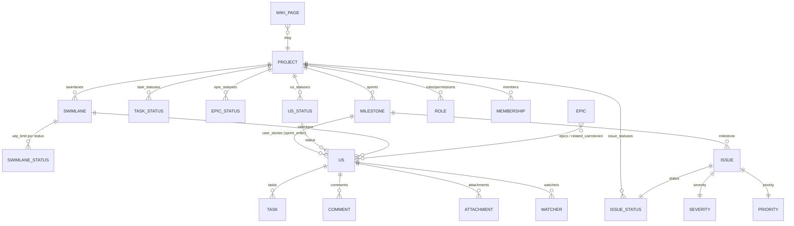

# Taiga (front) — UI/UX, views e interação

> Escopo: `_REF/taiga-front` (somente leitura), versão **6.10.3** (`package.json:3`), commit `da8afa5` ("Merge … fix-epic-status-filter", 2026-10-27). Analisados: `app/coffee` (controllers e a maior parte das diretivas), `app/modules` (componentes em pastas com `*.controller.coffee`/`*.directive.coffee`/`*.jade`/`*.scss`), `app/partials`, `app/styles`, `app/themes`, `app/locales`, `gulpfile.js`, `elements.js`. Fora de escopo: backend/API (apenas contratos implícitos), testes E2E (`e2e/`), mobile nativo.

## 1. Arquitetura em 10 linhas

1. SPA **AngularJS 1.5.10** + **CoffeeScript** + **Jade**, empacotada por **gulp** (concat + `templatecache` de todos os `.jade`); dependências em `package.json:104-134`.
2. Duas árvores de código convivem: `app/coffee/modules/*` (controllers "clássicos", diretivas de tela, mixins) e `app/modules/*` (componentes isolados por pasta, criados depois — `app/modules/components`, `app/modules/history`, `app/modules/epics`).
3. 23 módulos Angular registrados (`grep module("taiga…")`): `taiga, taigaAdmin, taigaAuth, taigaBacklog, taigaBase, taigaCommon, taigaEpics, taigaEvents, taigaFeedback, taigaIntegrations, taigaIssues, taigaKanban, taigaPlugins, taigaProject, taigaRelatedTasks, taigaResources, taigaSearch, taigaTaskboard, taigaTasks, taigaTeam, taigaUserSettings, taigaUserStories, taigaWiki`.
4. Roteamento por **`$routeProvider`** com `resolve` injetado em *todos* os `when`: `languageLoad` (espera i18n) e `projectLoaded` (carrega projeto por `pslug` antes de renderizar) — `app/coffee/app.coffee:39-70`.
5. As rotas de projeto declaram `section:` (usado pelo menu/project service) e algumas `joyride:` (tour com intro.js) — `app/coffee/app.coffee:228-243`.
6. Estado do projeto é centralizado e imutável em `tgProjectService` (`Immutable.Map`), com `my_permissions` vindo do backend e auto-refresh de 10 min — `app/modules/services/project.service.coffee:14-26,90-111`.
7. Listas usam **Immutable.js** + diretiva própria `tg-repeat` (clone de `ngRepeat` otimizado para Immutable) — `app/js/tg-repeat.js:20-45`.
8. UI é montada com **diretivas**: 189 diretivas registradas em `app/coffee` + dezenas em `app/modules`; `component()` (API 1.5) aparece **uma única vez** (`app/modules/components/input-search/input-search.component.coffee:34`) — o resto usa `bindToController` (ex. `app/modules/components/card/card.directive.coffee:9-29`, `app/modules/epics/dashboard/epics-table/epics-table.directive.coffee`).
9. Há **híbrido com Web Components**: `elements.js` (bundle de 1,6 MB) registra `tg-legacy-loader`, `tg-project-navigation`, `tg-text-editor`, `tg-html-editor`, `tg-markdown-editor`, `tg-svg-sprite`; o AngularJS conversa com eles por atributos/propriedades (`app/coffee/modules/base/load-element.coffee:14-27`, `app/modules/components/wysiwyg/wysiwyg.directive.coffee:94`).
10. Bibliotecas de UI: **dragula** (+ helper próprio `js/dragula-drag-multiple.js`, `gulpfile.js:197`), **Flot** (burndown), **intro.js** (joyride), **pikaday** (datas), **awesomplete** (autocomplete), **checksley** (validação), **ng-infinite-scroll**, CKEditor 5 via `taiga-html-editor` (`package.json:104-134`).

## 2. Entidades e relações (visão do front)

O front não define schema; consome o projeto inteiro em um único GET e o mantém em `tgProjectService`. As coleções que a UI assume existirem em `project`:

| Entidade | Coleção no projeto | Onde a UI usa |
|---|---|---|
| Status de US / task / issue / epic | `us_statuses`, `task_statuses`, `issue_statuses`, `epic_statuses` | colunas de kanban/taskboard, selects | 
| Swimlanes | `swimlanes` (com `statuses` por swimlane) | linhas do kanban (`app/coffee/modules/kanban/main.coffee:568-583`) |
| Pontos (escala) | `points` (ordenável) | estimativa por papel (`app/coffee/modules/common/estimation.coffee`) |
| Prioridade / severidade / tipo | `priorities`, `severities`, `issue_types` | tabela de issues |
| Papéis | `roles` (`computable`, `permissions`) | admin de permissões e estimativa |
| Membros | `members` (`is_active`) | avatares, filtros, atribuição |
| Sprint (milestone) | `milestones` (aberto/fechado, `estimated_start/finish`, `slug`) | backlog, taskboard |
| Custom attributes | derivados de `custom_attributes` do projeto | detalhe de US/task/issue/epic |
| Wiki | páginas com `slug`, `content`, `version`, `editions` | wiki |
| Histórico | por objeto: `history`/comentários + `values_diff` | aba de atividade |

Detalhes de modelagem que vazam na UI:
- US carrega **pontos por papel** (`us.points` é mapa `role_id → point_id`), somados em `total_points` usado nos cards e no backlog (`app/coffee/modules/taskboard/main.coffee:735-765`).
- US pode estar ligada a **vários épicos** (`us.epics`, renderizado como pílulas coloridas) — `app/partials/includes/components/backlog-row.jade:44-50`, e o relacionamento é criado/removido pelo lightbox `tg-lb-relatetoepic` (`app/coffee/modules/common/lightboxes.coffee:924-1030`).
- Ordenação é explícita por contexto: `kanban_order` (kanban), `backlog_order` (backlog), `sprint_order` (dentro do sprint), `epics_order` (dash de épicos) — `app/coffee/modules/backlog/main.coffee:492-497`, `app/coffee/modules/kanban/main.coffee:131-137`, `app/modules/epics/epics.service.coffee:100-120`.

## 3. Campos, enums e estados

### 3.1 Status (US/task/issue/epic)

Administrados em Admin → *Project values → Status*. Campos editáveis na tabela administrativa: nome, cor, `is_closed`, ordem (drag) — `app/partials/includes/modules/admin/project-status.jade:17-95`. Para US há ainda `is_archived` (coluna "arquivada", colapsada por padrão) e `wip_limit` por status **e por swimlane** — `app/partials/includes/modules/kanban-table.jade:117,193`, `app/modules/components/wip-limit-selector/wip-limit-selector.controller.coffee:14-26`.

| Campo | Efeito visual |
|---|---|
| `color` | borda do header da coluna, cor do texto do status em backlog/epics |
| `is_closed` | card/linha em estado `is-closed`, nome riscado no backlog, progresso do épico/story em 100% |
| `is_archived` | coluna vira "coluna comprimida" com contador vertical (`app/partials/includes/modules/kanban-table.jade:135-160`) |
| `wip_limit` | marcador "WIP Limit" injetado após o N-ésimo card (`app/coffee/modules/kanban/main.coffee:809-847`) |
| `order` | ordem das colunas em todas as views |

### 3.2 Escalas de issue

- `severity`, `priority`, `type` são listas ordenadas e coloridas; a UI pinta os botões de detalhe (`app/coffee/modules/issues/detail.coffee:446,544,642`) e usa as mesmas listas como filtros (`app/coffee/modules/issues/list.coffee:54-68`).
- `is_iocaine`, `is_blocked`, `team_requirement`, `client_requirement` são booleanos expostos como *chips* no header do detalhe e no card (`app/partials/includes/components/backlog-row.jade` / `app/partials/us/us-detail.jade:180-215`).

### 3.3 Custom attributes (tipos)

`app/coffee/modules/common/custom-field-values.coffee:17-26` define `text, multiline, date, url, dropdown, checkbox, number` e um `RICHTEXT_TYPE`. **Achado/anti-padrão:** `RICHTEXT_TYPE = "url"` duplica o valor de `URL_TYPE`, de modo que `TYPE_CHOICES` tem duas entradas com a mesma `key` ("url": uma "URL" e uma "Rich text") — `app/coffee/modules/common/custom-field-values.coffee:18-26,28-61`. O formulário de criação não consegue distinguir os dois tipos; o template de edição testa `type=="richtext"` (`app/partials/custom-attributes/custom-attribute-value-edit.jade:19`), valor que nunca é enviado por esse caminho [INFERENCE].

| Tipo | Editor |
|---|---|
| `text` | `<input type=text>` |
| `multiline` | `<textarea>` |
| `date` | pikaday (`data-pikaday`) |
| `url` | `<input type=url>` |
| `dropdown` | `<select>` com `extra` (opções) |
| `number` | `<input type=number>` |
| `checkbox` | checkbox estilizado + labels Yes/No |
| `richtext` | `tg-custom-field-edit-wysiwyg` |

Fonte: `app/partials/custom-attributes/custom-attribute-value-edit.jade:19-60`.

### 3.4 Estados de interface (não persistidos, mas estruturais)

| Estado | Onde |
|---|---|
| `zoomLevel 0..3` do kanban (persistido em localStorage `kanban_zoom`) | `app/modules/components/kanban-board-zoom/kanban-board-zoom.directive.coffee:13-34` |
| Colunas dobradas do kanban (por projeto) | `app/coffee/modules/resources/kanban.coffee:10-33` |
| Swimlanes dobradas (por projeto) | idem (`kanban-swimlanesmodels`) |
| Filtros aplicados (query string + storage local **e** remoto) | `app/coffee/modules/controllerMixins.coffee:106-133` |
| Ordem das colunas da tabela de épicos | `app/modules/epics/dashboard/epics-table/epics-table.controller.coffee:25-34` |
| Modo do editor (`html`/`markdown`) | `app/modules/components/wysiwyg/wysiwyg.directive.coffee:23,116` |

### 3.5 Zoom do card (kanban)

`zooms` mapeia nível → campos visíveis; os níveis são cumulativos (`app/modules/components/kanban-board-zoom/kanban-board-zoom.directive.coffee:15-20`):

| Nível | Campos habilitados |
|---|---|
| 0 | `assigned_to`, `ref` |
| 1 | + `subject`, `card-data`, `assigned_to_extended` |
| 2 | + `tags`, `extra_info`, `unfold` |
| 3 | + `related_tasks`, `attachments` |

O card consulta `vm.visible(name)` para cada bloco (`app/modules/components/card/card.controller.coffee:42-45`); `_setVisibility` decide se tarefas/anexos aparecem expandidos ou dobrados (`:76-98`). O nível ≥ 2 também dispara `include_attachments=1&include_tasks=1` na API (`app/coffee/modules/kanban/main.coffee:446-449`) — **a densidade da UI altera o payload**.

## 4. Permissões e gestão de acesso

### 4.1 Modelo no cliente

- `project.my_permissions: string[]` é a fonte de verdade; `tgProjectService.hasPermission(p)` só faz `indexOf` e `canEdit(p)` adiciona o bloqueio de projeto arquivado — `app/modules/services/project.service.coffee:102-111`.
- Duas diretivas concentram toda a checagem:
  - `tg-check-permission="modify_us"` → adiciona `hidden` e só remove se `canEdit` (`app/coffee/modules/common.coffee:83-118`);
  - `tg-class-permission="{'readonly': '!modify_task'}"` → aplica classe condicional, inclusive negação com `!` (`app/coffee/modules/common.coffee:121-156`).
- Permissões citadas no front (amostra): `view_epics, view_milestones, view_us, view_tasks, view_issues, view_wiki_pages, view_wiki_links, add_us, modify_us, delete_us, add_issue, modify_issue, add_milestone, modify_milestone, modify_epic, modify_wiki_page, add_wiki_page, add_wiki_link, delete_wiki_link`.
- Os **módulos** (backlog/kanban/issues/wiki/epics) são feature flags do projeto e entram na mesma decisão de menu (`app/modules/components/project-menu/project-menu.controller.coffee:59-77`).

### 4.2 Administração

| Tela | Rota | O que faz |
|---|---|---|
| Memberships | `/project/:pslug/admin/memberships` | lista paginada, avatar, checkbox "is admin", seletor de role por linha, ações em massa (`app/coffee/modules/admin/memberships.coffee:270-500`) |
| Roles | `/project/:pslug/admin/roles` | matriz de permissões por categoria, `computable` (conta pontos) e role "external user" (`app/coffee/modules/admin/roles.coffee:14,19-90,470-505`) |
| Project values | `/admin/project-values/{status,points,priorities,severities,types,custom-fields,tags,due-dates,kanban-power-ups}` | CRUD de todas as listas acima (`app/coffee/app.coffee:346-397`) |
| Project profile | `/admin/project-profile/{details,default-values,modules,export,reports}` | dados, valores default, ativação de módulos, CSV (`app/coffee/modules/admin/project-profile.coffee:184-540`) |
| Third parties | `/admin/third-parties/{webhooks,github,gitlab,bitbucket,gogs}` | integrações |

Notas de UX:
- O role "external user" edita `public_permissions` e deriva `anon_permissions` apenas das `view_*` — `app/coffee/modules/admin/roles.coffee:490-500`.
- Exclusão de role é bloqueada se for a última (`:97-108`).
- Export é **CSV por entidade** com UUID regenerável e URL absoluta (`app/coffee/modules/admin/project-profile.coffee:388-440`); import é página separada com fluxos Trello/Jira/GitHub/Asana/Taiga (`app/modules/projects/create/import/import-project.controller.coffee:14-60`).
- Projeto arquivado (`archived_code`) desabilita qualquer edição no cliente, não só no servidor (`project.service:107-110`), e mostra banner (`tg-project-archived-warning` em todas as telas de projeto).

## 5. Views e organização visual

### 5.1 Mapa módulo → rota → componentes/diretivas → recursos

| Área | Rota (`app.coffee`) | Nav key (`base.coffee`) | Diretivas/componentes centrais | Recursos usados |
|---|---|---|---|---|
| Kanban | `/project/:pslug/kanban` (`:235-243`) | `project-kanban` (`:65`) | `tg-kanban`, `tg-kanban-sortable`, `tg-kanban-squish-column`, `tg-kanban-wip-limit`, `tg-kanban-swimlane`, `tg-kanban-board-zoom`, `tg-card` | `userstories.listAll`, `swimlanes.list`, `kanban.store*Modes` |
| Backlog | `/project/:pslug/backlog` (`:226-234`) | `project-backlog` (`:63`) | `tg-backlog`, `tg-backlog-sortable`, `tg-sprint`, `tg-backlog-sprint-header`, `tg-backlog-us-points`, `tg-us-status`, `tg-us-edit-selector`, `tg-toggle-burndown-visibility` | `userstories.listUnassigned`, `sprints.list`, `projects.stats`, `userstories.bulkUpdateBacklogOrder` |
| Taskboard (sprint) | `/project/:pslug/taskboard/:sslug` (`:245-252`) | `project-taskboard` (`:64`) | `tg-taskboard`, `tg-taskboard-sortable`, `tg-taskboard-squish-column`, `tg-taskboard-zoom`, `tg-sprint-chart` | `tasks`, `issues` do milestone, `sprints` |
| Epics | `/project/:pslug/epics` (`:208-215`) | `project-epics` (`:67`) | `tg-epics-table`, `tg-epic-row`, `tg-story-row`, `tg-epics-sortable`, `tg-create-epic` | `epics.list/filtersData`, `userstories.listInEpic` |
| Épico (detalhe) | `/project/:pslug/epic/:epicref` (`:218-224`) | `project-epics-detail` (`:71`) | `tg-related-userstories`, `tg-related-userstory-row`, `tg-epic-status-*`, `tg-history-section` | `epics.getByRef`, `epics.*RelatedUserstory` |
| Issues | `/project/:pslug/issues` (`:299-313`) | `project-issues` (`:66`) | `tg-issues-table`, `tg-issues-pagination`, `tg-issues-ordering`, `tg-issue-status-inline-edition`, `tg-issue-assigned-to-inline-edition` | `issues.list`, `issues.bulkCreate` |
| Issue (detalhe) | `/project/:pslug/issue/:issueref` | `project-issues-detail` (`:74`) | `tg-detail-header`, `tg-detail-nav`, `tg-item-wysiwyg`, `tg-history-section`, sidebar `ticket-*` | `issues.getByRef` |
| US (detalhe) | `/project/:pslug/us/:usref` (`:254-261`) | `project-userstories-detail` (`:70`) | idem + `tg-us-estimation`, `tg-us-status-*`, `tg-related-tasks`, `tg-custom-attributes-values` | `userstories.getByRef` |
| Wiki | `/project/:pslug/wiki/:slug` e `/wiki-list` (`:272-288`) | `project-wiki-page`/`-list` (`:77-78`) | `tg-wiki-wysiwyg`, `tg-wiki-nav`, `tg-wiki-summary`, `tg-wiki-history`, `tg-attachments-full` | `wiki.getBySlug/listLinks` |
| Timeline do projeto | `/project/:pslug/timeline` (`:179-188`) | `project-timeline` (`:69`) | página pública (logo, likes/watch, tags) + `tg-user-timeline` | `projects.getProjectBySlug`, feed |
| Busca | `/project/:pslug/search` (`:198-206`) | `project-search` (`:68`) | `tg-search`, `tg-search-box` (lightbox), `tg-search-list` | `search.do` |
| Time | `/project/:pslug/team` (`:290-298`) | `project-team` (`:81`) | `tg-team-members`, `tg-team-filters`, `tg-team-member-stats` | `memberships` |
| Home | `/` (`:72-84`) | `home` | `tg-working-on`, `tg-home-project-list` | `userstories` filtradas por usuário |
| Admin | `/project/:pslug/admin/*` (`:315-448`) | `project-admin-*` (`:84-108`) | ver §4.2 | vários |

Menu de projeto é híbrido: `tg-project-menu` monta um objeto `{component:'tg-project-navigation', params}` e o entrega ao web component `<tg-legacy-loader>` (`app/modules/components/project-menu/project-menu.controller.coffee:23-35`, `app/modules/components/project-menu/project-menu.jade:8-12`).

### 5.2 Kanban

Estrutura: header fixo (nomes das colunas) + corpo com scroll horizontal; o header é transladado por JS para acompanhar o scroll (`app/coffee/modules/kanban/main.coffee:717-730`), e cada swimlane repete o truque para o título (`:1124-1160`).

- **Colunas** = `us_statuses` ordenados; archived ficam dobradas por padrão (`app/coffee/modules/kanban/main.coffee:590-600`).
- **Colunas colapsáveis**: `foldStatus` persiste em storage por projeto e reduz a coluna a 36 px (`app/coffee/modules/kanban/main.coffee:766-803`, `app/styles/modules/kanban/kanban-table.scss:4,75-107`). O CSS tem `--kanban-width`/`--kanban-column-margin` calculados via `ResizeObserver` (`app/coffee/modules/kanban/main.coffee:652-700`).
- **Swimlanes**: linhas por swimlane, com `-1` = "unclassified"; podem ser dobradas e há auto-abertura ao arrastar sobre uma swimlane dobrada por 1 s (`app/coffee/modules/kanban/main.coffee:1124-1183`).
- **WIP limit**: é apenas **informativo**. O directive insere um marcador com classes `one-left`/`reached`/`exceeded` conforme a contagem (`app/coffee/modules/kanban/main.coffee:809-847`); não há nenhuma checagem no `drop` do dragula (`app/coffee/modules/kanban/sortable.coffee:97-150`). Portanto o limite **não bloqueia** o movimento [INFERENCE a partir da ausência de código].
- **Drag & drop**: dragula com `moves: item is tg-card`, cálculo de `previousCard`/`nextCard` pelo DOM e envio de `bulkUpdateKanbanOrder` (`app/coffee/modules/kanban/sortable.coffee:41-150`, `app/coffee/modules/kanban/main.coffee:617-660`). Multi-seleção com Ctrl/Cmd (`ctrl+click`) habilita arrastar vários cards (`kanban-table.jade:168`, `sortable.coffee:76-90`).
- **Filtros**: tags, assigned_users, role, epic, owner, com modo include/exclude, persistidos em URL **e** storage local/remoto; busca textual `q` com debounce de 100 ms (`app/coffee/modules/kanban/main.coffee:57-66,150-160`; `controllerMixins.coffee:54-133`).
- **Performance**: renderização em lotes intercalando colunas (10 por coluna por rodada), `IntersectionObserver` para materializar cards só quando entram em viewport (`app/coffee/modules/kanban/main.coffee:413-440,652-690`, `app/js/boards.js:11-60`).
- **Card**: parcelas independentes (`tg-card-actions`, `tg-card-assigned-to`, `tg-card-data`, `tg-card-slideshow`), recompiladas por template string quando `item`/`zoomLevel` mudam (`app/modules/components/card/card.jade:10-40`, `app/coffee/modules/kanban/main.coffee:850-1119`). Mostra `#ref`, subject, epics, pontos totais, due date (cor por proximidade), anexos/comentários/watchers/tasks feitas, ícones de bloqueio/io-caine.

### 5.3 Backlog

Duas colunas: backlog (lista) + sidebar de sprints (`app/partials/backlog/backlog.jade:120-125`, `app/partials/includes/modules/sprints.jade`).

- **Sprints** abertos aparecem expandidos; fechados ficam sob "mostrar sprints fechados" e são carregados sob demanda (`app/coffee/modules/backlog/main.coffee:281-303`, `app/coffee/modules/backlog/sprints.coffee:142-180`).
- Cada sprint tem header com nome, intervalo de datas, fechados/total de pontos e barra de progresso (`app/partials/backlog/sprint.jade:7-9`, `sprint-header.jade:26-34`).
- **Story points**: coluna "Points" com popover que edita pontos **por papel** (`tg-backlog-us-points`, `app/coffee/modules/backlog/main.coffee:1054-1157`); o header permite filtrar por papel (`tg-us-role-points-selector`, `backlog-table.jade:12-15`).
- **Drag** entre backlog ↔ sprint e reordenação intra-lista com dragula, multi-seleção por checkbox e indicador de "doom line" (linha que marca onde a velocidade do projeto estoura) (`app/coffee/modules/backlog/sortable.coffee:24-150`, `app/coffee/modules/backlog/main.coffee:700-760`).
- **Velocity forecasting**: ao ativar, mostra apenas as US que cabem na velocidade e adiciona um CTA de criar sprint/mover para o sprint atual (`app/coffee/modules/backlog/main.coffee:244-254,444-470`; `backlog.jade:196-230`).
- **Burndown** do backlog colapsável com estado persistido (`app/coffee/modules/backlog/main.coffee:1160-1210`), gráfico Flot.
- **Ordenação**: sempre por `backlog_order` no cliente **e** `bulkUpdateBacklogOrder` no servidor; há um comentário explícito de que `orderBy` em partials não funciona (`app/coffee/modules/backlog/main.coffee:492-497`).
- Paginação por `infinite-scroll` + `x-pagination-next` (`app/partials/includes/modules/backlog-table.jade:17-24`, `app/coffee/modules/backlog/main.coffee:390-410`).

### 5.4 Taskboard (sprint)

Grade **user story × status de task**, com colunas fixas por status e uma linha "sem US" (`app/partials/includes/modules/taskboard-table.jade:43-100`).

- Colunas e linhas são colapsáveis, com largura recalculada para "squish" (avatares empilhados) quando dobradas — `app/coffee/modules/taskboard/main.coffee:751-920`.
- Drag de tasks entre status/US com `set-orders` no header e atualização otimista (`app/coffee/modules/taskboard/main.coffee:640-680`).
- Burndown do sprint em Flot no topo, com toggle de visibilidade (`app/coffee/modules/taskboard/charts.coffee:21-127`).
- Issues do sprint aparecem na mesma tela via `tg-issues-table` com `sprintIssues=true` (`app/modules/components/issues-table/issues-table.jade:9-40`).

### 5.5 Epics

Não é timeline/Gantt. É uma **tabela de épicos com linhas expansíveis** que revelam as user stories relacionadas (`app/modules/epics/dashboard/epic-row/epic-row.jade:1-90`, `epic-row.controller.coffee:35-45`).

- Colunas opcionais (project, sprint, assigned, status, progress, closed, closed_us) com dropdown de checkboxes, estado por projeto em storage (`app/modules/epics/dashboard/epics-table/epics-table.controller.coffee:25-34,55-64`).
- Progresso calculado por `user_stories_counts.progress/total`, 100% se status fechado (`epic-row.controller.coffee:27-33`).
- Status editável inline (lista suspensa com cores), reordenação por drag, scroll infinito (`:47-63`, `epics-table.jade:104-118`).
- No detalhe do épico: lista de US relacionadas ordenável, criação/relacionamento por lightbox, e histórico/comentários (`app/modules/epics/related-userstories/related-userstories.jade:10-32`).
- **Não existe** módulo de timeline horizontal de US por status, milestones com zoom ou dependências no repositório: a rota `/timeline` é a página pública do projeto com feed de atividades (`app/coffee/app.coffee:179-188`, `app/modules/projects/project/project.jade:58-60`), e não há nenhuma ocorrência de `gantt`, `calendar` ou `workload` em `app/` (código ou templates).

### 5.6 Issues

Tabela (`basic-table`) com colunas ordenáveis: type, severity, priority, votes, ref, status, attachments (taskboard), modified, assigned (`app/modules/components/issues-table/issues-table.jade:53-145`).

- Ordenação por `order_by` na URL; paginação renderizada por JS com elipses (`app/coffee/modules/issues/list.coffee:489-560`).
- **Inline edit**: status (popover por linha) e assigned (lightbox de usuários) sem sair da lista (`app/coffee/modules/issues/list.coffee:637-716`).
- **Bulk create**: um textarea onde cada linha vira issue (`app/coffee/modules/issues/lightboxes.coffee:18-70`).
- Filtros: tags, status, type, severity, priority, assigned_to, owner, role, include/exclude (`app/coffee/modules/issues/list.coffee:54-80`), com filtros customizados salvos (nomeados) (`app/modules/components/filter/filter.jade:10-52`).
- Anexos e comentários ficam no detalhe (`tg-attachments-full`, `tg-history-section`).

### 5.7 Wiki

- Layout: sidebar de links (arrastável, criar/remover) + conteúdo + resumo + anexos + histórico (`app/partials/wiki/wiki.jade:8-34`).
- Página inexistente com permissão de criação vira rascunho editável na hora (`app/coffee/modules/wiki/main.coffee:86-104`).
- Editor: CKEditor 5 em web component `tg-text-editor`, com dois modos (`html`/`markdown`), preferência em `localStorage['editor-mode']`, rascunho local por página e aviso de "outdated" quando a versão do servidor muda (`app/modules/components/wysiwyg/wysiwyg.directive.coffee:20-30,94-145,205-250`).
- Histórico por versão com diff (`tg-wiki-history`, `app/modules/wiki/history/wiki-history.directive.coffee:26`).
- Links internos são entidades próprias (`wikiLinks`) com `href` = slug (`app/coffee/modules/wiki/main.coffee:106-120`).

### 5.8 Atividade, histórico e tempo real

- **Detalhe** (US/task/issue/epic/wiki): header + conteúdo (wysiwyg) + custom fields + anexos + `tg-history-section` com duas abas: **Comments** e **Activity**, contadores e ordenação cronológica invertível (`app/modules/history/history-tabs/history-tabs.jade:8-40`).
- Atividade = lista de entradas com autor, data e `values_diff` renderizado por `tg-history-diff` (`app/modules/history/history/history.jade:10-22`, `app/modules/history/history-lightbox/history-entry.directive.coffee`).
- Comentários têm edição inline com wysiwyg, deleção suave/restauração e histórico do comentário (`app/modules/history/comments/comments.jade:10-37`).
- **WebSocket**: `$tgEvents` abre WS, faz heartbeat, reconecta (5 tentativas, 10 s) e expõe `subscribe(scope, routingKey, cb)`; cada view assina `changes.project.<id>.userstories|issues|milestones|projects` com debounce (ex.: 700-1000 ms aleatório) (`app/coffee/modules/events.coffee:16-60,238-290`, `app/coffee/modules/kanban/main.coffee:259-283`).
- Quando chega evento com um lightbox aberto, o kanban **adia** o refresh e o executa ao fechar (`lightbox:opened/closed`, `app/coffee/modules/kanban/main.coffee:230-250`).
- Notificações: dropdown no navbar com badge de não lidas, "dismiss all" e lista apenas das não lidas (o `infinite-scroll` ali está desabilitado — `app/modules/navigation-bar/dropdown-notifications/dropdown-notifications.jade:8-35`); a página `/notifications` é que pagina. Há ainda um anunciante global (`tg-live-announcement`) para mensagens do sistema.
- **Watchers**: componente no sidebar do detalhe, com remoção inline e limite de avatares visíveis (`app/modules/components/ticket-watchers/ticket-watchers.jade:8-40`).
- **Favoritos**: não existe "favorite" por item; existem *likes/fans* e *watch* de projeto (`tg-like-project-button`, `tg-watch-project-button`) e *votes* em US. `profile-favs` lista projetos favoritos com filtros e busca (`app/modules/profile/profile-favs/profile-favs.jade:9-40`).

### 5.9 Busca

- Busca **global do projeto** em lightbox acionada pelo menu (`tg-search-box`, `app/coffee/modules/search.coffee:111-157`), que redireciona para `/project/:pslug/search?text=…` e recarrega a rota.
- Página de resultados: sidebar "search in" (tipo) + tabela de resultados agrupada, com debounce de 100 ms e abort da requisição anterior (`app/coffee/modules/search.coffee:84-100`, `app/partials/search/search.jade:8-18`).
- Busca **dentro de listas** é diferente: `tg-input-search` altera `q` e recarrega a lista (não filtra no cliente) — `app/modules/components/input-search/input-search.component.coffee`.

### 5.10 Lightbox como padrão central

- `lightboxService.open/close/closeAll` controla foco automático no primeiro campo, ESC por padrão, transição e eventos globais `lightbox:opened`/`closed` (`app/coffee/modules/common/lightboxes.coffee:23-109`).
- `tgLightboxFactory.create(name, attrs, scopeAttrs)` **compila e anexa** um componente-lightbox ao `body` com escopo novo e `remove-on-close` — é assim que "selecionar usuário", "mover para sprint" etc. aparecem sem existir no template da página (`app/modules/services/lightbox-factory.service.coffee:9-30`).
- `tgLbCreateEdit` é **um único lightbox para criar/editar US, task e issue**, escolhendo schema e campos por `objType`, com validação, anexos e tags (`app/coffee/modules/common/lightboxes.coffee:527-905`). É disparado por eventos de `$rootScope` (`genericform:new`, `genericform:edit`) e devolve `*form:new|edit:success`.
- Confirmações também são lightboxes reutilizáveis (`.lightbox-generic-ask`, `-delete`, `-success`, `-error`) com API `ask/askOnDelete/notify` (`app/coffee/modules/common/confirm.coffee:40-140,271-320`).

### 5.11 Design, estilo e responsividade

- SCSS organizado em `core` (base, forms, typography), `layout` (por tela), `components`, `modules` (por domínio) e `shame` (`app/styles/*`).
- Tema único com variáveis de cor (`app/themes/taiga/variables.scss:4-45`) e `tgThemeService` que só troca o `href` de `theme-<nome>.css` (`app/modules/services/theme.service.coffee:9-15`); `custom.scss` está vazio.
- Breakpoints: `$mobile 480`, `$tablet 769`, `$desktop 1024`, `$widescreen 1216`, `$fullhd 1408`, `$ultrawide 1960` + mixins `from/until/mobile/tablet/...` (`app/styles/dependencies/responsive.scss:1-50`).
- Uso real de responsividade é baixo: 62 usos de mixins e 11 `@media` em todo o SCSS, concentrados em telas de detalhe/backlog; kanban/taskboard declaram `overflow: hidden` e largura fixa por coluna (`app/styles/modules/kanban/kanban-table.scss:4,30-40,420`). **Não há layout mobile dedicado** — em telas pequenas o kanban rola horizontalmente [INFERENCE].
- Classes utilitárias de layout (`basic-table`, `level`, `check`) padronizam tabelas e checkboxes (`app/styles/components/basic-table.scss`, `level.scss`, `check.scss`).
- Acessibilidade: há apenas **29** ocorrências de `aria-*`/`role=` nos 378 templates Jade, quase todas `aria-hidden` de ícones, `role="button"` em divs clicáveis e `aria-label` de inputs; **zero** `role="dialog"`, `aria-modal` ou `aria-live` em todo o repositório. Em lightbox não há gerenciamento de foco além de focar o primeiro campo (`app/coffee/modules/common/lightboxes.coffee:40-56`); teclado existe como Enter/ESC em formulários e setas no seletor de usuário (`:112-160`). Contraste e foco visível não têm cobertura no repositório.

## 6. Comparação: "lightbox + lista" × páginas dedicadas

Taiga usa **os dois padrões ao mesmo tempo, para tarefas diferentes**:

| Operação | Padrão | Evidência | Efeito |
|---|---|---|---|
| Criar/editar US, task, issue | Lightbox único (`tg-lb-create-edit`) | `app/coffee/modules/common/lightboxes.coffee:527-905` | Mantém o contexto da lista/board; uma implementação para 3 entidades |
| Criar em lote | Lightbox bulk | `app/coffee/modules/issues/lightboxes.coffee:18-70` | Textarea multi-linha |
| Atribuir usuário | Lightbox factory dinâmico | `app/modules/services/lightbox-factory.service.coffee:9-30` | Aberto de qualquer tela (card, linha, detalhe) |
| Confirmar exclusão | Lightbox `ask` | `app/coffee/modules/common/confirm.coffee:40-140` | Substitui `confirm()` nativo, com loading |
| Ver detalhe de US/task/issue/epic | **Página própria** (`/us/:ref`) | `app/coffee/app.coffee:254-261` | URL compartilhável, histórico, comentários, sidebar de metadados |
| Abrir US a partir do kanban | Link que **carrega os filtros do board** como `kanban-*` query params | `app/modules/components/card/card.controller.coffee:15-40` | "Voltar" reconstruível, mas sem retorno automático ao board |
| Navegar entre US | setas prev/next usando ordem do backlog salva | `app/modules/components/detail/nav/detail-nav.controller.coffee:22-55` | Preserva a ordem da lista de origem (backlog "sem milestone") |

Forças do padrão híbrido:
1. **Edição leve nunca sai da lista** — inline (status, assigned, pontos) e lightbox (criar/editar), com atualização otimista e evento global de refresh.
2. **Detalhe é profundo e linkável** — comentários, histórico, campos custom, anexos e sidebars exigem espaço; a URL permite colar em chat/issue externa.
3. **Um lightbox, três entidades** reduz duplicação e mantém consistência de validação/anexos/tags.
4. **Contexto preservado** via `getLinkParams()` + `tgStorage` para prev/next.

Limitações observadas:
1. Detalhe é **página cheia**, então abrir várias US exige várias abas; Taiga antigo usava lightbox de detalhe e perdeu isso [INFERENCE].
2. Voltar do detalhe para o board **não restaura scroll nem estado de filtro na tela** — os parâmetros vão na URL, mas o controller os aplica apenas ao backlog (`applyStoredFilters`, `controllerMixins.coffee:106-118`); scroll é perdido.
3. Lightboxes são dirigidos por **eventos globais de `$rootScope`** (`genericform:new`, `usform:success`), sem contrato tipado; bugs de sincronização são tratados com flags `isLightboxOpened`/`isRefreshNeeded` (`app/coffee/modules/kanban/main.coffee:230-250`).
4. Empilhamento de lightboxes é manual (`closeAll` em vários fluxos, `app/coffee/modules/common/lightboxes.coffee:751,831`) e não há pilha/gestão de foco.

## 7. Padrões aproveitáveis / anti-padrões

### Aproveitáveis

1. **Um "create/edit sheet" genérico por entidade** (schema declarativo por `objType`) — `app/coffee/modules/common/lightboxes.coffee:534-620`.
2. **Filtros como cidadãos de primeira classe**: query string + storage local + storage remoto + filtros nomeados + include/exclude, com mixin reutilizado por kanban, backlog, issues, epics (`app/coffee/modules/controllerMixins.coffee:54-160`; `app/modules/components/filter/filter-remote.service.coffee:9-57`).
3. **Densidade controlada pelo usuário** (4 níveis de zoom do card, colunas/linhas colapsáveis com persistência) — resolve o trade-off "ver tudo" × "ver o suficiente" sem telas separadas (`kanban-board-zoom.directive.coffee:13-40`).
4. **Atualização em tempo real com debounce e "defer while lightbox open"** — evita perda de digitação (`app/coffee/modules/kanban/main.coffee:259-283`).
5. **Renderização sob demanda**: batching + IntersectionObserver + `tg-repeat` para Immutable (`app/js/boards.js`, `app/js/tg-repeat.js`, `app/coffee/modules/kanban/main.coffee:413-440`).
6. **Ordenação explícita por contexto** (`kanban_order`, `backlog_order`, `sprint_order`, `epics_order`) em vez de um único sort genérico.
7. **WIP como sinal visual, não como bloqueio** — reduz atrito em times imaturos, embora permita violação silenciosa.
8. **Editor com rascunho local e detecção de versão desatualizada** — boa proteção contra perda de texto (`wysiwyg.directive.coffee:205-250`).
9. **Permissão como atributo declarativo** (`tg-check-permission`/`tg-class-permission`) com negação embutida (`'!modify_us'`).
10. **Progressive enhancement por web components** (`tg-text-editor`, `tg-project-navigation`) sem reescrever a SPA.

### Anti-padrões / dívidas visíveis

1. **Duas convenções de código** (controllers em `app/coffee/modules` × componentes em `app/modules`) e estilos espalhados — custo de navegação alto.
2. **HTML gerado por concatenação de template strings em diretivas** (`CardSvgTemplate`, `_.template` + `$compile`), sem escaping uniforme e com recompilação a cada mudança de zoom (`app/coffee/modules/kanban/main.coffee:850-1119`).
3. **Estado de UI em singleton de serviço** (`kanbanUserstoriesService` com `Immutable.Map` mutado in place por `refresh`), risco de dessincronização entre abas (`app/coffee/modules/kanban/kanban-usertories.coffee:16-60`).
4. **Bug de enum**: `RICHTEXT_TYPE = "url"` (`app/coffee/modules/common/custom-field-values.coffee:17-25`).
5. **Sem paginação server-side uniforme**: issues pagina, backlog usa scroll infinito, kanban carrega tudo (com batching só no render).
6. **Acessibilidade frágil**: lightbox sem `role=dialog`/foco preso, tabelas sem `<table>` semântica (divs), ícones SVG sem texto alternativo consistente (apenas 29 usos de ARIA em 378 templates).
7. **Responsividade quase inexistente** para boards; sem versão mobile.
8. **Falta de Gantt/calendar/workload/timeline real** — a expectativa "multi-visão" do Taiga se limita a lista, kanban, tabela e grade de sprint.
9. **Dependência de `window.dragMultiple` global** e de dragula manipulando DOM por fora do Angular (`$scope.$apply` manual em `sortable.coffee:133-150`).
10. **Traduções monolíticas** (50 namespaces em um único `locale-*.json` por idioma, 29 idiomas), carregadas por partial loader com `addPart('taiga')` (`app/coffee/app.coffee:798-808`).

### O que vale copiar para o "meraki"

| Padrão Taiga | Adaptação sugerida |
|---|---|
| Zoom de card em 4 níveis cumulativos | densidade configurável global + por view, persistida por usuário |
| Filtros com include/exclude + salvos nomeados | modelo de "view salva" (filtros + colunas + densidade) |
| Um sheet de create/edit por tipo de entidade | componente único com schema declarativo |
| WIP informativo com marcador | opção por projeto: avisar × bloquear |
| Lista + lightbox para edição, página para detalhe | manter, mas com painel lateral (split view) para não perder contexto |
| Eventos WS por routing key com debounce | mesma estratégia, com reconciliação por versão |
| Status com cor/`is_closed`/`is_archived`/WIP por swimlane | copiar o modelo, inclusive arquivamento como coluna comprimida |

## Apêndice: mapa de arquivos

| Caminho | Papel |
|---|---|
| `app/coffee/app.coffee` | bootstrap Angular, rotas (`:72-587`), interceptors, i18n (`:796-810`) |
| `app/coffee/modules/base.coffee` | tabela de URLs/nav keys (`:32-130`), diretiva `tgMain` |
| `app/coffee/modules/base/navurls.coffee` | `$tgNavUrls` + diretiva `tg-nav` (`:21-165`) |
| `app/coffee/modules/base/load-element.coffee` | ponte AngularJS → web components |
| `app/coffee/modules/common.coffee` | `tgCheckPermission` (`:83-118`), `tgClassPermission` (`:121-156`), `$projectUrl` (`:205-228`) |
| `app/coffee/modules/common/lightboxes.coffee` | `lightboxService` (`:23-109`), `tgLbCreateEdit` (`:527-905`), `tgLbRelatetoepic` (`:924-1038`) |
| `app/coffee/modules/common/confirm.coffee` | `ask`, `askOnDelete`, `notify` (toasts) |
| `app/coffee/modules/common/custom-field-values.coffee` | render/edição de custom attributes e `TYPE_CHOICES` |
| `app/coffee/modules/common/sections.coffee` | lista de seções e `getPath` |
| `app/coffee/modules/common/popovers.coffee` | popovers de status (US/task/issue), ordenação |
| `app/coffee/modules/common/tags.coffee` | `tgTags`, `tgLbTagLine`, cores de tags |
| `app/coffee/modules/common/estimation.coffee` | seletor de pontos por papel |
| `app/coffee/modules/controllerMixins.coffee` | `PageMixin`, `FiltersMixin`, `UsFiltersMixin` |
| `app/coffee/modules/kanban/*` | controller, sortable (dragula), serviço de agrupamento por status/swimlane |
| `app/coffee/modules/backlog/*` | controller, sprints, sortable, lightbox de sprint |
| `app/coffee/modules/taskboard/*` | controller, tabela, charts (Flot), sortables |
| `app/coffee/modules/issues/*` | lista/paginação/ordenação, detalhe, bulk |
| `app/coffee/modules/epics/detail.coffee` | detalhe do épico |
| `app/coffee/modules/wiki/*` | página, nav de links, listagem |
| `app/coffee/modules/userstories/detail.coffee` | detalhe de US + status/estimativa |
| `app/coffee/modules/admin/*` | memberships, roles, project values/profile, third parties |
| `app/coffee/modules/resources/*` | chamadas de API por recurso (+ storage de colunas/filtros) |
| `app/coffee/modules/events.coffee` | `$tgEvents` (WebSocket, heartbeat, subscribe) |
| `app/modules/components/*` | card, filter, wysiwyg, attachments, issues-table, project-menu, voto/watch, wip-limit-selector |
| `app/modules/epics/**` | dashboard (tabela expansível), epic-row, story-row, related-userstories |
| `app/modules/history/**` | abas activity/comments, diff, lightbox de histórico |
| `app/modules/services/*` | project, lightbox-factory, theme, current-user, attachments |
| `app/partials/**` | 378 templates Jade (kanban, backlog, issue, wiki, admin, includes) |
| `app/styles/**`, `app/themes/taiga/**` | SCSS por camada + variáveis do tema |
| `app/locales/taiga/locale-*.json` | 29 idiomas, 50 namespaces no `en` |
| `app/js/boards.js`, `tg-repeat.js`, `dragula-drag-multiple.js` | utilitários de performance/drag |
| `elements.js` | bundle de web components (`tg-legacy-loader`, `tg-text-editor`, …) |
