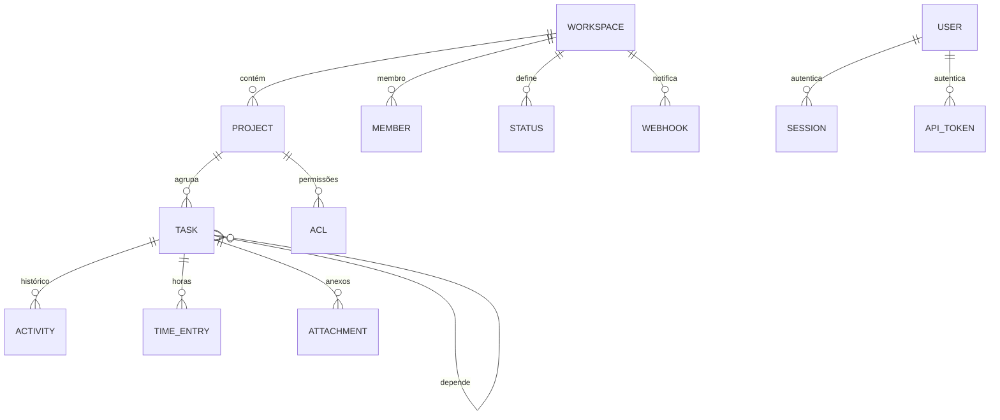

# task-manager — visão geral e mapa

> Projeto pessoal revisado em `_REF/task-manager`: backend Rust single-binary (Axum 0.8 + SQLite/SQLx 0.8), API REST multi-tenant, auth por sessão/API key, RBAC+ACL, soft delete e OpenAPI. Este documento é o mapa; o detalhe está nos cinco documentos numerados.

## 1. O que existe

| Item | Número | Evidência |
|---|---|---|
| Código do backend | 12.948 linhas em 101 arquivos | `backend/src` |
| Rotas registradas | 79 | `backend/src/api/router.rs` |
| Handlers | 84 | `backend/src/api/` |
| Repositórios | 18 | `backend/src/db/repositories/` |
| Tabelas | 16 (`STRICT`) + FTS5 + `_schema_version` | `backend/sql/v1-initial.sql` |
| Índices / triggers | 24 / 13 | idem |
| Transações explícitas | **1** no projeto inteiro | `db/repositories/status_repo.rs` |
| Testes de integração | 614 linhas | `backend/tests/integration.rs` |
| Crates | `backend` (lib+bin) e `www` | `Cargo.toml` |

Stack real: Rust edition 2024 / 1.85, Axum 0.8, Tokio, SQLx 0.8 (SQLite), Argon2id, UUIDv7, `tracing`, `thiserror`. Sem ORM, sem Redis, sem fila, sem serviço externo — um processo e um arquivo SQLite (WAL).

## 2. Organização em cinco camadas (não seis)

| Camada | O que faz | Onde |
|---|---|---|
| Erro | `AppError` → RFC 9457, 9 categorias | `backend/src/error/` |
| HTTP | Router, middlewares (log, rate limit, auth), extractors | `backend/src/api/` |
| Auth | Argon2, SHA-256 de tokens, sessão, API key | `backend/src/auth/` |
| Domínio | regras, permissões, cache, orquestração | `backend/src/core/` |
| Dados | SQL, row↔model, migrações, pool | `backend/src/db/` |

O wiki fala em 6 camadas separando "handlers" de "auth service"; no código, auth é uma biblioteca chamada por handlers e middleware, não uma camada independente. Essa diferença importa: **menos camadas do que a documentação sugere**.

Fluxo de uma escrita (`§01`):

```text
request
  → require_auth (cookie ou Bearer → AuthUser)
  → rate_limit (login/write/global)
  → log_request (mais interno: não vê 401/403/429)
  → handler (parse + chamada)
  → core::*_ops (validar, autorizar, carregar, montar)
  → repository (SQL)
  → cache (hoje: write-through)
  → resposta ApiResponse/ProblemDetails
```

A ordem é o **inverso** do comentário em `router.rs` ("outermost first"): cada `.layer()` envolve o anterior. O efeito prático é que 401/403/429 não entram no log e o rate limit roda depois da autenticação, reextraindo o token (`§01` §3.2).

Na prática, 73 dos 84 handlers devolvem `Response` manualmente em vez de `Result<impl IntoResponse, AppError>`; o `match` repetido é o maior ruído do projeto (`§04`).

## 3. Modelo de dados em uma tela



Decisões centrais:

- **IDs TEXT com UUIDv7** — ordenável por tempo, gerado na aplicação, sem sequência no banco.
- **`version INTEGER`** em `tasks`, `projects` e `workspaces` — a intenção é optimistic locking.
- **Soft delete** por `archived`/`archived_at`/`archived_by`.
- **Listas como JSON em TEXT**: `assignees`, `tags`, `depends_on`, `watchers`, `integrations`. Simples de gravar, ruim de filtrar/agregar; não há FK para esses ids.
- **`STRICT` + `CHECK`** nos enums fechados; FKs presentes na maioria das relações.
- **Triggers** para `updated_at`, `closed_at` e FTS.

## 4. Proteção em três anéis

1. **Identidade**: sessão opaca (`sessions.token_hash`, SHA-256) por cookie, ou API token (`api_tokens.token_hash`) por `Authorization: Bearer`. Senha em Argon2id. Sem JWT.
2. **Autorização**: papel no workspace (`Admin`/`Maintainer`/`Member`/`Viewer`) + ACL por projeto (allowlist de ações) + bypass de creator/assignee para `Update`/`Sync`.
3. **Transporte/abuso**: três rate limiters em memória, body limit de 55 MB, CORS configurável, cookie de sessão.

O desenho é proporcional para um produto pequeno. A execução tem furos: autorização ausente em rotas, cache consultado antes do filtro de tenant e `version` que não entra no `WHERE` (`§03`, `§04`).

## 5. O que este projeto faz bem

| Padrão | Por que vale |
|---|---|
| `api → core → repo` com `core` puro | permissões testáveis sem banco; SQL não vaza para o handler (`§01`) |
| Um erro de domínio com `IntoResponse` | respostas consistentes sem `map_err` em cada handler (`§01`) |
| `ProblemDetails` com `type` URN e `instance` | cliente trata erro por categoria, não por string (`§01`) |
| Schema `STRICT` + `CHECK` + FK | o banco recusa boa parte dos bugs de bind (`§02`) |
| UUIDv7 | id legível por tempo, sem coordenação (`§02`) |
| Repositórios como funções sobre `&Pool` | SQL explícito e testável, sem ORM (`§02`) |
| Teste de integração in-process | sobe o router real com SQLite `:memory:` em 614 linhas (`§05`) |
| `unwrap_used`/`expect_used = deny` | zero `unwrap` em código de produção (`§05`) |
| Runtime de 113 linhas | fácil de entender e operar (`§04`) |

## 6. O que cobra caro

1. **Optimistic locking decorativo**: `UPDATE ... WHERE id = ?` sem `AND version = ?`; `version` é escrito, mas não é predicado. Dois PATCH concorrentes → último vence (`§02`).
2. **Sem transações**: só 1 `begin()` no projeto. Criar/atualizar task grava recurso, atividade e FTS em statements independentes (`§02`, `§04`).
3. **Autorização espalhada**: `let _ = auth`, `_auth`, `username == "admin"` e `restore` que concede Admin. Um único ponto de decisão resolveria (`§03`).
4. **Cache global antes do tenant**: `get_by_id` devolve do cache sem conferir `workspace_id`; o mesmo padrão em projeto (`§03`).
5. **Dois donos do tempo e do FTS**: triggers + Rust escrevem `updated_at`/`closed_at`/índice; pelo formato `datetime('now')` (sem offset), o parse RFC 3339 falha e o código cai em `Utc::now()` na leitura `[INFERENCE]` (`§02`).
6. **Contrato manual**: `openapi.yaml` escrito à mão já divergiu do router em 2 operações (`§04`).

## 7. Como ler

| Documento | Pergunta que responde |
|---|---|
| [`01-arquitetura.md`](01-arquitetura.md) | como as camadas se organizam, o que vaza, onde está a cerimônia |
| [`02-dados.md`](02-dados.md) | schema, invariantes, repositórios, concorrência, migrações |
| [`03-protecao.md`](03-protecao.md) | auth, RBAC+ACL, tenancy, rate limit, uploads, webhooks, lacunas |
| [`04-api-runtime.md`](04-api-runtime.md) | rotas, DTOs, erros, operações de domínio, bulk, runtime |
| [`05-engenharia.md`](05-engenharia.md) | testes, CI, config, Docker, observabilidade, documentação |
| [`06-simplicidade.md`](06-simplicidade.md) | o que levar, o que cortar e a receita mínima para o meraki |

Regra de leitura: os documentos descrevem o código **como ele está**, inclusive os erros. As recomendações aparecem separadas, sempre com a alternativa mais simples.
