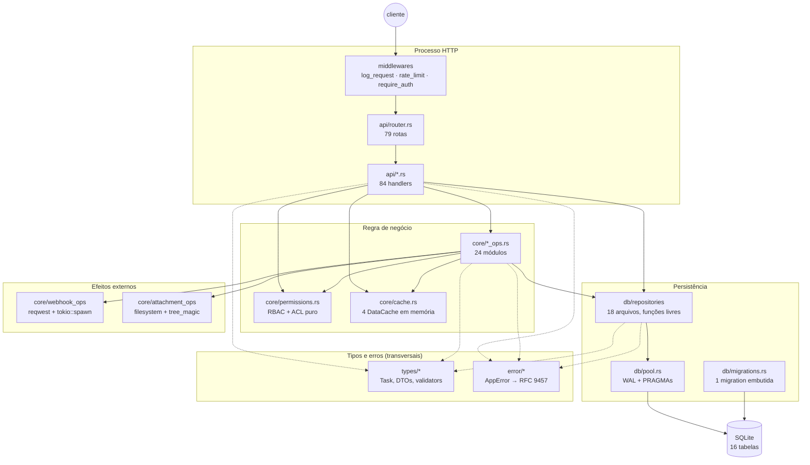
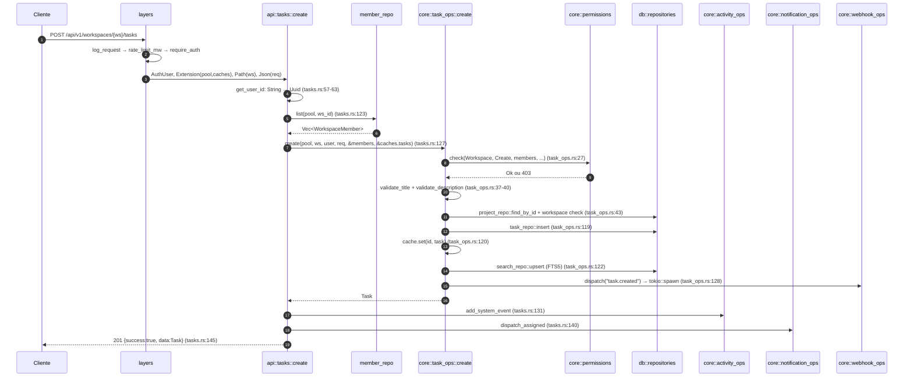
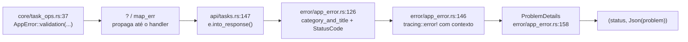

# 01 — Arquitetura, camadas e organização

> **Escopo deste documento.** Li os 101 arquivos `.rs` de `backend/src` (12.948 linhas), os
> manifests, as migrations, o `seed.rs`, o crate `www` e a topologia Docker. Nada foi compilado,
> testado ou executado. Toda afirmação estrutural vem com `caminho:linha`; o que é dedução está
> marcado `[INFERENCE]`.

O objetivo não é descrever o produto, é responder a uma pergunta só: **cada camada deste backend
se paga?** A resposta curta: a espinha `api → core → repo` sim; `error/` quase; `types/` sim;
cache, rate limit e spec são cerimônia parcial com risco real embutido.

---

## 1. Papel da área no sistema

O `backend` é uma API REST (Axum 0.8) sobre um único arquivo SQLite, com um segundo binário
(`www`) que serve HTML SSR e monta **o mesmo router de API no mesmo processo**
(`www/src/main.rs:74`, `www/src/main.rs:106`). A arquitetura existe para resolver três problemas
concretos:

| Problema | Onde é resolvido | Custo |
|---|---|---|
| Transporte HTTP heterogêneo (cookie, Bearer, multipart, JSON, rate limit) | `api/` + middlewares | 2.925 LOC |
| Regra de negócio reutilizável por dois front-ends (REST e SSR) | `core/*_ops.rs` | 4.326 LOC |
| Persistência em SQLite com um schema estável | `db/repositories` + migrations | 2.682 LOC |

| Métrica | Valor | Fonte |
|---|---|---|
| LOC em `backend/src` | 12.948 (101 arquivos) | `wc -l` |
| Rotas registradas | 79 | `api/router.rs` (`.route(`) |
| Handlers públicos | 84 | `grep "pub async fn" api/*.rs auth/handlers.rs` |
| Repositórios | 18 arquivos / 2.343 LOC | `db/repositories/` |
| Handlers que devolvem `Response` na mão | 73 de 84 | `grep -- "-> Response"` |
| Chamadas `member_repo::list` | 55 | `grep -rn` |
| Transações explícitas | 1 | `db/repositories/status_repo.rs:42` |
| Dependências diretas | 23 | `backend/Cargo.toml:12-35` |
| Testes | 84 inline + 11 de integração | `grep "#[test]"`; `backend/tests/integration.rs` |

O número que mais diz sobre a arquitetura é a linha "73 de 84". O projeto tem um tipo de erro
capaz de virar resposta (`AppError: IntoResponse`), mas a maioria dos handlers **não usa `?`**:
faz `match`, converte com `.into_response()` e devolve `Response` manualmente
(ex.: `api/tasks.rs:118-126`, `api/stats.rs:22-25`). Isso transforma cada handler em 20–40 linhas
de plumbing repetido e é a maior fonte de ruído do código.

---

## 2. Como está organizado

### 2.1 Workspace e crates

| Caminho | Tipo | LOC | Papel | Fonte |
|---|---|---|---|---|
| `Cargo.toml` | workspace, 2 membros | 14 | `backend` + `www` | `Cargo.toml:3` |
| `backend/` | lib (`rlib`) + bin | 12.948 | API REST | `backend/Cargo.toml:9-10`, `backend/src/main.rs` |
| `www/` | bin | 1.459 | SSR Askama + htmx, embute a API | `www/Cargo.toml:9`, `www/src/main.rs:74` |
| `old_frontend/` | **fora do workspace** | 292K | Leptos morto | não listado em `Cargo.toml:3` |
| `ai_guides/`, `wiki/` | docs | — | guias e 5 páginas de arquitetura | `wiki/05-arquitetura-interna/` |

**Por que `backend` é lib + bin.** `[lib] crate-type = ["rlib"]` (`backend/Cargo.toml:9-10`)
existe para o `www` reusar pool, migrations, seed, autenticação e o router inteiro por
`path = "../backend"` (`www/Cargo.toml:9`, usado em `www/src/main.rs:59-61,74`). O bin
(`backend/src/main.rs`) é a API pura — é o que o `docker/Dockerfile.backend:71` executa; o
`docker/Dockerfile.full:74` executa `/app/www`. Uma lib, dois processos possíveis: a decisão se
paga, mas gera dois `main` quase idênticos (`backend/src/main.rs:10-21` vs
`www/src/main.rs:55-61`), que divergem com o tempo (o `www` não tem CORS nem
`RequestBodyLimitLayer`, por exemplo).

`old_frontend/` é 292K de código Leptos que **não é compilado por nada** (`Cargo.toml:3` só lista
`backend` e `www`). É peso morto que confunde quem chega — o tipo de coisa que deveria ter sido
deletada no cutover.

### 2.2 Features e perfil de build

Não há `[features]` em nenhum crate. O perfil release é agressivo:

```toml
# Cargo.toml:9-14
[profile.release]
opt-level = 3
lto = "fat"
codegen-units = 1
strip = "symbols"
panic = "abort"
```

`lto = "fat"` + `codegen-units = 1` num projeto de 13K LOC com 23 deps custa minutos de link para
economizar poucos MB num container. `panic = "abort"` é compatível com `#[tokio::main]` aqui
porque não há `catch_unwind` no código. **Veredito:** manter `strip` e `opt-level`; `lto = "thin"`
e `codegen-units` default dariam 95% do resultado sem o custo de CI.

### 2.3 Dependências: o que cada uma resolve

| Dependência | Resolve | Vale? |
|---|---|---|
| `axum 0.8` (`multipart`) | HTTP + extractors + roteamento | sim, é o esqueleto |
| `tower-http 0.6` (`cors`, `limit`) | CORS e limite de corpo | sim, mas `TraceLayer` e `CompressionLayer` não estão habilitados (`backend/Cargo.toml:15`): o tracing foi reescrito em `log_request` e **não há compressão** em lugar nenhum (nem no `Caddyfile`) |
| `tokio` (`full`) | runtime + `spawn` + `fs` | sim |
| `tracing` / `tracing-subscriber` (`env-filter`) | logs estruturados | sim |
| `serde` / `serde_json` | DTOs e colunas JSON | sim |
| `thiserror 2` | `AppError` | sim, sem `anyhow` em lugar nenhum |
| `uuid` (`v7`) | IDs ordenáveis por tempo | sim, e é a melhor decisão de dados |
| `chrono` | timestamps | sim |
| `sqlx 0.8` (sem macros/offline) | queries em runtime | sim, mas sem `query!` não há checagem de SQL em compile-time |
| `argon2` + `sha2` + `hmac` + `hex` + `rand_core` | senha, hash de token, assinatura de webhook | sim |
| `tree_magic_mini` | sniff de MIME por magic bytes | sim, 1 uso (`core/attachment_ops.rs:153`) |
| `reqwest` (`rustls`, sem default) | dispatch de webhook | sim, 2 usos (`core/webhook_ops.rs`) |
| `futures-util` | `StreamExt` no multipart | sim, 1 uso (`api/attachments.rs:4`) |
| `url` | `form_urlencoded` no sync de integração | sim, 1 uso (`core/integration_ops.rs:264`) |

Nenhuma dependência morta. `criterion` só existe como dev-dep e o bench tem 14 linhas
(`backend/benches/tasks.rs`).

### 2.4 Mapa de módulos

| Módulo | Responsabilidade | LOC | Depende de |
|---|---|---|---|
| `api/` | 20 arquivos: 1 por recurso + `router`, `api_key_mw`, `rate_limit`, `helpers` | 2.925 | `core`, `db::repositories`, `error`, `types` (via `models`) |
| `auth/` | hash Argon2id, sessões, API tokens, 5 handlers | 498 | `db::repositories`, `error`, `types` |
| `core/` | 24 arquivos `*_ops` + `permissions` + `cache` + `stats` + `constants` | 4.326 | `db::repositories`, `error`, `types`, rede (`webhook_ops`) |
| `db/` | 18 repos + `pool` + `migrations` | 2.682 | `sqlx`, `error`, `types` |
| `error/` | `AppError`, `ProblemDetails`, `ApiResponse`, `category`, `context` | 719 | `axum`, `thiserror` |
| `types/` | 15 arquivos: modelos de domínio, DTOs, validação | 1.369 | `serde`, `uuid`, `chrono` |
| `spec/` | `include_str!` do `openapi.yaml` + HTML do Swagger | 40 | `axum` |
| raiz | `main`, `lib`, `models` (barrel), `errors` (barrel), `seed` | 389 | tudo |

Soma: 2.925 + 498 + 4.326 + 2.682 + 719 + 1.369 + 40 + 389 = 12.948.

### 2.5 Diagrama de camadas



### 2.6 A regra de dependência (e onde ela vaza)

A intenção declarada é `types ← error ← db ← core ← api`: cada camada só olha para baixo. Ela é
respeitada no essencial — `core` nunca importa `api`, e `db` nunca importa `core`. Os vazamentos:

1. **`api` importa repositório direto.** `api/tasks.rs:18` traz `member_repo` e o handler chama
   `member_repo::list` 9 vezes no arquivo (linhas 77, 123, 163, 186, 275, 308, 346, 390, 416).
   São 55 ocorrências no total. O handler passou a conhecer a forma de carregar autorização.
2. **`db` devolve `AppError`.** 14 dos 18 repos retornam `AppError` (88 assinaturas); apenas 4
   (`api_token`, `invite`, `session`, `user`) retornam `sqlx::Error` (17 assinaturas). Ou seja: a
   camada de dados depende do tipo HTTP-semântico da camada de erro, e o faz de forma
   inconsistente.
3. **`core` faz I/O de rede.** `core/webhook_ops.rs:124-160` cria `reqwest::Client` e dispara
   `tokio::spawn` por webhook. Um `*_ops` deixou de ser "banco + regra".
4. **Dois nomes para o mesmo módulo.** `errors.rs:1-4` é `pub use crate::error::*` e
   `models.rs:1-5` é `pub use crate::types::*`. Todo o código importa `crate::errors::…` e
   `crate::models::…` (ex.: `core/task_ops.rs:11-14`), então a camada "nova" (`error`, `types`)
   só existe de fato na declaração — os barrels venceram por inércia.

---

## 3. Fluxos passo a passo

### 3.1 Boot (`backend/src/main.rs`)

1. `tracing_subscriber` com `RUST_LOG`, default `info` (`main.rs:3-8`).
2. Lê `DATABASE_URL`, `SITE_ADDR`, `UPLOAD_DIR`; **cria o diretório de upload com `.ok()`**,
   ignorando erro (`main.rs:10-15`).
3. `init_pool` → `migrations::run` → `seed::run`, em sequência e sem retry (`main.rs:17-19`).
4. Cria `Caches::new()` — 4 mapas vazios (`main.rs:21`).
5. Monta CORS a partir de `ALLOWED_ORIGIN`, com fallback wildcard se inválido (`main.rs:24-41`).
6. `Router` com `/_healthz` + `nest("/api", api::router::build(...))`, depois
   `RequestBodyLimitLayer(55 MiB)` e CORS (`main.rs:43-50`).
7. `tokio::spawn` de um loop de limpeza de sessões a cada 72 h (`main.rs:52-65`,
   `core/constants.rs:26`).
8. `axum::serve` com graceful shutdown em Ctrl+C/SIGTERM (`main.rs:70-72`, `main.rs:87-113`).
9. Após o serve retornar, `PRAGMA optimize` (`main.rs:74-77`).

O boot é linear e legível — 113 linhas. O ponto frágil é o passo 3: `seed` roda em **toda**
inicialização e chama `core::*_ops` (`seed.rs:13-31`), então qualquer bug de `_ops` impede o
processo de subir.

### 3.2 Ciclo de vida de uma request

O `router.rs` empilha 8 layers (`api/router.rs:124-131`). A ordem real de execução é o **inverso**
da listagem, porque cada `.layer()` envolve o resultado do anterior (`[INFERENCE]`, confirmado
pela implementação do Axum 0.8.9 em `path_router.rs:285-297`, e pela necessidade de
`require_auth` enxergar `Extension(pool)` — que só é inserido na linha seguinte,
`api/router.rs:129-130`):

| # | Layer (execução real, fora → dentro) | Faz o quê | Fonte |
|---|---|---|---|
| 1 | `Extension(caches)` | injeta os 4 caches | `api/router.rs:131` |
| 2 | `Extension(pool)` | injeta o `SqlitePool` | `api/router.rs:130` |
| 3 | `require_auth` | Bearer → `verify_api_token`; senão cookie → `verify_session`; injeta `AuthUser` | `api/api_key_mw.rs:90-113` |
| 4-6 | `Extension(write/login/rate_limiter)` | injeta os 3 limitadores | `api/router.rs:126-128` |
| 7 | `rate_limit_mw` | login 5/60s por IP, escrita 10/60s, geral 100/60s | `api/rate_limit.rs:127-190` |
| 8 | `log_request` | loga método, path, status, ms | `api/api_key_mw.rs:120-160` |

Duas consequências diretas dessa ordem:

- **`log_request` é o mais interno**, então 401/403/429 gerados por `require_auth` ou pelo rate
  limit **não são logados**, e a duração medida exclui os middlewares. O comentário
  `// Layers (outermost first)` (`api/router.rs:123`) descreve o inverso do que acontece.
- **`rate_limit_mw` roda depois de `require_auth`**, mas ignora o `AuthUser` já presente nas
  extensions e reextrai o token por conta própria (`api/rate_limit.rs:108-124`). É a terceira
  cópia da mesma lógica de extração, ao lado de `api/helpers.rs:9-30` e
  `api/api_key_mw.rs:130-142`.

`ws_id`/`task_id` chegam por `Path<Uuid>` do Axum (`api/tasks.rs:116-117`); o usuário chega por
`AuthUser` (extractor sobre extensions, `api/api_key_mw.rs:42-60`). Não há extractor que una os
dois — cada handler recombina `Path` + `AuthUser` + `Extension(pool)` + `Extension(caches)`.

### 3.3 `POST /tasks` de ponta a ponta



Quem faz o quê, com evidência:

| Responsabilidade | Onde | Observação |
|---|---|---|
| Desserializar JSON | `Json<CreateTaskRequest>` (`api/tasks.rs:117`) | falha vira rejeição do Axum, não `ProblemDetails` (ver §3.4) |
| Converter `String`→`Uuid` do usuário | `api/tasks.rs:57-63` | 48 sítios em 14 arquivos (46 `parse()` inline em 12 + 2 helpers) |
| Carregar autorização | `api/tasks.rs:123` → `member_repo::list` | o handler busca **todos** os membros para o `core` decidir |
| Autorizar | `core/task_ops.rs:27` → `core/permissions.rs:26` | função pura, síncrona, sem I/O |
| Validar | `core/task_ops.rs:37-40` | `validate_*` retornam `Result<(), String>` |
| Abrir transação | **ninguém** | `task_repo::insert` usa `&pool` (`db/repositories/task_repo.rs:21-59`) |
| Persistir | `task_repo::insert` (`task_ops.rs:119`) | 1 `INSERT` |
| Efeitos colaterais | FTS (`task_ops.rs:122`), webhook (`128`), activity (`api/tasks.rs:131`), notificação (`140`) | 4 escritas/efeitos, todas com `let _ =` — erro engolido |
| Montar resposta | `api/tasks.rs:145` | `(StatusCode::CREATED, Json(ApiResponse::ok(task)))` |

O caminho é compreensível em uma leitura, mas note a assimetria: **`core` cria a tarefa e o
`api` registra atividade e notifica**. Se amanhã o `www` criar tarefa por outro caminho, ele
perde activity/notification silenciosamente — a regra vazou para o transporte. A prova disso é
que `www` já contorna o `core` em outros recursos, chamando repo direto
(`www/src/routes/workspace.rs:17,34`).

### 3.4 Como um erro de domínio vira RFC 9457



`AppError` é um enum plano com 9 variantes, todas com os mesmos 3 campos: `detail`, `instance`
(UUID v7) e `context: Box<ErrorContext>` (`error/app_error.rs:25-92`). `From<sqlx::Error>` mapeia
qualquer falha de banco para `Database` (`error/app_error.rs:170-180`), o que faz `?` funcionar em
toda a pilha de `core`/`db`.

| Variante | HTTP | `type` URN | `title` no `into_response` | `title()` da categoria |
|---|---|---|---|---|
| `NotFound` | 404 | `…:not-found` | "Not Found" | "Not Found" |
| `Validation` | 422 | `…:validation-error` | "Validation Error" | "Validation Error" |
| `Unauthorized` | 401 | `…:authentication-failed` | **"Unauthorized"** | "Authentication Failed" |
| `Forbidden` | 403 | `…:authorization-denied` | **"Forbidden"** | "Authorization Denied" |
| `Conflict` | 409 | `…:conflict` | "Conflict" | "Conflict" |
| `Archived` | 410 | `…:archived` | "Resource Archived" | "Resource Archived" |
| `Database` | 500 | `…:database-error` | "Database Error" | "Database Error" |
| `Internal` | 500 | `…:internal-error` | "Internal Error" | "Internal Error" |
| `RateLimited` | 429 | `…:rate-limited` | "Rate Limited" | "Rate Limited" |

Fontes: `error/category.rs:33-47` (status), `:50-63` (URN), `:65-80` (title);
`error/app_error.rs:97-108` (títulos duplicados à mão). Os dois títulos divergem em 401 e 403 —
sintoma de duas tabelas de verdade para a mesma coisa. `ErrorCategory::title()`
(`error/category.rs:65`) só é chamada pelos testes do próprio módulo (`error/category.rs:118-126`).

Três buracos no fluxo:

1. **`ErrorContext` é decoração.** `with_operation`/`with_user_id`/`with_resource_id`
   (`error/app_error.rs:265-286`) não têm uma única chamada fora de `error/`. Os campos
   `http_status`, `api_errors` e `response_body` (`error/context.rs:12-20`) nunca são escritos.
   Todo `AppError` carrega um `Box<ErrorContext>` vazio — alocação por erro, zero informação.
2. **JSON inválido não é `ProblemDetails`.** `handle_json_rejection` existe
   (`error/mod.rs:14-46`) mas **não é montado em lugar nenhum**; sem `Json` customizado, um corpo
   malformado sai no formato de rejeição do Axum, quebrando a promessa de erro uniforme.
3. **Erro de banco vaza para o cliente.** `Database` usa `err.to_string()` como `detail`
   (`error/app_error.rs:170-178`) e devolve 500 com a mensagem crua do SQLite.

### 3.5 Escrita, leitura e cache

`DataCache<T>` é um `HashMap<Uuid, T>` atrás de `tokio::sync::RwLock` (`core/cache.rs:25-31`),
com `get`/`set`/`remove`/`get_all`/`warm_from` (`core/cache.rs:41-98`). `Caches` agrega 4 mapas:
tasks, projects, sprints, workspaces (`core/cache.rs:102-116`).

O padrão é write-through manual: `create` faz `insert` no banco e `cache.set` em seguida
(`core/task_ops.rs:119-120`); `update` faz `cache.set` (`:320`); `delete` faz `cache.remove`
(`:420`). Não há TTL, tamanho máximo nem versão. `warm_from` existe mas não é chamado por ninguém.

**O cache muda o resultado de autorização.** Em `get_by_id`, o caminho de banco filtra por
workspace (`core/task_ops.rs:154-157`), mas o caminho de cache retorna direto, sem checar
`task.workspace_id == workspace_id` (`core/task_ops.rs:151-153`). Basta ser membro de qualquer
workspace e conhecer o UUID de uma task cacheada para lê-la por
`GET /workspaces/{ws_qualquer}/tasks/{task_id}`. O comentário do módulo avisa que "o cache não
substitui autorização" (`core/cache.rs:12-13`), mas ele substitui, porque a checagem de escopo
está depois do `get`.

---

## 4. Decisões boas e por quê

1. **Repositórios como funções livres sobre `&SqlitePool`, sem traits.** 18 arquivos, 2.343 LOC,
   zero `dyn`/`Box<dyn Repository>`. Isso permite o pool `:memory:` com `max_connections=1`
   (`db/mod.rs:10-28`) e testes de integração que sobem o router real in-process
   (`backend/tests/integration.rs:16-48`). Um trait aqui só adicionaria indireção.
2. **`permissions::check` é puro e síncrono** (`core/permissions.rs:26-110`): recebe `members`,
   ACLs e assignees já carregados, devolve `Result<(), AppError>`. 100% testável sem banco
   (há 9 testes no módulo). É a melhor fronteira do projeto.
3. **`AppError` + `From<sqlx::Error>`** (`error/app_error.rs:170-180`) deixam `?` atravessar
   `core`/`db` inteiros. O enum tem 9 variantes — grande o suficiente para o domínio, pequeno o
   suficiente para caber na cabeça.
4. **`ProblemDetails` com 5 campos** (`error/problem.rs:22-35`) e `type` como URN estável
   (`error/category.rs:50-63`, `error/app_error.rs:159`). Cliente pode fazer `match` no `type` sem parsear texto.
5. **`unwrap_used`/`expect_used` = `deny`** (`backend/Cargo.toml:41-42`) e **cumprido**: todos os
   `unwrap()`/`expect()` do `src` estão depois de um `#[cfg(test)]` (verificado arquivo por
   arquivo). É raro e vale copiar.
6. **PRAGMAs no `after_connect`** (`db/pool.rs:32-52`): WAL, `foreign_keys`, `busy_timeout(10s)`,
   `cache_size`, `temp_store=MEMORY`, `trusted_schema=OFF`, `defensive=ON`. Garante que toda
   conexão do pool nasça igual — a alternativa (PRAGMA no boot) só afeta uma conexão.
7. **`AuthUser` como extractor sobre extensions** (`api/api_key_mw.rs:42-60`): o handler pede
   "usuário autenticado" e não sabe se veio de cookie ou Bearer. O `require_auth` decide uma vez
   (`api/api_key_mw.rs:90-113`).
8. **Migrations com `BEGIN IMMEDIATE` + checagem de integridade** e `application_id` "TMAN"
   (`db/migrations.rs:108`, `:185`, `:206`; `db/pool.rs:11`). Uma migration só
   (`sql/v1-initial.sql`, 419 linhas, 16 tabelas, 24 índices), mas o mecanismo está pronto.
9. **`ApiResponse<T>` uniforme** (`error/response.rs:28-68`): `success`, `data`, e campos de
   paginação que só aparecem quando existem (`skip_serializing_if`). Um formato, um lugar.
10. **`Uuid::now_v7()` em todo insert** (`core/task_ops.rs:55`, `core/workspace_ops.rs:19`):
    IDs ordenáveis por tempo, bons para índice B-tree e para debug por log.

---

## 5. Complexidade, custo e riscos

### 5.1 Riscos com evidência e correção mínima

| # | Risco | Evidência | Correção mais simples |
|---|---|---|---|
| R1 | Cache ignora o escopo do workspace → leitura cross-workspace | `core/task_ops.rs:151-153` vs `:154-157` | mover a checagem de `workspace_id` para antes do `cache.get` |
| R2 | `DELETE /api-keys/{id}` não verifica dono | `api/api_key_mw.rs:231-240` (`_auth`), `core/api_key_ops.rs:60-66` | `DELETE … WHERE id = ? AND user_id = ?` |
| R3 | `GET /workspaces/{id}/stats` autentica e não autoriza | `api/stats.rs:21` (`let _ = auth;`) | `member_repo::is_member` antes da consulta |
| R4 | "admin" é comparado por **username** | `api/stats.rs:34` | flag/role na tabela de usuário |
| R5 | Nenhuma transação em fluxos multi-escrita | única `pool.begin()` em `db/repositories/status_repo.rs:42`; `core/workspace_ops.rs:39,47` faz 2 inserts | `pool.begin()` em `workspace_ops::create` e `task_ops::create` |
| R6 | Erro de banco vaza SQL ao cliente | `error/app_error.rs:170-178` | `detail` fixo; logar o original |
| R7 | `ErrorContext` alocado e nunca preenchido | `error/app_error.rs:265-286` sem chamadas; `error/context.rs:12-20` | remover o campo e os builders (−80 LOC) |
| R8 | Título de erro duplicado e divergente | `error/app_error.rs:97-108` vs `error/category.rs:65-80` | usar `category.title()` |
| R9 | Rejeição de JSON fora do formato padrão | `error/mod.rs:14-46` nunca montado | `.layer(from_fn(handle_json_rejection))` ou `Json` com `WithRejection` |
| R10 | Rate limiter sem poda global | `api/rate_limit.rs:40-56`: entradas só saem quando a mesma chave volta | remover entradas vazias num `retain` periódico |
| R11 | Cache sem TTL nem limite | `core/cache.rs:25-31` | TTL por entrada ou remover o cache (ver §6) |
| R12 | `list_for_user` devolve cache parcial como se fosse completo | `core/workspace_ops.rs:58-66` (retorna se `!result.is_empty()`) | só usar cache se `result.len() == ws_ids.len()` |
| R13 | Seed cria `admin`/`admin123` e loga tokens crus | `seed.rs:35`, `:49`, `:86` | exigir env var ou gerar senha aleatória e imprimir uma vez |
| R14 | Limite de upload em 3 lugares, 2 valores | `api/attachments.rs:19` (50 MiB fixo), `core/attachment_ops.rs:12,46-49` (env), `main.rs:49` (55 MiB) | uma constante, um `Extension` |
| R15 | Busca carrega todas as tasks de todos os workspaces | `core/search_ops.rs:52-75` | `JOIN` de FTS com `tasks` e filtrar no SQL |
| R16 | Filtros: duas cadeias paralelas que precisam casar | `db/repositories/task_repo.rs:81-136` (SQL) vs `:139-176` (binds) | montar `Vec<&str>` de condições + binds numa passada |
| R17 | Linha corrompida desaparece silenciosamente | `db/repositories/task_repo.rs:180` (`filter_map(…ok())`) | `collect::<Result<_,_>>()` |
| R18 | Spec mantida à mão | `openapi.yaml` 92.9K, 54 paths vs 79 rotas | gerar do código ou aceitar que é doc, não contrato |
| R19 | `log_request` não vê 401/429 | ordem dos layers (`api/router.rs:123-131`) | mover `.layer(log_request)` para o fim |

### 5.2 O que é simples e o que é cerimônia

**Simples e funciona:**

1. **Um `AppError` para tudo, com `From<sqlx::Error>`** (`error/app_error.rs:25-92`, `:170-180`).
   Nove variantes, uma tabela de status, uma resposta. Um dev entende em 10 minutos.
2. **`permissions::check` síncrono e puro** (`core/permissions.rs:26-110`). Sem async, sem banco,
   sem trait. A hierarquia Admin > Maintainer > Member > Viewer está em 4 métodos de 1 linha
   (`types/workspace.rs:23-46`).
3. **Repositórios = funções** (`db/repositories/*.rs`). `find_by_id`, `insert`, `list` — nomes
   previsíveis, sem estado, sem `dyn`.
4. **`AuthUser` extractor** (`api/api_key_mw.rs:42-60`). O handler não vê token.
5. **Validação como funções `&str -> Result<(), String>`** (`types/validate.rs:37-117`), com os
   limites em constantes nomeadas no topo do arquivo (`:6-32`).

**Cerimônia (custo sem retorno):**

6. **`ErrorContext` em `Box` em todas as variantes, nunca usado.** 116 linhas de módulo
   (`error/context.rs`) + 3 builders (`error/app_error.rs:265-286`) + um `Box` por erro. Zero
   chamadas fora de `error/`. Poderia ser um campo `operation: &'static str` ou nada.
7. **`errors.rs` e `models.rs` como barrels de compatibilidade** (`errors.rs:1-4`,
   `models.rs:1-5`) mantêm dois caminhos de import para o mesmo tipo. "New code should import
   directly from `crate::error`" é um aviso que ninguém segue — 100% do código usa `crate::errors`.
8. **Três extrações de token** (`api/helpers.rs:9-30`, `api/rate_limit.rs:108-124`,
   `api/api_key_mw.rs:130-142`). Uma função resolveria; a duplicação nasceu da ordem dos layers.
9. **`handle_json_rejection` morto** (`error/mod.rs:14-46`, 33 linhas): a única coisa que ele
   faria — padronizar erro de JSON — não acontece.
10. **`ErrorCategory::title()` duplicado por um `match` à mão** (`error/category.rs:65-80` vs
    `error/app_error.rs:97-108`). Duas tabelas de verdade, já divergentes.

### 5.3 Onde três arquivos poderiam ser um

- `error/app_error.rs` (301) + `error/category.rs` (152) + `error/context.rs` (116) = 569 linhas
  para: 9 variantes, 1 tabela de status e 1 struct nunca preenchida. Uma versão de ~120 linhas
  (`enum` com `status()` + `title()` no mesmo `impl`, sem `context`) faria o mesmo.
- `types/request.rs` (238) + `types/validate.rs` (117) + `types/task.rs` (137) descrevem a mesma
  tarefa em três lugares: o DTO, as regras de tamanho e o modelo. Um `TaskInput` com `TryFrom`
  concentraria o invariante — hoje `CreateTaskRequest` aceita `title` de qualquer tamanho
  (`types/request.rs:14-71`) e a validação só acontece se alguém lembrar de chamar
  (`core/task_ops.rs:37`). Prova de que a validação não é invariante: `POST /workspaces` **não
  valida nome** (`api/workspaces.rs:37-50` → `core/workspace_ops.rs:15-49`), enquanto `PUT`
  valida (`core/workspace_ops.rs:199`).

O que está bem separado e deve continuar assim: `api/router.rs` (só rotas), `db/pool.rs` (só
PRAGMAs), `db/migrations.rs` (só schema), `core/constants.rs` (29 linhas, só números),
`spec/mod.rs` (40 linhas, só `include_str!`).

---

## 6. O que levar para o meraki

Curto e acionável. Cada item cita a evidência que o justifica.

**Levar**

1. **`api → core → repo`, com `core` puro e síncrono onde der.** O padrão de
   `permissions::check` (`core/permissions.rs:26`) — receber os dados já carregados e devolver
   `Result` — é o que torna regra testável sem banco. No meraki, `core` não deve receber `&Pool`
   quando puder receber dados.
2. **Um único tipo de erro que implementa `IntoResponse`** (`error/app_error.rs:125-168`), com
   `From<sqlx::Error>`. Sem `anyhow` — o projeto inteiro não tem um `anyhow` sequer.
3. **`ProblemDetails` com 5 campos e `type` URN** (`error/problem.rs:22-35`). Copiar a forma;
   descartar o `ErrorContext`.
4. **Handlers retornando `Result<impl IntoResponse, AppError>`**, não `Response`. O task-manager
   prova o custo do contrário: 73 de 84 handlers com `match` manual.
5. **Repositórios como funções sobre `&Pool`** (`db/repositories/`), com `test_pool()` `:memory:`
   de `max_connections=1` (`db/mod.rs:10-28`) e um teste de integração que sobe o router real
   (`backend/tests/integration.rs:16-48`).
6. **PRAGMAs em `after_connect`** (`db/pool.rs:32-52`) — WAL, `foreign_keys`, `busy_timeout`.
7. **`Uuid::now_v7()`** para IDs (`core/task_ops.rs:55`).
8. **`unwrap_used`/`expect_used` = `deny`** (`backend/Cargo.toml:41-42`), aceitando que teste
   pode usar `unwrap`.
9. **Extractor de usuário sobre extensions** (`api/api_key_mw.rs:42-60`), com o `id` já tipado
   como `Uuid` — o task-manager guarda `String` e paga 48 conversões em 14 arquivos.

**Não levar**

10. **Cache em memória com invalidação manual** (`core/cache.rs`). 216 linhas, um bug de
    autorização (R1) e um bug de lista parcial (R12), para economizar um `SELECT` por PK num
    SQLite local. Se o meraki precisar de cache, começar por medir.
11. **Três rate limiters em `HashMap<Vec<Instant>>`** (`api/rate_limit.rs:24-56`) sem poda.
    Uma dependência (`tower_governor`) ou um único limiter por IP resolvem.
12. **`ErrorContext`, barrels de compatibilidade e `handle_json_rejection` morto** (§5.2, itens
    6-9). São ~180 linhas que não mudam comportamento.
13. **Dois `main` quase idênticos** (`backend/src/main.rs` vs `www/src/main.rs`). Se o meraki
    tiver lib + bin, extrair `fn build_app(pool, caches) -> Router` e deixar cada `main` com 20
    linhas.
14. **`lto = "fat"` + `codegen-units = 1`** (`Cargo.toml:11-12`) num app desse tamanho.

**Se copiar o `api/`, corrigir de saída**

15. Ordem dos layers: `log_request` por fora, depois rate limit, depois auth (`api/router.rs:123-131`
    faz o inverso e o log perde 401/429).
16. Autorização de recurso **dentro** do `core`, não no handler (`api/tasks.rs:123` carrega
    membros; `api/stats.rs:21` esquece de checar).
17. `Path` + `AuthUser` num extractor só (`WorkspaceCtx { ws_id, user_id, members }`) — mataria
    48 conversões e 55 `member_repo::list`.

---

## 7. Apêndice — arquivos-chave

| Arquivo | LOC | Por que importa |
|---|---|---|
| `backend/src/main.rs` | 113 | boot completo: env, pool, migrations, seed, CORS, layers, shutdown |
| `backend/src/lib.rs` | 10 | superfície pública da lib (10 módulos) |
| `backend/src/api/router.rs` | 134 | 79 rotas + 8 layers; ordem dos layers é o ponto mais delicado |
| `backend/src/api/api_key_mw.rs` | 240 | `require_auth`, `log_request`, `AuthUser`, CRUD de API keys |
| `backend/src/api/rate_limit.rs` | 258 | 3 limiters sliding-window em memória |
| `backend/src/api/tasks.rs` | 429 | maior handler; mostra o padrão `match` + `into_response` |
| `backend/src/core/task_ops.rs` | 552 | regra de tarefa; `create` é o fluxo de referência |
| `backend/src/core/permissions.rs` | 479 | RBAC + ACL, função pura |
| `backend/src/core/cache.rs` | 216 | `DataCache<T>` + `Caches` |
| `backend/src/db/repositories/task_repo.rs` | 384 | `TaskRow`, `row_to_task`, SQL dinâmico |
| `backend/src/db/pool.rs` | 57 | WAL + 8 PRAGMAs em `after_connect` |
| `backend/src/db/migrations.rs` | 253 | migration única com `BEGIN IMMEDIATE` e integrity check |
| `backend/src/error/app_error.rs` | 301 | enum + `IntoResponse` + `From<sqlx::Error>` |
| `backend/src/error/category.rs` | 152 | tabela status/URN/título (parcialmente duplicada) |
| `backend/src/types/request.rs` | 238 | DTOs de todos os recursos |
| `backend/src/types/validate.rs` | 117 | limites + validadores |
| `backend/src/seed.rs` | 89 | admin/workspace/projeto default em todo boot |
| `backend/tests/integration.rs` | 614 | 11 testes com servidor in-process e `:memory:` |
| `www/src/main.rs` | 125 | segundo binário; monta o router da API no mesmo processo |
| `sql/v1-initial.sql` | 419 | 16 tabelas, 24 índices |
| `openapi.yaml` | 92.9K | 54 paths mantidos à mão vs 79 rotas reais |
