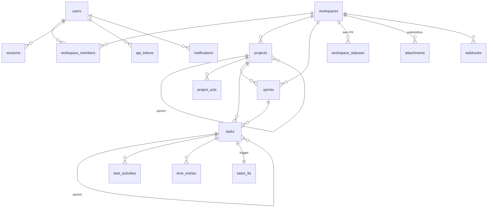

# task-manager — dados, schema e repositórios

> Camada 2: persistência. Fonte `_REF/task-manager/backend`. Toda afirmação estrutural tem
> `caminho:linha`; dedução sem execução está marcada `[INFERENCE]`. O recorte é de
> **simplicidade**: o que se paga, o que só custa, o que vale copiar.

---

## 1. Papel da área no sistema

O banco é um único arquivo SQLite e é a única fonte de verdade. Não há ORM: o SQL é escrito à
mão em `db/repositories/*.rs`, que devolvem structs de domínio (`types/*.rs`); as invariantes de
negócio ficam em `core/*_ops.rs`; os handlers em `api/*.rs` só orquestram. Três camadas, sem
geração de código e sem macro verificada em tempo de compilação — `sqlx` está com apenas
`features = ["runtime-tokio", "sqlite"]`, sem `chrono`/`uuid`/`macros`
(`backend/Cargo.toml:27`), o que explica o vai-e-vem manual de `String` e `format("%Y-%m-%d
%H:%M:%S")` que domina os repositórios.

A consequência arquitetural mais importante: **existe um segundo estado em memória**, o
`DataCache<T>` *write-through* injetado em todo handler (`core/cache.rs:26-38`,
`api/router.rs:131`). Toda leitura de task passa por ele antes do banco
(`core/task_ops.rs:149`). Isso não é cache de query: é uma cópia do agregado `Task` que precisa
ser invalidada manualmente em cada caminho de escrita — e nem todos invalidam (§5.1).

| Camada | Arquivos | Linhas | Responsabilidade |
|---|---|---|---|
| `sql/v1-initial.sql` | 1 | 419 | DDL completo, 16 tabelas, 24 índices, 13 triggers, FTS5 |
| `db/pool.rs` | 1 | 57 | pool, WAL, PRAGMAs por conexão |
| `db/migrations.rs` | 1 | 253 | runner versionado com backup e rollback |
| `db/repositories/` | 18 | 2.343 | SQL inline, row structs, mapeamento `String`→domínio |
| `core/*_ops.rs` | 19 | 3.291 | permissão, validação, cache, FTS, webhook, atividade |
| `api/` | 20 | 2.925 | parsing HTTP, carregamento de membros/ACL, diff para atividade |
| `types/` | 14 | 1.369 | structs de domínio e requests |

---

## 2. Como está organizado

### 2.1 Inventário do schema

16 tabelas `STRICT` (`sql/v1-initial.sql:11-370`), 1 tabela virtual FTS5 (`:378`) e a tabela de
controle `_schema_version`, criada em runtime (`db/migrations.rs:39`). Não há `ALTER` em lugar
nenhum: a migração V1 é um dump único, e não existe V2 (`db/migrations.rs:20-27`).

| Tabela | Propósito | Campos-chave | Índices |
|---|---|---|---|
| `workspaces` `:11` | raiz de tenancy | `slug` (sem UNIQUE), `created_by`, `archived`, `version` | só a PK |
| `users` `:41` | identidade | `username UNIQUE`, `password_hash`, `email` | UNIQUE implícito |
| `sessions` `:65` | sessão de cookie | `token_hash UNIQUE`, `expires_at` | `idx_sessions_user`, `idx_sessions_expires` |
| `invite_tokens` `:77` | convite de uso único | `token_hash UNIQUE`, `used_by` | `idx_invite_tokens_hash` (duplica o UNIQUE) |
| `api_tokens` `:89` | Bearer | `token_hash UNIQUE`, `expires_at` | `idx_api_tokens_user`, `idx_api_tokens_hash` (duplica o UNIQUE) |
| `workspace_members` `:102` | RBAC | PK `(workspace_id,user_id)`, `role CHECK(4)`, `archived` | `idx_wm_user`, `idx_wm_archived` (parcial) |
| `projects` `:120` | agrupador, auto-referente | `parent_id`, `color`, `version`, `archived` | `idx_projects_ws` |
| `project_acls` `:153` | ACL por ação | PK `(project_id,user_id,action)`, `granted` | PK cobre |
| `sprints` `:162` | ciclo | `project_id`, `start_date`, `due_date`, `velocity REAL` | `idx_sprints_ws` |
| `workspace_statuses` `:199` | workflow por workspace | PK `(workspace_id,name)`, `is_terminal`, `is_default`, `sort_order` | PK cobre (sem FK!) |
| `tasks` `:214` | agregado central | colunas abaixo | 5 índices, 2 parciais |
| `task_activities` `:291` | comentário + log | `activity_type CHECK(2)`, `metadata TEXT` JSON | `idx_ta_task` |
| `notifications` `:305` | caixa por usuário | `read INTEGER`, `task_id ON DELETE SET NULL` | `idx_notif_user`, `idx_notif_user_unread` |
| `time_entries` `:321` | apontamento | `hours REAL CHECK(>0)`, `date`, `project_id`/`sprint_id` SET NULL | 5 índices |
| `attachments` `:345` | binário em disco | `entity_type CHECK(4)`, `entity_id` polimórfico, `storage_path` | `idx_attach_entity` |
| `webhooks` `:362` | saída HTTP | `events` JSON, `secret`, `active` | `idx_webhooks_active` (parcial) |
| `tasks_fts` `:378` | busca | `task_id UNINDEXED`, `title`, `description`, `content_notes`, `tags` | FTS5 próprio, `porter unicode61` |

`tasks` é onde a decisão "JSON em coluna" aparece de forma mais forte
(`sql/v1-initial.sql:221-236`):

```sql
assignees TEXT NOT NULL DEFAULT '[]',
tags      TEXT NOT NULL DEFAULT '[]',
depends_on TEXT NOT NULL DEFAULT '[]',
watchers   TEXT NOT NULL DEFAULT '[]',
integrations TEXT NOT NULL DEFAULT '{}',
```

Quatro listas de UUID e um blob de integrações, todos sem FK, sem índice e sem `CHECK` de
formato. `integrations` nasce como `'{}'` (objeto) mas o domínio espera `Vec<IntegrationRef>`
(`db/repositories/integration_repo.rs:10`); `serde_json::from_str` falha e
`unwrap_or_default()` devolve lista vazia (`db/repositories/task_repo.rs:334`) — funciona por
acidente, não por desenho.

### 2.2 ER enxuto



Hierarquia real é `workspace → project → task`, com `sprint` opcional atravessando projetos.
`workspace_statuses` é o único filho sem FK (`sql/v1-initial.sql:200`), e
`project_acls.user_id` também não referencia `users` (`:155`) — inconsistência, não desenho.

### 2.3 Identidade e tempo

**IDs**: `Uuid::now_v7()` em 53 sítios, nenhum `new_v4` (`grep` sobre `backend/src`). UUIDv7 dá
ordenabilidade temporal de graça e dispensa `AUTOINCREMENT` — decisão certa para sincronização
futura e para chaves em URL. `uuid` está habilitado com `features = ["v7","serde","js"]`
(`Cargo.toml:24`).

**Tempo**: tudo `TEXT`, nunca `INTEGER` epoch. Dois formatos convivem:

| Formato | Quem escreve | Exemplo |
|---|---|---|
| `%Y-%m-%d %H:%M:%S` (= `datetime('now')`) | `tasks`, `projects`, `workspaces`, `sprints`, `sessions`, `seed` | `db/repositories/task_repo.rs:52-56` |
| `%Y-%m-%dT%H:%M:%S` | **só** `time_entries` | `db/repositories/time_entry_repo.rs:26-27` |

O primeiro é lexicograficamente ordenável e casa com `datetime('now')`, o que faz índices
`ORDER BY created_at DESC` (`:302`, `:318`) e comparações `expires_at > datetime('now')`
(`db/repositories/session_repo.rs:47`) funcionarem sem cast. O segundo quebra essa
comparabilidade: `dashboard`/relatório faz `date >= 'YYYY-MM-DDTHH:MM:SS'` contra datas
gravadas nesse mesmo formato — internamente consistente, mas o `T` faz `time_entries.date`
ordenar **depois** de qualquer timestamp com espaço, então um `JOIN` temporal entre
`time_entries` e `tasks` compara maçãs com laranjas.

O ponto grave é a leitura. Todo mapeamento faz:

```rust
let created_at: DateTime<Utc> = r.created_at.parse::<DateTime<Utc>>().unwrap_or_else(|_| Utc::now());
```

(`db/repositories/task_repo.rs:345-346`; idem `project_repo.rs:138-139`,
`sprint_repo.rs:162-163`, `attachment_repo.rs:109`, `workspace_repo.rs:138`). `FromStr` de
`DateTime<Utc>` é RFC 3339, que exige offset; a string gravada não tem offset. Logo o `parse`
falha e **todo `created_at`/`updated_at`/`due_date` lido do banco vira o instante da leitura**
`[INFERENCE]`: não rodei o parser, mas o formato sem offset não é RFC 3339 e os testes de
integração não inspecionam timestamps (`backend/tests/integration.rs:486-533` só olha `version`).
O efeito colateral é silencioso: a API responde datas plausíveis, sempre iguais a "agora".

### 2.4 Invariantes: banco vs. Rust

| Invariante | Quem garante | Evidência |
|---|---|---|
| PK, NOT NULL, `STRICT` (sem tipo dinâmico) | banco | 16× `) STRICT` `sql/v1-initial.sql:23-370`; `STRICT` rejeita `REAL` em coluna `TEXT` |
| FK em 30 colunas, `ON DELETE CASCADE/SET NULL` | banco, **se** o PRAGMA estiver ligado | `pool.rs:27` `foreign_keys(true)` por conexão |
| `role ∈ {admin,maintainer,member,viewer}` | banco | `sql/v1-initial.sql:105` |
| `activity_type ∈ {comment,system}` | banco | `:296` |
| `hours > 0` | banco | `:328` |
| `entity_type ∈ {task,project,sprint,workspace}` | banco | `:348` |
| `status`/`priority` válidos | **ninguém** — sem CHECK, sem FK para `workspace_statuses` | `:225-226`; trigger `:268` só consulta `is_terminal` |
| `assignees`/`watchers`/`depends_on` contêm UUIDs e membros do workspace | só Rust | `core/task_ops.rs:48-56`, `:257-267` |
| `slug` único | ninguém | schema sem UNIQUE (`:14`), `workspace_ops.rs:22` não verifica |
| projeto/task pertence ao workspace da URL | só Rust | `task_ops.rs:45`, `:154`, `:236` (`filter(|x| x.workspace_id == ...)`) |
| `updated_at` acompanha a escrita | trigger **e** Rust, redundantes | `sql:259-265` vs `task_ops.rs:317` |
| `closed_at` acompanha status terminal | trigger **e** Rust, redundantes | `sql:268-284` vs `task_ops.rs:304-313` |
| FTS sincronizado | trigger **e** Rust, redundantes | `sql:392-411` vs `search_repo::upsert` (`core/task_ops.rs:122`) |

Os triggers de `created_at` (`:25`, `:137`, `:183`, `:252`) são **código morto**: a coluna é
`NOT NULL` sem default e o `WHEN NEW.created_at IS NULL` só rodaria depois de um INSERT que o
próprio `NOT NULL` já rejeitou. Já os de `updated_at` (`:32`, `:144`, `:190`, `:259`) têm um
uso real e estreito: pegam as escritas **parciais** que não passam pela struct
(`task_repo::archive` em `:266-275` não toca `updated_at`; `integration_repo.rs:104-113` idem).

### 2.5 Repositórios: o padrão

18 repositórios (mais um `mod.rs` de re-exports), 2.343 linhas, 95 chamadas `sqlx::query*`. O molde é sempre o mesmo:

1. SQL como literal `&'static str` com placeholders numerados `?1..?N`;
2. `sqlx::query_as::<_, XRow>` + struct `#[derive(sqlx::FromRow)]` privada ao módulo;
3. função `row_to_x` convertendo `String`→`Uuid`, `i32`→`bool`, `String` JSON→`Vec`, e
   devolvendo `AppError::internal` (500) quando o dado é corrompido;
4. devolução de struct de domínio, nunca da row.

| Repositório | SQL | `RETURNING` | Destaque |
|---|---|---|---|
| `task_repo.rs` | 8 | não | filtros montados por `format!` com `param_idx` (`:75-188`) |
| `member_repo.rs` | 9 | não | `INSERT OR IGNORE` (`:64-79`) |
| `project_repo.rs` / `workspace_repo.rs` | 7 / 7 | não | `IN (...)` dinâmico (`workspace_repo.rs:42-63`) |
| `sprint_repo.rs` | 8 | não | dois ramos duplicando SELECT (`:48-70`) |
| `activity_repo.rs` | 5 | sim (`:25`) | único repo com paginação + count |
| `notification_repo.rs` / `session_repo.rs` / `api_token_repo.rs` / `user_repo.rs` | 5 | sim | devolvem a row recém-criada sem segundo SELECT |
| `status_repo.rs` | 4 | não | **única** transação explícita do projeto (`:42`) |
| `acl_repo.rs` | 3 | não | `load_project_acls` ignora `workspace_id` (`:10-35`) |
| `search_repo.rs` | 5 | não | FTS manual; `MATCH` com `*` por palavra (`:43-59`) |
| `integration_repo.rs` | 2 | não | lê a task inteira para editar um JSON (`:16-30`) |
| `attachment_repo.rs` / `webhook_repo.rs` / `invite_repo.rs` | 4 / 4 / 3 | não | — |

Comparação com os idiomas do SQLx: o projeto usa o *runtime API* (`query_as`, `query_scalar`)
em 100% dos casos, sem `query!`/`sqlx::migrate!` e sem tabela de metadados do SQLx — ele
implementa o próprio runner (`db/migrations.rs:36-148`). `RETURNING` é usado onde o SQLite 3.35+
permite, o que é o idioma correto e evita um SELECT extra (6 de 18 repositórios). O que foge do
idioma: (a) `SELECT *` + struct que precisa espelhar a tabela (`task_repo.rs:64`, `:92`), então
adicionar coluna quebra o `FromRow` em runtime; (b) `f32`/`f64` para dinheiro/horas
(`hours REAL`), quando o próprio SQLite documenta que `REAL` é binário de ponto flutuante;
(c) `ORDER BY ... LIMIT` ausente na listagem principal.

Veredito por camada, que é o critério do documento:

| Camada | Existe para | Se paga? |
|---|---|---|
| `repositories` | isolar SQL e mapeamento | **sim** — 2.343 linhas chatas, mas nenhum handler monta SQL |
| `core/*_ops` | permissão + validação + efeitos (cache/FTS/webhook) | **sim**, mas absorveu responsabilidade demais (webhook, cache, FTS) e virou o ponto de acoplamento |
| `api` | HTTP | **parcialmente** — carrega membros e ACL em todo request (`api/tasks.rs:186-192`) e acumula o diff de atividade, que é regra de negócio |
| `cache` | evitar SELECT | **não no volume atual**: 1 SELECT por PK (`task_repo.rs:62`) é barato; o cache adiciona um estado a invalidar e 4 caminhos de escrita (`dep_ops`, `watcher_ops`, `integration_repo`, `archive_ops`) não o invalidam |

### 2.6 Soft delete e archive

O padrão é `archived INTEGER NOT NULL DEFAULT 0` + `archived_at TEXT` + `archived_by TEXT`, em
`workspaces`, `projects`, `sprints`, `tasks` e `workspace_members` (`sql/v1-initial.sql:19-21`,
`:130-132`, `:176-178`, `:241-243`, `:107-108`). Três colunas para um booleano: `archived` é
derivável de `archived_at IS NOT NULL`, e nada no banco impede `archived=1, archived_at=NULL`
(o `archive` grava os dois, `task_repo.rs:266-275`, mas o `restore` limpa os dois, `:277-285`).

O repositório expõe `archive`/`restore` como `UPDATE` de uma linha sem `rows_affected` e sem
`version` (idem `project_repo.rs:95-117`, `workspace_repo.rs:98-120`). Logo arquivar duas
vezes é sucesso silencioso, e arquivar enquanto outro cliente edita não conflita.

`core/archive_ops.rs` repete o mesmo par `archive_x`/`restore_x` para 4 entidades + membro
(257 linhas), mas só `workspace` tem efeito colateral (remove os membros,
`core/archive_ops.rs:37-41`). A camada HTTP promete genérico e entrega um caso:

```rust
// api/archive.rs:42, 55, 62
Path((_entity_type, id)): Path<(String, Uuid)>,
...
archive_ops::get_archived_workspace(&pool, id)
```

`entity_type` é parseado e ignorado — `GET /archive/task/{id}` devolve workspace. As três rotas
"unificadas" (`api/router.rs:94-96`) só funcionam para workspace, enquanto os outros
`archive_ops` estão mortos.

### 2.7 Histórico e atividade

`task_activities` é uma tabela híbrida: comentário humano e evento de sistema na mesma linha,
discriminados por `activity_type CHECK(comment|system)` (`sql/v1-initial.sql:296`). O "diff" é
`metadata TEXT` com JSON `{field, old_value, new_value}` — todos como `String`
(`types/activity.rs:24-31`). Ou seja, o formato do diff é uma convenção de
`api/tasks.rs`, não um contrato: nada impede gravar `field:"x"` sem valores.

O que é registrado (`api/tasks.rs`, 8 sítios): criação (`:131`), mudança de status, prioridade,
assignees e título (`:203`, `:218`, `:229`, `:247`), arquivamento (`:285`), toggle (`:318`),
bulk (`:362`). O que **não** é: descrição, notas, datas, tags, posição, sprint, projeto,
dependências, watchers. E o diff é calculado no handler com dois `get_by_id` antes/depois
(`api/tasks.rs:194`, `:200`) — porque `task_ops::update` devolve o agregado e não um delta.

Transactionalidade: nenhuma. O `update` grava em autocommit (`task_repo.rs:223-262`), depois o handler faz
até 4 `INSERT`s, todos com `let _ =` (`api/tasks.rs:203-256`). Falha de atividade é invisível;
o log pode ficar incompleto e a task já está alterada.

---

## 3. Fluxos passo a passo

### 3.1 Leitura (GET task)

```
GET /v1/workspaces/{ws}/tasks/{id}
  └─ require_auth (middleware)                 api/router.rs:129
  └─ member_repo::list(ws)                     api/tasks.rs:163  → 1 SELECT
  └─ task_ops::get_by_id                       core/task_ops.rs:138
       ├─ membership in-memory check           :146-148
       ├─ cache.get(id)  → hit? retorna        :149
       └─ task_repo::find_by_id                db/repositories/task_repo.rs:62 → 1 SELECT
            └─ row_to_task (parse de datas falha → Utc::now)   :318-384
       └─ cache.set(id)                        :156
```

Duas queries por request (membros + task) e a task é **filtrada por workspace em Rust**
(`:154`), não no `WHERE` (`task_repo.rs:64` só `id = ?1`). Para listagem a situação é pior:
`task_repo::list` devolve **todas** as tasks do workspace (`:75-188`, sem `LIMIT`) e o handler
corta em memória `(skip/take)` (`api/tasks.rs:100-103`) — o `total` da paginação só existe
porque tudo foi materializado.

### 3.2 Escrita A — criar task

| Passo | Onde | SQL |
|---|---|---|
| 1. membros | `api/tasks.rs:123` | `SELECT ... workspace_members WHERE archived=0` |
| 2. permissão | `core/task_ops.rs:27-35` | — |
| 3. validação de título/descrição | `:37-40` | — |
| 4. projeto existe e é do ws | `:43-46` | SELECT `projects` |
| 5. assignees ∈ membros | `:48-56` | — (memória) |
| 6. `id = Uuid::now_v7()` | `:57` | — |
| 7. pai / sprint | `:62-76` | até 2 SELECT |
| 8. cada dependência | `:78-86` | **1 SELECT por dependência** |
| 9. INSERT | `:119` → `task_repo.rs:21-60` | 1 INSERT (27 colunas) |
| 10. cache | `:120` | memória |
| 11. FTS upsert | `:122-127` → `search_repo.rs:8-32` | DELETE + INSERT (o trigger `:392` já inseriu) |
| 12. webhook | `:128-133` → `core/webhook_ops.rs:99` | SELECT **todos** webhooks ativos + `tokio::spawn` |
| 13. atividade | `api/tasks.rs:131-139` | 1 INSERT |
| 14. notificações | `api/tasks.rs:140-145` | 1 INSERT por assignee |

Total: 1 escrita de domínio + 1 atividade + N notificações, **sem transação**. Se o passo 13
falhar, o passo 9 permanece. O passo 8 é N+1 clássico: um POST com 10 dependências custa 10
`SELECT` de existência antes de um único `INSERT` — o candidato natural a `WHERE id IN (...)`
ou a FK composta `(id, workspace_id)`.

### 3.3 Escrita B — mover/editar task (optimistic locking)

`POST /move` e `PATCH /toggle` são açúcar sobre `task_ops::update`
(`core/task_ops.rs:338-399`), e ambos passam `version: Some(existing.version)` — isto é,
**repetem a versão que acabaram de ler**. Como `update` relê pelo mesmo cache (`:197`), o
compare `:218-224` sempre passa: para operações internas o lock é decorativo.

No `PUT` externo o lock é real, mas só contra leitura obsoleta:

```
1. members + acl_repo::load_project_acls   api/tasks.rs:186-192  ← carrega ACL de TODOS os workspaces
2. before = get_by_id (cache)              api/tasks.rs:194
3. update() → get_by_id de novo (cache)    core/task_ops.rs:197
4. if version != existing.version → 409    :218-224
5. merge campo a campo (19 `if let Some`)  :232-301
6. closed_at por is_terminal               :304-313
7. version += 1; updated_at = now          :316-317
8. UPDATE ... WHERE id=?26                 task_repo.rs:223-262
9. cache.set / FTS / webhook               :320-333
10. diff e até 4 INSERT de atividade       api/tasks.rs:203-256
```

O `UPDATE` final não tem `AND version = ?26` (`task_repo.rs:231`). Entre o passo 4 e o 8 cabe
outra escrita: é read-check-write, não compare-and-swap. Pior, a leitura do passo 3 pode vir do
cache, que **não** é atualizado por `dep_ops`/`watcher_ops` (`core/dep_ops.rs:31-33`,
`core/watcher_ops.rs:27-29` gravam no banco e esquecem o cache). Sequência real de perda de
dado: `POST /dependencies` grava `depends_on=[X]` e `version=2` no banco; o cache continua com
`depends_on=[]`, `version=1`; o próximo `PUT` lê `version=1` do cache, compara com o `version:1`
do cliente, passa, e regrava o array vazio com `version=2`. A dependência some. `[INFERENCE]`
pela ordem das operações, não por execução.

Custo adicional: `load_project_acls` ignora o `workspace_id` recebido e faz `SELECT` sem filtro
(`db/repositories/acl_repo.rs:10-19`); cada `PUT` de task materializa as ACLs de todos os
workspaces em um `HashMap<Uuid, HashMap<Uuid, HashSet<_>>>`.

### 3.4 Escrita C — arquivar

```
DELETE /tasks/{id}
  └─ members (1 SELECT)                      api/tasks.rs:275
  └─ before = get_by_id                      :279
  └─ task_ops::delete                        core/task_ops.rs:400
       ├─ permissão Delete                   :409-417
       ├─ UPDATE archived=1, archived_at, archived_by   task_repo.rs:266-275
       ├─ search_repo::delete                :419   ← necessário: tasks_fts_ad só dispara em DELETE real
       ├─ cache.remove                       :420
       └─ webhook "task.deleted"             :421-424
  └─ INSERT atividade "archived task"        api/tasks.rs:285
```

Observações que importam para copiar ou descartar:

- o soft delete **não** incrementa `version` e **não** seta `updated_at`; quem salva o
  `updated_at` é o trigger `trg_tasks_updated_at` (`sql:259-265`), porque a escrita não passou
  pela struct. É o único lugar onde o trigger se paga;
- o FTS precisa de `DELETE` manual justamente porque o trigger `tasks_fts_ad` (`sql:398-401`)
  só vê `DELETE`, não `archived=1`. Soft delete e trigger de FTS não conversam;
- restaurar (`core/archive_ops.rs:129-148`) faz `restore` + `find_by_id` + troca de
  `project_id` + `update` completo: **duas** escritas e um `version` incrementado por fora do
  fluxo normal, sem atividade registrada.

Resumo das três escritas:

| Escrita | Transação | Lock | Atividade | Atomicidade real |
|---|---|---|---|---|
| criar | nenhuma; 1 INSERT de domínio + N de notificação | não se aplica | INSERT em `api/tasks.rs:131` | task existe mesmo se FTS/webhook/atividade falharem |
| mover/editar | nenhuma; 1 UPDATE de 25 colunas + até 4 INSERT | `version` comparado antes (`task_ops.rs:218`), ausente no `WHERE` (`task_repo.rs:231`) | até 4 INSERT no handler (`api/tasks.rs:203-256`) | estado pode gravar sem log; TOCTOU entre 218 e 231 |
| arquivar | nenhuma; 1 UPDATE parcial + 1 DELETE de FTS | nenhum (`version` não é tocado) | INSERT no handler (`api/tasks.rs:285`) | FTS e `archived` podem divergir se o segundo passo falhar |

A coluna "Atomicidade real" é o resumo da seção 5: o projeto tem um banco transacional e não
usa transação em nenhum caminho de escrita de task.

### 3.5 Caminho de erro

`AppError` carrega categoria → status HTTP (`error/category.rs:39`: `Conflict => 409`), e a
resposta é `application/problem+json` com `instance`. O mapeamento de `sqlx::Error` é o atalho
mais grosseiro possível:

```rust
// error/app_error.rs:170-178
AppError::Database { detail: err.to_string(), ... }
```

Toda violação de constraint vira 500 com a mensagem do SQLite no corpo. Como o cadastro
depende de `username UNIQUE` (`sql/v1-initial.sql:43`) e a checagem prévia é read-then-write
(`auth/service.rs:120`), dois cadastros simultâneos com o mesmo nome retornam 500 em vez de 409.
Do lado do `core`, os erros são tipados e úteis: `AppError::conflict` para versão
(`core/task_ops.rs:221`), `validation` para FK lógica (`:78-86`), `not_found` para isolamento de
tenant (`:155`). O problema está na borda do banco, não no desenho do erro.

---

## 4. Decisões boas e por quê

| Decisão | Evidência | Por que se paga |
|---|---|---|
| SQLite com `STRICT` em todas as tabelas | `sql/v1-initial.sql:23-370` | pega `bind` de tipo errado em runtime; sem ele o SQLite aceita string em coluna `REAL` |
| WAL + `busy_timeout=10s` + PRAGMAs por conexão | `db/pool.rs:24-48` | leitores não bloqueiam escritor; `after_connect` garante que nenhuma conexão do pool escape da configuração |
| UUIDv7 como PK `TEXT` | 53 sítios `Uuid::now_v7()`; `Cargo.toml:24` | ordenável, gerável no cliente, sem `AUTOINCREMENT` nem sequência central |
| `ON DELETE CASCADE` onde o filho não tem vida própria | `sql:67`, `:91`, `:291-300`, `:321-332` | apagar workspace/task limpa atividade, tempo e notificação sem código |
| `ON DELETE SET NULL` onde o histórico sobrevive | `notifications.task_id` `:310`, `time_entries.project_id` `:326` | relatório de horas não desaparece ao apagar projeto |
| Índices parciais casando com o filtro dominante | `:249`, `:250`, `:318`, `:372` | `WHERE archived = 0`/`read = 0`/`active = 1` é o predicado de quase toda listagem; índice menor e mais quente |
| `STRICT` + `CHECK` nos enums pequenos | `:105`, `:296`, `:328`, `:348` | `role` e `activity_type` são fechados; o banco pode ser a última linha |
| Defaults no banco para JSON vazio | `:221-236` | INSERT parcial não gera `NULL` que estoura o `FromRow` |
| FTS5 com `porter unicode61` e colunas separadas | `:378-385` | busca por prefixo e stemming sem serviço externo; `task_id UNINDEXED` evita peso no índice |
| `RETURNING *` nos repos de token/sessão | `session_repo.rs:15-24`, `api_token_repo.rs:16-28` | uma ida ao banco em vez de INSERT+SELECT |
| `ApiResponse::paginated(items, total, offset, limit)` | `types/filter.rs:37-46` | contrato de paginação uniforme, mesmo que a implementação peque (§5.4) |
| `status_repo::list` devolve defaults quando a tabela está vazia | `:11-33` | workspace novo funciona sem seed de status |
| Runner de migração com `BEGIN IMMEDIATE` | `db/migrations.rs:108-133` | pega o lock de escrita antes de mexer no schema, evitando upgrade concorrente |
| Seed idempotente por `find_by_username` | `seed.rs:7-12` | boot repetido não duplica admin nem projeto |

O ponto mais bem resolvido é o **equilíbrio tabela × JSON**: `assignees`, `tags`, `watchers` e
`depends_on` nunca são filtrados por igualdade no SQL (só `LIKE` grosseiro em
`task_repo.rs:98-101`), então guardá-los como JSON é honesto. `workspace_statuses`, ao
contrário, é tabela porque `is_terminal`/`sort_order` são lidos em toda transição
(`core/task_ops.rs:305-308`).

---

## 5. Complexidade/custo e riscos

### 5.1 Onde o banco não garante e o Rust garante pela metade

| Risco | Evidência | Consequência |
|---|---|---|
| `version` não participa do `WHERE` | `task_repo.rs:231` | lost update sob concorrência; 409 só detecta leitura velha |
| `dep_ops`/`watcher_ops` não tocam o cache | `core/dep_ops.rs:31-33`; `core/watcher_ops.rs:27-29` | cache serve versão antiga; próximo `PUT` sobrescreve |
| `load_project_acls` sem filtro de workspace | `acl_repo.rs:10-19` | O(ACLs de todos os tenants) por request de escrita; o `HashMap` cresce com o banco inteiro |
| `webhook_repo::list_active_by_event` sem filtro de workspace | `webhook_repo.rs:48-62` | **todo** webhook ativo recebe evento de **qualquer** workspace; o payload leva `workspace_id` mas o destino já foi escolhido |
| `rows_affected` não é checado no archive | `task_repo.rs:266-275` | arquivar inexistente devolve 200 |
| `slug` sem UNIQUE | `sql:14` | dois workspaces com o mesmo slug; qualquer rota futura por slug fica ambígua |
| `workspace_statuses` sem FK | `sql:200` | status órfão sobrevive ao workspace e é lido por todos |
| `INSERT OR IGNORE` em membro arquivado | `member_repo.rs:64-79` | re-adicionar um membro removido **não** desarquiva: o INSERT é ignorado, `archived` continua 1 |
| `attachments` apaga linha, não arquivo | `core/attachment_ops.rs:189-211` | binário órfão em disco; não há GC |

### 5.2 FTS com dois donos

O schema instala `tasks_fts_ai/au/ad` (`sql:392-411`) e o Rust chama
`search_repo::upsert`/`delete` em `create`, `update` e `delete` (`core/task_ops.rs:122`, `:322`,
`:419`). Nas escritas normais isso significa 4 statements de FTS por update (trigger DELETE +
trigger INSERT + upsert DELETE/INSERT). Funciona, mas: qualquer escrita que não passe por
`task_ops` (ex.: `UPDATE tasks SET status` em `integration_ops.rs:292`) só tem o trigger; e o
`optimize` roda apenas na criação do schema (`sql:414`). **Um dono só** — trigger — elimina
`search_repo::upsert` e metade da superfície.

### 5.3 Migrações: boas intenções, um caso só

`db/migrations.rs` tem backup (`VACUUM INTO`, `:232-250`), `quick_check` antes e
`integrity_check` depois (`:105`, `:138`), `BEGIN IMMEDIATE` (`:108`), rollback `down()`
(`:152-203`) e identificador de formato `application_id` (`:51`). É engenharia de banco
adulto, aplicada a **uma** migração cujo `down_sql` é vazio (`:20-27`), então `down()` sempre
falha com "não possui comando de rollback" (`:178-183`).

O que vale: `_schema_version` + `BEGIN IMMEDIATE` + `quick_check`. O que não se paga:
`VACUUM INTO` num diretório relativo `backups/` (`:233`) que ninguém versiona nem expira;
`integrity_check` completo a cada migração (O(páginas), e o banco é pequeno hoje);
`PRAGMA optimize` em dois lugares (`:85`, `:146`).

Riscos de SQLite que o arquivo ignora: o SQL de migração roda com `raw_sql` multi-statement
(`:112`), então `ALTER TABLE` limitado não é problema agora — mas quando houver V2, qualquer
`ALTER ... ADD COLUMN NOT NULL` sem default falha em tabela com dados, e a receita "criar nova,
copiar, dropar, renomear" precisa desligar `foreign_keys` no meio da transação (o PRAGMA é
no-op dentro de transação). Não há teste de migração em `backend/tests/` (só integração HTTP).

### 5.4 Outros custos medidos

- **Paginação em memória**: `task_repo::list` sem `LIMIT` (`:75-188`) + `skip/take`
  (`api/tasks.rs:103`); com 10k tasks, toda listagem transporta 10k rows.
- **Filtro de assignee por `LIKE '%uuid%'`** (`task_repo.rs:98-101`): sem índice, falsos
  positivos impossíveis mas varredura total garantida.
- **`list_dependents` por `LIKE` + filtro em Rust** (`:201-219`): duas passadas para responder
  "quem depende de X".
- **`integrations` lê a task inteira** para editar um item do array
  (`integration_repo.rs:16-30`): 27 colunas + parse de 4 JSONs para tocar um blob.
- **`list_active_by_event` carrega todos os webhooks** e filtra `events` em Rust (`:48-62`),
  porque JSON não é indexável.
- **`stats` faz ~15 contas separadas** (`core/stats.rs:78-230`) em vez de um `GROUP BY`; cada
  `COUNT(*)` é uma varredura do índice de workspace.
- **Cache sem TTL nem tamanho** (`core/cache.rs:26-38`): cresce com o número de tasks
  acessadas; em processo único é aceitável, em multi-instância vira divergência.
- **`f32` para `hours`/`spent_hours`** (`sql:232-233`, `:328`): soma de horas acumula erro binário;
  `REAL` é `f64`, o `f32` no struct (`task_repo.rs:304-305`) trunca na leitura.

---

## 6. O que levar para o meraki

### 6.1 Simplicidade: 10 decisões, com veredito

1. **Copiar `STRICT` + `CHECK` nos enums fechados.** Barato, pega bug de bind. Um `CHECK
   (role IN (...))` custa uma linha e substitui um `match` defensivo.
2. **Copiar UUIDv7 como PK `TEXT`.** Ordena por tempo, dispensa sequência, funciona em réplica.
   Não copiar a ausência das features `uuid`/`chrono` do SQLx: com elas, `Uuid` e
   `DateTime<Utc>` vão direto no `bind` e somem dezenas de `format!`/`parse` manuais.
3. **Copiar o padrão "repo devolve domínio, ops decide".** A separação `repositories/` ↔
   `core/*_ops.rs` é a melhor coisa do projeto: SQL não vaza para o handler e permissão não
   vaza para o SQL.
4. **Copiar índice parcial casado com o predicado dominante** (`archived = 0`, `read = 0`) e
   **descartar índice que duplica UNIQUE**: `api_tokens.token_hash` e
   `invite_tokens.token_hash` têm UNIQUE *e* índice explícito (`sql:93,99` e `:79,86`) — dois
   B-trees para a mesma coluna. Mesmo erro em `tasks.status`: `idx_tasks_status` (`:248`) e
   `idx_tasks_status_active` (`:249`) respondem à mesma query, a segunda é estritamente melhor
   para `archived=0`.
5. **Escolher um dono para o FTS.** Se houver FTS, trigger; se houver trigger, apagar o
   `upsert` do Rust. Dois donos = 4 escritas por update e um `optimize` esquecido.
6. **Apagar os triggers de `created_at`.** `NOT NULL` sem default já é a garantia; o trigger
   nunca dispara (`sql:25`, `:137`, `:183`, `:252`). Manter só o `updated_at` para escritas
   parciais, e mesmo assim preferir `DEFAULT (datetime('now'))` na coluna.
7. **Optimistic lock de verdade**: `UPDATE ... SET ..., version = version + 1 WHERE id = ? AND
   version = ?`, `rows_affected() == 0 → 409`. Uma linha de SQL resolve o TOCTOU que o projeto
   tenta resolver com dois `SELECT` (`task_ops.rs:218` vs `task_repo.rs:231`). E não passar
   `version` de operação interna para operação interna (`core/task_ops.rs:360`, `:470`).
8. **Paginação no SQL desde o dia 1**: `LIMIT/OFFSET` no repositório e `COUNT(*)` separado (ou
   cursor por `(created_at, id)`). O padrão do projeto — carregar tudo e cortar no handler
   (`api/tasks.rs:103`) — não sobrevive ao primeiro workspace grande.
9. **Soft delete com uma coluna, não três.** `archived_at TEXT` (NULL = vivo) +
   `archived_by TEXT` eliminam o estado impossível `archived=1, archived_at=NULL`. Se precisar
   de filtro rápido, índice parcial `WHERE archived_at IS NULL` no lugar de `archived INTEGER`.
10. **Atividade na mesma transação da escrita, dentro do ops.** Hoje o diff mora no handler
    (`api/tasks.rs:203-256`), com `let _ =` em cada INSERT. Levar para `task_ops::update` com
    `pool.begin()` custa 5 linhas e garante que log e estado não divergem — e elimina os 8
    call-sites duplicados.

### 6.2 Checklist acionável

- [ ] Tabelas: `STRICT`, PK `TEXT` UUIDv7, `created_at`/`updated_at` com `DEFAULT
      (datetime('now'))`, `CHECK` em todo enum fechado.
- [ ] FK em toda coluna `*_id` que aponta para tabela existente — inclusive `workspace_statuses
      .workspace_id` e `project_acls.user_id`, que o projeto esqueceu.
- [ ] `ON DELETE CASCADE` para filhos sem vida própria; `SET NULL` para histórico.
- [ ] JSON só para lista que nunca é filtrada por igualdade (`assignees`, `tags`); tabela para
      tudo que precisa de `ORDER BY`/`COUNT` (`statuses`, `activities`, `time_entries`).
- [ ] `version` no `WHERE` do `UPDATE`; 409 mapeado explicitamente, não 500 do SQLx.
- [ ] Um `now()`/`parse_ts()` único no projeto (ou as features do SQLx), formato
      `%Y-%m-%d %H:%M:%S` em todas as colunas, sem exceção por tabela.
- [ ] FTS: trigger único + `INSERT INTO fts(fts) VALUES('optimize')` no fim da migração.
- [ ] Nenhuma query de listagem sem `LIMIT`.
- [ ] Atividade e notificação dentro da transação da escrita, uma função por entidade.
- [ ] Testes de dado (não só HTTP): round-trip de timestamp, conflito de versão concorrente,
      soft delete idempotente.

---

## 7. Apêndice — arquivos-chave

| Arquivo | Linhas | Por que ler |
|---|---|---|
| `backend/sql/v1-initial.sql` | 419 | DDL integral: 16 tabelas, 24 índices, 13 triggers, FTS5, `ANALYZE` |
| `backend/src/db/pool.rs` | 57 | WAL, `busy_timeout`, PRAGMAs por conexão, `application_id` |
| `backend/src/db/migrations.rs` | 253 | runner `BEGIN IMMEDIATE`, backup, rollback, checks de integridade |
| `backend/src/db/repositories/task_repo.rs` | 384 | CRUD central, filtros dinâmicos, `row_to_task`, archive/restore |
| `backend/src/db/repositories/acl_repo.rs` | 100 | ACL como `HashMap` aninhado; consulta sem filtro de workspace |
| `backend/src/db/repositories/status_repo.rs` | 76 | **única** transação explícita (`pool.begin`, `:42`) |
| `backend/src/db/repositories/search_repo.rs` | 68 | FTS manual, prefixo por palavra, sem `LIMIT` |
| `backend/src/db/repositories/integration_repo.rs` | 113 | JSON em coluna: read-modify-write do agregado |
| `backend/src/db/repositories/webhook_repo.rs` | 96 | filtro de evento em Rust; falta escopo de workspace |
| `backend/src/db/repositories/activity_repo.rs` | 118 | `RETURNING *`, paginação com `COUNT` separado |
| `backend/src/core/task_ops.rs` | 552 | permissão, merge de campos, versão, cache, FTS, webhook |
| `backend/src/core/archive_ops.rs` | 257 | soft delete/restore de 5 entidades, quase todo sem uso |
| `backend/src/core/permissions.rs` | 479 | RBAC + ACL + assignee/creator override |
| `backend/src/core/cache.rs` | 216 | `DataCache<T>` write-through injetado nos handlers |
| `backend/src/api/tasks.rs` | 429 | diff antes/depois → 8 `INSERT` de atividade fora de transação |
| `backend/src/api/archive.rs` | 66 | rota "unificada" que ignora `entity_type` |
| `backend/src/error/app_error.rs` | 301 | `sqlx::Error` → 500 com detalhe cru (`:170-178`) |
| `backend/src/seed.rs` | 89 | seed idempotente, token de convite, workspace/projeto padrão |
| `backend/tests/integration.rs:486-533` | 48 | único teste de conflito de versão (sequencial, sem concorrência) |
