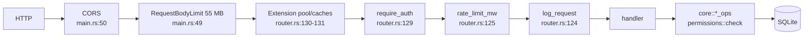
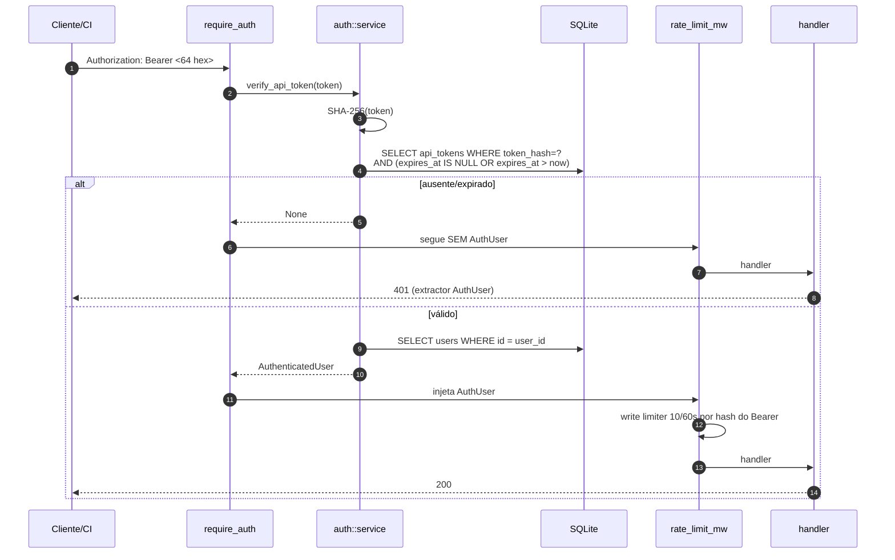
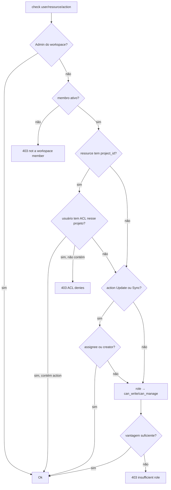

# Task Manager — camadas de proteção

> Autenticação, autorização, isolamento multi-tenant, rate limiting, uploads, webhooks e segredos
> no backend Rust/Axum em `_REF/task-manager/` (101 arquivos `.rs`, 12.948 linhas; `VERSION:1` =
> v0.1, mas `backend/Cargo.toml:3` diz 0.3.0). Citações são relativas a `_REF/task-manager/`;
> dedução leva `[INFERENCE]`. Cada camada é avaliada por "existe? se paga?".

---

## 1. Papel da área no sistema

Quatro anéis respondem perguntas diferentes — e é essa separação que dá ao código o pouco de rigor
que ele tem:

| Anel | Pergunta | Implementação | Onde roda |
|---|---|---|---|
| Identidade | "quem é você?" | token opaco em cookie ou Bearer, hash SHA-256 no banco | `backend/src/api/api_key_mw.rs:90-118` |
| Autorização | "pode fazer isso aqui?" | RBAC de workspace + ACL por projeto | `backend/src/core/permissions.rs:26-110` |
| Isolamento | "esse dado é do seu tenant?" | `ws_id` do path + `member_repo::list` + filtro SQL | 42 chamadas em 9 handlers |
| Transporte | "quanto e com que forma?" | rate limit, body limit, CORS, MIME | `backend/src/api/rate_limit.rs`, `backend/src/main.rs:24-50` |

Números que dimensionam a área: **79 rotas** (`backend/src/api/router.rs:25-113`), **42** consultas
de membros em handlers, **24** chamadas de `permissions::check` (incluindo 3 em `acl_ops`), **10**
delas passando `Uuid::default()` como id de projeto, **16** tabelas em `backend/sql/v1-initial.sql` e
**95** testes (11 de integração em `backend/tests/integration.rs`).

O desenho central: **o middleware autentica e injeta; a autorização é opt-in por handler.**



O comentário `// Layers (outermost first)` em `backend/src/api/router.rs:123` está **invertido**: no
Axum a última `.layer()` é a mais externa, então a ordem efetiva é a do diagrama — `require_auth`
roda **antes** do rate limit. Uma enxurrada sem token ainda faz 1–2 consultas ao SQLite antes de ser
limitada.

O contrato de falha é seguido à risca: **401** só do extractor `AuthUser` sem sessão/chave válida
(`backend/src/api/api_key_mw.rs:42-55`); **403** das regras de negócio; **404** deliberado em alguns
pontos (`backend/src/core/task_ops.rs:147-149`); **422** validação, **429** limite e **500**
banco/interno (`backend/src/error/category.rs:36-47`).

A fronteira 403/404 não é estável: `GET /workspaces/{id}` devolve 403 a não-membro
(`backend/src/core/workspace_ops.rs:87-89`), `GET .../projects` devolve **200 com lista vazia**
(`backend/src/core/project_ops.rs:95-97`) e `GET .../tasks` devolve 404
(`backend/src/core/task_ops.rs:169-171`) — incoerência que o teste de isolamento *valida*
(`backend/tests/integration.rs:600-607`).

---

## 2. Como está organizado

### 2.1 Módulos

| Arquivo | Linhas | Papel | Se paga? |
|---|---:|---|---|
| `backend/src/auth/service.rs` | 333 | Argon2id, tokens, sessões, API keys, invites | sim, é o núcleo |
| `backend/src/auth/handlers.rs` | 155 | login/register/logout/me/invite | sim, com ressalvas (§5.5) |
| `backend/src/api/api_key_mw.rs` | 240 | middleware auth + logging + CRUD de chaves | sim para auth; não para o CRUD |
| `backend/src/core/auth_helpers.rs` | 36 | reimplementa a extração para o SSR | duplicação pura |
| `backend/src/core/permissions.rs` | 479 (346 de testes) | RBAC + ACL num único `check()` | parcialmente (§5.1) |
| `backend/src/types/permission.rs` | 35 | 8 ações | barato, mas largo |
| `backend/src/api/acl.rs` + `backend/src/core/acl_ops.rs` | 241 | endpoints de ACL | **não** (§5.2) |
| `backend/src/api/rate_limit.rs` | 258 | sliding window em memória | sim para login; falho no global |
| `backend/src/api/attachments.rs` + `backend/src/core/attachment_ops.rs` | 611 | upload/serve/delete | sim |
| `backend/src/core/webhook_ops.rs` | 167 | dispatch HMAC assíncrono | não como está (§5.7) |
| `backend/src/types/validate.rs` | 117 | limites de campo | sim, barato |
| `backend/src/error/*` | 719 | `AppError`, categorias, Problem Details | 60% se paga; 40% é cerimônia |

A extração de token existe duas vezes: `require_auth` (`backend/src/api/api_key_mw.rs:90-118`) e
`extract_auth_user` (`backend/src/core/auth_helpers.rs:17-34`) — mesma ordem (Bearer, depois cookie),
mesmas consultas, erros diferentes. Divergência barata hoje, bug quando alguém adicionar uma regra em
um lugar só.

### 2.2 Schema relevante

| Tabela | Chave / índice | O que garante | Evidência |
|---|---|---|---|
| `users` | `username UNIQUE`, `password_hash` | identidade | `backend/sql/v1-initial.sql:41-50` |
| `sessions` | `token_hash UNIQUE`, `idx_sessions_expires` | sessão opaca revogável | `:64-74` |
| `invite_tokens` | `token_hash UNIQUE`, `used_by` | convite de uso único | `:76-86` |
| `api_tokens` | `token_hash UNIQUE`, `expires_at NULL` = eterno | CI/CD | `:88-99` |
| `workspace_members` | PK `(workspace_id, user_id)`, `role CHECK`, `archived` | RBAC + soft-delete | `:101-113` |
| `project_acls` | PK `(project_id, user_id, action)`, `granted` | ACL granular | `:152-159` |
| `attachments` | `entity_id` polimórfico **sem FK** | arquivos | `:344-359` |
| `webhooks` | `workspace_id`, `secret TEXT` | callbacks | `:361-372` |

Nenhum token é guardado em claro: tudo é `SHA-256(token)` antes do `INSERT`
(`backend/src/auth/service.rs:31-35,217-233`). Para token de 256 bits aleatórios, SHA-256 puro
basta — KDF lento aqui só queimaria CPU por request. Já `project_acls.user_id` não tem FK
(`backend/sql/v1-initial.sql:154`): ACL órfã sobrevive à remoção do usuário.

---

## 3. Fluxos passo a passo

### 3.1 Login por senha

```mermaid
sequenceDiagram
    autonumber
    participant C as Cliente
    participant RA as require_auth
    participant RL as rate_limit_mw
    participant H as login_handler
    participant S as service::login
    participant DB as SQLite

    C->>RA: POST /api/v1/auth/login {"username","password"}
    Note over RA: sem Bearer/cookie → segue sem AuthUser
    RA->>RL: next.run
    RL->>RL: login_limiter(X-Forwarded-For, 5/60s)
    alt janela esgotada
        RL-->>C: 429 + Retry-After
    else dentro do limite
        RL->>H: handler
        H->>H: login_limiter.check_login(username)
        alt 429 no 2º limiter
            H-->>C: 429 sem Retry-After
        else ok
            H->>S: login(pool, username, password)
            S->>DB: SELECT users WHERE username
            S->>S: verify_password (Argon2id + pepper)
            alt inválida
                S-->>H: 401 "Invalid credentials"
            else válida
                S->>S: generate_token() 32 bytes OsRng → 64 hex
                S->>DB: INSERT sessions(SHA256(token), expires_at=+30d)
                S-->>H: {session_token, user}
                H-->>C: 200 + Set-Cookie session=…; HttpOnly; Path=/; SameSite=Strict; Max-Age=2592000<br/>(token também no corpo JSON)
            end
        end
    end
```

Pontos factuais:

1. **Dois limiters independentes** para o mesmo login: IP de `x-forwarded-for`
   (`backend/src/api/rate_limit.rs:139-143`) e username (`backend/src/auth/handlers.rs:61`). Ambos
   contam tentativas **bem-sucedidas** também.
2. Chavear por username transforma o limite em **trava de conta**: 5 requests/60 s contra `admin`
   bloqueiam o `admin` para todos, de qualquer IP.
3. O cookie não tem `Secure` (`backend/src/auth/handlers.rs:66-69`) — aceitável para HTTP local, mas
   é o mesmo código do deploy com TLS.
4. O token volta **também no JSON** (`:72-78`), anulando o `HttpOnly` se o frontend guardar a resposta.
5. Sem rotação nem invalidação das sessões antigas no login (`backend/src/auth/service.rs:155-190`).
6. `register` cria sessão mas **não** seta cookie (`backend/src/auth/handlers.rs:75-87`).

### 3.2 Request autenticado por API key



A chave é **do usuário, não do workspace** (`backend/sql/v1-initial.sql:88-96`) e não tem escopos:
uma chave de CI pode tudo que o dono pode, em todos os workspaces dele. O `bearerFormat: uuid` do
OpenAPI (`openapi.yaml:2000`) está errado — o token é hex de 64 chars
(`backend/src/auth/service.rs:17-23`).

`POST /api-keys` devolve o token uma única vez e grava só o hash
(`backend/src/api/api_key_mw.rs:216-228`), expiração default de 720 h (`:183-185`). **`DELETE
/api-keys/{id}` não verifica dono** (`:231-239` → `backend/src/core/api_key_ops.rs:60-66` →
`backend/src/db/repositories/api_token_repo.rs:63-69`): qualquer autenticado apaga a chave de
qualquer outro se souber o UUID.

### 3.3 Registro por convite

1. Só quem tem `username == "admin"` cria convite (`backend/src/auth/handlers.rs:133-136`) e o token
   cru vai para o log em `warn!` (`:150`); o seed faz o mesmo (`backend/src/seed.rs:49`).
2. `register` valida username/senha, busca convite válido não usado, checa unicidade do username,
   cria usuário, marca o convite e cria sessão (`backend/src/auth/service.rs:97-152`).
3. Não há transação em `user_repo::create` + `invite_repo::mark_used` (`:126-128`): dois registros
   concorrentes com o mesmo convite podem ambos passar. `[INFERENCE]` janela pequena, mas é TOCTOU.
4. **O usuário novo não entra em nenhum workspace** — fica autenticado sem acesso a nada até um admin
   adicioná-lo (`backend/src/core/workspace_ops.rs:102-135`).

### 3.4 Escrita de tarefa (o fluxo com mais checagem)

```
PUT /workspaces/{ws}/tasks/{task}
 1. AuthUser (401)                                   api_key_mw.rs:42-55
 2. member_repo::list(ws)                            api/tasks.rs:186
 3. acl_repo::load_project_acls(ws)                  api/tasks.rs:190
 4. task_ops::get_by_id → membership + cache/SQL     core/task_ops.rs:139-157
 5. permissions::check(Task, Update)                 core/task_ops.rs:198-206
      5a. Admin do ws → Ok                           core/permissions.rs:38
      5b. não-membro → 403                           core/permissions.rs:40-45
      5c. ACL do projeto → allowlist ou 403          core/permissions.rs:53-60
      5d. assignee/creator → Ok                      core/permissions.rs:62-71
      5e. role ≥ Maintainer → Ok, senão 403          core/permissions.rs:82-87
 6. validações de campo                              core/task_ops.rs:208-217
 7. version check (optimistic lock)                  core/task_ops.rs:219-224
 8. UPDATE + cache + activity + notification + webhook
```

Dois custos: `get_by_id` roda no handler **e** de novo em `update`
(`backend/src/core/task_ops.rs:197`), porque o handler precisa do estado "antes"
(`backend/src/api/tasks.rs:194-197`); e `load_project_acls` carrega **todas** as ACLs a cada escrita,
ignorando o `ws_id` recebido (`backend/src/db/repositories/acl_repo.rs:10-35`).

### 3.5 Erro, JSON malformado e 429

Todo `AppError` vira `application/problem+json` com `type`, `title`, `status`, `detail`, `instance`
(`backend/src/error/app_error.rs:125-168`). O `detail` é `self.to_string()` (`:131`), então **erro de
banco chega ao cliente com o texto do SQLx** (`:170-178`) — tabela, constraint, caminho de arquivo.

`handle_json_rejection` foi escrito para padronizar rejeições do extractor JSON
(`backend/src/error/mod.rs:14-42`), mapeando `MissingJsonContentType → 415` e sintaxe → 400, mas
**nunca é registrado em router nenhum**. JSON inválido retorna a rejeição padrão do Axum, em texto
puro, fora do envelope: código morto com cara de controle ativo.

429 tem três caminhos: o middleware responde com `Retry-After` (`backend/src/api/rate_limit.rs:145-153,163-170,178-185`);
o handler de login responde 429 **sem** o header (`backend/src/auth/handlers.rs:61-63`). O corpo é o
mesmo `AppError::rate_limited`.

### 3.6 Webhook

`dispatch` é chamado em create/update/toggle/bulk de task e em sync de integração
(`backend/src/core/task_ops.rs:128,328,421`; `backend/src/core/integration_ops.rs:135`), lista
webhooks ativos por evento e dispara um `tokio::spawn` por webhook
(`backend/src/core/webhook_ops.rs:91-131`). O filtro de workspace não entra na consulta
(`backend/src/db/repositories/webhook_repo.rs:48-65`: `SELECT * FROM webhooks WHERE active = 1`).

---

## 4. Decisões boas e por quê

1. **Token opaco + SHA-256, não JWT** (`backend/src/auth/service.rs:17-35`). Revogação é um `DELETE`;
   não há chave de assinatura para vazar nem `alg: none` para errar. Para single-node com SQLite, é a
   escolha economicamente correta.
2. **Argon2id com parâmetros por env e pepper opcional** (`:38-77`): defaults `m=19456, t=2, p=1`
   (OWASP) e `ARGON2_SECRET` via `Argon2::new_with_secret`. Banco vazado sem o env = hashes
   inatacáveis offline. Pepper vazio por default (`:55-59`) é opt-in documentado (`.env.example:33-34`).
3. **Cookie `HttpOnly` + `SameSite=Strict`** (`backend/src/auth/handlers.rs:66-69`): CSRF clássico
   por formulário cross-site morre sem token. É a decisão que mais simplifica o resto (§5.5).
4. **Extractor separa "não autenticado" de "sem permissão"**: handler não repete 401 e o teste de
   contrato fica trivial.
5. **Membro com soft-delete e checagem por SQL** (`backend/src/db/repositories/member_repo.rs:13-20,44-58`):
   remover é `UPDATE`; auditoria e restauração saem de graça.
6. **404 em vez de 403 em recursos de tarefa** (`backend/src/core/task_ops.rs:147-149`): não revela se
   o UUID existe. Barato e correto — só precisaria ser consistente (§1).
7. **MIME por sniff + allowlist explícita** (`backend/src/core/attachment_ops.rs:93-106,144-155`):
   `tree_magic_mini` sobre 8 KB, match exato de string (não há wildcard `image/*`).
8. **Caminho de armazenamento gerado pelo servidor** (`:108-111`) com extensão sanitizada
   (`:216-228`): `ws/entity/uuid.ext`, o nome original nunca toca o filesystem. Path traversal
   eliminado por construção, não por validação.
9. **Upload em staging + `rename` atômico** (`backend/src/api/attachments.rs:70-84`;
   `backend/src/core/attachment_ops.rs:118-123`): processo morto no meio não deixa arquivo "válido"
   truncado no diretório final.
10. **Convite de uso único com hash** (`backend/src/db/repositories/invite_repo.rs:35-45`):
    `used_by IS NULL AND expires_at > now` numa query. Suficiente para app de um admin.
11. **Problem Details com `instance` por erro** (`backend/src/error/app_error.rs:93-95,161-167`):
    correlaciona resposta e log sem request-id global.
12. **Optimistic locking por `version`** (`backend/src/core/task_ops.rs:219-224`;
    `backend/src/core/project_ops.rs:131-138`): sem lost update, sem lock, sem WebSocket.

O que **não** se paga está em §5; o resumo: ACL por projeto, o contexto do `AppError`, o CRUD de API
keys e a camada de webhooks ainda não justificam o código que ocupam.

---

## 5. Complexidade/custo e riscos

Síntese dos controles antes do detalhe:

| Controle | Onde está | Lacuna principal |
|---|---|---|
| Sessão opaca | `backend/src/auth/service.rs:17-35,199-215` | cookie sem `Secure`, sem rotação, 30 d fixos |
| API key | `backend/src/auth/service.rs:217-251`; `backend/src/api/api_key_mw.rs:216-239` | sem escopo; delete sem dono |
| RBAC | `backend/src/types/workspace.rs:22-45`; `backend/src/core/permissions.rs:73-107` | assignee altera qualquer campo; `archive` não usado |
| ACL | `backend/src/core/permissions.rs:53-60`; `backend/src/db/repositories/acl_repo.rs:10-35,38-67` | allowlist, sem herança, ignorada em 4 caminhos |
| Isolamento | 42 × `member_repo::list` + SQL | 7 rotas sem checagem; cache global |
| Transporte | `backend/src/api/rate_limit.rs`; `backend/src/main.rs:49` | balde anônimo global; body limit em 3 lugares |
| Uploads | `backend/src/api/attachments.rs`; `backend/src/core/attachment_ops.rs` | SVG inline; Viewer sobe; blob órfão |
| Webhooks | `backend/src/core/webhook_ops.rs`; `backend/src/db/repositories/webhook_repo.rs:48-65` | sem tenant, SSRF ou retry; secret exposto |

### 5.1 Matriz real role × ação (extraída do código)

`Admin` faz bypass antes de qualquer regra (`backend/src/core/permissions.rs:36-38`). Para os demais,
o mapa ação→capacidade é `backend/src/core/permissions.rs:73-107` e as capacidades estão em
`backend/src/types/workspace.rs:22-45` (`can_manage_members` = Admin; `can_manage` =
Admin|Maintainer; `can_write` = Admin|Maintainer|Member).

| Ação | Admin | Maintainer | Member | Viewer | Viewer assignee/creator |
|---|:--:|:--:|:--:|:--:|:--:|
| `read` | ✅ | ✅ | ✅ | ✅ | ✅ |
| `create` | ✅ | ✅ | ✅ | ❌ | ❌ |
| `update` | ✅ | ✅ | ❌ | ❌ | ✅ (atalho) |
| `delete` | ✅ | ✅ | ❌ | ❌ | ❌ |
| `sync` | ✅ | ✅ | ✅ | ❌ | ✅ (atalho) |
| `manage` | ✅ | ❌ | ❌ | ❌ | ❌ |
| `configure` | ✅ | ❌ | ❌ | ❌ | ❌ |
| `archive` | ✅ | ❌ | ❌ | ❌ | ❌ |

O que a matriz esconde:

- **O atalho assignee/creator vem antes da role** (`backend/src/core/permissions.rs:62-71`): um
  `Viewer` designado pode alterar a tarefa, inclusive `status`, `assignees` e `project_id` — não há
  distinção de campos. `test_assignee_can_update` (`:372`) fixa o comportamento.
- **`archive` não é usado na rota de arquivar workspace**: `workspace_ops::delete` só exige
  membership (`backend/src/core/workspace_ops.rs:222-236` → `get_by_id` em `:87-89`). Qualquer
  `Viewer` arquiva o tenant inteiro e remove todos os membros (`:230-233`).
- **`has_role` usa semântica "≥"** (`backend/src/core/permissions.rs:114-133`): `has_role(Member)` vale
  para Admin/Maintainer/Member. API perigosa por nome; hoje só usada em testes.

### 5.2 Ordem de checagem, herança, negação e onde falta



**Herança**: não existe. `project_acls` é por `project_id` exato (`backend/sql/v1-initial.sql:152-159`)
e `check` consulta só o projeto da tarefa (`backend/src/core/permissions.rs:53-60`). Projeto filho é,
para permissão, independente.

**Negação**: não há linha de deny. `set_project_acl(..., false)` faz `DELETE`
(`backend/src/db/repositories/acl_repo.rs:38-67`) e a checagem só lê `granted = 1` (`:13`). Logo
"negar" = "não listar", e **ter qualquer entrada de ACL transforma a ACL em allowlist completa**:
conceder `create` a um Viewer remove o `read` dele — exatamente o que
`test_project_acl_overrides_role` (`backend/src/core/permissions.rs:432-470`) demonstra.

**Owner bypass**: não existe "owner" de workspace. `created_by` é só um campo; o criador que se
removeu perde acesso como qualquer um. Os únicos "donos" são `attachments.uploaded_by`
(`backend/src/core/attachment_ops.rs:206`) e `tasks.creator_id` (atalho). A redundância real é
**RBAC + ACL + atalho criador/assignee** — três mecanismos para a mesma decisão, com a ACL ganhando
de todos menos do Admin.

**Onde a checagem falta** (verificado no código):

| # | Rota / caminho | O que falta | Evidência |
|---|---|---|---|
| 1 | `GET /workspaces/{id}/stats` | auth descartado (`let _ = auth`) | `backend/src/api/stats.rs:21-26` |
| 2 | `GET /workspaces/{id}/reports/time` | nenhuma checagem de membership | `backend/src/api/reports.rs:34-48` |
| 3 | `GET /archive/{entity_type}` | auth e `entity_type` ignorados; lista workspaces arquivados de todos | `backend/src/api/archive.rs:24-33`; `backend/src/core/archive_ops.rs:182-184` |
| 4 | `GET /archive/{entity_type}/{id}` | any-to-any por UUID | `backend/src/api/archive.rs:36-46`; `backend/src/core/archive_ops.rs:187-192` |
| 5 | `POST /archive/{entity_type}/{id}/restore` | qualquer autenticado restaura qualquer workspace **e vira Admin dele** | `backend/src/api/archive.rs:49-63`; `backend/src/core/archive_ops.rs:46-67` |
| 6 | `DELETE /workspaces/{id}` | só membership; Member/Viewer arquivam o tenant | `backend/src/api/workspaces.rs:156-175`; `backend/src/core/workspace_ops.rs:222-236` |
| 7 | `GET /workspaces/{id}/statuses` | `_auth` não usado | `backend/src/api/workspaces.rs:178-186` |
| 8 | `DELETE /api-keys/{id}` | sem filtro de dono | `backend/src/api/api_key_mw.rs:231-239` |
| 9 | `DELETE /webhooks/{id}` | checa só o **primeiro** workspace; sem nenhum, pula a checagem | `backend/src/core/webhook_ops.rs:67-88` |
| 10 | `GET .../tasks/{task}/permissions` | `_auth` não usado; devolve permissões efetivas de qualquer usuário | `backend/src/api/acl.rs:88-104` |
| 11 | `PUT .../projects/{p}/permissions` | não valida que `project_id` é do `ws_id` nem que `user_id` é membro | `backend/src/core/acl_ops.rs:57-95` |
| 12 | attachments | upload exige só membership (Viewer sobe); `entity_id` não é verificado | `backend/src/api/attachments.rs:46-48,63` |
| 13 | deps/watchers/integrations | passam `Uuid::default()` como projeto → ACL nunca casa | `backend/src/api/deps_watchers.rs:44-52` (10 ocorrências) |
| 14 | `POST /workspaces/{id}/members` | Maintainer adiciona alguém como `Admin` (sem teto de role) | `backend/src/core/workspace_ops.rs:102-135` |

O caso 5 é o mais grave: `restore_workspace` não verifica nenhuma relação com o workspace (que está
arquivado e sem membros, por construção) e insere o chamador como `Admin`
(`backend/src/core/archive_ops.rs:51-62`). Combinado com o caso 6, o ciclo é: qualquer Viewer arquiva
um tenant e qualquer usuário o "restaura" para si.

### 5.3 Isolamento multi-tenant e IDOR

O padrão correto existe e é majoritário: `ws_id` do path → `member_repo::list(ws_id)` → `ops` com
`workspace_id = ?1`. Task/project/sprint/time-entry/attachment filtram workspace
(`backend/src/db/repositories/task_repo.rs:82,192,206`; `project_repo.rs` 2 filtros;
`sprint_repo.rs` 3; `time_entry_repo.rs:1`). O isolamento quebra em quatro pontos:

**(a) cache global antes do filtro de tenant.** `get_by_id` de task e project devolve do cache antes
de comparar `workspace_id` (`backend/src/core/task_ops.rs:146-150`; `backend/src/core/project_ops.rs:69-73`).
O `DataCache` é um `HashMap<Uuid, T>` por processo, sem noção de tenant
(`backend/src/core/cache.rs:25-28`). Quem é membro de A e conhece o UUID de uma task de B recebe a
task de B por `/workspaces/{A}/tasks/{uuid}`. O comentário do módulo diz "O cache não substitui
autorização" (`:10-11`) — mas nesse caminho ele substitui o filtro de tenant.

**(b) rotas sem `ws_id` no path.** `/archive/*` (casos 3–5) e `/webhooks` operam por `list_by_user` e
depois varrem workspaces.

**(c) agregações.** `stats` e `reports` recebem `ws_id` e não checam nada (casos 1 e 2). O dano é
agregado (contagens, horas), não conteúdo — ainda é dado de outro cliente.

**(d) ACL sem tenant.** `load_project_acls` lê a tabela inteira (`backend/src/db/repositories/acl_repo.rs:10-22`):
não vaza por si só (lookup por `project_id`), mas é O(n) global por escrita.

| IDOR | Como | Impacto |
|---|---|---|
| workspace arquivado | `POST /archive/workspace/{id}/restore` | **vira Admin** do tenant |
| workspace ativo | `DELETE /workspaces/{id}` como Member/Viewer | indisponibilidade + expulsão de todos |
| stats/report alheios | `GET /workspaces/{id}/stats` e `.../reports/time` | leitura de agregados |
| API key alheia | `DELETE /api-keys/{id}` | negação de serviço ao dono |
| webhook alheio | `DELETE /webhooks/{id}` sem workspace próprio | remoção silenciosa |
| task/project de outro tenant | cache hit por UUID | leitura de conteúdo |
| statuses alheios | `GET /workspaces/{id}/statuses` | leitura de configuração |

**Testes**: `test_unauthorized` cobre 401 sem token (`backend/tests/integration.rs:167-184`);
`test_permission_isolation` cobre não-membro em `/workspaces/{id}` e `/files`
(`:541-612`); `test_attachment_upload_and_serve` cobre o caminho feliz (`:355-437`). **Nada** cobre
stats, reports, archive, webhooks, API key delete ou cache cross-workspace. E o servidor de teste
sobe sem CORS e sem body limit (`:34-36`): o que é testado não é o binário de produção.

### 5.4 Rate limiting

Algoritmo: **sliding window por log de timestamps** em `HashMap<String, Vec<Instant>>`
(`backend/src/api/rate_limit.rs:24-58`). Simples de ler, correto na janela, com um leak: o mapa
**nunca remove chaves**, só timestamps vencidos de uma chave. Cada sessão, chave de API e IP de login
cria entrada eterna.

| Limiter | Limite | Chave | Onde |
|---|---|---|---|
| geral | 100/60 s | hash do Bearer/sessão, ou `"anonymous"` | `backend/src/api/rate_limit.rs:19,175-186` |
| login (middleware) | 5/60 s | `x-forwarded-for` | `backend/src/api/rate_limit.rs:138-156` |
| login (handler) | 5/60 s | `username` | `backend/src/auth/handlers.rs:61` |
| escrita | 10/60 s | hash do Bearer/sessão | `backend/src/api/rate_limit.rs:159-171` |

Problemas concretos: `"anonymous"` é **um balde único** (100/60 s para todos os não autenticados —
um scanner esgota a cota de todo mundo); `X-Forwarded-For` é confiado sem proxy confiável
(`:141-143`; o Caddy sobrescreve no deploy fornecido `[INFERENCE]`); login é contado duas vezes com
chaves diferentes; e `/auth/register` só cai no balde anônimo, então Argon2 (19 MiB × 2) pode ser
disparado ~100×/min — `[INFERENCE]` o DoS mais caro do serviço. Memória em vez de distribuído é a
escolha certa para um processo; réplica é problema futuro, não justifica Redis hoje.

### 5.5 Sessão, CSRF, headers, CORS, body limit

**Sessão**: token de 32 bytes, expiração absoluta de 30 dias (`backend/src/core/constants.rs:23`;
`backend/src/auth/service.rs:169-175`), sem `last_used`, idle timeout, rotação ou vínculo com IP/UA.
`logout` apaga só a sessão corrente (`:192-197`) e não limpa o cookie. O cleanup roda a cada 72 h
(`backend/src/main.rs:53-66`) apagando `expires_at <= now`
(`backend/src/db/repositories/session_repo.rs:63-68`) — com sessão de 30 dias, linha expirada pode
viver até 30 dias + 72 h.

**CSRF**: não existe token no backend. `SameSite=Strict` + extratores JSON (um `<form>` cross-site
não produz `application/json`) bastam para origem única. O `www` tem middleware CSRF pronto
(`www/src/csrf.rs:6-34`) **desligado** (`www/src/main.rs:101`) — código morto. A exceção seria o
upload multipart (`backend/src/api/attachments.rs:30`); o cookie `Strict` impede o envio.

**Headers**: o backend não emite nenhum; emitem o Caddy (HSTS, `X-Frame-Options: DENY`, `nosniff`,
CSP — `docker/Caddyfile:7-25`) e o `www` (CSP com `'unsafe-inline'`, `nosniff` —
`www/src/main.rs:108-118`). No compose o backend só é `expose`d
(`docker-compose.backend.yml:48-49`); binário direto (`SITE_ADDR=0.0.0.0:8080`) perde tudo.

**CORS**: default `*` com métodos/headers `*` (`backend/src/main.rs:24-29`). O `tower_http` não põe
`allow-credentials`, então cookie cross-origin não é aceito pelo navegador — o wildcard é menos grave
do que parece. Há descompasso real: `.env.example:29` diz "vazio = qualquer origem", mas o compose
passa a variável **vazia** (`docker-compose.backend.yml:57`), caindo em `AllowOrigin::exact("")`
(`backend/src/main.rs:30-34`): nenhuma origem casa. O wildcard só ocorre se a variável estiver
**ausente**.

**Body limit**: 55 MB no router externo (`backend/src/main.rs:49`), 50 MB no upload
(`backend/src/api/attachments.rs:19,88`) e `MAX_UPLOAD_SIZE` de env à parte
(`backend/src/core/attachment_ops.rs:45-50`): três fontes de verdade, e o limite global vence.

### 5.6 Uploads

| Controle | Estado | Evidência |
|---|---|---|
| path traversal | **fechado por construção** (uuid + extensão alfanumérica ≤10) | `backend/src/core/attachment_ops.rs:108-111,216-228` |
| tamanho | checado durante o stream (aborta e apaga o tmp) e de novo em `ops` | `backend/src/api/attachments.rs:86-95`; `backend/src/core/attachment_ops.rs:79-91` |
| MIME | sniff de 8 KB + allowlist por env, match exato | `backend/src/core/attachment_ops.rs:93-106,144-155` |
| leitura | membership do workspace, não ACL/role | `backend/src/core/attachment_ops.rs:176` |
| escrita | membership apenas (Viewer sobe arquivo) | `backend/src/api/attachments.rs:46-48` |
| delete (permissão) | Admin do ws ou uploader | `backend/src/core/attachment_ops.rs:201-210` |
| serving | `inline` para `image/*`, `attachment` para o resto | `backend/src/api/attachments.rs:180-182` |
| memória | lê o arquivo **inteiro** em `Vec<u8>` | `backend/src/core/attachment_ops.rs:180-183` |
| delete (blob) | apaga a linha e **mantém o arquivo em disco** | `backend/src/core/attachment_ops.rs:212-213` (teste `:353-374`) |

O risco que resta é de conteúdo: `image/svg+xml` está na allowlist (`backend/src/core/attachment_ops.rs:14`),
detectado como `image/*` (`:106`) e servido `inline` (`backend/src/api/attachments.rs:180-186`). Como o Caddy
roteia app e API no mesmo host (`docker/Caddyfile:28`), um SVG com `<script>` executa **na origem do
app** com o cookie de sessão — `nosniff` não impede script dentro de SVG. É stored XSS por upload; o
teste de MIME (`backend/tests/integration.rs:355-437`) só cobre PNG.

### 5.7 Webhooks

| Requisito | Estado | Evidência |
|---|---|---|
| assinatura | HMAC-SHA256 do corpo em `X-Webhook-Signature` (hex, sem prefixo) | `backend/src/core/webhook_ops.rs:142-146,159-167` |
| anti-replay | **ausente** — assina só o corpo; replay infinito | `backend/src/core/webhook_ops.rs:144-145` |
| segredo | texto puro no banco; serializado na listagem | `backend/src/core/webhook_ops.rs:36`; `backend/src/types/webhook.rs:19-21` |
| SSRF | nenhuma validação além de "não vazia" | `backend/src/core/webhook_ops.rs:21-23` |
| retries | nenhum; falha vira `warn!` | `backend/src/core/webhook_ops.rs:124-128,152-156` |
| tenant no dispatch | **ausente** — todos os webhooks ativos de todos os workspaces | `backend/src/db/repositories/webhook_repo.rs:48-65`; `backend/src/core/webhook_ops.rs:98` |
| criação | qualquer membro (Viewer incluído), replicado em todos os workspaces do usuário | `backend/src/core/webhook_ops.rs:15-45` |
| remoção | quebrada: só o primeiro workspace, e pula tudo se não houver nenhum | `backend/src/core/webhook_ops.rs:67-88` |

Consequência do dispatch global: `task.created` no workspace A é enviado para a URL cadastrada no
workspace B, com `workspace_id` e `data` de A. Não é teórico — basta dois workspaces com webhooks.
Somando a listagem que devolve o `secret`, qualquer membro de qualquer workspace lê o segredo alheio,
assina payloads e o consumidor aceita.

### 5.8 Segredos, logging e mensagens de erro

- **Credencial default**: `admin` / `admin123` no boot (`backend/src/seed.rs:35`), usada nos testes
  (`backend/tests/integration.rs:101`), sem aviso nem troca forçada.
- **Tokens crus no log**: convite (`backend/src/auth/handlers.rs:150`; `backend/src/seed.rs:49`). Com
  `RUST_LOG=info` (default em `.env.example:20`), vão para o stdout do container e o driver json-file
  (`docker-compose.backend.yml:1-5`); um `docker logs` entrega acesso.
- **Log de request**: mascara cookie (8 chars) e Bearer (16) (`backend/src/api/api_key_mw.rs:131-145`)
  — vaza prefixo (baixo risco) e, por ser **innermost**, não registra requests barrados pelo limite.
- **Erro 500 com detalhe do SQLx** (`backend/src/error/app_error.rs:131,170-178`) e **todo 4xx logado
  como `error!`** (`:146-159`): schema exposto e log afogado por scanner. Em compensação,
  `#[instrument(skip_all)]` em todos os handlers (`backend/src/auth/handlers.rs:57`) e `AppError` sem
  token/password — cuidado consistente, vale copiar.

### 5.9 Validação de entrada

`backend/src/types/validate.rs` é pequeno e útil: username 3–64, senha 8–256, título 1–1000, nome
1–200, descrição 10.000, tags 20 × 50, cor ≤7. Chamado em 16 sítios
(ex.: `backend/src/core/task_ops.rs:37-40,208-217`). Lacunas:

- `validate_color` só checa `#` e comprimento, não hexadecimal (`:88-96`); a constante `COLOR_PATTERN`
  (`:26`) nunca é usada — não há dependência de regex no `Cargo.toml`. A validação promete mais do
  que entrega.
- Comprimentos usam `v.len()` (bytes), não `chars()` (`:38,53,65`): 21 emojis (84 bytes) são
  rejeitados; 64 caracteres CJK passam. `[INFERENCE]` cosmético, mas aparece depois.
- Sem `trim`/normalização: `" admin "` é outro usuário (`backend/sql/v1-initial.sql:43`) e usernames
  são case-sensitive, então `Admin` e `admin` coexistem — enquanto o superusuário é comparado por
  string exata (`backend/src/auth/handlers.rs:135`).
- `Uuid::parse_str(&val).unwrap_or_default()` transforma lixo em **UUID nil**
  (`backend/src/api/attachments.rs:63`) em vez de 422.
- Paginação sem teto em `/tasks` (`backend/src/api/tasks.rs:101-102`; `notifications` limita a 200,
  `backend/src/api/notifications.rs:32`); e content-type sem o handler registrado (§3.5) devolve a
  resposta padrão do Axum, fora do contrato.

### 5.10 O que é redundante (e o que é proporcional)

| Peça | Veredito | Por quê |
|---|---|---|
| RBAC de 4 roles | **proporcional** | 4 roles × ~4 capacidades em 40 linhas (`backend/src/types/workspace.rs:22-45`) cobrem o produto |
| 8 `PermissionAction` | **larga demais** | `Manage`/`Configure`/`Archive` acabam todos em `can_manage_members` (`backend/src/core/permissions.rs:90-107`); 3 nomes para 1 bit |
| ACL por projeto | **não se paga hoje** | ignorada em project update/delete, create de task, deps/watchers/integrations; allowlist que remove `read`; carregada inteira por request |
| atalho assignee/creator | **proporcional, mal posicionado** | útil no dia a dia; deveria valer para campos (status/comentário), não `project_id`/`assignees` |
| `OptionalAuth` | **morto** | definido (`backend/src/api/api_key_mw.rs:66-80`) e reexportado (`backend/src/api/mod.rs:24`), zero usos |
| `ErrorContext`/builders | **não se paga** | `with_operation/with_user_id/with_resource_id` sem chamador fora de `error/`; 116 linhas + `Box` por variante para campos sempre `None` |
| `handle_json_rejection` | **não se paga como está** | escrito, testável, não registrado |
| middleware CSRF do `www` | **não se paga** | desligado; `SameSite=Strict` já resolve |
| rate limiter de login duplo | **redundante** | dois mapas, dois comportamentos, duas respostas |

---

## 6. O que levar para o meraki

### 6.1 Proteção proporcional — 8 itens

1. **Um mecanismo de identidade**: token opaco de 32 bytes (`OsRng` → hex) guardado como SHA-256,
   entregue por cookie `HttpOnly; SameSite=Lax/Strict; Secure` **e** `Authorization: Bearer` para
   máquinas. Sem JWT, refresh token ou rotação. Base: `backend/src/auth/service.rs:17-35,199-234`;
   acrescentar `Secure`.
2. **Argon2id com parâmetros default fixos**, pepper opcional por env, validação só de comprimento
   (≥12) — regras de composição são teatro. Sempre `401 "Invalid credentials"`, nunca distinguindo
   usuário inexistente de senha errada (`backend/src/auth/service.rs:155-166`).
3. **Autorização em um único ponto por operação**, com assinatura explícita
   `check(actor, resource, action, ctx) -> Result<(), Denied>`. Não espalhar `if role == …` em
   handlers — o Task Manager tem quatro variações (`permissions::check`, checagem inline em
   `workspace_ops`, `let _ = auth`, `_auth`).
4. **RBAC com 3 roles e 4 ações** (`read`, `write`, `manage_members`, `delete`), não 4×8. Membro com
   `archived = 0` no `WHERE` (soft-delete), como `backend/src/db/repositories/member_repo.rs:44-58`.
5. **Sem ACL por projeto na v1**. Se um dia houver: `granted` booleano **consultado**, nunca
   `DELETE`, e sem allowlist que apaga o resto — a ACL daqui é a maior complexidade sem retorno (§5.1–5.2).
6. **`ws_id` obrigatório em toda query** e membership checada **antes** do cache. Se houver cache, é
   por tenant (`HashMap<(ws, id), T>`), nunca global por UUID — isso teria evitado 3 falhas de §5.3.
7. **Limites em um lugar**: body limit de 25 MB no roteador, `MAX_UPLOAD` igual ou menor, `limit` de
   paginação com teto, e rate limit **por identidade + balde anônimo por IP** (não um balde global
   `"anonymous"`). Login com chave `(ip, username)` e `Retry-After` em todos os 429.
8. **Arquivos: MIME sniff + allowlist sem `image/svg+xml` e sem `text/html`**, caminho gerado pelo
   servidor (`uuid.ext`), `Content-Disposition: attachment` por default, `nosniff` na origem da API e
   delete que remove o blob. Sem inline para formatos ativos.

### 6.2 Checklist curto

- [ ] `Secure` no cookie; não devolver o token no corpo do login quando o cliente é browser.
- [ ] Helper `require_member(pool, ws, user) -> Result<Role, Denied>` em todo handler com `ws_id`;
      proibir `let _ = auth`.
- [ ] Nenhuma rota sem `ws_id` devolvendo recurso por id global; se existir, escopar por
      `list_by_user`.
- [ ] `DELETE` sempre com `AND user_id = ?` (API keys) e `AND workspace_id IN (...)` (webhooks).
- [ ] Dispatch de webhook filtrado por `workspace_id`; `secret` fora do DTO; assinatura
      `t=<ts>,v1=<hmac(ts + "." + body)>`; URL só `https` e host não privado (bloquear loopback,
      link-local e RFC1918 literal; DNS rebinding fica para depois).
- [ ] 5xx com `detail` genérico no cliente e detalhe real só no log; 4xx em `warn`.
- [ ] Matriz role×ação em **um teste de tabela** — o melhor teste de segurança do repo
      (`backend/src/core/permissions.rs:134-479`).

### 6.3 Não copiar

Rate limiter sem eviction e balde `"anonymous"` global; ACL allowlist; `restore` que concede Admin;
`DELETE /workspaces` sem role; cache global antes do filtro de tenant; `admin` por comparação de
username; webhook `WHERE active = 1` sem workspace; `handle_json_rejection` morto; `OptionalAuth` sem usos.

---

## 7. Apêndice de arquivos-chave

| Arquivo | Linhas | Por que ler |
|---|---:|---|
| `backend/src/auth/service.rs` | 333 | Argon2id (38-94), tokens/hash (17-35), login/registro (97-190), verificação (199-251) |
| `backend/src/auth/handlers.rs` | 155 | cookie (66-69), limite por username (61), convite (120-153) |
| `backend/src/api/api_key_mw.rs` | 240 | `AuthUser` (42-55), `require_auth` (90-118), log mascarado (120-158), CRUD (216-239) |
| `backend/src/core/permissions.rs` | 479 | `check` (26-110), `has_role`/rank (114-133), matriz em testes (134-479) |
| `backend/src/types/workspace.rs` | — | roles e capacidades (11-45); 8 ações em `backend/src/types/permission.rs:8-31` |
| `backend/src/api/acl.rs` + `backend/src/core/acl_ops.rs` | 241 | endpoints de ACL e as checagens ausentes (`backend/src/api/acl.rs:88-104`) |
| `backend/src/db/repositories/acl_repo.rs` | ~100 | ACL sem filtro de tenant (10-35), deny = DELETE (38-67) |
| `backend/src/api/rate_limit.rs` | 258 | sliding window (24-58), chaves (108-123), middleware (127-186) |
| `backend/src/api/attachments.rs` + `backend/src/core/attachment_ops.rs` | 611 | upload/serve/delete e MIME |
| `backend/src/core/webhook_ops.rs` + `backend/src/db/repositories/webhook_repo.rs` | ~230 | HMAC, dispatch sem tenant, delete quebrado |
| `backend/src/error/app_error.rs` | 301 | Problem Details (125-168), vazamento de detalhe (170-178) |
| `backend/src/main.rs` | 113 | CORS (24-50), body limit (49), cleanup (53-66); seed `admin/admin123` em `backend/src/seed.rs:35`; limites em `backend/src/types/validate.rs:5-28` |
| `backend/sql/v1-initial.sql` | 419 | schema de identidade/autorização (41-159) |
| `backend/tests/integration.rs` | 614 | o que é testado (`:167`, `:355`, `:541`) e o que não é |
| `docker/Caddyfile` | 33 | HSTS/CSP/frame-deny (7-25), app+API no mesmo host (28) |
