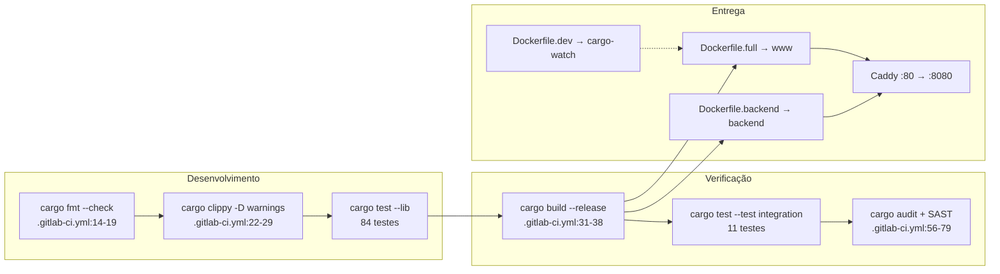
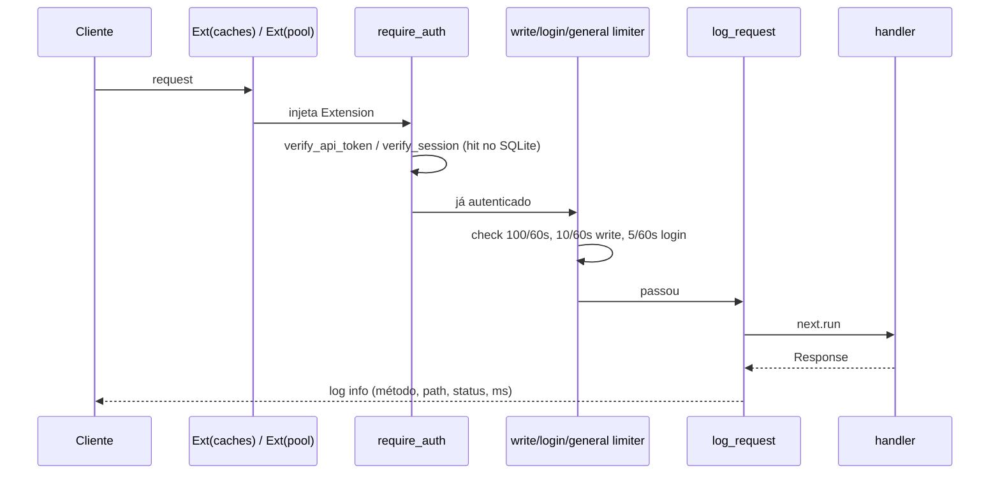
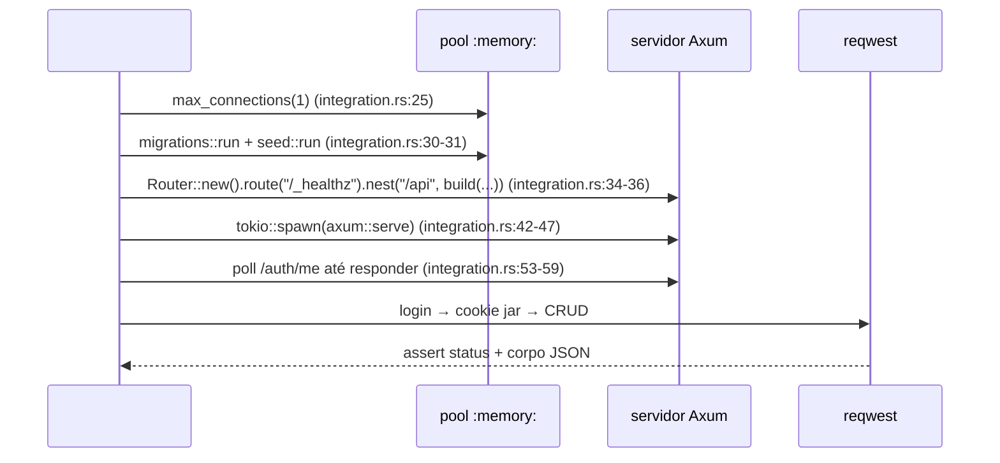

# 05 — Engenharia: testes, CI, configuração, deploy e documentação

> Referência conceitual extraída de `_REF/task-manager` (projeto pessoal, backend Rust/Axum 0.8 + SQLite).
> Foco: **simplicidade**. Cada seção separa o que funciona e se paga do que é custo sem retorno.
> Toda afirmação estrutural tem citação `caminho:linha`; inferência é marcada `[INFERENCE]`.

---

## 1. Papel da área no sistema

O backend é uma API REST de ~13 mil linhas (`backend/src`, 101 arquivos `.rs`) com um frontend Askama/HTMX separado no crate `www` (`www/Cargo.toml:9`, `:13`). A engenharia em volta existe para responder três perguntas:

| Pergunta | Artefato que responde | Onde |
|---|---|---|
| "posso mudar isso sem quebrar?" | 84 testes unitários + 11 de integração | `backend/src/**` (módulos `#[cfg(test)]`), `backend/tests/integration.rs` |
| "isso sobe em outro lugar?" | 3 Dockerfiles, 3 composes, Caddy, `.env.example` | `docker/`, `docker-compose.*.yml`, `.env.example` |
| "o que aconteceu às 3h da manhã?" | tracing + `/_healthz` + Problem Details com `instance` UUIDv7 | `backend/src/main.rs:3-7`, `backend/src/error/app_error.rs:93-95` |

O que **não** existe: métricas (nenhum endpoint Prometheus/OTel no repositório — `grep` por `metrics|prometheus` em `backend/src` retorna vazio), request-id propagado, tracing distribuído, alertas. Observabilidade aqui é "log estruturado + healthcheck", e isso é proporcional ao escopo (instância única, banco em arquivo).

A área se paga? Sim para testes e healthcheck; parcialmente para CI; **não** para a triplicação de Docker/compose, que já divergiu do que a documentação descreve.

---

## 2. Como está organizado (números e caminhos)

### 2.1 Inventário

| Artefato | Tamanho | Observação |
|---|---|---|
| `backend/src` | 101 arquivos, 12.948 linhas | maior arquivo: `core/task_ops.rs` (552) |
| `backend/tests/integration.rs` | 614 linhas, 11 testes | servidor in-process + SQLite `:memory:` |
| Testes unitários | 84 funções em 9 módulos | 12 blocos `#[cfg(test)]` |
| `backend/benches/tasks.rs` | 14 linhas | **placeholder** (`black_box(2 + 2)`) |
| `.gitlab-ci.yml` | 79 linhas, 7 jobs, 3 stages | sem cache, sem job de imagem |
| `docker/` | 3 Dockerfiles (182 linhas) + Caddyfile (34) | multi-stage Alpine, rootless |
| `docker-compose.*.yml` | 3 arquivos (~80 linhas cada) | perfis full / backend / dev |
| `openapi.yaml` | 3.420 linhas, 54 paths | servido em runtime via `include_str!` |
| `wiki/` | 66 arquivos `.md`, 11.662 linhas | 8 seções + `plan/` + `frontend/` |
| `rustfmt.toml` | 34 linhas | `max_width = 100` (`rustfmt.toml:12`) |

### 2.2 Mapa de camadas de engenharia



A seta `dback --> caddy` está **quebrada na prática**: o Caddyfile faz `reverse_proxy www:8080` (`docker/Caddyfile:28`) enquanto o serviço do compose backend se chama `backend` (`docker-compose.backend.yml:38`). Ver §5.3.

### 2.3 Cobertura de teste por área

84 unitários (9 módulos) + 11 de integração. A tabela abaixo é o mapa honesto do que um `cargo test` verde significa — e do que não significa.

| Área | Unitário | Integração (HTTP) | Lacuna real |
|---|---|---|---|
| Hash/token/Argon2 | 9 (`auth/service.rs:258+`) | login indireto | rotação de `ARGON2_SECRET`, token expirado |
| Sessão / API key | — | `test_login` (`:94`), `test_register_and_api_key` (`:117`) | logout, expiração, chave revogada, `verify_api_token` inválido |
| RBAC/ACL | 9 (`core/permissions.rs:133+`) | `test_permission_isolation` (`:541`) | endpoints `/permissions`, cada role exercida via HTTP, acesso por ID a outro workspace (bug do cache, §5.2) |
| Workspace | — | `test_workspace_lifecycle` (`:186`) | create, delete, membros, statuses, stats |
| Projeto | — | `test_project_hierarchy` (`:226`) | update, delete/arquivar, restore |
| Task CRUD | — | `test_task_crud` (`:271`) | 13 filtros (só `status=done` é testado), paginação, bulk, move, dependents, parent_id, delete |
| Optimistic locking | — | `test_version_conflict` (`:486`) | conflito em workspace/projeto/sprint |
| Anexos | 7 (`core/attachment_ops.rs:230+`) | upload + serve + list (`:355`) | MIME rejeitado via HTTP, `MAX_UPLOAD_SIZE`, delete |
| Sprint | — | `test_sprint_crud` (`:439`) | update |
| Erros RFC 9457 | 12 (`error/context.rs`, `error/category.rs`) | — | **nenhum** teste HTTP valida `type`/`instance`/`status` do corpo |
| Rate limiting | 7 (`api/rate_limit.rs:190+`) | — | nenhum 429 real; ordem auth↔limiter (§3.1) não é testada |
| Cache | 7 (`core/cache.rs:135+`) | — | justamente onde estão os bugs de §5.2 |
| Validação de modelos | 23 (`models.rs:6+`) | — | — |
| Busca FTS5 | — | — | zero cobertura |
| Webhooks, notificações, time entries, integrações, stats, admin, arquivamento | — | — | zero cobertura |
| Healthcheck | — | `test_healthcheck` (`:84`) | testa uma closure do harness, não o `main.rs` |

Leitura: o eixo **auth + RBAC + CRUD principal + 409** está coberto no nível certo (HTTP). O eixo **erros, rate limit e cache** tem unidade mas nenhuma prova de integração — e é exatamente ali que os três defeitos encontrados em §5 vivem. Para um projeto solo, essa é uma troca defensável; o custo de fechar as lacunas é ~6 testes de 15 linhas.

---

## 3. Fluxos passo a passo

### 3.1 Fluxo de request (e a ordem real dos middlewares)

O router monta tudo em `backend/src/api/router.rs:124-131`, com o comentário "Layers (outermost first)". Em Axum a regra é o inverso: **o último `.layer()` adicionado é o mais externo**. Logo a ordem efetiva é:



Consequências verificáveis:

1. **Autenticação antes do rate limit.** `require_auth` foi adicionado depois de `rate_limit_mw` (`backend/src/api/router.rs:129` vs `:125`), então cada request com token inválido gera consulta ao banco *antes* de qualquer limite. Um atacante com tokens aleatórios contorna o limiar de 100 req/60s.
2. **`log_request` é o mais interno** (`router.rs:124`): respostas 429 emitidas pelo limiter não passam pela linha de log de acesso — só pelo `tracing::error!` do erro (`backend/src/error/app_error.rs:146`).
3. Requests anônimos compartilham um único balde: `extract_key` cai em `"anonymous"` (`backend/src/api/rate_limit.rs:122`), então um cliente sem sessão consome a cota de todos os anônimos.

Nenhum desses pontos derruba o sistema; todos são correções de uma linha de ordenação/uma chave. Vale registrar porque é o tipo de detalhe que "parece pronto" e não está.

### 3.2 Fluxo de escrita (POST /tasks)

1. Limiter de escrita (10/60s por usuário) — `rate_limit.rs:157-172`.
2. Handler com `#[instrument(skip_all)]` → `task_ops::create` (`backend/src/core/task_ops.rs:18-30`).
3. Permissão RBAC → validação de título/descrição → existência do projeto no workspace (`task_ops.rs:29-40`).
4. `task_repo::insert` com 27 binds e JSON serializado em colunas TEXT (`backend/src/db/repositories/task_repo.rs:24-58`).
5. `cache.set(id, task)` (`task_ops.rs:120`) e webhooks.

O caminho de escrita é direto, sem Unit of Work nem repositório genérico. Custo: SQL manual repetido em 19 repositórios. Benefício: zero mágica, `EXPLAIN QUERY PLAN` trivial de ler.

### 3.3 Fluxo de erro

```
AppError (9 variantes) → category (error/category.rs:33-45) → status HTTP
                       → ProblemDetails {type, title, status, detail, instance}
                       → tracing::error! com operation/user_id/resource_id (app_error.rs:146-157)
```

`instance()` gera `Uuid::now_v7()` por erro (`app_error.rs:93-95`) — é o único mecanismo de correlação disponível hoje, e é bom: o cliente reporta o UUID e o log tem a mesma string. O problema é o nível: **404 e 422 também logam em `ERROR`** (`app_error.rs:146`), então o log de produção é dominado por erro de cliente e o sinal real (500) desaparece.

### 3.4 Fluxo de teste



Dois detalhes que custam pouco e ensinam muito:

- `max_connections(1)` é **obrigatório** para `:memory:` — cada conexão nova abriria um banco vazio (`integration.rs:25`).
- O harness **redeclara** `/_healthz` (`integration.rs:35`) em vez de reutilizar o app do `main.rs`. `test_healthcheck` (`integration.rs:84-91`) valida uma closure de teste, não o binário. É o único teste que não toca o código real.

### 3.5 Fluxo de boot/deploy

`main.rs` → `init_pool` (`backend/src/db/pool.rs:15-57`) → `migrations::run` (`backend/src/main.rs:18`) → `seed::run` (`:19`) → monta router → `tokio::spawn` de limpeza de sessões a cada 72h (`main.rs:52-65`, `core/constants.rs:26`) → `axum::serve` com `shutdown_signal` (`main.rs:71`, `:87-113`) → `PRAGMA optimize` no encerramento (`main.rs:74-77`).

Migração no boot é a escolha certa aqui: instância única, banco em arquivo, sem orquestrador. O que não é certo é o runner caseiro (253 linhas) e o backup que nunca acontece — §5.1.

---

## 4. Decisões boas e por quê

| # | Decisão | Evidência | Por que se paga |
|---|---|---|---|
| 1 | Teste de integração **in-process** com `:memory:` e porta 0 | `integration.rs:14-61` | Sem subprocesso, sem arquivo temporário, sem colisão de porta. Um `cargo test` cobre HTTP real (serialização, cookies, status). |
| 2 | `unwrap_used`/`expect_used = deny` e `unsafe_code = forbid` | `backend/Cargo.toml:38-42` | Zero `unwrap/expect` fora de `#[cfg(test)]` (verificado por grep). Panic em produção vira evento raro, não rotina. |
| 3 | Erros como enum + `IntoResponse` único, RFC 9457 | `error/app_error.rs:125-168`, `error/category.rs:33-45` | 9 categorias mapeadas em um lugar; o handler nunca monta `(status, Json)` à mão. Contrato de erro estável e testável. |
| 4 | `instance` = UUIDv7 por erro | `app_error.rs:93-95` | Correlação cliente↔log sem infraestrutura. Custo: 16 bytes. |
| 5 | PRAGMAs aplicados em `after_connect` | `db/pool.rs:32-57` | Toda conexão do pool nasce idêntica (WAL, `busy_timeout` 10s, FK on). Elimina a classe "uma conexão sem FK". |
| 6 | `PRAGMA optimize` no shutdown + `wal_autocheckpoint` | `main.rs:74-77`, `pool.rs:48` | Duas linhas que mantêm o arquivo saudável. Melhor que job de manutenção. |
| 7 | Healthcheck no Dockerfile **e** no compose, com `start_period` | `docker/Dockerfile.backend:66-67`, `docker-compose.backend.yml:58-63` | `depends_on: service_healthy` do Caddy só funciona por causa disso (`docker-compose.backend.yml:23-25`). |
| 8 | Imagens pinadas por digest | `docker/Dockerfile.backend:5`, `docker-compose.full.yml:11` | Reprodutibilidade de build sem Renovate. |
| 9 | Non-root + `cap_drop: ALL` + `no-new-privileges` | `Dockerfile.backend:43-49`, `:69`; `docker-compose.backend.yml:67-68` | Custo zero, remove classe inteira de escalada. |
| 10 | Spec OpenAPI embutida no binário | `backend/src/spec/mod.rs:4-10` (`include_str!` em `:10`) | Docs e código viajam juntos; impossível servir spec de outra versão. |
| 11 | `.env.example` comentado com valores reais | `.env.example:1-40` | Onboarding sem caçar defaults no código. |
| 12 | Teste de conflito de versão e de isolamento entre usuários | `integration.rs:486-539`, `:541-614` | São os dois bugs que um task manager multi-tenant realmente tem. |

O padrão comum: **poucas peças, cada uma com uma razão clara**. Nada aqui exige equipe.

---

## 5. Complexidade/custo e riscos

### 5.1 Runner de migração caseiro (253 linhas para um schema)

`backend/src/db/migrations.rs` implementa à mão: tabela `_schema_version` (`:39`), `PRAGMA application_id` (`:51`), detecção de banco legado (`:64-78`), backup via `VACUUM INTO` (`:232-253`), `quick_check` pré e `integrity_check` pós (`:206-230`), `BEGIN IMMEDIATE` manual (`:108-131`) e um `down()` (`:152-183`).

Custos concretos:

- **`down()` é código morto.** Nenhum chamador no repo (`grep migrations::down` → vazio). ~35 linhas mantidas sem uso.
- **O backup nunca roda no container.** `pre_migration_backup` faz `create_dir_all("backups")` relativo (`migrations.rs:233`); no runner o `WORKDIR` é `/app`, dono `root`, e o processo roda como `app` (`Dockerfile.backend:48-49`, `:69`). A falha é engolida com `warn` e `return Ok(())` (`migrations.rs:245-249`) — ou seja, a rede de segurança é ficção. `[INFERENCE: permissões do diretório]`
- **`integrity_check` completo a cada migração** é O(páginas) e roda no boot; com uma única migração V1, o custo aparece só em bancos grandes, mas é trabalho por nada num deploy de arquivo único.
- A reinvenção ignora `sqlx::migrate!`, que faz versão + transação + checksum em ~3 linhas.

**Alternativa mais simples:** `sqlx::migrate!("./sql")` no boot; backup como script de deploy (`sqlite3 .backup`), não como código de aplicação; remover `down()` (rollback de SQLite em app pessoal = restaurar o arquivo).

### 5.2 Cache em memória: complexidade alta, retorno duvidoso e dois bugs

`DataCache<T>` é `RwLock<HashMap<Uuid,T>>` sem TTL, sem limite, sem métrica (`backend/src/core/cache.rs:25-30`). `Caches` agrega quatro instâncias (`cache.rs:102-118`).

Problemas verificáveis:

| Problema | Evidência | Efeito |
|---|---|---|
| Lista pode ficar **incompleta** | `project_ops::list` retorna o cache se não-vazio e nunca consulta o banco: `core/project_ops.rs:99-103` | `GET /projects/{a}` popula o cache com A; o `GET /projects` seguinte devolve **só A**, omitindo B e C. |
| Mesma classe em workspaces | `workspace_ops::list_for_user`: `core/workspace_ops.rs:63-71` | Workspace ao qual o usuário foi adicionado depois não aparece se houver qualquer entrada em cache. |
| `get_by_id` ignora o workspace | `task_ops.rs:149-152` retorna do cache **antes** do filtro `t.workspace_id == workspace_id` (`:155-157`) | Task de outro workspace pode ser servida a membro de um workspace qualquer, se estiver cacheada. O teste de isolamento (`integration.rs:541`) só cobre não-membro, então passa. |
| `get_all()` clona o mapa inteiro | `cache.rs:47-51` | Cada list de projetos/workspaces copia **todos** os itens já vistos; O(n) por request com n crescendo sem limite. |
| Escrita por item em cada list | `task_ops.rs:180-182` | Um `write lock` por task listada, sem benefício: `list` sempre vai ao banco. |

Ou seja: o cache acelera **somente** `get_by_id` de task/projeto/sprint, e para isso introduz staleness, custo O(n) e um vazamento entre workspaces. Para um app solo com SQLite local (leituras de microssegundos), a troca é negativa.

**Alternativa mais simples:** apagar `DataCache`; se algum endpoint comprovadamente doer, um `SELECT` com índice já resolve, ou `moka` com TTL se um dia houver métrica mostrando necessidade.

### 5.3 Três Dockerfiles + três composes: a divergência já aconteceu

Comparação dos perfis:

| | `full` | `backend` | `dev` |
|---|---|---|---|
| Serviços | caddy + `www` (`:38`) | caddy + `backend` (`:38`) | caddy + `www` (`:38`) |
| Imagem app | `Dockerfile.full` → `/app/www` (`:74`) | `Dockerfile.backend` → `/app/backend` | `Dockerfile.dev` + `cargo-watch` (`:37`) |
| Fonte | build multi-stage | build multi-stage | bind mount `./backend`, `./www` (`:50-57`) |
| Volume de dados | `data:/app/data` | `data:/app/data` | `data:/app/data` |
| Limite app | 0.5 CPU / 128M (`:67-68`) | 0.5 CPU / 256M (`:72-73`) | 4 CPU / 2G (`:78-79`) |
| Healthcheck app | `GET /` (`:53-58`) | `GET /_healthz` (`:58-63`) | `GET /` |
| `cap_drop` | ALL (`:62`) | ALL (`:67-68`) | ausente |
| `UPLOAD_DIR` explícito | **não** | sim | **não** |
| `MAX_UPLOAD_SIZE`/`ARGON2_*` | **não** | **não** | **não** |

Achados:

1. **O perfil backend não funciona como está.** Caddy aponta para `www:8080` (`docker/Caddyfile:28`) e o serviço se chama `backend` (`docker-compose.backend.yml:38`). `[INFERENCE: DNS interno resolve só o nome do serviço]`
2. **`Dockerfile.backend` tem um bloco "Build real" duplicado** (`docker/Dockerfile.backend:27-35`): `COPY backend backend` e `COPY openapi.yaml` aparecem duas vezes, e o primeiro bloco ainda recria o stub de `www`. Funciona, mas dobra uma camada de ~MB e confunde quem lê.
3. **Caddyfile não faz TLS.** Os comentários prometem Let's Encrypt (`docker/Caddyfile:2-4`), mas o site é declarado como `http://{$DOMAIN:localhost}` (`:6`) — sempre HTTP. Ainda envia `Strict-Transport-Security` (`:11`), que só tem efeito em HTTPS; e o CSP `script-src 'self'` (`:12-21`) **bloqueia** o Swagger UI, que carrega JS de `unpkg.com` (`backend/src/spec/mod.rs:28`, `:32`).
4. **Divergência de porta:** compose usa `${PORT_HTTP:-10123}` (`docker-compose.full.yml:15`), `.env.example:16` e a wiki dizem `80`.
5. **A wiki descreve um `docker-compose.yml` que não existe** (`wiki/04-implantacao/02-docker-compose.md:3`), com `MAX_UPLOAD_SIZE`/`ARGON2_*` passados ao container — nenhum dos três composes reais faz isso.
6. **`deploy.resources` só é aplicado por `docker compose` v2** `[INFERENCE]`; em `docker run` puro não vale. Não é errado, mas não é a única fonte de limite — o Dockerfile não declara nada.

**Alternativa mais simples:** **um** compose (o `full`), Caddyfile com `{$DOMAIN:localhost}` (sem `http://`) e `reverse_proxy` para o nome que existe; dev via `cargo watch` no host, sem imagem. O perfil `backend` só se justifica se o frontend for descartado.

### 5.4 CI: cobre o básico, com trabalho redundante

Checklist:

| Item | Existe | Evidência | Comentário |
|---|---|---|---|
| `cargo fmt --check` | ✅ | `.gitlab-ci.yml:14-19` | só em MR (`:19`) — push direto em `main` não é formatado |
| `cargo clippy -D warnings` | ✅ | `:22-29` | só em MR (`:28`) |
| Testes unitários | ✅ | `:40-45` | `needs: []` → compila em paralelo com `build` |
| Testes de integração | ✅ | `:47-53` | `needs: [build]` mas **recompila** `--release` (`:51`) — artefato baixado não é usado |
| Build release | ✅ | `:31-38` | artefato `target/release/backend` (`:36-38`) |
| `cargo audit` | ✅ | `:56-67` | `cargo install cargo-audit` a cada run (`:60`); manual em MR (`:67`) |
| SAST / secret detection | ✅ | `:69-79` | templates GitLab |
| Cache de `~/.cargo` / `target` | ❌ | `grep cache` → só `apk --no-cache` (`:10`) | 3–4 compilações completas por pipeline |
| Build de imagem Docker | ❌ | — | imagem nunca é construída no CI |
| Job de `cargo bench` | ❌ | — | coerente: o bench é placeholder |
| Cobertura | ❌ | — | aceitável para solo |
| Deploy | ❌ | — | aceitável para solo |
| Gate em `main` | ❌ | `rules` só em MR (`:19`, `:28`) | regressão pode entrar sem lint |

Também há **drift de toolchain**: CI usa `rust:1.85-alpine` (`:8`) e as imagens usam `rust:1.97.0-alpine3.24` (`docker/Dockerfile.backend:5`). O CI pode passar em código que falha no build de produção `[INFERENCE: diferenças de lints/edição entre versões]`.

### 5.5 Benchmarks: custo de manutenção, zero informação

`backend/benches/tasks.rs:11-13` mede `2 + 2`. O `criterion` está em `dev-dependencies` (`backend/Cargo.toml:47`) e o harness é `harness = false` (`:51-52`). Nenhum gargalo real (serialização de escrita SQLite, custo de Argon2 no login, N+1 em list) está medido. **Alternativa:** deletar o bench até existir pergunta de performance; quando existir, medir `task_repo::list` com 10k tasks e `POST /auth/login`.

### 5.6 Configuração: defaults que escondem erro

Nenhuma variável é obrigatória — tudo tem `unwrap_or*` (`main.rs:10-24`, `pool.rs:17-20`, `auth/service.rs:39-59`). "Sobe sempre" é bom para dev e ruim para operação, porque um deploy com `DATABASE_URL` errado **cria um banco vazio** em vez de falhar.

| Variável | Default no código | Risco | Evidência |
|---|---|---|---|
| `DATABASE_URL` | `sqlite://./data/task-manager.db?mode=rwc` | caminho relativo ao CWD → banco novo e vazio se o CWD mudar | `main.rs:10-11` |
| `SITE_ADDR` | `0.0.0.0:8080` | expõe em todas as interfaces por padrão | `main.rs:12` |
| `UPLOAD_DIR` | `./data/uploads` | idem CWD; `create_dir_all` ignora falha (`.ok()`) | `main.rs:14-15` |
| `MAX_UPLOAD_SIZE` | 50 MB | **inútil acima de 55 MB**: o body limit é fixo em 55 MB no código | `core/attachment_ops.rs:12`, `main.rs:49` |
| `ALLOWED_MIME_TYPES` | lista embutida | ok | `attachment_ops.rs:13-21`, `:52-59` |
| `ALLOWED_ORIGIN` | `*` | wildcard por padrão; **valor inválido cai para wildcard** com warn | `main.rs:24`, `:36-40` |
| `ARGON2_SECRET` | vazio | pepper efetivamente inexistente; trocá-lo depois invalida todos os hashes, sem caminho de rotação | `auth/service.rs:55-59` |
| `ARGON2_M/T/P_COST` | 19456/2/1 | parse inválido → default silencioso | `auth/service.rs:39-50` |
| `SQLITE_MAX_CONNECTIONS` | 10 | parse inválido → 10 silencioso | `pool.rs:17-20` |
| `RUST_LOG` | `info` | ok | `main.rs:5-6` |
| `CSRF_SECRET` (só `www`) | **aleatório por boot** | tokens CSRF de formulários abertos morrem a cada restart `[INFERENCE]` | `www/src/main.rs:63-68` |
| `DOMAIN` / `PORT_HTTP` | `localhost` / `10123` | `DOMAIN` não habilita HTTPS de fato | `docker/Caddyfile:6`, `docker-compose.full.yml:15` |
| `UID`/`GID` | 1000 | ok | `Dockerfile.backend:43-44` |

Dois defaults de **segurança** merecem destaque separado, ambos intencionais para uso local mas perigosos se o app for exposto:

- `seed::run` cria `admin` com senha `admin123` (`backend/src/seed.rs:35`) e imprime o invite token e uma API key em `WARN` (`seed.rs:49`, `:86`; `auth/handlers.rs:150`). Log de container com `docker logs` é acessível a qualquer um com acesso ao host.
- Não existe noção de ambiente (`APP_ENV`): o mesmo binário faz seed, aceita CORS wildcard e serve HTTP.

**Alternativa mais simples:** manter os defaults, mas falhar rápido em duas condições: (a) `APP_ENV=production` e `ARGON2_SECRET` vazio → `exit(1)`; (b) `ALLOWED_ORIGIN` inválido → `exit(1)` em vez de wildcard. Duas linhas, sem framework de config.

### 5.7 Documentação: muita, e já divergente

11.662 linhas de wiki para 12.948 linhas de código. A estrutura é boa (visão geral, guia, API por recurso, deploy, arquitetura interna, referência, catálogo de erros), e o catálogo de erros em `wiki/08-erros/` é o tipo de doc que **é contrato**: uma página por categoria, alinhada com `error/category.rs:33-45`.

O problema é manutenção. Divergências verificadas:

| Doc afirma | Realidade | Evidência |
|---|---|---|
| `integration.rs` tem 601 linhas e `setup() -> (TestClient, String, String)` | 614 linhas; `setup() -> (String, SqlitePool)` | `wiki/06-desenvolvimento/01-testes.md:59-65` vs `integration.rs:14` |
| 18 índices | 24 `CREATE INDEX` | `README.md:199` vs `sql/v1-initial.sql` |
| árvore do projeto tem `frontend/`, `docker-compose.yml`, `benches.rs` | não existem; há `www/`, 3 composes, `benches/tasks.rs` | `README.md` (Estrutura) |
| `docker-compose.yml` na raiz com 2 serviços | 3 composes em `docker-compose.*.yml` | `wiki/04-implantacao/02-docker-compose.md:3` |
| "14 variáveis, todas com defaults seguros" | `.env.example` tem 17 chaves e a maioria dos defaults esconde erro | `wiki/07-referencia/02-env-vars.md:3` vs `.env.example:1-40` |
| `AGENTS.md` é guia Leptos 0.8 | o frontend usa Askama 0.16 | `AGENTS.md:1-3` vs `www/Cargo.toml:13` |

**O que vale manter:** (1) `.env.example` como fonte única de config, (2) catálogo de erros (1 página por categoria), (3) `openapi.yaml` como contrato de API, (4) um README de 1 página. **O que pode esperar:** `wiki/plan/` (3.908 linhas de planos de schema), `UI_PLAN*.md`, `BACKEND_PLAN.md`, `ai_guides/` — são diários de projeto, não documentação operacional.

Sobre o OpenAPI: 54 paths (`openapi.yaml`) para 79 registros de rota (`backend/src/api/router.rs:20-122`). A diferença é legítima em parte (mesmo path com métodos distintos conta 1 path), mas não há teste que compare spec e router — a spec é embutida por `include_str!` (`spec/mod.rs:10`), então ela **nunca quebra o build** por divergir.

### 5.8 Qualidade de código

O que está bem: lints negando `unwrap/expect/unsafe` (`backend/Cargo.toml:38-42`) e nenhuma violação fora de testes; `#[instrument(skip_all)]` em ~20 módulos de API; `thiserror` com variantes semânticas; `STRICT` em 16 tabelas (`sql/v1-initial.sql`, 16 ocorrências) e FTS5 com triggers (`sql/v1-initial.sql:378-406`).

O que cobra preço:

- **`panic = "abort"`** (`Cargo.toml:14`): qualquer panic mata o processo inteiro — inclusive um panic em task de webhook derruba o servidor. Os lints reduzem a chance, não eliminam (o parse de UUID em `seed.rs:14` usa `map_err`, mas o caminho de erro termina em `?`). Trade-off consciente: binário menor e sem unwind; exige que o container reinicie (`restart: unless-stopped`, `docker-compose.full.yml:44`).
- **`lto = "fat"` + `codegen-units = 1`** (`Cargo.toml:11-12`): build release lento para ganho de performance que não foi medido (o bench é placeholder). Para solo, `lto = "thin"` é o ponto doce.
- **`rustfmt.toml` com opções instáveis** (`group_imports`, `imports_granularity` — `rustfmt.toml:15-16`): no stable o rustfmt apenas avisa e ignora, então a formatação local pode divergir da do CI sem ninguém notar `[INFERENCE]`.
- **Dois entrypoints duplicando boot**: `backend/src/main.rs:3-19` e `www/src/main.rs:57-72` repetem tracing, `DATABASE_URL`, `SITE_ADDR`, pool, migração, seed. Toda mudança de boot precisa ser feita duas vezes.
- **`src/error` + `src/errors.rs`**: um barrel de compatibilidade (`errors.rs:1-4`) mantido para imports antigos, mas a migração nunca aconteceu: 66 ocorrências de `crate::errors::` em 59 arquivos contra 4 de `crate::error::`. Ou seja, o caminho "novo" é o raro.
- **Arquivos grandes**: `task_ops.rs` 552 linhas, `permissions.rs` 479, `api/tasks.rs` 429. Não é absurdo; é o limite antes de virar "arquivo que ninguém revisa".

### 5.9 Performance: o que está certo e onde dói

Certo: WAL + `synchronous=NORMAL` + `busy_timeout` 10s (`pool.rs:24-27`), `cache_size = -64000` (64 MB, `pool.rs:34`), `temp_store = MEMORY` (`:36`), FTS5 com triggers de sincronização (`sql/v1-initial.sql:392-406`), 24 índices para 16 tabelas, UUIDv7 (inserção quase sequencial no B-tree).

Onde dói:

1. **Escritas serializadas.** SQLite tem um writer por vez; com pool de 10 conexões (`pool.rs:31`), N escritas concorrentes viram fila com `busy_timeout` de 10s. Para uso pessoal é irrelevante; o `WriteRateLimiter` de 10 req/60s (`api/rate_limit.rs:86-99`) mascara o problema em vez de resolvê-lo.
2. **Cache O(n) por list** (§5.2) — o gargalo que o cache criou.
3. **Argon2 no login** (`auth/service.rs:39-50`): ~19 MB e 2 iterações por tentativa. Correto para segurança, e é o que domina o tempo da suíte: cada `setup()` roda o seed com hash de senha e quase todo teste faz login (`integration.rs:14-31`). `[INFERENCE]`
4. **Sem `EXPLAIN`/medição**: nenhum teste de carga, nenhum bench real. As decisões de índice vieram de plano escrito (`wiki/plan/plan-04-index-optimization.md`, 948 linhas), não de medição.

---

## 6. Mínimo viável de engenharia (para o meraki)

Dez itens, ordenados por retorno sobre esforço. Cada um tem a evidência de onde o task-manager acertou ou errou.

1. **Teste de integração in-process com SQLite `:memory:` e `max_connections(1)`.** É o melhor ativo do repositório: 614 linhas cobrem auth, CRUD, 409 e isolamento, sem subprocesso (`integration.rs:14-61`). No meraki, extraia `build_app(pool, state) -> Router` da `main` para que o teste exercite o **mesmo** router (o task-manager duplica `/_healthz` em `integration.rs:35` e por isso `test_healthcheck` não testa nada real).
2. **Um helper `TestClient`** com login + cookie jar + `get/post/put` tipados. Hoje quase todos os 11 testes repetem 8–10 linhas de login e extração de `data[0].id` (`integration.rs:186-200`, `:226-240`). Reduz o teste novo de ~50 para ~15 linhas — é o que determina se testes serão escritos.
3. **`unwrap_used = deny`, `expect_used = deny`, `unsafe_code = forbid`** (`backend/Cargo.toml:38-42`). Custo: zero. Resultado verificado: nenhum `unwrap/expect` em código não-testado.
4. **Um erro de domínio + `IntoResponse` + `instance` UUIDv7** (`error/app_error.rs:93-168`). Mas logue **4xx em `WARN` e 5xx em `ERROR`** — o task-manager loga tudo em `ERROR` (`app_error.rs:146`) e afoga o sinal.
5. **CI de 4 jobs em um arquivo**: fmt, clippy `-D warnings`, `cargo test --lib`, `cargo test --test integration`. **Rode em push e MR** (o task-manager só roda lint em MR, `.gitlab-ci.yml:19,28`) e **cacheie `~/.cargo` + `target`** (ausente em todo o arquivo). Sem docker build, sem coverage, sem audit agendado no dia 1.
6. **Um compose, um Dockerfile multi-stage, um Caddyfile.** O task-manager tem 3+3 e já divergiu: Caddy aponta para um serviço inexistente no perfil backend (`docker/Caddyfile:28` vs `docker-compose.backend.yml:38`), há bloco de build duplicado (`Dockerfile.backend:27-35`) e a porta default é 10123 num lugar e 80 em outro. Dev = `cargo watch` no host; produção = uma imagem.
7. **Fail-fast em produção, defaults em dev.** Duas checagens no boot: `ARGON2_SECRET`/`SESSION_SECRET` vazio com `APP_ENV=production` → `exit(1)`; `ALLOWED_ORIGIN` inválido → `exit(1)` (hoje cai para wildcard, `main.rs:36-40`). E **nunca** semear usuário com senha fixa em produção (`seed.rs:35`).
8. **Healthcheck que olha o banco.** `/_healthz` devolve `"OK"` literal (`main.rs:83-85`); um `SELECT 1` no pool custa microssegundos e transforma o healthcheck em sinal. Use o mesmo endpoint no Dockerfile e no compose.
9. **Configuração com um módulo só.** O task-manager lê `std::env` em 6 arquivos (`main.rs`, `pool.rs`, `auth/service.rs`, `core/attachment_ops.rs`, `www/main.rs`). Um `struct Config::from_env()` com tipos (`u32`, `Duration`, `Url`) elimina parse silencioso e permite testar a config. Bônus: um único lugar para documentar (`.env.example`).
10. **Documentação = 4 artefatos.** `README` de 1 página, `.env.example` comentado, catálogo de erros (1 página por categoria, como `wiki/08-erros/`), e a spec OpenAPI **com teste de contrato** que compare paths do router com a spec — no task-manager a spec é `include_str!` (`spec/mod.rs:10`), então nunca falha por divergir. Deixe planos e diários fora do repo.

O que **pode esperar** (e o task-manager fez cedo demais): runner de migração próprio com rollback (§5.1), cache em memória (§5.2), 3 perfis Docker (§5.3), benchmark Criterion (§5.5), 11 mil linhas de wiki (§5.7), `lto = "fat"` (§5.8).

---

## 7. Apêndice — arquivos-chave

| Arquivo | Linhas | Por que importa |
|---|---|---|
| `backend/tests/integration.rs` | 614 | harness in-process; 11 testes; duplica o router de `main` |
| `backend/src/db/mod.rs` | 29 | `test_pool()` reutilizável (`:10-29`) |
| `backend/benches/tasks.rs` | 14 | placeholder `2+2` (`:11-13`) |
| `backend/Cargo.toml` | 52 | lints `deny` (`:38-42`), `criterion` (`:47`) |
| `Cargo.toml` (raiz) | 14 | `lto=fat`, `panic=abort` (`:11-14`) |
| `.gitlab-ci.yml` | 79 | 7 jobs, 3 stages, zero cache, toolchain 1.85 |
| `.env.example` | 40 | 17 variáveis, todas opcionais |
| `backend/src/main.rs` | 113 | config, CORS, body limit, cleanup, shutdown |
| `backend/src/db/pool.rs` | 57 | PRAGMAs por conexão, WAL |
| `backend/src/db/migrations.rs` | 253 | runner caseiro; `down()` morto; backup inócuo |
| `backend/src/error/app_error.rs` | 301 | RFC 9457, `instance` UUIDv7, log de erro |
| `backend/src/core/cache.rs` | 216 | cache sem TTL/limite; `get_all` O(n) |
| `backend/src/core/project_ops.rs` | 194 | bug de lista incompleta (`:99-103`) |
| `backend/src/api/router.rs` | 134 | 79 rotas; ordem de layers (`:124-131`) |
| `backend/src/api/rate_limit.rs` | 258 | 3 limiters; balde `"anonymous"` (`:122`) |
| `backend/src/api/api_key_mw.rs` | 240 | `require_auth` sem rejeição, `log_request` |
| `backend/src/spec/mod.rs` | 40 | spec embutida (`:10`); Swagger via CDN (`:28`, `:32`) |
| `backend/sql/v1-initial.sql` | 419 | 16 tabelas STRICT, 24 índices, FTS5 |
| `docker/Dockerfile.backend` | 71 | multi-stage rootless; bloco duplicado (`:27-35`) |
| `docker/Dockerfile.full` | 74 | binário único `www`; sem `UPLOAD_DIR` (`:66-67`) |
| `docker/Dockerfile.dev` | 37 | cargo-watch + bind mount |
| `docker-compose.full.yml` | 76 | perfil canônico |
| `docker-compose.backend.yml` | 81 | serviço `backend` vs Caddy `www` |
| `docker-compose.dev.yml` | 91 | hot reload, 4 CPU/2G |
| `docker/Caddyfile` | 34 | `http://` fixo (`:6`), proxy `www` (`:28`), CSP |
| `openapi.yaml` | 3.420 | 54 paths, sem teste de contrato |
| `wiki/06-desenvolvimento/01-testes.md` | 103 | doc de testes, já defasada |
| `wiki/07-referencia/02-env-vars.md` | 62 | "nenhuma obrigatória, defaults seguros" |
| `README.md` | 385 | promete `frontend/`, `docker-compose.yml`, `benches.rs` |
